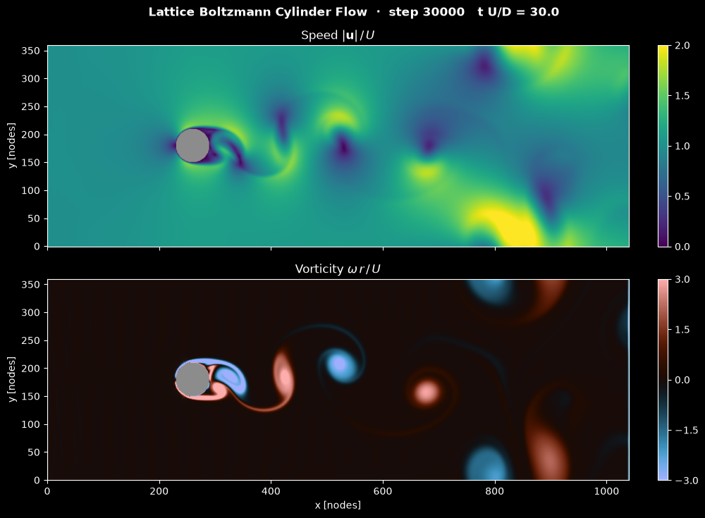

# The Lattice Boltzmann Method in Practice

A lattice Boltzmann code works in lattice units, where the node spacing, the time step and the reference density are all 1. Setting up a simulation therefore means translating a physical problem into three numbers: the resolution $N$, the lattice velocity $U_{\mathrm{lb}}$ and the relaxation time $\tau$. This note gives the conversion with a worked example, explains how $\tau$ and the Mach number control stability and accuracy, lists a complete and validated NumPy implementation of a lid-driven cavity, and discusses memory, throughput and parallel performance. The algorithm itself is described in [The Lattice Boltzmann Algorithm](lattice_boltzmann_algorithm.md).

## Problem Statement

Given a physical flow with length scale $L$ \[m\], velocity scale $U$ \[m/s\], kinematic viscosity $\nu$ \[m²/s\], density $\rho$ \[kg/m³\] and a simulated physical time $T$ \[s\], choose

- the lattice spacing $\Delta x = L/N$,
- the time step $\Delta t$, equivalently the lattice velocity $U_{\mathrm{lb}} = U\Delta t/\Delta x$,
- the relaxation time $\tau$,

so that the Reynolds number $\mathrm{Re} = UL/\nu$ is matched exactly and the error budget is respected: discretisation error $O(\Delta x^2)$, compressibility error $O(\mathrm{Ma}^2)$ with $\mathrm{Ma} = U_{\mathrm{lb}}/c_s$, and a stability margin $\tau - 1/2$ that is not too small. The run then costs $N^D \times T/\Delta t$ node updates in $D$ dimensions, and that number, divided by the throughput of the code, decides whether the simulation is affordable.

## Lattice Units and Unit Conversion

All lattice quantities are dimensionless numbers. Physical values follow from three conversion factors: $C_x = \Delta x$ for length, $C_t = \Delta t$ for time and $C_\rho = \rho/\rho_{\mathrm{lb}}$ for density, usually with $\rho_{\mathrm{lb}} = 1$. Every other factor is a combination of these:

| Quantity | Conversion factor | Lattice value |
| --- | --- | --- |
| Velocity | $C_u = \Delta x/\Delta t$ | $U_{\mathrm{lb}} = U/C_u$ |
| Kinematic viscosity | $C_\nu = \Delta x^2/\Delta t$ | $\nu_{\mathrm{lb}} = \nu/C_\nu = (\tau - 1/2)/3$ |
| Pressure | $C_p = C_\rho C_u^2$ | $p_{\mathrm{lb}} - p_{0,\mathrm{lb}} = (\rho_{\mathrm{lb}} - 1)/3$ |
| Force | $C_F = C_\rho C_u^2 \Delta x^{D-1}$ | sum of the momentum exchanged at the wall per step |
| Speed of sound | $C_u$ | $c_s = 1/\sqrt{3}$ |

The lattice speed of sound is a numerical parameter, not the physical one: the Mach number of the simulation is $\mathrm{Ma} = U_{\mathrm{lb}}\sqrt{3}$, chosen for accuracy, and it has nothing to do with the real Mach number of a liquid or low-speed gas flow. Since $\mathrm{Re} = UL/\nu = U_{\mathrm{lb}}N/\nu_{\mathrm{lb}}$, the parameters are set as follows:

1. Choose the resolution $N$ of the reference length $L$, from the smallest feature or boundary layer that must be resolved.
2. Choose $U_{\mathrm{lb}}$ for the Mach number, typically $0.01 \le U_{\mathrm{lb}} \le 0.1$.
3. Compute $\nu_{\mathrm{lb}} = U_{\mathrm{lb}}N/\mathrm{Re}$ and $\tau = 3\nu_{\mathrm{lb}} + 1/2$. If $\tau$ is too close to 1/2, increase $N$ or $U_{\mathrm{lb}}$; if it is much larger than 1, decrease $U_{\mathrm{lb}}$ or $N$.
4. Convert: $\Delta x = L/N$, then $\Delta t = U_{\mathrm{lb}}\Delta x/U$. Check that $`\nu\,\Delta t/\Delta x^2 = \nu_{\mathrm{lb}}`$.
5. The number of time steps is $T/\Delta t$.

### Worked Example

Air ($\nu = 1.5 \times 10^{-5}$ m²/s, $\rho = 1.2$ kg/m³) flows at $U = 0.15$ m/s past a cylinder of diameter $D = 10$ mm, so $\mathrm{Re} = 100$, a laminar periodic wake.

1. Resolve the diameter with $N = 40$ nodes: $\Delta x = 0.25$ mm.
2. Take $U_{\mathrm{lb}} = 0.05$, so $\mathrm{Ma} = 0.087$ and the compressibility error is about $`\mathrm{Ma}^2 \approx 0.75\%`$.
3. $\nu_{\mathrm{lb}} = 0.05 \times 40/100 = 0.02$ and $\tau = 0.56$, a comfortable BGK value.
4. $\Delta t = 0.05 \times 2.5 \times 10^{-4}/0.15 = 8.33 \times 10^{-5}$ s. Check: $1.5 \times 10^{-5} \times 8.33 \times 10^{-5}/(2.5 \times 10^{-4})^2 = 0.02$.
5. One physical second takes 12 000 steps. The shedding frequency at $\mathrm{Re} = 100$ ($\mathrm{St} \approx 0.164$) is $`f = \mathrm{St}\,U/D = 2.46`$ Hz, so one shedding period is about 4900 steps.

A domain of $30D \times 10D$ has $1200 \times 400 = 4.8 \times 10^5$ nodes. With two D2Q9 arrays in double precision that is 69 MB. The pressure conversion is $C_p = 1.2 \times 3^2 = 10.8$ Pa per lattice unit, so a lattice pressure difference of $10^{-3}$ corresponds to 0.0108 Pa.

### Parameters of the Cylinder Script

The [cylinder flow simulation](../../../scripts/simulations/lattice_boltzmann_cylinder_flow/) is set up the same way, entirely in lattice units. Its $1040 \times 360$ lattice holds a cylinder of radius 30 nodes centred at $(260, 180)$. The inflow velocity $U_{\mathrm{lb}} = 0.06$ ($\mathrm{Ma} = 0.10$) and $\mathrm{Re} = 350$ based on the radius (700 based on the diameter) give $\nu_{\mathrm{lb}} = 0.06 \times 30/350 = 0.00514$ and $\tau = 0.515$, close to the BGK stability limit. The inlet imposes the uniform velocity, with a $10^{-4}$ sinusoidal perturbation that breaks the symmetry, by bouncing back the non-equilibrium part of the unknown populations. The outlet copies the incoming populations from the neighbouring column, the top and bottom are periodic, and the cylinder is a staircase with full-way bounce-back. The wake starts to oscillate after about 15 000 steps and sheds a von Kármán street from about 20 000 steps; the default 30 000 steps correspond to $tU/D = 30$. At $\mathrm{Re}_D = 700$ a real cylinder wake is three-dimensional, so the run shows 2D vortex dynamics rather than a prediction for a real cylinder.



The vorticity panel shows the shear layers separating from the cylinder and rolling up into alternating clockwise (blue) and counter-clockwise (red) vortices. Further downstream the street becomes irregular, partly because of the periodic top and bottom boundaries.

### Acoustic and Diffusive Scaling

Refining the lattice at fixed Re can follow two rules:

|  | Acoustic scaling | Diffusive scaling |
| --- | --- | --- |
| Held fixed | $U_{\mathrm{lb}}$ (Mach number) | $\tau$ (so $\nu_{\mathrm{lb}}$) |
| Time step | $\Delta t \propto \Delta x$ | $\Delta t \propto \Delta x^2$ |
| $\tau$ as $N$ grows | $\tau \to 1/2$ ($\nu_{\mathrm{lb}} \propto N$ grows) | constant |
| Compressibility error | constant, $O(\mathrm{Ma}^2)$ | falls as $\Delta x^2$ ($\mathrm{Ma} \propto 1/N$) |
| Cost of halving $\Delta x$ in 2D | $4 \times 2 = 8$ times | $4 \times 4 = 16$ times |

Acoustic scaling is cheaper but converges only to the weakly compressible solution at the chosen Ma. Diffusive scaling converges to the incompressible solution at second order, which is what a grid-convergence study of an incompressible flow should use.

## Choosing the Relaxation Time

$\tau$ controls both stability and accuracy, and the two pull in opposite directions:

- Close to $\tau = 1/2$ the BGK collision becomes unstable. Plain BGK is usually run with $\tau$ no lower than about 0.51 to 0.55, depending on resolution and velocity; MRT or TRT collisions allow smaller values.
- For large $\tau$ the error terms grow. The half-way bounce-back slip in Poiseuille flow grows as $(\tau - 1/2)^2$: at $\tau = 2$ on a channel 8 nodes wide the profile error is 24%, against 2% at $\tau = 0.6$ (the [Poiseuille validation](../../../scripts/algorithms/lbm_poiseuille_validation/)). In the [Taylor–Green test](../../../scripts/algorithms/lbm_taylor_green_decay/) the viscosity error on a $32 \times 32$ lattice is 0.3% at $\tau = 1$ and 2.9% at $\tau = 2$.
- $\tau = 1$ relaxes every population to equilibrium in one step and simplifies the collision. $\tau = 1/2 + \sqrt{3/16} \approx 0.933$ makes the bounce-back wall location exact for Poiseuille flow.

A range of about $0.52 \lesssim \tau \lesssim 1$ covers most BGK simulations. When Re and resolution push $\tau$ below that, the remedies are more nodes, a higher $U_{\mathrm{lb}}$ (at the price of Mach error), or a more robust collision operator.

## Compressibility Error

LBM solves the weakly compressible equations with $p = c_s^2\rho$. In a steady flow the pressure variation scales as $\rho U^2$, so the density variation is

$$
\frac{\delta\rho}{\rho} = \frac{\delta p}{\rho c_s^2} \sim
\frac{U^2}{c_s^2} = \mathrm{Ma}^2
$$

and the velocity field differs from the incompressible one by a relative amount of order $\mathrm{Ma}^2$. Unsteady flows also carry acoustic waves at speed $c_s$, launched by impulsive starts and reflected by boundaries; they are a numerical artefact when the target is incompressible flow. On the standard lattices the viscous stress has a further error of order $\mathrm{Ma}^3$. With $U_{\mathrm{lb}} = 0.1$ ($\mathrm{Ma} = 0.17$) the $\mathrm{Ma}^2$ estimate is about 3%, and with $U_{\mathrm{lb}} = 0.05$ about 0.75%, but these are upper estimates: in the cavity below, halving the lid speed from 0.1 to 0.05 changes the minimum centreline velocity by less than $10^{-4}$, so the remaining discrepancy there is discretisation error.

## A Compact NumPy Implementation

The program below solves the lid-driven cavity at $\mathrm{Re} = 100$ with D2Q9, BGK collision and half-way bounce-back on all four walls, with the moving-wall correction on the lid. The fluid occupies $N \times N$ nodes surrounded by one layer of solid nodes; each wall lies halfway between the solid layer and the first fluid layer, so the cavity side is exactly $N$ lattice units. Streaming uses `np.roll`, and the populations that arrive from a solid node are replaced by the bounced-back ones.

```python
import numpy as np

# D2Q9 lattice in lattice units (dx = dt = 1)
c = np.array([(0, 0), (1, 0), (0, 1), (-1, 0), (0, -1), (1, 1), (-1, 1), (-1, -1), (1, -1)])
w = np.array([4 / 9] + [1 / 9] * 4 + [1 / 36] * 4)
opp = [0, 3, 4, 1, 2, 7, 8, 5, 6]

N, U, Re = 64, 0.1, 100.0    # fluid nodes per side, lid speed (Ma = 0.17), Reynolds number
nu = U * N / Re              # lattice viscosity (the walls are N lattice units apart)
tau = 3 * nu + 0.5           # relaxation time, 0.692

def equilibrium(rho, ux, uy):
    cu = c[:, 0, None, None] * ux + c[:, 1, None, None] * uy
    return w[:, None, None] * rho * (1 + 3 * cu + 4.5 * cu**2 - 1.5 * (ux**2 + uy**2))

# One layer of solid nodes around the fluid; each wall lies halfway between layers.
solid = np.ones((N + 2, N + 2), dtype=bool)
solid[1:-1, 1:-1] = False
lid = np.zeros_like(solid)
lid[:, -1] = True            # the top layer moves with velocity (U, 0)
from_solid = [np.roll(solid, c[i], axis=(0, 1)) for i in range(9)]
from_lid = [np.roll(lid, c[i], axis=(0, 1)) for i in range(9)]

f = equilibrium(np.ones((N + 2, N + 2)), 0.0, 0.0)
for step in range(20000):
    rho = f.sum(axis=0)
    ux = np.tensordot(c[:, 0], f, axes=1) / rho
    uy = np.tensordot(c[:, 1], f, axes=1) / rho
    f_post = f - (f - equilibrium(rho, ux, uy)) / tau            # BGK collision
    for i in range(9):
        f[i] = np.roll(f_post[i], c[i], axis=(0, 1))              # streaming
        # Half-way bounce-back: what would arrive from a solid node is the
        # population that left this node towards the wall, reversed.
        f[i][from_solid[i]] = f_post[opp[i]][from_solid[i]]
        f[i][from_lid[i]] += 6 * w[i] * c[i, 0] * U               # moving lid, rho_w = 1

u_centre = ux[N // 2 : N // 2 + 2, 1:-1].mean(axis=0) / U        # u/U on x = N/2
y = (np.arange(N) + 0.5) / N
print(f"min u/U = {u_centre.min():.4f} at y/N = {y[u_centre.argmin()]:.3f}")
```

The masks `from_solid[i]` mark the nodes whose upstream neighbour in direction $i$ is solid. At those nodes the streamed value is meaningless and is replaced by $f_{\bar\imath}^\star$ of the same node, which is half-way bounce-back. The lid term is $`-2w_{\bar\imath}\rho_w\,\mathbf{c}_{\bar\imath} \cdot \mathbf{u}_w/c_s^2 = 6w_i\,c_{ix}U`$ with $\rho_w = 1$. Values at the solid nodes are never used by the fluid.

The program runs 20 000 steps in about 10 s on a laptop and prints `min u/U = -0.2079 at y/N = 0.461`; the solution is steady after about 15 000 steps. The benchmark of Ghia, Ghia and Shin (1982) gives $-0.2109$ at $y = 0.453$. The 1.4% difference is a resolution effect: the same code with $N = 128$ and $U = 0.05$ gives $-0.2110$.

## Performance

### Memory

Each node stores $Q$ populations, and the simplest codes keep two copies (before and after streaming):

| Lattice | Bytes per node, one copy (double) | Two copies (double) | Two copies (single) |
| --- | --- | --- | --- |
| D2Q9 | 72 | 144 | 72 |
| D3Q19 | 152 | 304 | 152 |
| D3Q27 | 216 | 432 | 216 |

A $512^3$ D3Q19 lattice with two double-precision copies needs about 41 GB. In-place streaming patterns (AA pattern, swap) halve this, and single precision halves it again; single precision is usually adequate if the populations are stored as deviations from the rest equilibrium $w_i\rho_0$.

### Throughput

LBM performance is quoted in MLUPS, millions of lattice-node updates per second. A fused collide-and-stream update reads and writes every population once, $2 \times 8Q$ bytes per node in double precision, and does only a few hundred floating-point operations. The method is therefore limited by memory bandwidth, and an upper bound is

$$
\mathrm{MLUPS} \approx \frac{B}{2 \times 8 Q \times 10^6}
$$

for a memory bandwidth $B$ in bytes per second. For D3Q19 this gives about 330 MLUPS at 100 GB/s (a multi-core CPU node) and about 3300 MLUPS at 1 TB/s (a data-centre GPU); well-optimised codes reach a large fraction of this bound. The NumPy cavity above achieves about 9 MLUPS, and the cylinder script about 5 MLUPS on its $1040 \times 360$ lattice, because NumPy makes many passes over memory per step.

### Parallelism

The collision needs no neighbour data, and streaming only touches nearest neighbours. A domain split across processes or GPU thread blocks therefore exchanges a single layer of halo populations per step, and only the populations that point across the cut. There is no global linear system, so no global communication except for diagnostics. This is why LBM scales to very large machines and maps well onto GPUs. The weaknesses are the fixed uniform lattice (local refinement needs nested grids with rescaled populations) and the large number of steps that low Mach numbers and fine lattices require.

## Is LBM Meshless?

No. LBM needs no mesh generation in the usual sense: the geometry is a voxel mask on a Cartesian lattice, with no connectivity tables, cell-quality checks or body-fitted layers. That convenience is why it is sometimes called meshless. But the lattice is a mesh, with a fixed spacing that sets the resolution and the accuracy. The populations live at fixed nodes, and streaming relies on every $\mathbf{c}_i\Delta t$ being a lattice vector. Meshless methods in the proper sense, such as smoothed-particle hydrodynamics, use moving particles without any fixed connectivity.

## Key Takeaways

- Fix $N$ and $U_{\mathrm{lb}}$ first; Re then fixes $\nu_{\mathrm{lb}} = U_{\mathrm{lb}}N/\mathrm{Re}$ and $\tau = 3\nu_{\mathrm{lb}} + 1/2$, and $\Delta t = U_{\mathrm{lb}}\Delta x/U$ follows.
- The lattice Mach number $U_{\mathrm{lb}}\sqrt{3}$ is an accuracy parameter, typically 0.02 to 0.17; the compressibility error scales as its square.
- Stability needs $\tau$ comfortably above 1/2; accuracy degrades as $\tau$ grows. BGK works best for roughly $0.52 \lesssim \tau \lesssim 1$.
- Diffusive scaling ($\tau$ fixed, $\Delta t \propto \Delta x^2$) converges to the incompressible solution at second order; acoustic scaling is cheaper but keeps the Mach error.
- LBM is memory-bandwidth bound: $8Q$ bytes per population array per node, and throughput is roughly bandwidth divided by $16Q$ bytes. Its locality makes it parallelise very well.
- A short NumPy code with half-way bounce-back reproduces the lid-driven cavity benchmark to 1.4% at $N = 64$.

## Related Scripts

- [Lattice Boltzmann Cylinder Flow Simulation](../../../scripts/simulations/lattice_boltzmann_cylinder_flow/): simulates 2D flow past a circular cylinder with the lattice Boltzmann method (D2Q9 lattice, BGK collision operator) and animates the velocity magnitude and the vorticity with Matplotlib.
- [LBM Poiseuille Validation](../../../scripts/algorithms/lbm_poiseuille_validation/): validates a D2Q9 BGK lattice Boltzmann solver against the exact solution for body-force-driven channel flow with half-way bounce-back walls.
- [LBM Taylor–Green Decay](../../../scripts/algorithms/lbm_taylor_green_decay/): measures the viscosity of the D2Q9 BGK lattice Boltzmann scheme from the decay of a Taylor–Green vortex and compares it with $\nu = c_s^2(\tau - 1/2)$.
- [Lid-Driven Cavity Flow Simulation](../../../scripts/simulations/lid_driven_cavity/): solves the 2D incompressible Navier-Stokes equations for flow in a square cavity driven by a moving lid at a Reynolds number of 100 and animates the velocity field.

## Exercises

**Exercise 1.** Many codes use the relaxation frequency $\omega = \Delta t/\tau$ instead of $\tau$. For $\omega = 1$, what are $\tau$ and $\nu_{\mathrm{lb}}$? What $\omega$ gives $\nu_{\mathrm{lb}} = 0.01$?

<details>
<summary>Answer</summary>

$\omega = 1$ gives $\tau = 1$ and $\nu_{\mathrm{lb}} = (1 - 0.5)/3 = 1/6 \approx 0.167$. For $\nu_{\mathrm{lb}} = 0.01$, $\tau = 3 \times 0.01 + 0.5 = 0.53$ and $\omega = 1/0.53 \approx 1.887$. Values of $\omega$ approaching 2 give low viscosity but reduced stability.

</details>

**Exercise 2.** A D2Q9 run uses $\tau = 0.8$, $\Delta x = 1$ mm and $\Delta t = 0.1$ ms. What physical viscosity does it simulate? With the same $\Delta x$ and $\Delta t$, what $\tau$ would water ($\nu = 10^{-6}$ m²/s) require, and why is that a problem?

<details>
<summary>Answer</summary>

$\nu_{\mathrm{lb}} = (0.8 - 0.5)/3 = 0.1$, and $`\nu = \nu_{\mathrm{lb}}\,\Delta x^2/\Delta t = 0.1 \times 10^{-6}/10^{-4} = 1.0 \times 10^{-3}`$ m²/s.

For water, $\nu_{\mathrm{lb}} = 10^{-6} \times 10^{-4}/10^{-6} = 10^{-4}$, so $\tau = 0.5 + 3 \times 10^{-4} = 0.5003$, far too close to the BGK stability limit. With these $\Delta x$ and $\Delta t$ the lattice speed is 10 m/s, so the fix is to reduce $\Delta t$ (which lowers $U_{\mathrm{lb}}$ and raises $\nu_{\mathrm{lb}}$), refine $\Delta x$, or use a more robust collision operator.

</details>

**Exercise 3.** A cylinder at $\mathrm{Re} = 100$ is resolved with $N = 40$ nodes per diameter and $U_{\mathrm{lb}} = 0.05$. Compute $\nu_{\mathrm{lb}}$, $\tau$ and Ma. Repeat for $\mathrm{Re} = 1000$ with the same $N$ and $U_{\mathrm{lb}}$, and say what you would change.

<details>
<summary>Answer</summary>

$\nu_{\mathrm{lb}} = 0.05 \times 40/100 = 0.02$, $\tau = 0.56$ and $\mathrm{Ma} = 0.05\sqrt{3} \approx 0.087$, with a compressibility error of order $\mathrm{Ma}^2 \approx 0.0075$.

For $\mathrm{Re} = 1000$, $\nu_{\mathrm{lb}} = 0.002$ and $\tau = 0.506$, too close to 1/2 for plain BGK. Raising $U_{\mathrm{lb}}$ is limited by the Mach number (even $U_{\mathrm{lb}} = 0.1$ only gives $\tau = 0.512$). The practical remedies are more nodes across the cylinder, which the thinner boundary layers at higher Re need anyway, or an MRT, TRT or regularised collision.

</details>

**Exercise 4.** Refine the worked example from $N = 40$ to $N = 80$ (a) with acoustic scaling and (b) with diffusive scaling. Give $U_{\mathrm{lb}}$, $\tau$, $\Delta t$ and the number of steps per physical second in each case.

<details>
<summary>Answer</summary>

The lattice spacing is 10 mm / 80 = 0.125 mm in both cases.

(a) With acoustic scaling $U_{\mathrm{lb}} = 0.05$ is kept, so $\nu_{\mathrm{lb}} = 0.05 \times 80/100 = 0.04$ and $\tau = 0.62$. $\Delta t = 0.05 \times 1.25 \times 10^{-4}/0.15 = 4.17 \times 10^{-5}$ s, which is 24 000 steps per second. Ma is still 0.087.

(b) With diffusive scaling $\tau = 0.56$ is kept, so $\nu_{\mathrm{lb}} = 0.02$ and $U_{\mathrm{lb}} = 100 \times 0.02/80 = 0.025$. $\Delta t = 0.025 \times 1.25 \times 10^{-4}/0.15 = 2.08 \times 10^{-5}$ s, which is 48 000 steps per second. Ma halves to 0.043 and the compressibility error falls by a factor of 4, matching the $\Delta x^2$ discretisation error.

With four times as many nodes in 2D, case (a) costs 8 times and case (b) 16 times as much as the original run.

</details>

**Exercise 5.** Estimate the memory of the population arrays in double precision for (a) the $66 \times 66$ D2Q9 lattice of the NumPy cavity (one array, plus the `f_post` copy) and (b) a D3Q19 lattice of $512^3$ nodes with two copies. If the 3D code runs at 50 MLUPS, how long do $10^4$ time steps take, and what is the bandwidth-bound estimate on a 1 TB/s GPU?

<details>
<summary>Answer</summary>

(a) $66 \times 66 \times 9 \times 8 \times 2 \approx 6.3 \times 10^5$ bytes, about 0.6 MB.

(b) $512^3 \times 19 \times 2 \times 8 \approx 4.08 \times 10^{10}$ bytes, 41 GB (38 GiB).

At 50 MLUPS: $512^3 \times 10^4/(5 \times 10^7) \approx 2.7 \times 10^4$ s, about 7.5 hours. The bandwidth bound for D3Q19 at 1 TB/s is $10^{12}/(16 \times 19) \approx 3.3 \times 10^9$ updates per second, about 3300 MLUPS, which would bring the run down to about 7 minutes if the lattice fitted in the GPU's memory.

</details>

## References

- T. Krüger, H. Kusumaatmaja, A. Kuzmin, O. Shardt, G. Silva and E. M. Viggen, *The Lattice Boltzmann Method: Principles and Practice*, Springer, 2017.
- S. Succi, *The Lattice Boltzmann Equation: For Complex States of Flowing Matter*, Oxford University Press, 2018.
- S. Chen and G. D. Doolen, "Lattice Boltzmann method for fluid flows", *Annual Review of Fluid Mechanics* 30, 329–364, 1998.
- U. Ghia, K. N. Ghia and C. T. Shin, "High-Re solutions for incompressible flow using the Navier-Stokes equations and a multigrid method", *Journal of Computational Physics* 48(3), 387–411, 1982.
- M. Wittmann, T. Zeiser, G. Hager and G. Wellein, "Comparison of different propagation steps for lattice Boltzmann methods", *Computers & Mathematics with Applications* 65(6), 924–935, 2013.
- C. H. K. Williamson, "Vortex dynamics in the cylinder wake", *Annual Review of Fluid Mechanics* 28, 477–539, 1996.
