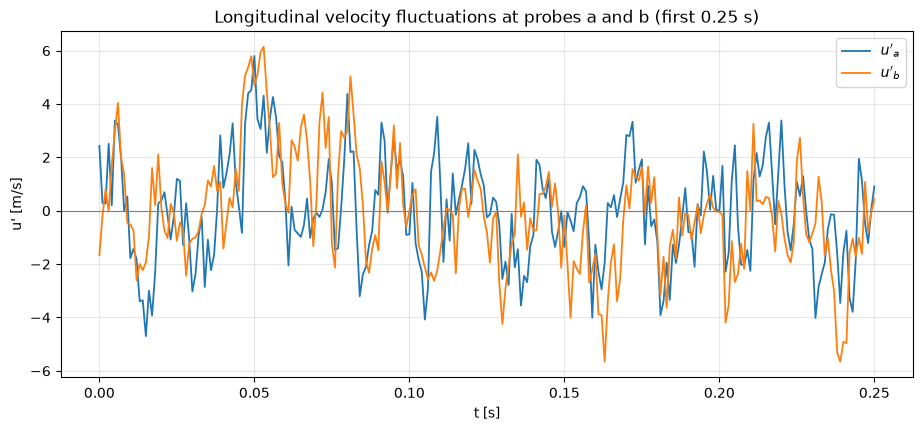
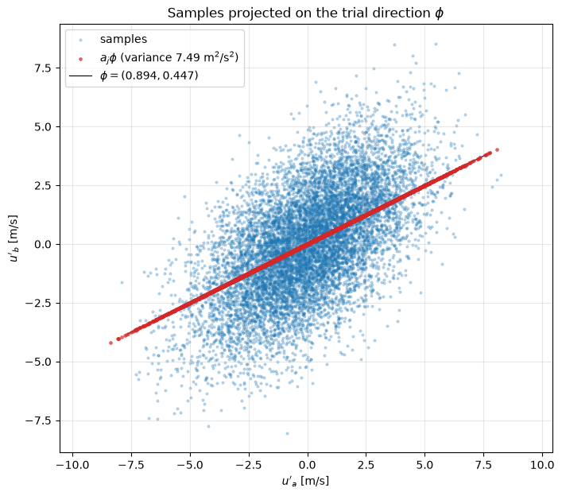

# Two-Point POD: A Worked Example

The smallest problem that shows everything POD does is a velocity signal measured at two points. The snapshots are then points in a plane, the covariance matrix is $2 \times 2$, and the POD modes are the principal axes of the elliptical data cloud, which can be drawn. This note works through that case: snapshot matrix, covariance, variance along a direction, principal axes as eigenvectors, the energy split between the two modes, and the reconstruction from rank-one mode contributions. [POD for N Points](derivation_in_n_dim.md) repeats the same steps for a whole field, and [Proper Orthogonal Decomposition](pod_intro.md) gives the continuous theory.

The example follows the structure of the tutorial by Weiss (2019), which uses PIV data from a turbulent separation bubble. The data here are synthetic, generated by the scripts listed at the end, so that every number can be reproduced: two probe signals that share a large-scale motion and each carry their own small-scale motion.

## Problem Statement

The longitudinal velocity $U$ is sampled at two probe positions $a$ and $b$ at $M$ instants $t_1, \dots, t_M$. Given the $M$ pairs $(U_a(t_j), U_b(t_j))$, find

1. the unit vector $\boldsymbol{\phi} = (\phi_1, \phi_2)^T$ along which the velocity fluctuations have the largest variance, and the orthogonal direction with the remaining variance;
2. how the fluctuation energy divides between these two directions;
3. the time coefficients that express every sample in the new basis, and the error of keeping only the first direction.

The problem is solved when the two directions are found and the reconstruction from both is exact. Nothing about it is hard; the point is that the same three questions, asked for $N = 10^6$ points instead of two, are the general POD.

## The Data

Each probe signal is the sum of a motion $s(t)$ seen by both probes (a large eddy passing over both) and a local motion $\ell_a(t)$ or $\ell_b(t)$ (small-scale turbulence that is different at each probe),

```math
u'_a(t) = s(t) + \ell_a(t), \qquad u'_b(t) = s(t) + \ell_b(t)
```

where $s$, $\ell_a$ and $\ell_b$ are independent random signals with variances $\sigma_s^2 = 2.8$ m²/s² and $\sigma_\ell^2 = 2.2$ m²/s² and correlation times of 10 ms and 2 ms. The script draws $`M = 10\,000`$ samples at 1 kHz. The primes denote fluctuations, $`u'_a = U_a - \overline{U}_a`$, so the mean of each signal has already been removed; in real data this is the first step.



The two traces follow each other on the slow time scale of the shared motion and depart from each other on the fast local scale. The snapshot matrix holds one sample per column, with the two probes as rows, the convention used by all POD code in this repository:

```math
\mathbf{U} = \begin{pmatrix} u'_a(t_1) & u'_a(t_2) & \cdots & u'_a(t_M) \\ u'_b(t_1) & u'_b(t_2) & \cdots & u'_b(t_M) \end{pmatrix} = \begin{pmatrix} \mathbf{u}'_1 & \mathbf{u}'_2 & \cdots & \mathbf{u}'_M \end{pmatrix} \in \mathbb{R}^{2 \times M}
```

## Covariance and Fluctuation Energy

The sample covariance matrix is

```math
\mathbf{C} = \frac{1}{M-1}\mathbf{U}\mathbf{U}^T = \frac{1}{M-1}\begin{pmatrix} \sum_j u'_a(t_j)^2 & \sum_j u'_a(t_j)\,u'_b(t_j) \\ \sum_j u'_b(t_j)\,u'_a(t_j) & \sum_j u'_b(t_j)^2 \end{pmatrix} = \begin{pmatrix} c_{11} & c_{12} \\ c_{12} & c_{22} \end{pmatrix}
```

Its diagonal holds the variances at the two probes and its off-diagonal the covariance between them; it is symmetric and positive semi-definite. It is the two-point correlation tensor $`R_{11}(\mathbf{x}_a, \mathbf{x}_b)`$ of the continuous theory, sampled at two points. For the signal model the exact matrix is $`c_{11} = c_{22} = \sigma_s^2 + \sigma_\ell^2 = 5.0`$ and $`c_{12} = \sigma_s^2 = 2.8`$; the samples give

```math
\mathbf{C} = \begin{pmatrix} 5.074 & 2.991 \\ 2.991 & 5.195 \end{pmatrix}\ \text{m}^2/\text{s}^2, \qquad \rho_{ab} = \frac{c_{12}}{\sqrt{c_{11}c_{22}}} = 0.583
```

The correlation coefficient $\rho_{ab}$ is clearly nonzero: the probes see a common structure. The fluctuation energy of the longitudinal component, summed over the two probes and per unit mass, is

```math
\frac{1}{2}\left(\overline{u'^2_a} + \overline{u'^2_b}\right) = \frac{1}{2}(c_{11} + c_{22}) = \frac{1}{2}\mathrm{tr}\,\mathbf{C} = 5.134\ \text{m}^2/\text{s}^2
```

This is the $u$-contribution to the turbulent kinetic energy at the two points; with $v'$ and $w'$ included as further rows it would be the full turbulent kinetic energy.

## Variance Along a Direction

Any unit vector $\boldsymbol{\phi}$ in the $(u'_a, u'_b)$ plane defines a pattern of fluctuation: $(1, 0)$ is "probe $a$ alone", $(1, 1)/\sqrt{2}$ is "both probes together, same sign", $(1, -1)/\sqrt{2}$ is "the probes in opposition". Projecting each sample onto it gives a time coefficient, and the variance of the coefficients is a quadratic form in $\boldsymbol{\phi}$:

```math
a_j = \boldsymbol{\phi}^T\mathbf{u}'_j, \qquad \mathbf{a}^T = \boldsymbol{\phi}^T\mathbf{U}, \qquad \mathrm{var}_{\boldsymbol{\phi}} = \frac{1}{M-1}\sum_{j=1}^{M} a_j^2 = \frac{1}{M-1}\boldsymbol{\phi}^T\mathbf{U}\mathbf{U}^T\boldsymbol{\phi} = \boldsymbol{\phi}^T\mathbf{C}\,\boldsymbol{\phi}
```

For the trial direction $\boldsymbol{\phi} = (2, 1)/\sqrt{5}$ this gives $7.49$ m²/s², more than the variance along either axis ($5.07$ and $5.20$).



The red points are the projections $a_j\boldsymbol{\phi}$: the cloud collapsed onto the line. Their spread is the variance along $\boldsymbol{\phi}$, and it changes as the line is rotated.

## Principal Axes

The direction of largest variance maximises $\boldsymbol{\phi}^T\mathbf{C}\boldsymbol{\phi}$ subject to $\boldsymbol{\phi}^T\boldsymbol{\phi} = 1$. With a Lagrange multiplier $\lambda$, the stationarity condition of $\boldsymbol{\phi}^T\mathbf{C}\boldsymbol{\phi} - \lambda(\boldsymbol{\phi}^T\boldsymbol{\phi} - 1)$ is

```math
\mathbf{C}\,\boldsymbol{\phi} = \lambda\,\boldsymbol{\phi}
```

so the stationary directions are the eigenvectors of $\mathbf{C}$, and at each of them the variance equals the eigenvalue, $`\boldsymbol{\phi}^T\mathbf{C}\boldsymbol{\phi} = \lambda`$. The maximum is the larger eigenvalue $\lambda_1$, the minimum the smaller one $\lambda_2$ (Exercise 4). Because $\mathbf{C}$ is symmetric, the two eigenvectors are orthogonal: they are the major and minor axes of the data ellipse, the proper orthogonal modes. For a $2 \times 2$ matrix the eigenpairs have a closed form,

```math
\lambda_{1,2} = \frac{c_{11} + c_{22}}{2} \pm \sqrt{\left(\frac{c_{11} - c_{22}}{2}\right)^2 + c_{12}^2}, \qquad \tan 2\theta = \frac{2c_{12}}{c_{11} - c_{22}}
```

where $\theta$ is the angle of $`\boldsymbol{\phi}_1`$ to the $`u'_a`$ axis, with $`2\theta`$ taken in the quadrant of $`(c_{11} - c_{22}, 2c_{12})`$. For the sample covariance,

```math
\lambda_1 = 8.126\ \text{m}^2/\text{s}^2,\ \ \boldsymbol{\phi}_1 = (0.700, 0.714), \qquad \lambda_2 = 2.143\ \text{m}^2/\text{s}^2,\ \ \boldsymbol{\phi}_2 = (0.714, -0.700), \qquad \theta = 45.6^\circ
```

Every other direction, including the trial vector above, gives a variance between these two. In matrix form, with $\boldsymbol{\Phi} = (\boldsymbol{\phi}_1\ \boldsymbol{\phi}_2)$ and $`\boldsymbol{\Lambda} = \mathrm{diag}(\lambda_1, \lambda_2)`$,

```math
\mathbf{C} = \boldsymbol{\Phi}\boldsymbol{\Lambda}\boldsymbol{\Phi}^T, \qquad \boldsymbol{\Phi}^T\boldsymbol{\Phi} = \mathbf{I}
```


The arrows are the two modes, scaled by $2\sqrt{\lambda_k}$; the red and green points are the projections on them. Their variances, 8.13 and 2.14 m²/s², are the eigenvalues.

The signal model explains the modes. For the exact covariance, $\boldsymbol{\phi}_1 = (1, 1)/\sqrt{2}$ and $\boldsymbol{\phi}_2 = (1, -1)/\sqrt{2}$, and the coefficients are

```math
a_1 = \frac{u'_a + u'_b}{\sqrt{2}} = \sqrt{2}\,s + \frac{\ell_a + \ell_b}{\sqrt{2}}, \qquad a_2 = \frac{u'_a - u'_b}{\sqrt{2}} = \frac{\ell_a - \ell_b}{\sqrt{2}}
```

with variances $2\sigma_s^2 + \sigma_\ell^2 = 7.8$ and $\sigma_\ell^2 = 2.2$ m²/s². The first mode is the in-phase motion and contains all of the shared structure; the second is the out-of-phase motion and contains only local turbulence. POD separates the coherent part from the incoherent part because the coherent part is what correlates the probes. The sample values differ from the exact ones by a few percent because the shared motion has a long correlation time, which reduces the number of independent samples; that also tilts $\boldsymbol{\phi}_1$ slightly from $45^\circ$.

## Energy Split

The trace is invariant under the rotation to the principal axes, $\lambda_1 + \lambda_2 = c_{11} + c_{22}$, so the eigenvalues split the fluctuation energy:

```math
\frac{\lambda_1}{\lambda_1 + \lambda_2} = \frac{8.126}{10.269} = 79.1\%, \qquad \frac{\lambda_2}{\lambda_1 + \lambda_2} = 20.9\%
```

In the natural basis the energy is shared evenly between the probes (49% and 51%) and the coordinates are correlated; in the POD basis it is concentrated in the first coordinate and the coordinates are uncorrelated:

```math
\frac{1}{M-1}\mathbf{A}\mathbf{A}^T = \frac{1}{M-1}\boldsymbol{\Phi}^T\mathbf{U}\mathbf{U}^T\boldsymbol{\Phi} = \boldsymbol{\Phi}^T\mathbf{C}\boldsymbol{\Phi} = \boldsymbol{\Lambda}, \qquad \mathbf{A} = \boldsymbol{\Phi}^T\mathbf{U} = \begin{pmatrix} \mathbf{a}_1^T \\ \mathbf{a}_2^T \end{pmatrix}
```

The rows of $\mathbf{A}$ are the time coefficients of the two modes.

## Decomposition and Reconstruction

Since $\boldsymbol{\Phi}$ is orthogonal, $\boldsymbol{\Phi}^{-1} = \boldsymbol{\Phi}^T$ and the snapshots are recovered from the coefficients:

```math
\mathbf{U} = \boldsymbol{\Phi}\mathbf{A} = \boldsymbol{\phi}_1\mathbf{a}_1^T + \boldsymbol{\phi}_2\mathbf{a}_2^T = \tilde{\mathbf{U}}^1 + \tilde{\mathbf{U}}^2
```

Each $`\tilde{\mathbf{U}}^k = \boldsymbol{\phi}_k\mathbf{a}_k^T`$ has the shape of $\mathbf{U}$ and rank one: row 1 is the contribution of mode $k$ to the signal at probe $a$, row 2 its contribution at probe $b$. Geometrically, $\tilde{\mathbf{U}}^1$ is the cloud projected onto the major axis and $\tilde{\mathbf{U}}^2$ the cloud projected onto the minor axis, both written in the original coordinates. Keeping only the first mode approximates the data with the error

```math
\lVert \mathbf{U} - \tilde{\mathbf{U}}^1 \rVert_F^2 = \lVert \mathbf{a}_2 \rVert^2 = (M-1)\lambda_2
```

which is the smallest possible error of any one-direction approximation. Here it keeps 79% of the energy and discards the local turbulence.

The contributions are easiest to see in a deterministic example. In the next figure the two signals are $\sin(2\pi f t) \pm 0.5\sin(4\pi f t)$ with $f = 10$ Hz plus weak noise: an in-phase fundamental and an anti-phase harmonic.


Mode 1 (red) is the fundamental, identical at both probes, with 79.9% of the energy; mode 2 (blue) is the harmonic, with opposite signs at $a$ and $b$, with 20.1%. The dashed curve, their sum, is the measured fluctuation. The covariance of the noise-free signals is $`\begin{pmatrix} 0.625 & 0.375 \\ 0.375 & 0.625 \end{pmatrix}`$ m²/s², with eigenvalues 1.0 and 0.25, hence the 80/20 split.

## From Two Points to a Field

Nothing above used the fact that there were two probes. With $N$ points, $\mathbf{U}$ becomes $N \times M$, $\mathbf{C}$ becomes $N \times N$, and its eigenvectors are spatial patterns that can be drawn as fields; dimensionality reduction becomes useful because a few of the $N$ modes hold most of the energy. The general derivation, with proofs and the weighting needed on non-uniform meshes, is in [POD for N Points](derivation_in_n_dim.md).

## Key Takeaways

- With the snapshots as columns of $\mathbf{U}$, the covariance matrix is $\mathbf{C} = \mathbf{U}\mathbf{U}^T/(M-1)$ and the variance along a unit vector is $\boldsymbol{\phi}^T\mathbf{C}\boldsymbol{\phi}$.
- The POD modes are the eigenvectors of $\mathbf{C}$, the principal axes of the data cloud, and each eigenvalue is the variance along its mode.
- The eigenvalues split the trace, so $\lambda_k/\sum_i\lambda_i$ is the energy fraction of mode $k$.
- In the POD basis the time coefficients are uncorrelated; correlation between points has become the shape of the modes.
- A coherent motion shared by the points appears as the in-phase leading mode; incoherent local motion goes into the remaining modes.

## Related Scripts

- [Longitudinal Velocity Fluctuations and Projections](../../../scripts/plots/longitudinal_velocity_fluctuations_and_projections/): plots synthetic two-point velocity fluctuations as time traces, as a scatter cloud, and projected onto a unit vector, which are the first steps of the two-point POD example.
- [Eigenvector Projection of Velocity Fluctuations](../../../scripts/plots/eigenvector_projection/): finds the principal directions of correlated 2D velocity fluctuations from the eigenvectors of their covariance matrix and projects the data onto them.
- [POD Modes of a Two-Point Velocity Signal](../../../scripts/plots/pod_modes_2d/): applies Proper Orthogonal Decomposition to velocity signals measured at two points, a and b, and plots how much each of the two POD modes contributes to each signal.

## Exercises

**Exercise 1.** Using the sample covariance matrix of this note, compute the variance of the data along $(1, 1)/\sqrt{2}$ and along $(1, -1)/\sqrt{2}$, and compare with the eigenvalues.

<details>
<summary>Answer</summary>

With $\mathrm{var}_{\boldsymbol{\phi}} = \boldsymbol{\phi}^T\mathbf{C}\boldsymbol{\phi}$:

- $(1, 1)/\sqrt{2}$: $(5.074 + 2 \times 2.991 + 5.195)/2 = 8.1255$ m²/s².
- $(1, -1)/\sqrt{2}$: $(5.074 - 2 \times 2.991 + 5.195)/2 = 2.1435$ m²/s².

These are within 0.001 of $\lambda_1 = 8.1261$ and $\lambda_2 = 2.1429$: the principal axes are only $0.6^\circ$ from $\pm 45^\circ$, and a small rotation from the maximum changes the variance only to second order. The two values sum to the trace, $10.269$ m²/s².

</details>

**Exercise 2.** Evaluate the closed-form eigenvalues and the angle $\theta$ for the sample covariance matrix, and the energy fractions.

<details>
<summary>Answer</summary>

The mean of the diagonal is $5.1345$, half the difference is $(5.074 - 5.195)/2 = -0.0605$, and $\sqrt{0.0605^2 + 2.991^2} = 2.9916$. So $\lambda_1 = 8.1261$ and $\lambda_2 = 2.1429$ m²/s².

Since $c_{11} - c_{22} < 0$ and $c_{12} > 0$, $2\theta$ lies in the second quadrant: $2\theta = \mathrm{atan2}(5.982, -0.121) = 91.16^\circ$, so $\theta = 45.58^\circ$ and $\boldsymbol{\phi}_1 = (\cos\theta, \sin\theta) = (0.700, 0.714)$, $\boldsymbol{\phi}_2 = (0.714, -0.700)$ up to sign. The energy fractions are $`8.1261/10.269 = 79.1\%`$ and $`20.9\%`$.

</details>

**Exercise 3.** Take $M = 4$ mean-subtracted samples, $u'_a = (1, 2, -1, -2)$ and $u'_b = (2, 1, -2, -1)$. Compute $\mathbf{C}$, its eigenpairs, the coefficients $\mathbf{A} = \boldsymbol{\Phi}^T\mathbf{U}$, the check $\mathbf{A}\mathbf{A}^T/(M-1) = \boldsymbol{\Lambda}$, the one-mode approximation $\tilde{\mathbf{U}}^1$ and its squared error.

<details>
<summary>Answer</summary>

$`\mathbf{U}\mathbf{U}^T = \begin{pmatrix} 10 & 8 \\ 8 & 10 \end{pmatrix}`$, so $`\mathbf{C} = \frac{1}{3}\begin{pmatrix} 10 & 8 \\ 8 & 10 \end{pmatrix}`$, with $\lambda_1 = 18/3 = 6$, $\lambda_2 = 2/3$, $\boldsymbol{\phi}_1 = (1, 1)/\sqrt{2}$ and $\boldsymbol{\phi}_2 = (1, -1)/\sqrt{2}$.

The rows of $\mathbf{A}$ are $\mathbf{a}_1^T = (3, 3, -3, -3)/\sqrt{2}$ and $\mathbf{a}_2^T = (-1, 1, 1, -1)/\sqrt{2}$. Then $\mathbf{a}_1^T\mathbf{a}_1/3 = (36/2)/3 = 6$, $\mathbf{a}_2^T\mathbf{a}_2/3 = 2/3$ and $\mathbf{a}_1^T\mathbf{a}_2 = 0$, so $\mathbf{A}\mathbf{A}^T/3 = \mathrm{diag}(6, 2/3)$. Mode 1 holds $`6/(20/3) = 90\%`$ of the energy.

$`\tilde{\mathbf{U}}^1 = \boldsymbol{\phi}_1\mathbf{a}_1^T`$ has both rows equal to $(1.5, 1.5, -1.5, -1.5)$. The residual has eight entries of magnitude $0.5$, so $`\lVert \mathbf{U} - \tilde{\mathbf{U}}^1 \rVert_F^2 = 8 \times 0.25 = 2 = (M-1)\lambda_2`$.

</details>

**Exercise 4.** Prove that for a symmetric $\mathbf{C}$ with eigenvalues $\lambda_1 \ge \lambda_2$ the variance $\boldsymbol{\phi}^T\mathbf{C}\boldsymbol{\phi}$ of every unit vector lies between $\lambda_2$ and $\lambda_1$, with the extremes at the eigenvectors.

<details>
<summary>Answer</summary>

Expand $\boldsymbol{\phi} = \alpha_1\boldsymbol{\phi}_1 + \alpha_2\boldsymbol{\phi}_2$ in the orthonormal eigenbasis, with $\alpha_1^2 + \alpha_2^2 = 1$. Then

```math
\boldsymbol{\phi}^T\mathbf{C}\boldsymbol{\phi} = \lambda_1\alpha_1^2 + \lambda_2\alpha_2^2 = \lambda_2 + (\lambda_1 - \lambda_2)\alpha_1^2
```

which increases with $\alpha_1^2 \in [0, 1]$, from $\lambda_2$ at $\boldsymbol{\phi} = \pm\boldsymbol{\phi}_2$ to $\lambda_1$ at $\boldsymbol{\phi} = \pm\boldsymbol{\phi}_1$. For the trial direction $(2, 1)/\sqrt{5}$ and the exact covariance of the model, $\alpha_1^2 = (2 + 1)^2/10 = 0.9$, so the variance is $2.2 + 5.6 \times 0.9 = 7.24$ m²/s², between $2.2$ and $7.8$.

</details>

## References

- J. Weiss, "A tutorial on the proper orthogonal decomposition", AIAA Paper 2019-3333, *AIAA Aviation 2019 Forum*, Dallas, 2019.
- G. Berkooz, P. Holmes and J. L. Lumley, "The proper orthogonal decomposition in the analysis of turbulent flows", *Annual Review of Fluid Mechanics* 25, 1993, pp. 539–575.
- P. Holmes, J. L. Lumley, G. Berkooz and C. W. Rowley, *Turbulence, Coherent Structures, Dynamical Systems and Symmetry*, 2nd ed., Cambridge University Press, 2012.
- I. T. Jolliffe, *Principal Component Analysis*, 2nd ed., Springer, 2002.
- S. B. Pope, *Turbulent Flows*, Cambridge University Press, 2000.
