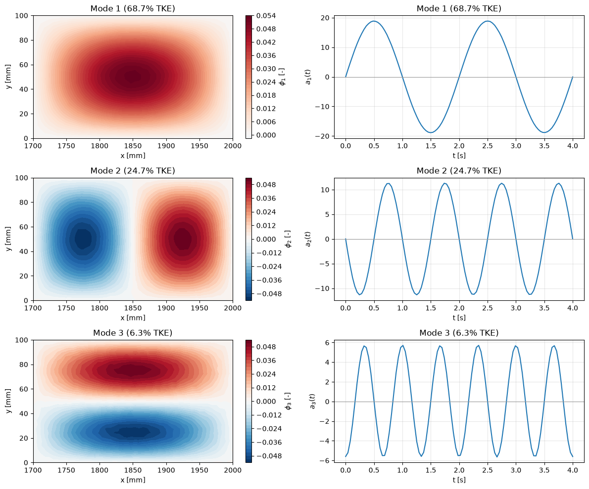

# POD for N Points

This note derives POD for a field sampled at $N$ points, which is the form used on CFD and PIV data. It generalises the [two-point example](derivation_in_2d.md) step by step: snapshot matrix, mean subtraction, covariance matrix, eigenvalue problem, modes, coefficients and reconstruction. It then proves the properties used everywhere else (orthonormal modes, uncorrelated coefficients, energy bookkeeping, truncation error) and shows how to weight the inner product on a non-uniform mesh. The continuous theory and the optimality argument are in [Proper Orthogonal Decomposition](pod_intro.md); efficient algorithms for large $N$ are in [POD and the SVD](pod_vs_svd.md) and [The Method of Snapshots](snapshot_pod.md).

## Problem Statement

A simulation or PIV measurement gives $M$ snapshots $\mathbf{u}_1, \dots, \mathbf{u}_M \in \mathbb{R}^N$ of a field at $N$ degrees of freedom: $N = N_x N_y$ for one velocity component on a 2D grid, $N = 3N_c$ for three components on $N_c$ cells. With the mean $\bar{\mathbf{u}}$ removed, find for each $r$ an orthonormal basis $\boldsymbol{\Phi}_r = (\boldsymbol{\phi}_1 \cdots \boldsymbol{\phi}_r)$ that minimises the mean squared projection error

```math
\varepsilon_r = \frac{1}{M-1}\sum_{j=1}^{M} \left\lVert \mathbf{u}'_j - \boldsymbol{\Phi}_r\boldsymbol{\Phi}_r^T\mathbf{u}'_j \right\rVert^2, \qquad \mathbf{u}'_j = \mathbf{u}_j - \bar{\mathbf{u}}
```

where $\lVert \cdot \rVert$ is the Euclidean norm on a uniform grid and a weighted norm otherwise. Solved means: the modes, their energies $\lambda_i$ and the coefficients of every snapshot are known, the reconstruction with all modes is exact to round-off, and $\varepsilon_r$ equals the sum of the discarded eigenvalues. The difficulty is size: $N$ ranges from $10^3$ (PIV) to $10^9$ (LES), so the $N \times N$ matrices that appear in the derivation are never formed for large $N$.

## Snapshot Matrix

Each snapshot is flattened into a column vector, and the columns are placed side by side,

```math
\mathbf{U} = \begin{pmatrix} \mathbf{u}'_1 & \mathbf{u}'_2 & \cdots & \mathbf{u}'_M \end{pmatrix} = \begin{pmatrix} u'(\mathbf{x}_1, t_1) & \cdots & u'(\mathbf{x}_1, t_M) \\ \vdots & \ddots & \vdots \\ u'(\mathbf{x}_N, t_1) & \cdots & u'(\mathbf{x}_N, t_M) \end{pmatrix} \in \mathbb{R}^{N \times M}
```

so that rows are spatial points and columns are instants. This is the convention of `create_snapshot_matrix` and `compute_pod` in [scripts/_numerics.py](../../../scripts/_numerics.py), which flatten all axes except the last (time) one. Several velocity components are stacked within each column, for example all $u'$ values followed by all $v'$ values, so that $N = 2N_xN_y$; the order is arbitrary but must be the same for every snapshot and must be undone when the modes are plotted. Some texts, including Weiss (2019), use the transpose with snapshots as rows; every formula below then has its transposes swapped.

The temporal mean $\bar{\mathbf{u}} = \frac{1}{M}\sum_j \mathbf{u}_j$ is subtracted from every column. The columns of $\mathbf{U}$ then sum to zero, so $`\mathrm{rank}\,\mathbf{U} \le M - 1`$: at most $M - 1$ modes carry energy. Without mean subtraction the first mode approximates the mean field and its eigenvalue measures the mean kinetic energy, which usually dwarfs the fluctuations.

## Covariance Matrix and Eigenvalue Problem

The spatial covariance matrix

```math
\mathbf{C} = \frac{1}{M-1}\mathbf{U}\mathbf{U}^T \in \mathbb{R}^{N \times N}, \qquad C_{kl} = \frac{1}{M-1}\sum_{j=1}^{M} u'(\mathbf{x}_k, t_j)\, u'(\mathbf{x}_l, t_j)
```

is the sample estimate of the two-point correlation $R(\mathbf{x}_k, \mathbf{x}_l)$; its diagonal is the variance at each point. As in the two-point case, the unit vector that maximises the variance of the projections, $\boldsymbol{\phi}^T\mathbf{C}\boldsymbol{\phi}$, is an eigenvector, and the modes are the solutions of

```math
\mathbf{C}\boldsymbol{\Phi} = \boldsymbol{\Phi}\boldsymbol{\Lambda}, \qquad \boldsymbol{\Lambda} = \mathrm{diag}(\lambda_1, \dots, \lambda_N), \qquad \lambda_1 \ge \lambda_2 \ge \dots \ge 0
```

This is the discrete form of the Fredholm equation of [Proper Orthogonal Decomposition](pod_intro.md#the-continuous-eigenvalue-problem). $\mathbf{C}$ is symmetric and positive semi-definite, so the eigenvalues are real and non-negative and the eigenvectors can be chosen orthonormal, $\boldsymbol{\Phi}^T\boldsymbol{\Phi} = \mathbf{I}$. A dense symmetric eigensolver (`numpy.linalg.eigh`) returns them in ascending order; they must be reversed. Solving this $N \times N$ problem is the direct method; it is affordable only for small $N$.

## Modes, Coefficients and Reconstruction

The temporal coefficients are the projections of the snapshots on the modes,

```math
a_i(t_j) = \boldsymbol{\phi}_i^T\mathbf{u}'_j, \qquad \mathbf{A} = \boldsymbol{\Phi}^T\mathbf{U} \in \mathbb{R}^{N \times M}
```

so row $i$ of $\mathbf{A}$ is the time history of mode $i$. Because $\boldsymbol{\Phi}$ is orthogonal, $\mathbf{U} = \boldsymbol{\Phi}\mathbf{A}$, which written as a sum of rank-one matrices is

```math
\mathbf{U} = \sum_{i=1}^{N}\boldsymbol{\phi}_i\,\mathbf{a}_i^T = \sum_{i=1}^{N}\tilde{\mathbf{U}}^i, \qquad \mathbf{u}'(\mathbf{x}_k, t_j) = \sum_{i=1}^{N} a_i(t_j)\,\phi_i(\mathbf{x}_k)
```

the discrete counterpart of $`\mathbf{u}'(\mathbf{x}, t) = \sum_i a_i(t)\boldsymbol{\phi}_i(\mathbf{x})`$. Each $\tilde{\mathbf{U}}^i$ is the space-time contribution of mode $i$; adding $\bar{\mathbf{u}}$ to its columns gives a "one-mode flow" that can be animated. Keeping the first $r$ terms gives the truncated reconstruction $`\mathbf{U}_r = \boldsymbol{\Phi}_r\mathbf{A}_r`$, with $\mathbf{A}_r$ the first $r$ rows of $\mathbf{A}$. A mode is plotted by reshaping its column back to the grid, reversing the flattening. Only modes with $\lambda_i > 0$ matter; at most $M - 1$ of them exist, and with $N > M$ the remaining eigenvectors only complete the basis.



For this synthetic field, built from three separable structures of decreasing amplitude, POD recovers each structure as one mode (left, reshaped to the $50 \times 30$ grid) with its time signal (right). The sign of a mode and its coefficient is arbitrary: $(-\boldsymbol{\phi}_i)(-\mathbf{a}_i)^T$ is the same contribution.

## Properties and Proofs

The following hold for any snapshot matrix, and every later note relies on them.

1. The modes are orthonormal: $\boldsymbol{\Phi}^T\boldsymbol{\Phi} = \mathbf{I}$, because eigenvectors of a symmetric matrix with distinct eigenvalues are orthogonal (for $\mathbf{C}\boldsymbol{\phi}_i = \lambda_i\boldsymbol{\phi}_i$ and $\mathbf{C}\boldsymbol{\phi}_k = \lambda_k\boldsymbol{\phi}_k$, $`\lambda_i\boldsymbol{\phi}_k^T\boldsymbol{\phi}_i = \boldsymbol{\phi}_k^T\mathbf{C}\boldsymbol{\phi}_i = \lambda_k\boldsymbol{\phi}_k^T\boldsymbol{\phi}_i`$), and an orthonormal basis can be chosen within any repeated eigenspace.

2. The coefficients are uncorrelated, and the variance of coefficient $i$ is $\lambda_i$:

   ```math
   \frac{1}{M-1}\mathbf{A}\mathbf{A}^T = \boldsymbol{\Phi}^T\left(\frac{1}{M-1}\mathbf{U}\mathbf{U}^T\right)\boldsymbol{\Phi} = \boldsymbol{\Phi}^T\mathbf{C}\boldsymbol{\Phi} = \boldsymbol{\Lambda}
   ```

3. The eigenvalues add up to the total variance, since the trace is invariant under the orthogonal change of basis:

   ```math
   \sum_{i} \lambda_i = \mathrm{tr}\,\mathbf{C} = \frac{1}{M-1}\lVert \mathbf{U} \rVert_F^2 = \sum_{k=1}^{N}\overline{u'^2}(\mathbf{x}_k)
   ```

4. The truncation error is the discarded energy. With $`\mathbf{E} = \mathbf{U} - \mathbf{U}_r = \sum_{i > r}\boldsymbol{\phi}_i\mathbf{a}_i^T`$ and properties 1 and 2,

   ```math
   \lVert \mathbf{E} \rVert_F^2 = \mathrm{tr}(\mathbf{E}^T\mathbf{E}) = \sum_{i, k > r}(\boldsymbol{\phi}_i^T\boldsymbol{\phi}_k)(\mathbf{a}_k^T\mathbf{a}_i) = \sum_{i > r}\mathbf{a}_i^T\mathbf{a}_i = (M-1)\sum_{i > r}\lambda_i
   ```

   so $\varepsilon_r = \sum_{i > r}\lambda_i$. Because energies of orthogonal contributions add, the energy fraction of any group of modes is the sum of their individual fractions.

5. No other $r$-dimensional orthonormal basis gives a smaller $\varepsilon_r$. This is the discrete form of the optimality result proved in [Proper Orthogonal Decomposition](pod_intro.md#why-the-modes-are-optimal), and it is the Eckart–Young theorem for $\mathbf{U}$ ([POD and the SVD](pod_vs_svd.md#best-low-rank-approximation)).

## Energy Content of Each Mode

When the snapshot vector contains all three velocity components at every cell and the inner product is weighted by cell volume (next section), the turbulent kinetic energy per unit mass, $`k(\mathbf{x}) = \frac{1}{2}\overline{u'_iu'_i}`$, integrates to

```math
\int_\Omega k\, dV \approx \frac{1}{2}\sum_{k} w_k\, \overline{u'^2}(\mathbf{x}_k) = \frac{1}{2}\sum_i \lambda_i
```

so $\lambda_i/2$ is the volume-integrated turbulent kinetic energy carried by mode $i$, and $\lambda_i/\sum_k\lambda_k$ is the fraction of the TKE in that mode. With only one component, or without weights, the same ratios are fractions of that component's variance summed over the grid points; this is what most PIV studies report as "%TKE". In turbulent flows the spectrum decays slowly: Weiss (2019) reports about 20% of the longitudinal energy in the first mode and 8% in the second for a turbulent separation bubble, so a low-order model there captures the dominant large-scale motion but not the turbulence. The truncation in a periodic wake, where a few modes hold most of the energy, is illustrated in [Proper Orthogonal Decomposition](pod_intro.md#energy-fractions-and-truncation).

## Non-Uniform Meshes and Weighted Inner Products

On a CFD mesh the cells have different sizes, and the Euclidean norm counts a refined region more than its area deserves. The discrete version of the $L^2$ norm uses a symmetric positive definite weight matrix $\mathbf{W}$,

```math
(\mathbf{f}, \mathbf{g})_W = \mathbf{f}^T\mathbf{W}\mathbf{g} \approx \int_\Omega \mathbf{f}\cdot\mathbf{g}\, dV
```

with $\mathbf{W} = \mathrm{diag}(V_k)$ (cell volumes, or quadrature weights) in finite volumes and the mass matrix $`W_{kl} = \int \psi_k\psi_l\, dV`$ in finite elements. Several variables of different units, as in compressible flow, are combined by a block-diagonal $\mathbf{W}$ whose blocks scale each variable so that the norm has the dimensions of an energy. Maximising $`\overline{(\mathbf{u}', \boldsymbol{\phi})_W^2} = \boldsymbol{\phi}^T\mathbf{W}\mathbf{C}\mathbf{W}\boldsymbol{\phi}`$ subject to $\boldsymbol{\phi}^T\mathbf{W}\boldsymbol{\phi} = 1$ gives the generalised eigenvalue problem

```math
\mathbf{W}\mathbf{C}\mathbf{W}\boldsymbol{\phi} = \lambda\mathbf{W}\boldsymbol{\phi} \quad \Longleftrightarrow \quad \mathbf{C}\mathbf{W}\boldsymbol{\phi} = \lambda\boldsymbol{\phi}
```

$\mathbf{C}\mathbf{W}$ is not symmetric, but the substitution $`\boldsymbol{\psi} = \mathbf{W}^{1/2}\boldsymbol{\phi}`$ turns the problem into the ordinary symmetric eigenproblem of the scaled data $`\hat{\mathbf{U}} = \mathbf{W}^{1/2}\mathbf{U}`$:

```math
\frac{1}{M-1}\hat{\mathbf{U}}\hat{\mathbf{U}}^T\boldsymbol{\psi} = \lambda\boldsymbol{\psi}, \qquad \boldsymbol{\phi} = \mathbf{W}^{-1/2}\boldsymbol{\psi}, \qquad \boldsymbol{\Phi}^T\mathbf{W}\boldsymbol{\Phi} = \boldsymbol{\Psi}^T\boldsymbol{\Psi} = \mathbf{I}, \qquad \mathbf{A} = \boldsymbol{\Phi}^T\mathbf{W}\mathbf{U}
```

The algorithm is therefore: scale the rows of $\mathbf{U}$ by $\sqrt{w_k}$, compute an ordinary POD (by the SVD or the method of snapshots), and divide the rows of the modes by $\sqrt{w_k}$. Coefficients and eigenvalues need no back-transformation. For a non-diagonal mass matrix, $\mathbf{W}^{1/2}$ is replaced by a Cholesky factor $\mathbf{W} = \mathbf{L}\mathbf{L}^T$, with $\hat{\mathbf{U}} = \mathbf{L}^T\mathbf{U}$ and $\boldsymbol{\phi} = \mathbf{L}^{-T}\boldsymbol{\psi}$. The modes are orthonormal only in the weighted sense; $\boldsymbol{\Phi}^T\boldsymbol{\Phi} \ne \mathbf{I}$.

The [POD Energy and Truncation](../../../scripts/plots/pod_energy_and_truncation/) script does this on a wake mesh stretched toward the centreline. Without the weights the first two modes hold 83.3% of the energy instead of 80.7%, and 99% of the energy is reached with 24 modes instead of 26, because the small cells near the centreline, where the fundamental shedding mode is strongest, are counted too heavily.

## Cost of the Direct Method

Forming $\mathbf{C}$ costs $O(N^2M)$ operations and $8N^2$ bytes, and a dense eigendecomposition $O(N^3)$. For $N = 5805$ (a $129 \times 45$ PIV grid) this is a 270 MB matrix and seconds of work; for $N = 10^6$ it is 8 TB and impossible. Since at most $M - 1$ eigenvalues are nonzero, the same information is available from the $M \times M$ matrix $\mathbf{U}^T\mathbf{U}$ ([The Method of Snapshots](snapshot_pod.md)) or directly from the thin SVD of $\mathbf{U}$ ([POD and the SVD](pod_vs_svd.md)), which is also the most accurate route.

## Key Takeaways

- Store snapshots as the columns of an $N \times M$ matrix, subtract the temporal mean, and keep the flattening order to reshape the modes back to fields.
- The modes are the eigenvectors of $\mathbf{C} = \mathbf{U}\mathbf{U}^T/(M-1)$, the coefficients are $\mathbf{A} = \boldsymbol{\Phi}^T\mathbf{U}$, and $\mathbf{U} = \boldsymbol{\Phi}\mathbf{A}$ exactly.
- Coefficients are uncorrelated with variances $\lambda_i$; the eigenvalues sum to the total variance; the truncation error is $(M-1)\sum_{i > r}\lambda_i$.
- With all velocity components and volume weights, $\lambda_i/2$ is the integrated turbulent kinetic energy in mode $i$.
- On non-uniform meshes use the weighted inner product: POD of $\mathbf{W}^{1/2}\mathbf{U}$, then $\boldsymbol{\phi} = \mathbf{W}^{-1/2}\boldsymbol{\psi}$, so $\boldsymbol{\Phi}^T\mathbf{W}\boldsymbol{\Phi} = \mathbf{I}$.
- Never form the $N \times N$ matrix for large $N$; use the SVD or the method of snapshots.

## Related Scripts

- [POD Spatial Modes and Temporal Coefficients](../../../scripts/plots/pod_modes_and_temporal_coefficients/): extracts the first three POD spatial modes and their temporal coefficients from a synthetic two-dimensional, time-dependent field and plots them.
- [POD Energy and Truncation](../../../scripts/plots/pod_energy_and_truncation/): computes the POD of a synthetic cylinder-wake velocity field on a stretched mesh and shows how the number of retained modes $r$ follows from the eigenvalue spectrum, with the 90% and 99% energy thresholds and reconstructions of one snapshot with $r = 1, 2, 5$ and $10$ modes.
- [POD Analysis for Flow Fields](../../../scripts/plots/pod_analysis_for_flow_fields/): performs Proper Orthogonal Decomposition (POD) on a synthetic 100 × 50 snapshot matrix with the singular value decomposition (SVD) and plots the eigenvalue spectrum with the share of turbulent kinetic energy (TKE) in each mode.
- [Proper Orthogonal Decomposition (POD)](../../../scripts/algorithms/pod/): performs Proper Orthogonal Decomposition on a synthetic spatio-temporal field by taking the singular value decomposition of the mean-subtracted snapshot matrix.
- [Snapshot Proper Orthogonal Decomposition (Snapshot POD)](../../../scripts/algorithms/snapshot_pod/): computes POD modes of a synthetic spatio-temporal field with the snapshot method, which solves an eigenvalue problem for the $M \times M$ temporal correlation matrix instead of the much larger $N \times N$ spatial one.
- [Eigenvector Projection of Velocity Fluctuations](../../../scripts/plots/eigenvector_projection/): finds the principal directions of correlated 2D velocity fluctuations from the eigenvectors of their covariance matrix and projects the data onto them.
- [Longitudinal Velocity Fluctuations and Projections](../../../scripts/plots/longitudinal_velocity_fluctuations_and_projections/): plots synthetic two-point velocity fluctuations as time traces, as a scatter cloud, and projected onto a unit vector, which are the first steps of the two-point POD example.
- [POD Modes of a Two-Point Velocity Signal](../../../scripts/plots/pod_modes_2d/): applies Proper Orthogonal Decomposition to velocity signals measured at two points, a and b, and plots how much each of the two POD modes contributes to each signal.

## Exercises

**Exercise 1.** A PIV data set has $129 \times 45$ vectors per snapshot and $M = 3580$ snapshots. Estimate the double-precision storage of the covariance matrix $\mathbf{C}$ for the longitudinal component alone and for both in-plane components, and compare with the $M \times M$ matrix $\mathbf{U}^T\mathbf{U}$.

<details>
<summary>Answer</summary>

For $u'$ alone $N = 5805$, and $\mathbf{C}$ needs $5805^2 \times 8 \approx 2.70 \times 10^8$ bytes (270 MB). With $u'$ and $v'$, $`N = 11\,610`$ and $\mathbf{C}$ needs $1.08 \times 10^9$ bytes (1.08 GB, four times more). The $M \times M$ matrix needs $3580^2 \times 8 \approx 1.03 \times 10^8$ bytes (103 MB) in both cases, since it does not depend on $N$.

</details>

**Exercise 2.** Four points and three mean-subtracted snapshots give

```math
\mathbf{U} = \begin{pmatrix} 1 & 0 & -1 \\ 0 & 1 & -1 \\ -1 & 1 & 0 \\ 2 & -1 & -1 \end{pmatrix}
```

Compute $\mathbf{C}$, its nonzero eigenvalues and energy fractions, the first two modes and their coefficients. Why are only two eigenvalues nonzero?

<details>
<summary>Answer</summary>

```math
\mathbf{C} = \frac{1}{2}\mathbf{U}\mathbf{U}^T = \begin{pmatrix} 1 & 0.5 & -0.5 & 1.5 \\ 0.5 & 1 & 0.5 & 0 \\ -0.5 & 0.5 & 1 & -1.5 \\ 1.5 & 0 & -1.5 & 3 \end{pmatrix}
```

The eigenvalues are $4.5, 1.5, 0, 0$, so the energy fractions are 75% and 25%. The modes are $\boldsymbol{\phi}_1 = (1, 0, -1, 2)/\sqrt{6}$ and $\boldsymbol{\phi}_2 = (1, 2, 1, 0)/\sqrt{6}$ (up to sign); one checks $`\mathbf{C}\boldsymbol{\phi}_1 = 4.5\,\boldsymbol{\phi}_1`$ and $`\mathbf{C}\boldsymbol{\phi}_2 = 1.5\,\boldsymbol{\phi}_2`$. The coefficients are $\mathbf{a}_1^T = \boldsymbol{\phi}_1^T\mathbf{U} = (6, -3, -3)/\sqrt{6} = (2.449, -1.225, -1.225)$ and $\mathbf{a}_2^T = (0, 3, -3)/\sqrt{6} = (0, 1.225, -1.225)$, with $\mathbf{a}_1^T\mathbf{a}_1/2 = 4.5$, $\mathbf{a}_2^T\mathbf{a}_2/2 = 1.5$ and $\mathbf{a}_1^T\mathbf{a}_2 = 0$.

Only two eigenvalues are nonzero because the three columns sum to zero after mean subtraction, so $`\mathrm{rank}\,\mathbf{U} \le M - 1 = 2`$.

</details>

**Exercise 3.** For the matrix of Exercise 2, verify property 4 for $r = 1$: compute $\lVert \mathbf{U} \rVert_F^2$ and the squared error of the one-mode reconstruction.

<details>
<summary>Answer</summary>

$\lVert \mathbf{U} \rVert_F^2 = 12 = (M - 1)(4.5 + 1.5)$. The one-mode error is $`\mathbf{E} = \boldsymbol{\phi}_2\mathbf{a}_2^T`$, with $`\lVert \mathbf{E} \rVert_F^2 = \lVert \boldsymbol{\phi}_2 \rVert^2\lVert \mathbf{a}_2 \rVert^2 = 3 = 2 \times 1.5 = (M-1)\lambda_2`$. The one-mode model holds $`9/12 = 75\%`$ of the energy.

</details>

**Exercise 4.** Three points represent a field on two cells of unit area: points 1 and 2 are the two halves of the left cell (weights $w_1 = w_2 = 0.5$) and point 3 is the whole right cell ($w_3 = 1$). Two fluctuation snapshots are $\mathbf{u}'_1 = (1, 1, 2)$ and $\mathbf{u}'_2 = (1, 1, -2)$; take $M - 1 = 1$. Compare the eigenvalues and energy fractions of unweighted and weighted POD, and give the weighted modes.

<details>
<summary>Answer</summary>

Unweighted: $`\mathbf{U}\mathbf{U}^T = \begin{pmatrix} 2 & 2 & 0 \\ 2 & 2 & 0 \\ 0 & 0 & 8 \end{pmatrix}`$, with eigenvalues 8 and 4, i.e. 67% and 33%.

Weighted: $\hat{\mathbf{U}} = \mathbf{W}^{1/2}\mathbf{U}$ has rows $`(\sqrt{0.5}, \sqrt{0.5})`$, $`(\sqrt{0.5}, \sqrt{0.5})`$ and $(2, -2)$, so $`\hat{\mathbf{U}}\hat{\mathbf{U}}^T = \begin{pmatrix} 1 & 1 & 0 \\ 1 & 1 & 0 \\ 0 & 0 & 8 \end{pmatrix}`$, with eigenvalues 8 and 2, i.e. 80% and 20%. The eigenvectors are $\boldsymbol{\psi}_1 = (0, 0, 1)$ and $\boldsymbol{\psi}_2 = (1, 1, 0)/\sqrt{2}$, so $\boldsymbol{\phi}_1 = (0, 0, 1)$ and $\boldsymbol{\phi}_2 = \mathbf{W}^{-1/2}\boldsymbol{\psi}_2 = (1, 1, 0)$, which satisfies $\boldsymbol{\phi}_2^T\mathbf{W}\boldsymbol{\phi}_2 = 0.5 + 0.5 = 1$.

The weighted result is the physically correct one: the left cell has value 1 in both snapshots, energy $2 \times 1^2 \times 1 = 2$, and the right cell has value $\pm 2$, energy $2 \times 4 \times 1 = 8$. The unweighted POD counts the refined left cell twice.

</details>

## References

- J. Weiss, "A tutorial on the proper orthogonal decomposition", AIAA Paper 2019-3333, *AIAA Aviation 2019 Forum*, Dallas, 2019.
- P. Holmes, J. L. Lumley, G. Berkooz and C. W. Rowley, *Turbulence, Coherent Structures, Dynamical Systems and Symmetry*, 2nd ed., Cambridge University Press, 2012.
- K. Taira, S. L. Brunton, S. T. M. Dawson, C. W. Rowley, T. Colonius, B. J. McKeon, O. T. Schmidt, S. Gordeyev, V. Theofilis and L. S. Ukeiley, "Modal analysis of fluid flows: An overview", *AIAA Journal* 55(12), 2017, pp. 4013–4041.
- C. W. Rowley, T. Colonius and R. M. Murray, "Model reduction for compressible flows using POD and Galerkin projection", *Physica D* 189(1–2), 2004, pp. 115–129.
- L. Sirovich, "Turbulence and the dynamics of coherent structures. Part I: Coherent structures", *Quarterly of Applied Mathematics* 45(3), 1987, pp. 561–571.
- S. L. Brunton and J. N. Kutz, *Data-Driven Science and Engineering: Machine Learning, Dynamical Systems, and Control*, 2nd ed., Cambridge University Press, 2022.
