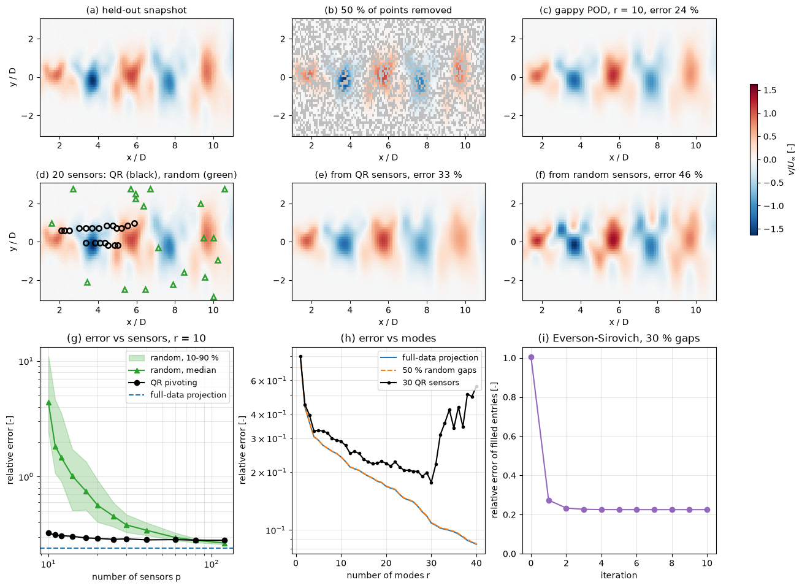

# Gappy POD

Gappy POD estimates a complete field from incomplete data by fitting the coefficients of a POD basis to the values that are known. It was introduced by Everson and Sirovich (1995) to reconstruct images with missing pixels and to compute a POD basis from an ensemble in which every member has gaps. In fluid dynamics it fills holes in PIV fields (spurious vectors, regions hidden by a model or a reflection), reconstructs surface pressure or velocity fields from a few sensors, and is the estimation step behind sensor placement and the discrete empirical interpolation method used in hyper-reduction. The POD itself is described in [Proper Orthogonal Decomposition](pod_intro.md) and [POD for N Points](derivation_in_n_dim.md).

## Problem Statement

A POD basis $\boldsymbol{\Phi}_r = (\boldsymbol{\phi}_1 \cdots \boldsymbol{\phi}_r) \in \mathbb{R}^{N \times r}$ and the mean $\bar{\mathbf{u}}$ are available from complete training snapshots. A new snapshot $\mathbf{u} \in \mathbb{R}^N$ is known only at the $p$ points of a set $\mathcal{S}$: the gaps of a PIV field, or the locations of $p$ sensors. The problem is to estimate $\mathbf{u}$ at all $N$ points, assuming

```math
\mathbf{u} \approx \bar{\mathbf{u}} + \boldsymbol{\Phi}_r\mathbf{a}
```

with unknown coefficients $\mathbf{a} \in \mathbb{R}^r$. The estimate is well defined when the coefficients are uniquely determined by the known values, which requires $p \ge r$ and suitable points; it is good when the field is close to the span of the basis and the coefficient problem is well conditioned. The second problem, covered below, is to build the basis when every training snapshot has gaps.

## Masked Least Squares

Let $\mathbf{P} \in \mathbb{R}^{p \times N}$ select the known entries (each row is a row of the identity), and $\mathbf{D} = \mathbf{P}^T\mathbf{P}$ the diagonal mask with $D_{kk} = 1$ at known points and 0 elsewhere. Everson and Sirovich define the gappy norm $`\lVert \mathbf{f} \rVert_D^2 = \mathbf{f}^T\mathbf{D}\mathbf{f}`$, the norm computed only over the known points, and choose the coefficients that minimise the misfit there:

```math
\hat{\mathbf{a}} = \arg\min_{\mathbf{a}} \lVert \mathbf{u} - \bar{\mathbf{u}} - \boldsymbol{\Phi}_r\mathbf{a} \rVert_D^2 \quad \Longrightarrow \quad \mathbf{G}\hat{\mathbf{a}} = \boldsymbol{\Phi}_r^T\mathbf{D}(\mathbf{u} - \bar{\mathbf{u}}), \qquad \mathbf{G} = \boldsymbol{\Phi}_r^T\mathbf{D}\boldsymbol{\Phi}_r
```

The masked Gram matrix $\mathbf{G}$ is the inner-product matrix of the modes restricted to the known points. With complete data $\mathbf{D} = \mathbf{I}$, $\mathbf{G} = \mathbf{I}$ and $\hat{\mathbf{a}} = \boldsymbol{\Phi}_r^T(\mathbf{u} - \bar{\mathbf{u}})$, the ordinary projection. With gaps the modes are no longer orthonormal over the known points, and $\mathbf{G}$ corrects for that. Writing $\boldsymbol{\Theta} = \mathbf{P}\boldsymbol{\Phi}_r$ (the rows of the basis at the known points) and $\mathbf{y} = \mathbf{P}\mathbf{u}$ (the known values),

```math
\hat{\mathbf{a}} = \boldsymbol{\Theta}^{+}(\mathbf{y} - \mathbf{P}\bar{\mathbf{u}}), \qquad \hat{\mathbf{u}} = \bar{\mathbf{u}} + \boldsymbol{\Phi}_r\hat{\mathbf{a}}
```

where $`\boldsymbol{\Theta}^{+} = (\boldsymbol{\Theta}^T\boldsymbol{\Theta})^{-1}\boldsymbol{\Theta}^T`$ is the pseudo-inverse and $\boldsymbol{\Theta}^T\boldsymbol{\Theta} = \mathbf{G}$. In practice $\hat{\mathbf{a}}$ is computed with a QR-based least-squares solver from $\boldsymbol{\Theta}$, not from $\mathbf{G}$, which would square the condition number. To fill gaps in measured data, the known values are usually kept and only the missing entries are replaced by those of $\hat{\mathbf{u}}$. On a non-uniform mesh the mask is combined with the weights, $\mathbf{D} \to \mathbf{D}\mathbf{W}$. For point measurements of a continuous field, the rows of $\boldsymbol{\Theta}$ are the modes evaluated at the sensor positions, $\Theta_{ki} = \phi_i(\mathbf{x}_k)$.

## Exactness and Error

Split the fluctuation of the true field into its part in the span of the basis and the remainder, $`\mathbf{u} - \bar{\mathbf{u}} = \boldsymbol{\Phi}_r\mathbf{a}^* + \mathbf{e}`$ with $\boldsymbol{\Phi}_r^T\mathbf{e} = \mathbf{0}$. Then

```math
\hat{\mathbf{a}} = \mathbf{a}^* + \boldsymbol{\Theta}^{+}\mathbf{P}\mathbf{e}, \qquad \lVert \hat{\mathbf{u}} - \mathbf{u} \rVert^2 = \lVert \mathbf{e} \rVert^2 + \lVert \boldsymbol{\Theta}^{+}\mathbf{P}\mathbf{e} \rVert^2 \le \lVert \mathbf{e} \rVert^2\left(1 + \frac{1}{\sigma_{\min}(\boldsymbol{\Theta})^2}\right)
```

using $\lVert \mathbf{P}\mathbf{e} \rVert \le \lVert \mathbf{e} \rVert$. Two conclusions follow.

1. If the field lies in the span ($\mathbf{e} = \mathbf{0}$) and $\boldsymbol{\Theta}$ has full column rank, the recovery is exact, whichever points are missing.
2. Otherwise the error is the projection error $\lVert \mathbf{e} \rVert$, which no method using these $r$ modes can avoid, plus the part of $\mathbf{e}$ seen at the known points, aliased into the coefficients and amplified by up to $1/\sigma_{\min}(\boldsymbol{\Theta})$. Measurement noise enters the same way.

Since $`\boldsymbol{\Phi}_r`$ has orthonormal columns, $`\sigma_{\min}(\boldsymbol{\Theta}) \le 1`$, with equality for complete data. A random half of the points gives $\sigma_{\min}$ close to $\sqrt{1/2} = 0.71$ (0.66 to 0.68 for the 10-mode wake basis of the example below) and costs almost nothing; a few badly placed sensors can make it tiny.

## Building the Basis from Gappy Data

When no complete snapshots exist, for example when every PIV field has a few spurious vectors, Everson and Sirovich compute the basis iteratively:

1. Fill each missing entry with the mean of the known values at that point (over the snapshots in which it is known).
2. Compute the POD of the filled snapshot matrix.
3. For every snapshot, compute $\hat{\mathbf{a}}$ from its known entries with the current $r$ modes and replace its missing entries by those of $\bar{\mathbf{u}} + \boldsymbol{\Phi}_r\hat{\mathbf{a}}$.
4. Repeat steps 2 and 3 until the filled values or the eigenvalues stop changing.

A common refinement is to increase $r$ gradually during the iteration, which guards against fitting noise with modes that are not yet well determined. For data that are close to a rank-$`r`$ subspace and missing at random, the iteration recovers the missing entries; the script below checks this on exactly low-rank data and shows convergence in a few iterations for the wake.

## Conditioning and Sensor Placement

The coefficient problem is solvable only if $p \ge r$ and $\boldsymbol{\Theta}$ has full column rank: the known points must distinguish the modes. Two modes that take proportional values at every sensor cannot be separated (Exercise 2). Even with full rank, a small $\sigma_{\min}(\boldsymbol{\Theta})$ amplifies the out-of-basis content and the noise, so the sensors should be placed to make $\boldsymbol{\Theta}$ well conditioned. Common strategies:

- Random locations work well when $p$ is several times $r$, and poorly when $p \approx r$.
- QR factorization with column pivoting of $\boldsymbol{\Phi}_r^T$ greedily picks the point whose row of $\boldsymbol{\Phi}_r$ has the largest component orthogonal to the rows already chosen, approximately maximising $|\det\boldsymbol{\Theta}|$ for $p = r$. It is the sensor-placement method of Manohar et al. (2018) and the Q-DEIM selection of Drmač and Gugercin (2016); the derivation and an example are in [Flow Feature Extraction](../../machine_learning/flow/feature_extraction.md#sparse-sensor-placement).
- For $p > r$, further points can be added greedily to maximise $\det(\boldsymbol{\Theta}^T\boldsymbol{\Theta})$ or $\sigma_{\min}(\boldsymbol{\Theta})$; Peherstorfer, Drmač and Gugercin (2020) analyse such oversampling and its stability.
- Willcox (2006) chooses sensors by minimising the condition number of $\mathbf{G}$ and uses gappy POD for unsteady flow sensing and estimation.

The discrete empirical interpolation method (Chaturantabut and Sorensen, 2010) is the case $p = r$ with greedily chosen points, applied to the nonlinear term of a reduced-order model rather than to measured data.

## A Worked Example

The [Gappy POD Reconstruction](../../../scripts/algorithms/gappy_pod_reconstruction/) script builds a 10-mode basis (95.6% of the energy) from 200 complete snapshots of a synthetic cylinder wake on a $120 \times 48$ grid, and reconstructs 20 snapshots taken later in time.



- With 50% of the points removed at random (b, c), the test error is 0.240, identical to the projection of the complete fields: with 2880 known values for 10 unknowns, the gaps cost nothing.
- With 20 sensors, the QR layout gives $\kappa(\boldsymbol{\Theta}) = 2.0$ and a smooth estimate with 33% error (e); the random layout shown has $\kappa = 29.9$ and overshoots, 46% error (f).
- Against the number of sensors (g), QR placement is near its asymptote already at $p = r = 10$ (error 0.325), while the median random layout has error 4.4 at $p = 10$ and needs about 60 sensors to come within 5% of QR. At $p \ge 80$ random layouts become marginally better, because the error is then dominated by the energy outside the basis, which spread-out random sensors sample more evenly than the clustered QR sensors.
- Against the number of modes (h), the error with 50% gaps follows the full-data projection; with 30 fixed sensors it decreases until $r = p$ and rises once $r > p$ makes the problem underdetermined.
- Building the basis from training snapshots with 30% of the entries missing (i), the Everson–Sirovich iteration reduces the error of the filled entries from 1.006 (mean fill) to 0.225, and the resulting basis reconstructs the gappy test snapshots as well as the basis from complete data (0.242 against 0.240).

## Pitfalls

- The basis must represent the field being reconstructed. Gappy POD cannot recover structures absent from the training snapshots, and it silently returns the closest field in the span.
- Gaps are not random in many applications. A region hidden by a model, or the boundary layer missing from PIV, removes exactly the points where some modes live, and $\boldsymbol{\Theta}$ becomes ill conditioned; check $\sigma_{\min}(\boldsymbol{\Theta})$ for the actual mask.
- More modes are not always better. With few sensors, choose $r$ well below $p$ or regularise, for example with Tikhonov regularisation $\min \lVert \mathbf{y} - \mathbf{P}\bar{\mathbf{u}} - \boldsymbol{\Theta}\mathbf{a} \rVert^2 + \delta\lVert \boldsymbol{\Lambda}_r^{-1/2}\mathbf{a} \rVert^2$, which penalises coefficients large compared with their typical size $\sqrt{\lambda_i}$.
- When the snapshots come from different geometries or flow conditions, features such as shocks or separation points move, and a fixed-grid basis is poor. The data have to be aligned (for example by mapping to a common reference geometry) before the POD is built.

## Key Takeaways

- Gappy POD solves a least-squares problem for the POD coefficients over the known points, $`\boldsymbol{\Phi}_r^T\mathbf{D}\boldsymbol{\Phi}_r\hat{\mathbf{a}} = \boldsymbol{\Phi}_r^T\mathbf{D}(\mathbf{u} - \bar{\mathbf{u}})`$, and reconstructs $\bar{\mathbf{u}} + \boldsymbol{\Phi}_r\hat{\mathbf{a}}$ everywhere.
- The recovery is exact for fields in the span of the basis when the masked basis has full column rank; otherwise the out-of-basis content is amplified by up to $1/\sigma_{\min}(\mathbf{P}\boldsymbol{\Phi}_r)$.
- Randomly scattered gaps are harmless; few sensors need careful placement, and QR pivoting on the basis is a cheap, effective choice.
- The Everson–Sirovich iteration builds a basis from data in which every snapshot has gaps.
- The number of modes must stay below the number of sensors, and preferably well below.

## Related Scripts

- [Gappy POD Reconstruction](../../../scripts/algorithms/gappy_pod_reconstruction/): reconstructs complete flow fields from incomplete data with gappy POD: a POD basis built from complete snapshots of a synthetic cylinder wake is fitted by least squares to held-out snapshots of which only 50% of the points, or a few point sensors, are known.
- [Proper Orthogonal Decomposition (POD)](../../../scripts/algorithms/pod/): performs Proper Orthogonal Decomposition on a synthetic spatio-temporal field by taking the singular value decomposition of the mean-subtracted snapshot matrix.
- [Flow Super-Resolution](../../../scripts/algorithms/flow_superresolution/): reconstructs a $128 \times 128$ velocity field from its $4\times$ block average with cubic-spline (bicubic) interpolation and with a learned linear patch model, then denoises noisy vortex-street snapshots by truncating their proper orthogonal decomposition (POD).

## Exercises

The exercises use four points with the Euclidean inner product, the orthonormal modes $\boldsymbol{\phi}_1 = (1, 1, 1, 1)/2$ and $\boldsymbol{\phi}_2 = (1, 1, -1, -1)/2$, zero mean, and the field $\mathbf{u} = (2, 2, 1, 1)$.

**Exercise 1.** Show that with all four points known the gappy solution reduces to the orthogonal projection, and compute the coefficients.

<details>
<summary>Answer</summary>

With $\mathbf{D} = \mathbf{I}$, $\mathbf{G} = \boldsymbol{\Phi}_2^T\boldsymbol{\Phi}_2 = \mathbf{I}$ and $\hat{\mathbf{a}} = \boldsymbol{\Phi}_2^T\mathbf{u}$. Numerically $\hat{a}_1 = (2 + 2 + 1 + 1)/2 = 3$ and $\hat{a}_2 = (2 + 2 - 1 - 1)/2 = 1$, so $\mathbf{u} = 3\boldsymbol{\phi}_1 + \boldsymbol{\phi}_2$ exactly.

</details>

**Exercise 2.** Only points 1 and 3 are known, $\mathbf{y} = (2, 1)$. Build $\boldsymbol{\Theta}$, solve for the coefficients and reconstruct the field. Repeat with points 1 and 2, and explain what goes wrong.

<details>
<summary>Answer</summary>

Points 1 and 3: $`\boldsymbol{\Theta} = \begin{pmatrix} 1/2 & 1/2 \\ 1/2 & -1/2 \end{pmatrix}`$ is invertible. Solving $a_1 + a_2 = 4$ and $a_1 - a_2 = 2$ gives $\hat{\mathbf{a}} = (3, 1)$ and $\hat{\mathbf{u}} = (2, 2, 1, 1)$, exact because $\mathbf{u}$ lies in the span.

Points 1 and 2: both rows of $\boldsymbol{\Theta}$ are $(1/2, 1/2)$, so $`\mathrm{rank}\,\boldsymbol{\Theta} = 1 < r = 2`$ and $\mathbf{G}$ is singular. The two modes take identical values at these points, so any $\mathbf{a}$ with $a_1 + a_2 = 4$ fits the data. The known points must make $\boldsymbol{\Theta}$ full rank, and preferably well conditioned.

</details>

**Exercise 3.** Points 1, 2 and 3 are measured with noise, $\mathbf{y} = (2.1, 1.9, 1.0)$. Compute $\mathbf{G}$, the right-hand side $\boldsymbol{\Theta}^T\mathbf{y}$, the coefficients, the reconstruction and the residual at the sensors.

<details>
<summary>Answer</summary>

$\boldsymbol{\Theta}$ has rows $(1/2, 1/2)$, $(1/2, 1/2)$ and $(1/2, -1/2)$, so

```math
\mathbf{G} = \begin{pmatrix} 0.75 & 0.25 \\ 0.25 & 0.75 \end{pmatrix}, \qquad \boldsymbol{\Theta}^T\mathbf{y} = \begin{pmatrix} 2.5 \\ 1.5 \end{pmatrix}
```

Solving gives $\hat{\mathbf{a}} = (3, 1)$ and $\hat{\mathbf{u}} = (2, 2, 1, 1)$, the noise-free field. The residual at the sensors is $(0.1, -0.1, 0)$: the redundant sensors at points 1 and 2 average out their opposite errors. With more sensors than modes, least squares filters noise.

</details>

**Exercise 4.** Show that with $\mathbf{P}$ selecting the known points, the normal equations $`\mathbf{G}\hat{\mathbf{a}} = \boldsymbol{\Phi}_r^T\mathbf{D}\mathbf{u}`$ in mask form coincide with $`\boldsymbol{\Theta}^T\boldsymbol{\Theta}\hat{\mathbf{a}} = \boldsymbol{\Theta}^T\mathbf{y}`$, and compute $`\sigma_{\min}(\boldsymbol{\Theta})`$ for the sensor sets $`\{1, 3\}`$ and $`\{1, 2, 3\}`$ of Exercises 2 and 3. What does it imply for the amplification of an out-of-basis error?

<details>
<summary>Answer</summary>

$`\boldsymbol{\Theta}^T\boldsymbol{\Theta} = \boldsymbol{\Phi}_r^T\mathbf{P}^T\mathbf{P}\boldsymbol{\Phi}_r = \boldsymbol{\Phi}_r^T\mathbf{D}\boldsymbol{\Phi}_r = \mathbf{G}`$ and $`\boldsymbol{\Theta}^T\mathbf{y} = \boldsymbol{\Phi}_r^T\mathbf{P}^T\mathbf{P}\mathbf{u} = \boldsymbol{\Phi}_r^T\mathbf{D}\mathbf{u}`$, so the systems are identical.

For $`\{1, 3\}`$, $\mathbf{G} = \boldsymbol{\Theta}^T\boldsymbol{\Theta} = \mathrm{diag}(0.5, 0.5)$, so $\sigma_{\min} = \sqrt{0.5} = 0.707$. For $`\{1, 2, 3\}`$, $\mathbf{G}$ has eigenvalues $0.75 \pm 0.25$, i.e. $1$ and $0.5$, so again $\sigma_{\min} = 0.707$, with $\sigma_{\max} = 1$. An out-of-basis error $\mathbf{e}$ therefore adds at most $`\lVert \mathbf{P}\mathbf{e} \rVert/0.707 = 1.41\lVert \mathbf{P}\mathbf{e} \rVert`$ to the coefficient error. For the singular set $`\{1, 2\}`$, $\sigma_{\min} = 0$ and the amplification is unbounded.

</details>

## References

- R. Everson and L. Sirovich, "Karhunen–Loève procedure for gappy data", *Journal of the Optical Society of America A* 12(8), 1995, pp. 1657–1664.
- T. Bui-Thanh, M. Damodaran and K. Willcox, "Aerodynamic data reconstruction and inverse design using proper orthogonal decomposition", *AIAA Journal* 42(8), 2004, pp. 1505–1516.
- K. Willcox, "Unsteady flow sensing and estimation via the gappy proper orthogonal decomposition", *Computers & Fluids* 35(2), 2006, pp. 208–226.
- D. Venturi and G. E. Karniadakis, "Gappy data and reconstruction procedures for flow past a cylinder", *Journal of Fluid Mechanics* 519, 2004, pp. 315–336.
- S. Chaturantabut and D. C. Sorensen, "Nonlinear model reduction via discrete empirical interpolation", *SIAM Journal on Scientific Computing* 32(5), 2010, pp. 2737–2764.
- Z. Drmač and S. Gugercin, "A new selection operator for the discrete empirical interpolation method: improved a priori error bound and extensions", *SIAM Journal on Scientific Computing* 38(2), 2016, pp. A631–A648.
- K. Manohar, B. W. Brunton, J. N. Kutz and S. L. Brunton, "Data-driven sparse sensor placement for reconstruction: Demonstrating the benefits of exploiting known patterns", *IEEE Control Systems Magazine* 38(3), 2018, pp. 63–86.
- B. Peherstorfer, Z. Drmač and S. Gugercin, "Stability of discrete empirical interpolation and gappy proper orthogonal decomposition with randomized and deterministic sampling points", *SIAM Journal on Scientific Computing* 42(5), 2020, pp. A2837–A2864.
