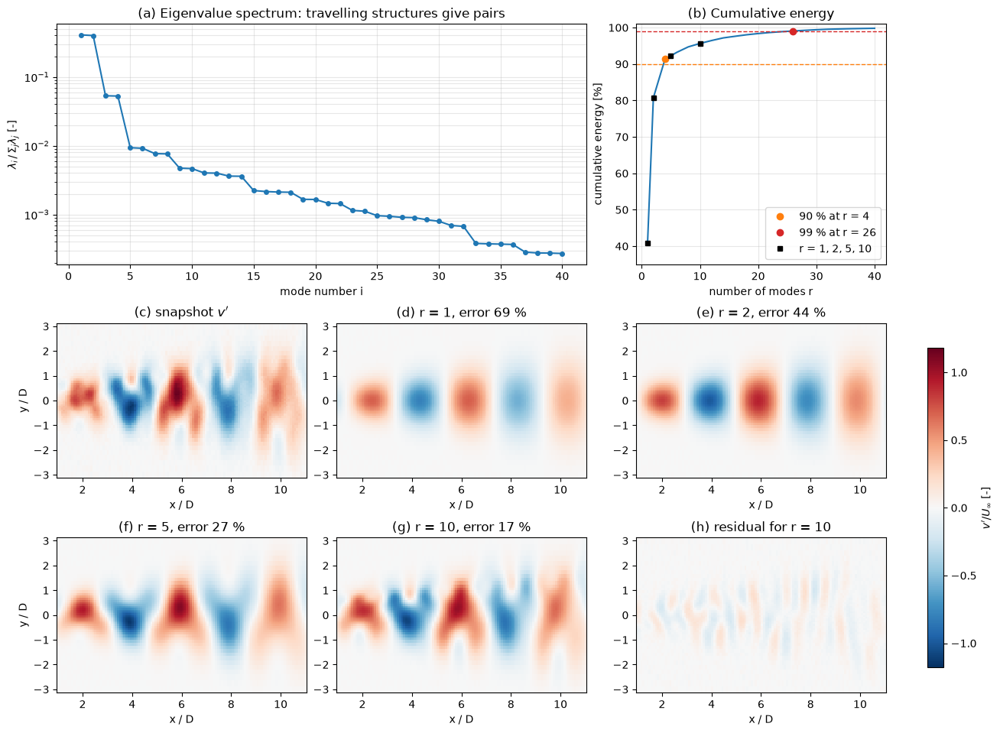

# Proper Orthogonal Decomposition

Proper orthogonal decomposition (POD) finds, from a set of flow fields, the orthonormal spatial patterns that capture the most fluctuation energy for a given number of patterns. In CFD it is used to identify coherent structures in simulation and PIV data, to compress large unsteady data sets, to build reduced-order models by Galerkin projection, and to estimate whole fields from a few sensors. The same decomposition is known as the Karhunen–Loève expansion in probability theory and as principal component analysis (PCA) in statistics.

This note states the problem, its continuous form and why the solution is optimal. The matrix computations are in the other notes of this folder: [Two-Point POD](derivation_in_2d.md) works through the smallest case, [POD for N Points](derivation_in_n_dim.md) gives the general discrete derivation, [POD and the SVD](pod_vs_svd.md) and [The Method of Snapshots](snapshot_pod.md) cover the algorithms, and [Gappy POD](gappy_pod.md) treats incomplete data.

## Problem Statement

Let $\mathbf{u}(\mathbf{x}, t)$ be a velocity field (or any field) on a domain $\Omega$, observed at times $t_1, \dots, t_M$ or over an ensemble of realizations. Split it into a mean and a fluctuation, $`\mathbf{u} = \bar{\mathbf{u}}(\mathbf{x}) + \mathbf{u}'(\mathbf{x}, t)`$, where the overbar is the time or ensemble average. With the inner product and norm

```math
(\mathbf{f}, \mathbf{g}) = \int_\Omega \mathbf{f}(\mathbf{x}) \cdot \mathbf{g}(\mathbf{x})\, d\mathbf{x}, \qquad \lVert \mathbf{f} \rVert^2 = (\mathbf{f}, \mathbf{f})
```

POD seeks, for each $r$, orthonormal functions $\boldsymbol{\phi}_1, \dots, \boldsymbol{\phi}_r$ that minimise the average squared error of the projection onto their span,

```math
\min_{(\boldsymbol{\phi}_i, \boldsymbol{\phi}_j) = \delta_{ij}} \ \overline{\left\lVert \mathbf{u}' - \sum_{i=1}^{r} (\mathbf{u}', \boldsymbol{\phi}_i)\,\boldsymbol{\phi}_i \right\rVert^2}
```

Because the projection is orthogonal, $`\lVert \mathbf{u}' \rVert^2 = \sum_{i \le r} (\mathbf{u}', \boldsymbol{\phi}_i)^2 + \lVert \text{error} \rVert^2`$, so minimising the error is the same as maximising the captured energy $`\sum_{i \le r} \overline{(\mathbf{u}', \boldsymbol{\phi}_i)^2}`$. The data are the snapshots; the unknowns are the modes $\boldsymbol{\phi}_i(\mathbf{x})$ and the coefficients $`a_i(t) = (\mathbf{u}'(\cdot, t), \boldsymbol{\phi}_i)`$; the problem is solved when the modes satisfy the eigenvalue problem below, and a truncation $r$ is chosen so that the discarded energy is acceptable for the purpose at hand. The practical difficulties are size (a 3D unsteady simulation gives $10^6$ to $10^9$ values per snapshot), the choice of variables and inner product, and the fact that captured energy is not the same as dynamical importance.

## The Continuous Eigenvalue Problem

Maximise the energy captured by one function, $`\overline{(\mathbf{u}', \boldsymbol{\phi})^2}/(\boldsymbol{\phi}, \boldsymbol{\phi})`$. Writing out the inner products,

```math
\overline{(\mathbf{u}', \boldsymbol{\phi})^2} = \int_\Omega \int_\Omega \phi_i(\mathbf{x})\, R_{ij}(\mathbf{x}, \mathbf{x}')\, \phi_j(\mathbf{x}')\, d\mathbf{x}'\, d\mathbf{x}, \qquad R_{ij}(\mathbf{x}, \mathbf{x}') = \overline{u'_i(\mathbf{x}, t)\, u'_j(\mathbf{x}', t)}
```

where $R_{ij}$ is the two-point correlation tensor of turbulence statistics (see [Turbulence Statistics](../../fluid_mechanics/turbulence/statistics.md)), and summation over repeated component indices is implied. This is a Rayleigh quotient of the symmetric, positive semi-definite integral operator with kernel $R_{ij}$. Setting its first variation to zero with a Lagrange multiplier for the normalisation gives the Fredholm integral equation of the second kind

```math
\int_\Omega R_{ij}(\mathbf{x}, \mathbf{x}')\, \phi_j(\mathbf{x}')\, d\mathbf{x}' = \lambda\, \phi_i(\mathbf{x})
```

By the Hilbert–Schmidt theory of symmetric compact operators it has a countable set of real eigenvalues $\lambda_1 \ge \lambda_2 \ge \dots \ge 0$ with orthonormal eigenfunctions $\boldsymbol{\phi}_k$, and the fluctuation can be expanded as

```math
\mathbf{u}'(\mathbf{x}, t) = \sum_{k=1}^{\infty} a_k(t)\, \boldsymbol{\phi}_k(\mathbf{x}), \qquad \overline{a_k a_l} = \lambda_k\, \delta_{kl}
```

Three properties follow.

1. The modes are orthonormal in space and the coefficients are uncorrelated in time; this double orthogonality is what makes POD unique among expansions.
2. The eigenvalue $\lambda_k$ is the mean energy in mode $k$, and $`\sum_k \lambda_k = \overline{\lVert \mathbf{u}' \rVert^2} = \int_\Omega R_{ii}(\mathbf{x}, \mathbf{x})\, d\mathbf{x}`$. For a velocity field this is twice the turbulent kinetic energy integrated over $\Omega$.
3. Each $\boldsymbol{\phi}_k$ is a linear combination of the snapshots, so it inherits their linear properties: divergence-free snapshots give divergence-free modes, and modes satisfy homogeneous boundary conditions that all fluctuations satisfy.

## Why the Modes Are Optimal

The first mode maximises the Rayleigh quotient, so no other function captures more energy. The second maximises it among functions orthogonal to $\boldsymbol{\phi}_1$, and so on. The stronger statement that the first $r$ modes together are the best $r$-dimensional subspace follows from expanding any orthonormal set $\boldsymbol{\psi}_1, \dots, \boldsymbol{\psi}_r$ in the eigenbasis: with $`\psi_i = \sum_k c_{ik}\phi_k`$ the captured energy is $`\sum_k \lambda_k \sum_{i \le r} c_{ik}^2`$, where each inner sum $`p_k = \sum_{i \le r} c_{ik}^2`$ lies between 0 and 1 and $`\sum_k p_k = r`$. The largest value of $\sum_k \lambda_k p_k$ under these constraints is obtained with $p_k = 1$ for the $r$ largest eigenvalues, so

```math
\sum_{i=1}^{r} \overline{(\mathbf{u}', \boldsymbol{\psi}_i)^2} \ \le \ \sum_{i=1}^{r} \lambda_i
```

with equality for the POD modes (Ky Fan's maximum principle). For a finite snapshot matrix the same result is the Eckart–Young theorem: the truncated singular value decomposition is the best rank-$`r`$ approximation in the Frobenius norm, and the squared error is the sum of the discarded squared singular values. The discrete statement and its consequences are in [POD and the SVD](pod_vs_svd.md).

Optimality is relative to the inner product. Changing it (for example weighting by cell volume, or combining velocity with pressure or temperature) changes the modes, so the inner product must be chosen to measure what matters; [POD for N Points](derivation_in_n_dim.md#non-uniform-meshes-and-weighted-inner-products) shows how.

## History

Lumley (1967) introduced POD into turbulence research as an objective definition of coherent structures: the structure that is most energetic on average, extracted from the measured two-point correlation tensor. Sirovich (1987) made it practical for numerical and PIV data with the method of snapshots, which solves an eigenvalue problem whose size is the number of snapshots rather than the number of grid points.

## Energy Fractions and Truncation

The fraction of energy in mode $i$ and in the first $r$ modes are

```math
e_i = \frac{\lambda_i}{\sum_k \lambda_k}, \qquad E(r) = \sum_{i=1}^{r} e_i
```

and the root-mean-square relative error of the rank-$`r`$ reconstruction over the snapshot set is $\sqrt{1 - E(r)}$. Common ways to choose $r$:

- An energy threshold, typically $E(r) \ge 0.9$ or $0.99$. Note that 99% of the energy still leaves a 10% rms error, because error and energy are related by a square root.
- A gap or elbow in the spectrum $\lambda_i$, when one exists.
- For noisy data, a threshold based on the noise level such as the optimal hard threshold of Gavish and Donoho, discussed in [Flow Feature Extraction](../../machine_learning/flow/feature_extraction.md#choosing-the-rank).
- The error in the quantity that matters: a force coefficient, the stability and accuracy of a Galerkin model, or the error of a sensor-based estimate.



The figure is for a synthetic cylinder wake. The eigenvalues come in nearly equal pairs, one pair for each travelling structure. One mode (panel d) gives a standing pattern that cannot move, two modes give the convected vortex street with 81% of the energy, and 90% and 99% of the energy need 4 and 26 modes.

## Uses in CFD

| Use | What POD provides | Where it is covered |
| --- | --- | --- |
| Coherent-structure identification in DNS, LES and PIV data | the most energetic spatial patterns and their time histories | [POD for N Points](derivation_in_n_dim.md) |
| Data compression and noise filtering | rank-$`r`$ storage, $r(N + M)$ numbers instead of $NM$; small-energy modes dominated by noise are discarded | [POD and the SVD](pod_vs_svd.md) |
| Galerkin reduced-order models | a basis onto which the Navier–Stokes equations are projected, giving $r$ ODEs for $a_i(t)$ | [POD-Galerkin Projection](../rom/pod_galerkin_projection.md), [Reduced-Order Models](../rom/rom.md) |
| Parametric reduced bases | a basis built from snapshots at several parameter values | [Reduced Basis Approximation](../rom/reduced_basis_approximation.md) |
| Flow estimation and gap filling | full fields from sensors or incomplete PIV data | [Gappy POD](gappy_pod.md) |
| Low-dimensional features for machine learning | coordinates $a_i$ for regression, clustering and sensor placement | [Flow Feature Extraction](../../machine_learning/flow/feature_extraction.md) |

## Limitations

- Energy is not dynamical importance. Low-energy modes can control the dynamics: they drain energy from the large scales in a Galerkin model (truncated POD-Galerkin models of turbulent flows often blow up for this reason), carry acoustic sources, or trigger instabilities. A POD of the velocity alone also ranks nothing by its effect on pressure or heat transfer.
- Travelling structures need many modes. A wave $\cos(kx - \omega t)$ needs two modes, and a structure that moves and changes shape, such as a convected vortex, a moving shock or a flame front, needs many, because the snapshots do not lie near a low-dimensional linear subspace.
- A mode generally mixes frequencies. The coefficient $a_i(t)$ of an energetic mode can contain several frequencies, so a POD mode is not a single physical oscillation. DMD and spectral POD address this.
- The basis only represents what was sampled. Snapshots must cover the dynamics and operating conditions the basis will be used for; a basis from one Reynolds number or geometry may be poor at another.
- The modes depend on the variables, their scaling and the inner product. For compressible flow or multi-physics data the variables have different units and an energy-based inner product has to be designed.

## Comparison with Other Decompositions

|  | POD | DMD | Spectral POD | Fourier |
| --- | --- | --- | --- | --- |
| Basis | data-driven, orthonormal in space | data-driven, not orthogonal | data-driven, orthonormal at each frequency | fixed sines and cosines |
| What a mode optimises | captured energy | fit of a linear map $\mathbf{u}_{j+1} \approx \mathbf{A}\mathbf{u}_j$ | captured energy at one frequency | nothing; complete basis |
| Time behaviour of one mode | coefficient $a_i(t)$ with any spectrum | one frequency and growth rate | one frequency | one wavenumber |
| Data needed | any snapshots, order irrelevant | time-resolved, uniform $\Delta t$ | long time-resolved record, split into blocks | periodic or homogeneous domain |
| Typical use | energetic structures, compression, Galerkin ROMs | oscillators, stability, prediction | broadband turbulence, jets, wakes | homogeneous directions |

DMD is described in [Dynamic Mode Decomposition](../rom/dmd.md) and, for data-driven modelling, in [Flow Dynamics](../../machine_learning/flow/flow_dynamics.md). In a statistically homogeneous direction the correlation depends only on $x - x'$ and the POD modes are Fourier modes (Exercise 4), so POD and Fourier analysis coincide there.

## Key Takeaways

- POD gives the orthonormal basis that captures the most mean energy for each number of modes; the modes are eigenfunctions of the two-point correlation tensor, and the eigenvalues are the energies.
- Modes are orthogonal in space, coefficients are uncorrelated in time, and $\sum_i \lambda_i$ is twice the integrated turbulent kinetic energy when the fields are velocities.
- Truncation is chosen from the cumulative energy $E(r)$, but the rms reconstruction error is $\sqrt{1 - E(r)}$, and the purpose of the model should decide.
- Travelling structures appear as pairs of modes with nearly equal energy; moving fronts and shocks need many modes.
- POD ranks by energy, not by dynamical importance or frequency; DMD and spectral POD complement it.

## Related Scripts

- [POD Energy and Truncation](../../../scripts/plots/pod_energy_and_truncation/): computes the POD of a synthetic cylinder-wake velocity field on a stretched mesh and shows how the number of retained modes $r$ follows from the eigenvalue spectrum, with the 90% and 99% energy thresholds and reconstructions of one snapshot with $r = 1, 2, 5$ and $10$ modes.
- [Proper Orthogonal Decomposition (POD)](../../../scripts/algorithms/pod/): performs Proper Orthogonal Decomposition on a synthetic spatio-temporal field by taking the singular value decomposition of the mean-subtracted snapshot matrix.
- [POD Analysis for Flow Fields](../../../scripts/plots/pod_analysis_for_flow_fields/): performs Proper Orthogonal Decomposition (POD) on a synthetic 100 × 50 snapshot matrix with the singular value decomposition (SVD) and plots the eigenvalue spectrum with the share of turbulent kinetic energy (TKE) in each mode.
- [Eigenvector Projection of Velocity Fluctuations](../../../scripts/plots/eigenvector_projection/): finds the principal directions of correlated 2D velocity fluctuations from the eigenvectors of their covariance matrix and projects the data onto them.
- [Gappy POD Reconstruction](../../../scripts/algorithms/gappy_pod_reconstruction/): reconstructs complete flow fields from incomplete data with gappy POD: a POD basis built from complete snapshots of a synthetic cylinder wake is fitted by least squares to held-out snapshots of which only 50% of the points, or a few point sensors, are known.
- [Image Compression Using SVD](../../../scripts/algorithms/image_compression_using_svd/): compresses a grayscale image by keeping only its $r$ largest singular values and the matching singular vectors, then compares the rank-$`r`$ reconstructions with the original.
- [Airfoil Shape PCA](../../../scripts/algorithms/airfoil_shape_pca/): builds a linear shape space for NACA 4-digit airfoils by principal component analysis (PCA) of their surface coordinates and shows how few modes are needed to describe the family.
- [Flow Regime Clustering with POD and k-means](../../../scripts/plots/flow_regime_clustering/): groups the snapshots of a synthetic wake that switches between three flow regimes into clusters, by projecting them onto their leading POD modes and running k-means on the POD coefficients.
- [POD Spatial Modes and Temporal Coefficients](../../../scripts/plots/pod_modes_and_temporal_coefficients/): extracts the first three POD spatial modes and their temporal coefficients from a synthetic two-dimensional, time-dependent field and plots them.
- [POD-Galerkin Reduced-Order Model of the Burgers Equation](../../../scripts/algorithms/pod_galerkin_burgers/): builds a POD-Galerkin reduced-order model (ROM) of the 1D viscous Burgers equation from snapshots of a 2000-point finite-difference solution, precomputes the reduced constant, linear and quadratic operators offline, and compares ROMs of 1 to 30 modes with the full-order model (FOM) inside the training window, in a later time window and at a new viscosity.
- [Snapshot Proper Orthogonal Decomposition (Snapshot POD)](../../../scripts/algorithms/snapshot_pod/): computes POD modes of a synthetic spatio-temporal field with the snapshot method, which solves an eigenvalue problem for the $M \times M$ temporal correlation matrix instead of the much larger $N \times N$ spatial one.

## Exercises

**Exercise 1.** A snapshot set has POD eigenvalues $\lambda = (12, 6, 1.5, 0.3, 0.15, 0.05)$. How many modes are needed for at least 90% and at least 99% of the energy, and what is the rms relative reconstruction error in each case?

<details>
<summary>Answer</summary>

The total is $\sum_i \lambda_i = 20$, and the cumulative fractions are $0.60, 0.90, 0.975, 0.99, 0.9975, 1$. So $r = 2$ reaches 90% and $r = 4$ reaches 99%. The rms relative errors are $\sqrt{1 - 0.9} = 0.316$ and $\sqrt{1 - 0.99} = 0.1$: even 99% of the energy leaves a 10% error.

</details>

**Exercise 2.** A 3D CFD case has $N = 10^6$ degrees of freedom per snapshot and $M = 200$ snapshots. Compare the double-precision storage of the $N \times N$ spatial correlation matrix with that of the $M \times M$ snapshot correlation matrix and of the snapshot matrix itself.

<details>
<summary>Answer</summary>

$N \times N$: $10^{12} \times 8$ bytes $= 8$ TB. $M \times M$: $200^2 \times 8$ bytes $= 320$ kB. The snapshot matrix: $2 \times 10^8 \times 8$ bytes $= 1.6$ GB. Only methods that work with the snapshot matrix or the $M \times M$ matrix are feasible ([The Method of Snapshots](snapshot_pod.md), [POD and the SVD](pod_vs_svd.md)).

</details>

**Exercise 3.** On the periodic domain $0 \le x < L$ with $L = 2\pi n/k$ for an integer $n$, consider the travelling wave $u'(x, t) = \cos(kx - \omega t)$, averaged over one period in time. Compute the two-point correlation $R(x, x')$, find the POD modes and eigenvalues, and compare with the standing wave $u'(x, t) = \cos(kx)\cos(\omega t)$.

<details>
<summary>Answer</summary>

The time average of $\cos(kx - \omega t)\cos(kx' - \omega t)$ is $R(x, x') = \frac{1}{2}\cos(k(x - x'))$. Since $\cos(k(x - x')) = \cos kx \cos kx' + \sin kx \sin kx'$, the operator has rank two, with orthonormal eigenfunctions $\sqrt{2/L}\cos kx$ and $\sqrt{2/L}\sin kx$. For the first,

```math
\int_0^L \tfrac{1}{2}\cos(k(x - x'))\sqrt{2/L}\cos kx'\, dx' = \tfrac{1}{2}\cdot\tfrac{L}{2}\sqrt{2/L}\cos kx
```

so $\lambda_1 = \lambda_2 = L/4$, 50% of the energy each. One mode can only represent a standing pattern; the wave needs the pair. For the standing wave $R = \frac{1}{2}\cos kx \cos kx'$, which has the single eigenfunction $\sqrt{2/L}\cos kx$ with $\lambda_1 = L/4$ and 100% of the energy. A numerical check with 64 points and 200 snapshots gives two equal eigenvalues of $NM/(4(M-1)) = 16.08$ for the travelling wave (the discrete analogue with $\Delta x = 1$).

</details>

**Exercise 4.** In a statistically homogeneous, periodic direction $x$ of length $L$, the correlation depends only on the separation, $R(x, x') = R(x - x')$. Show that the Fourier modes $e^{i\kappa x}$ with $\kappa = 2\pi n/L$ are eigenfunctions of the POD operator, and identify the eigenvalues.

<details>
<summary>Answer</summary>

Substitute $s = x - x'$:

```math
\int_0^L R(x - x')\, e^{i\kappa x'}\, dx' = e^{i\kappa x}\int R(s)\, e^{-i\kappa s}\, ds = \hat{R}(\kappa)\, e^{i\kappa x}
```

where periodicity lets the integral over $s$ run over any interval of length $L$. The eigenvalues are the Fourier coefficients $\hat{R}(\kappa)$ of the correlation, which by the Wiener–Khinchin theorem are the energy spectrum. POD in a homogeneous direction is therefore Fourier analysis, and POD only gives new information in inhomogeneous directions, such as the wall-normal direction of a boundary layer.

</details>

## References

- J. L. Lumley, "The structure of inhomogeneous turbulent flows", in A. M. Yaglom and V. I. Tatarski (eds.), *Atmospheric Turbulence and Radio Wave Propagation*, Nauka, Moscow, 1967, pp. 166–178.
- L. Sirovich, "Turbulence and the dynamics of coherent structures. Part I: Coherent structures", *Quarterly of Applied Mathematics* 45(3), 1987, pp. 561–571.
- G. Berkooz, P. Holmes and J. L. Lumley, "The proper orthogonal decomposition in the analysis of turbulent flows", *Annual Review of Fluid Mechanics* 25, 1993, pp. 539–575.
- P. Holmes, J. L. Lumley, G. Berkooz and C. W. Rowley, *Turbulence, Coherent Structures, Dynamical Systems and Symmetry*, 2nd ed., Cambridge University Press, 2012.
- K. Taira, S. L. Brunton, S. T. M. Dawson, C. W. Rowley, T. Colonius, B. J. McKeon, O. T. Schmidt, S. Gordeyev, V. Theofilis and L. S. Ukeiley, "Modal analysis of fluid flows: An overview", *AIAA Journal* 55(12), 2017, pp. 4013–4041.
- J. Weiss, "A tutorial on the proper orthogonal decomposition", AIAA Paper 2019-3333, *AIAA Aviation 2019 Forum*, Dallas, 2019.
- A. Towne, O. T. Schmidt and T. Colonius, "Spectral proper orthogonal decomposition and its relationship to dynamic mode decomposition and resolvent analysis", *Journal of Fluid Mechanics* 847, 2018, pp. 821–867.
- S. L. Brunton and J. N. Kutz, *Data-Driven Science and Engineering: Machine Learning, Dynamical Systems, and Control*, 2nd ed., Cambridge University Press, 2022.
