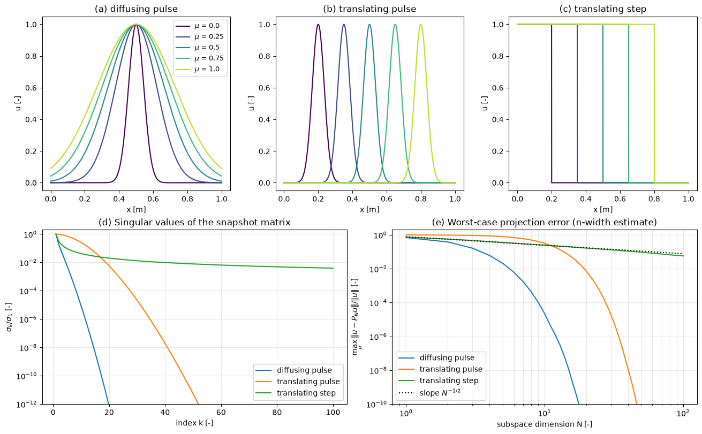

# Reduced-Order Modeling

A CFD solver with millions of unknowns is affordable for one design, but not for the thousands of evaluations that optimization, uncertainty quantification, parameter identification or real-time control require. A reduced-order model (ROM) replaces the high-fidelity model by a system with tens or hundreds of unknowns that reproduces its solutions over a range of parameters or times. This note gives the overview: what is reduced, the projection-based and data-driven families, the offline–online split that makes them fast, the limits set by the Kolmogorov $n$-width, hyper-reduction of nonlinear terms, error estimation and stability.

The other notes in this folder develop the pieces. [Parametrized Variational Problems](parameterized_variational_problems.md) and [Truth Discretization](discretization_techniques.md) set up the problem, [Reduced Basis Approximation](reduced_basis_approximation.md) treats certified reduced bases for elliptic problems, [POD-Galerkin Projection](pod_galerkin_projection.md) applies projection to the Navier–Stokes equations, and [Dynamic Mode Decomposition](dmd.md) covers the data-driven linear alternative. The POD machinery itself is in [`notes/numerical/pod/`](../pod/pod_intro.md).

## Problem Statement

The high-fidelity or full-order model (FOM) is a discretized PDE that depends on a parameter vector $\mu \in \mathcal{P} \subset \mathbb{R}^p$ (Reynolds number, inflow angle, geometry, material properties). In the steady case it is a system of $N_h$ algebraic equations, in the unsteady case a system of $N_h$ ODEs:

```math
\mathbf{R}_h(\mathbf{u}_h(\mu);\mu) = \mathbf{0}
\qquad \text{or} \qquad
M\frac{d\mathbf{u}_h}{dt} = \mathbf{F}_h(\mathbf{u}_h, t; \mu), \quad \mathbf{u}_h(0) = \mathbf{u}_{h,0}(\mu)
```

with $\mathbf{u}_h \in \mathbb{R}^{N_h}$, a mass matrix $M$ and the discrete residual or right-hand side $\mathbf{R}_h$, $\mathbf{F}_h$. Often only an output $s(\mu) = \ell(\mathbf{u}_h(\mu))$ such as a drag coefficient or a mean temperature is needed. A ROM seeks an approximation in an $N$-dimensional trial subspace,

$$
\mathbf{u}_h(\mu) \approx \mathbf{u}_N(\mu) = \bar{\mathbf{u}} + V\mathbf{u}_r(\mu),
\qquad V \in \mathbb{R}^{N_h \times N}, \quad N \ll N_h
$$

with a reference state $\bar{\mathbf{u}}$ (zero, a mean flow or a lifting function that carries inhomogeneous boundary conditions) and reduced coordinates $\mathbf{u}_r \in \mathbb{R}^N$ that solve a system of size $N$.

The ROM is solved when, for every $\mu$ in $\mathcal{P}$ and every $t$ in the time window of interest, $`\lVert \mathbf{u}_h - \mathbf{u}_N \rVert \le \varepsilon\lVert \mathbf{u}_h \rVert`$ for a prescribed tolerance $\varepsilon$, ideally with a computable bound that certifies it, at an online cost that does not depend on $N_h$. What makes this hard:

- The trial space must be found from a finite number of expensive FOM solutions (snapshots), and nothing guarantees that it represents parameters or times outside the sampled range.
- The best achievable accuracy for a given $N$ is a property of the solution set, its Kolmogorov $n$-width, and for transport-dominated flows it decays slowly.
- Nonlinear terms must be evaluated at the full-order dimension unless they are approximated as well (hyper-reduction).
- Projection does not inherit the stability of the FOM: a truncated Galerkin model of a convection-dominated flow can drift or blow up.

## Projection-Based ROMs

### Trial and Test Spaces

Substituting $\mathbf{u}_N = \bar{\mathbf{u}} + V\mathbf{u}_r$ into the FOM leaves a residual $\mathbf{R}_h(\bar{\mathbf{u}} + V\mathbf{u}_r;\mu) \ne \mathbf{0}$, $N_h$ equations for $N$ unknowns. A projection-based ROM closes the system by requiring the residual to be orthogonal to an $N$-dimensional test space spanned by the columns of $W \in \mathbb{R}^{N_h \times N}$:

$$
W^T\mathbf{R}_h(\bar{\mathbf{u}} + V\mathbf{u}_r;\mu) = \mathbf{0}
$$

The trial basis $V$ is usually built from snapshots by POD ([POD Introduction](../pod/pod_intro.md)) or by a greedy algorithm driven by an error estimator ([Reduced Basis Approximation](reduced_basis_approximation.md)). The choice of $W$ defines the method.

### Galerkin Projection

Galerkin projection takes $W = V$. For a linear steady problem $A(\mu)\mathbf{u}_h = \mathbf{f}(\mu)$ with $\bar{\mathbf{u}} = \mathbf{0}$, this gives

$$
A_N(\mu)\mathbf{u}_r = \mathbf{f}_N(\mu),
\qquad A_N = V^TA(\mu)V \in \mathbb{R}^{N \times N}, \quad
\mathbf{f}_N = V^T\mathbf{f}(\mu)
$$

For a symmetric positive definite $A$, the Galerkin solution minimizes the error in the energy norm $`\lVert \mathbf{v} \rVert_A = \sqrt{\mathbf{v}^TA\mathbf{v}}`$ over the trial space, which is the discrete form of Céa's lemma ([Truth Discretization](discretization_techniques.md)). For the unsteady system, Galerkin projection with orthonormal $V$ gives $d\mathbf{u}_r/dt = V^T\mathbf{F}_h(\bar{\mathbf{u}} + V\mathbf{u}_r)$, which for the incompressible Navier–Stokes equations is a quadratic ODE system ([POD-Galerkin Projection](pod_galerkin_projection.md)).

### Petrov–Galerkin and Least-Squares Petrov–Galerkin

For non-symmetric or nonlinear problems the Galerkin solution has no optimality property, and a different test space can be more accurate and more stable. Least-squares Petrov–Galerkin (LSPG; Carlberg, Bou-Mosleh and Farhat 2011) minimizes the norm of the fully discrete residual, at every Newton iteration or time step:

```math
\mathbf{u}_r = \arg\min_{\mathbf{y} \in \mathbb{R}^N} \left\lVert \mathbf{R}_h(\bar{\mathbf{u}} + V\mathbf{y};\mu) \right\rVert_2^2
\quad \Longrightarrow \quad
W = J V, \quad J = \frac{\partial \mathbf{R}_h}{\partial \mathbf{u}}
```

The test basis $W = JV$ changes with the state. Carlberg, Barone and Antil (2017) showed that LSPG applied to the time-discrete equations is optimal in a discrete sense at every step and is often stable where Galerkin is not, at the cost of a test basis that must be rebuilt during the solve and of results that depend on the time step. LSPG is the usual choice for compressible flows with shocks; Galerkin is the usual choice when the operators can be precomputed, as for incompressible flow.

## Data-Driven ROMs

Data-driven ROMs fit the reduced dynamics to snapshots instead of projecting the FOM operators, so they need no access to the solver's source code (they are non-intrusive).

- [Dynamic mode decomposition](dmd.md) (DMD) fits the best linear map between consecutive snapshots, $`\mathbf{x}_{k+1} \approx A\mathbf{x}_k`$, and represents the flow as a sum of modes with one frequency and growth rate each.
- Operator inference (Peherstorfer and Willcox 2016) projects the snapshots onto a POD basis, $`\hat{\mathbf{u}}_k = V^T(\mathbf{u}_k - \bar{\mathbf{u}})`$, estimates their time derivatives, and fits a model with the polynomial structure that an intrusive projection would have, $`\dot{\hat{\mathbf{u}}} = \mathbf{c} + L\hat{\mathbf{u}} + H(\hat{\mathbf{u}} \otimes \hat{\mathbf{u}})`$, by regularized least squares. When the FOM is polynomial, the fitted operators approach the intrusive Galerkin operators as the time derivatives become exact and the data rich enough to make the least-squares problem well posed.
- Neural networks can replace the linear trial space by a nonlinear manifold (autoencoder ROMs; Lee and Carlberg 2020), learn the reduced dynamics, or map parameters directly to POD coefficients. These are covered in [Modeling Flow Dynamics](../../machine_learning/flow/flow_dynamics.md) and [Neural-Network Surrogates for Aerodynamics](../../machine_learning/neural_networks/intro.md).

Data-driven ROMs are easier to build but lose the link to the governing equations that gives projection-based ROMs their error estimators and their physical structure (conservation, symmetry), unless that structure is imposed during the fit.

## Offline–Online Decomposition

A ROM is fast only if no online step touches an object of size $N_h$. The computation is therefore split into two stages.

| Stage | Work | Cost scales with |
| --- | --- | --- |
| Offline (once) | FOM solves at sampled parameters or times, POD or greedy basis construction, projection of the operators onto $V$, precomputation of error-estimator data | $N_h$, number of snapshots |
| Online (per query) | assemble the reduced operators for the new $\mu$, solve the $N \times N$ system or integrate $N$ ODEs, evaluate outputs and error bounds | $N$, number of affine terms $Q$ |

The split works directly when the parameter dependence is affine, $`A(\mu) = \sum_{q=1}^{Q}\theta_q(\mu)A_q`$: the reduced matrices $V^TA_qV$ are computed offline, and online $`A_N(\mu) = \sum_q\theta_q(\mu)V^TA_qV`$ costs $O(QN^2)$ ([Parametrized Variational Problems](parameterized_variational_problems.md)). Polynomial nonlinearities can be precomputed in the same way, a quadratic term giving an $N \times N \times N$ tensor. General nonlinear or non-affine terms need hyper-reduction.

The offline cost is repaid only after enough queries. If one FOM solve costs $t_h$, the offline stage $t_{\mathrm{off}}$ and one online query $t_N$, the ROM is cheaper overall after $q > t_{\mathrm{off}}/(t_h - t_N)$ queries (Exercise 1).

## Kolmogorov n-Width and the Limits of Linear Subspaces

The best accuracy that any $N$-dimensional linear trial space can achieve uniformly over the solution manifold $`\mathcal{M} = \{\mathbf{u}_h(\mu) : \mu \in \mathcal{P}\}`$ is its Kolmogorov $n$-width

```math
d_N(\mathcal{M}) = \inf_{\dim V_N = N}\ \sup_{\mathbf{u} \in \mathcal{M}}\ \inf_{\mathbf{v} \in V_N} \lVert \mathbf{u} - \mathbf{v} \rVert
```

No choice of basis, POD or greedy, can beat it. For elliptic and parabolic problems whose solutions depend analytically on $\mu$, $d_N$ decays exponentially, and a few tens of modes suffice. For transport, $d_N$ decays slowly: the family $u(x;\mu) = H(\mu - x)$ of translated unit steps has $L^2$ $n$-width of order $N^{-1/2}$, so halving the error requires four times as many modes.



The figure shows the three regimes. A pulse whose width changes with $\mu$ reaches a worst-case error of $10^{-12}$ with 20 modes; a pulse that travels twelve widths needs about as many modes as widths travelled before the error falls; a translating step follows the $N^{-1/2}$ line, with 5.7% error left at $N = 100$. Advection-dominated flows, moving shocks, contact discontinuities and travelling vortices all behave like the last two cases. The remedies replace the single linear space: local bases for different parts of parameter space or time, shifted or registered bases that transport the modes with the feature, adaptive bases updated online, and nonlinear manifolds built by autoencoders (Lee and Carlberg 2020).

## Hyper-Reduction of Nonlinear Terms

For a general nonlinear term, Galerkin projection gives $V^T\mathbf{f}(\bar{\mathbf{u}} + V\mathbf{u}_r)$: to evaluate it, the full state is reconstructed, $\mathbf{f}$ is evaluated at all $N_h$ points and the result is projected, so the online cost is $O(N_hN)$ and the ROM saves little. Hyper-reduction approximates $\mathbf{f}$ from a few of its entries.

The empirical interpolation method (EIM; Barrault, Maday, Nguyen and Patera 2004) does this for parametrized functions in the continuous setting, and its discrete version, DEIM (Chaturantabut and Sorensen 2010), for vectors. Snapshots of the nonlinear term $\mathbf{f}$ give a POD basis $U \in \mathbb{R}^{N_h \times m}$, and $\mathbf{f}$ is approximated by the vector in its span that interpolates $\mathbf{f}$ at $m$ selected indices, collected as columns of the identity in $P \in \mathbb{R}^{N_h \times m}$:

$$
\mathbf{f} \approx U(P^TU)^{-1}P^T\mathbf{f}
$$

Only the $m$ entries $P^T\mathbf{f}$ are evaluated online, which requires the state at those points and at their stencil neighbours. The indices are chosen greedily:

1. Take $p_1 = \arg\max_i \lvert (\mathbf{u}_1)_i \rvert$ for the first basis vector $\mathbf{u}_1$.
2. For $l = 2, \dots, m$, interpolate $`\mathbf{u}_l`$ with the first $`l - 1`$ basis vectors at the indices found so far, form the residual $`\mathbf{r} = \mathbf{u}_l - U_{l-1}(P_{l-1}^TU_{l-1})^{-1}P_{l-1}^T\mathbf{u}_l`$, and take $p_l = \arg\max_i \lvert r_i \rvert$.

With orthonormal $U$, the DEIM error is within a factor $`\lVert (P^TU)^{-1} \rVert_2`$ of the best approximation from the same space,

```math
\lVert \mathbf{f} - U(P^TU)^{-1}P^T\mathbf{f} \rVert_2 \le \lVert (P^TU)^{-1} \rVert_2\, \lVert (I - UU^T)\mathbf{f} \rVert_2
```

and the greedy selection keeps that factor moderate. Reconstruction from a subset of entries by least squares rather than interpolation ($m$ larger than the number of modes) is gappy POD ([Gappy POD](../pod/gappy_pod.md)), which the GNAT method combines with LSPG. Quadrature-based alternatives such as empirical cubature select a weighted subset of elements or cells and preserve the structure of the projected operator. For the quadratic convective term of incompressible flow, hyper-reduction is not needed because the term can be precomputed exactly, but the $O(N^3)$ tensor limits $N$ to about a hundred.

## Error Estimation

A ROM that cannot say how accurate it is has to be trusted on the basis of tests at other parameters. For linear coercive problems the residual gives a rigorous and cheap bound, $`\lVert \mathbf{u}_h - \mathbf{u}_N \rVert_X \le \lVert \mathbf{r}(\mu) \rVert_{X'}/\alpha_{\mathrm{LB}}(\mu)`$, where $\alpha_{\mathrm{LB}}$ is a lower bound for the coercivity constant, and both factors can be evaluated online at a cost independent of $N_h$ ([Reduced Basis Approximation](reduced_basis_approximation.md)). The same bound drives the greedy algorithm that builds the basis.

For time-dependent and nonlinear problems, residual-based bounds exist but grow exponentially in time through a Gronwall factor and are rarely sharp. Practical ROMs of unsteady flows rely instead on error indicators (the residual norm without a rigorous constant), on comparison with a few FOM runs at validation parameters, and on monitoring physical quantities such as kinetic energy for signs of drift.

## Stability and Closure

A Galerkin ROM of the incompressible Navier–Stokes equations inherits energy conservation of the convective term (for suitable boundary conditions), but it loses the dissipation of the discarded modes. In a turbulent or transitional flow the small-scale modes that are truncated carry most of the viscous dissipation, so a ROM with few modes gains energy it should lose, drifts to wrong amplitudes and can blow up. The Burgers example in [POD-Galerkin Projection](pod_galerkin_projection.md) shows this on a small scale. Further sources of trouble are the missing pressure term for open flows, inconsistent treatment of boundary conditions, and non-orthogonality of the basis in the inner product that makes the convective term energy-conserving.

Remedies fall into three groups:

- Closure terms that model the effect of the discarded modes, most simply a modal eddy viscosity added to the reduced viscous operator and calibrated on the snapshots (Wang et al. 2012).
- Stabilized projections: LSPG, Petrov–Galerkin with upwind-type test spaces, and supremizer enrichment of the velocity basis for the pressure ([POD-Galerkin Projection](pod_galerkin_projection.md)).
- Structure-preserving constructions that make the reduced convective operator energy-conserving by design or constrain a calibrated model to be so.

## Comparison of ROM Families

| Family | Trial space | Reduced equations | Online cost | Error control | Typical use |
| --- | --- | --- | --- | --- | --- |
| Certified reduced basis (Galerkin) | greedy snapshots | Galerkin, affine operators precomputed | $O(QN^2 + N^3)$ | rigorous a posteriori bound | linear elliptic and parabolic parametrized problems |
| POD-Galerkin | POD of snapshots | Galerkin, quadratic tensor for incompressible NS | $O(N^3)$ per step | indicators, validation runs | incompressible flow at moderate Reynolds number, control |
| LSPG / GNAT | POD of snapshots | minimum discrete residual, hyper-reduced | $O(mN^2)$ per iteration | residual indicators | compressible flow, shocks, nonlinear solvers |
| Galerkin + DEIM | POD of snapshots | Galerkin with interpolated nonlinear term | $O(mN + N^3)$ per step | DEIM factor times projection error | general nonlinear PDEs |
| DMD | POD subspace of snapshot pairs | linear map fitted to data | $O(N)$ per step | none; validation only | modal analysis, short-term prediction of periodic flows |
| Operator inference | POD of snapshots | polynomial model fitted to data | as POD-Galerkin | validation only | non-intrusive ROMs of polynomial PDEs |
| Autoencoder / neural ROM | nonlinear manifold | learned or projected dynamics | network evaluation | validation only | transport-dominated problems with slow $n$-width decay |

## Key Takeaways

- A ROM replaces $N_h$ unknowns by $N \ll N_h$ coordinates in a trial space built from snapshots; projection or a data fit supplies the equations for them.
- Speed comes from the offline–online split, which works directly for affine and polynomial operators and needs hyper-reduction (DEIM, gappy POD, empirical cubature) otherwise.
- The Kolmogorov $n$-width sets the best possible accuracy of any linear ROM; it decays exponentially for diffusion-dominated problems and only algebraically for transport and shocks.
- For coercive linear problems the residual gives a rigorous error bound at online cost; for unsteady nonlinear flows only indicators and validation runs are available.
- Truncated Galerkin models of flows lose the dissipation of the discarded modes and need closure or stabilization; LSPG trades cost for robustness.

## Related Scripts

- [Kolmogorov n-Width of Diffusing and Translating Solutions](../../../scripts/plots/rom_n_width_decay/): compares how fast linear subspaces can approximate three parametrized solution families, a diffusing pulse, a translating pulse and a translating step, by plotting the singular values of their snapshot matrices and the worst-case error of projecting the samples onto the best $N$-dimensional subspace.
- [POD-Galerkin Reduced-Order Model of the Burgers Equation](../../../scripts/algorithms/pod_galerkin_burgers/): builds a POD-Galerkin reduced-order model (ROM) of the 1D viscous Burgers equation from snapshots of a 2000-point finite-difference solution, precomputes the reduced constant, linear and quadratic operators offline, and compares ROMs of 1 to 30 modes with the full-order model (FOM) inside the training window, in a later time window and at a new viscosity.
- [Certified Reduced Basis Method for a Thermal Block](../../../scripts/algorithms/reduced_basis_thermal_block/): builds a certified reduced basis model of steady heat conduction in a 2D thermal block with three parametrized conductivities, using a weak greedy algorithm driven by the residual-based error bound $`\lVert r(\mu) \rVert_{X'}/\alpha_{\mathrm{LB}}(\mu)`$.
- [Dynamic Mode Decomposition (DMD)](../../../scripts/algorithms/dynamic_mode_decomposition/): applies exact dynamic mode decomposition to a noisy synthetic 1D wave field built from three wave packets whose frequencies and growth rates are known, and checks how well DMD recovers them.
- [Proper Orthogonal Decomposition (POD)](../../../scripts/algorithms/pod/): performs Proper Orthogonal Decomposition on a synthetic spatio-temporal field by taking the singular value decomposition of the mean-subtracted snapshot matrix.

## Exercises

**Exercise 1.** One high-fidelity solve takes 2 hours. The offline phase uses $N_s = 50$ snapshots plus 1 hour for POD and operator assembly, and each online ROM query takes 1 second. After how many parameter queries does the ROM become cheaper in total than running the high-fidelity model for each query?

<details>
<summary>Answer</summary>

The offline cost is $50 \times 2 + 1 = 101$ h. Each query saves $2$ h $- 1$ s. The ROM wins when $`q\,(2 - 1/3600) > 101`$, i.e. $q > 50.5$, so from 51 queries onward. If the snapshots are also useful results in themselves, the break-even comes earlier.

</details>

**Exercise 2.** For $N_h = 10^6$ and $N = 20$, estimate the double-precision storage of the basis matrix $V \in \mathbb{R}^{N_h \times N}$ and of a reduced operator $A_N \in \mathbb{R}^{N \times N}$. If $`A(\mu) = \sum_{q=1}^{3}\theta_q(\mu)A_q`$ is affine, what must be stored for the online phase?

<details>
<summary>Answer</summary>

$V$: $10^6 \times 20 \times 8 = 1.6 \times 10^8$ bytes (160 MB). $A_N$: $400 \times 8 = 3.2$ kB. With affine dependence, store the three reduced matrices $V^TA_qV$ (9.6 kB in total), the reduced load vectors and the functions $\theta_q$. Online, assemble $`A_N(\mu) = \sum_q \theta_q(\mu)\,V^TA_qV`$ without touching any $N_h$-sized object. $V$ itself is needed only to reconstruct full fields.

</details>

**Exercise 3.** Apply Galerkin projection to the system

```math
A = \begin{pmatrix} 4 & -1 & 0 \\ -1 & 4 & -1 \\ 0 & -1 & 4 \end{pmatrix}, \qquad \mathbf{f} = (1, 2, 1)^T
```

with the orthonormal basis $`V = [\,(1, 0, 1)^T/\sqrt{2},\ (0, 1, 0)^T\,]`$. Compute $A_N = V^TAV$ and $\mathbf{f}_N = V^T\mathbf{f}$, solve for $\mathbf{u}_r$, and compare $V\mathbf{u}_r$ with the truth $A^{-1}\mathbf{f}$.

<details>
<summary>Answer</summary>

$A\mathbf{v}_1 = (4, -2, 4)^T/\sqrt{2}$ and $A\mathbf{v}_2 = (-1, 4, -1)^T$, so

```math
A_N = \begin{pmatrix} 4 & -\sqrt{2} \\ -\sqrt{2} & 4 \end{pmatrix}, \qquad \mathbf{f}_N = \begin{pmatrix} \sqrt{2} \\ 2 \end{pmatrix}
```

Solving gives $\mathbf{u}_r = (3\sqrt{2}/7, 5/7) \approx (0.6061, 0.7143)$, so $V\mathbf{u}_r = (3/7, 5/7, 3/7) \approx (0.4286, 0.7143, 0.4286)$. This equals $A^{-1}\mathbf{f}$: $4 \cdot 3/7 - 5/7 = 1$ and $-3/7 + 20/7 - 3/7 = 2$. The ROM is exact because the truth solution is symmetric and $V$ spans all symmetric vectors.

</details>

**Exercise 4.** A DEIM basis for a nonlinear term on four points has the (non-orthonormal) columns $\mathbf{u}_1 = (1, 3, 2, 1)^T$ and $\mathbf{u}_2 = (0, 1, -1, 3)^T$. Find the two DEIM indices, the DEIM approximation of $\mathbf{f} = (2, 4, 0, 5)^T$, its error, and compare with the error of the orthogonal projection of $\mathbf{f}$ onto the same span.

<details>
<summary>Answer</summary>

The largest entry of $\mathbf{u}_1$ is at index 2, so $p_1 = 2$. Interpolating $\mathbf{u}_2$ by $\mathbf{u}_1$ at index 2 gives the coefficient $1/3$ and the residual $\mathbf{u}_2 - \mathbf{u}_1/3 = (-1/3, 0, -5/3, 8/3)$, so $p_2 = 4$.

Interpolation at indices 2 and 4 solves $3c_1 + c_2 = 4$, $c_1 + 3c_2 = 5$, so $c = (7/8, 11/8)$ and the approximation is $(0.875, 4, 0.375, 5)$. The error is $(1.125, 0, -0.375, 0)$ with norm 1.186. The orthogonal projection has error norm 1.179, so DEIM is within 0.6% of the best approximation in this span while evaluating only two of the four entries. With an orthonormalized basis the bound factor is $`\lVert (P^TU)^{-1} \rVert_2 = 1.52`$, so the guaranteed error is at most $1.52 \times 1.179 = 1.79$.

</details>

**Exercise 5.** Show that the family of unit steps $u(x;\mu) = H(\mu - x)$ on $(0, 1)$, $\mu \in [0, 1]$, cannot be approximated in $L^2$ by an $N$-dimensional space spanned by the $N$ steps at $\mu_k = k/N$ with error better than order $N^{-1/2}$, and explain what this means for a POD-Galerkin model of a moving shock.

<details>
<summary>Answer</summary>

The span of the steps $H(\mu_k - x)$ is the space of functions that are constant on each interval $(\mu_{k-1}, \mu_k)$. For a step at $\mu$ inside such an interval, the best piecewise-constant approximation on that interval is the mean value $\theta = (\mu - \mu_{k-1})N$, and the squared $L^2$ error is $\theta(1 - \theta)/N$. The worst case, $\theta = 1/2$, gives an error of $1/(2\sqrt{N})$, which decays like $N^{-1/2}$. The general lower bound, valid for every $N$-dimensional subspace, has the same rate. A linear ROM of a flow with a moving shock therefore needs about four times as many modes for each halving of the error, and the truncated expansions oscillate (Gibbs-like) around the shock, which feeds the instabilities discussed above.

</details>

## References

- P. Benner, S. Gugercin and K. Willcox, "A survey of projection-based model reduction methods for parametric dynamical systems", *SIAM Review* 57(4), 483–531, 2015.
- A. Quarteroni, A. Manzoni and F. Negri, *Reduced Basis Methods for Partial Differential Equations: An Introduction*, Springer, 2016.
- J. S. Hesthaven, G. Rozza and B. Stamm, *Certified Reduced Basis Methods for Parametrized Partial Differential Equations*, SpringerBriefs in Mathematics, Springer, 2016.
- K. Carlberg, C. Bou-Mosleh and C. Farhat, "Efficient non-linear model reduction via a least-squares Petrov–Galerkin projection and compressive tensor approximations", *International Journal for Numerical Methods in Engineering* 86(2), 155–181, 2011.
- K. Carlberg, M. Barone and H. Antil, "Galerkin v. least-squares Petrov–Galerkin projection in nonlinear model reduction", *Journal of Computational Physics* 330, 693–734, 2017.
- B. Peherstorfer and K. Willcox, "Data-driven operator inference for nonintrusive projection-based model reduction", *Computer Methods in Applied Mechanics and Engineering* 306, 196–215, 2016.
- M. Barrault, Y. Maday, N. C. Nguyen and A. T. Patera, "An 'empirical interpolation' method: application to efficient reduced-basis discretization of partial differential equations", *Comptes Rendus Mathématique* 339(9), 667–672, 2004.
- S. Chaturantabut and D. C. Sorensen, "Nonlinear model reduction via discrete empirical interpolation", *SIAM Journal on Scientific Computing* 32(5), 2737–2764, 2010.
- K. Lee and K. T. Carlberg, "Model reduction of dynamical systems on nonlinear manifolds using deep convolutional autoencoders", *Journal of Computational Physics* 404, 108973, 2020.
- Z. Wang, I. Akhtar, J. Borggaard and T. Iliescu, "Proper orthogonal decomposition closure models for turbulent flows: a numerical comparison", *Computer Methods in Applied Mechanics and Engineering* 237–240, 10–26, 2012.
