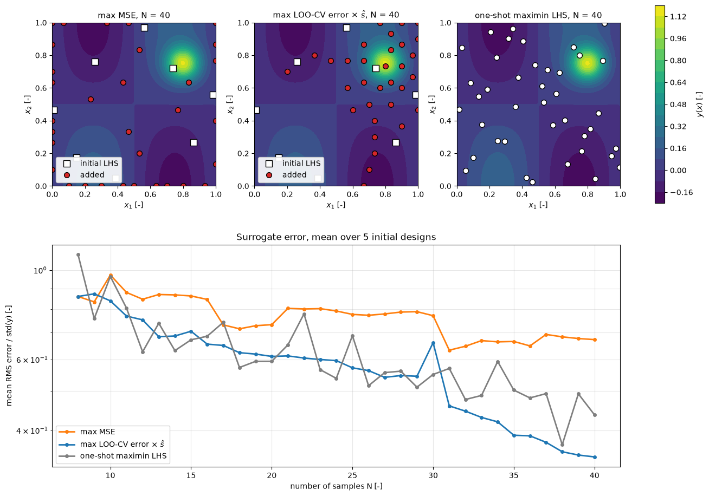

# Adaptive Sampling

Adaptive (sequential, or a posteriori) sampling builds the design in stages. After a small initial design has been evaluated, each new sample is placed where the current surrogate suggests it will help most, the surrogate is refitted, and the process repeats until the budget is spent or the model is accurate enough. Because the response of a CFD model is rarely equally difficult everywhere, for example where the flow switches between attached and separated, this reaches a given accuracy with fewer runs than a one-stage design that spreads the samples evenly. This note states the sequential design problem, describes exploration, exploitation and balanced infill criteria, compares two of them numerically, and covers stopping rules and batch infill for parallel CFD runs.

The initial design comes from [One-Stage Sampling](one_stage_sampling.md). When the goal is to find an optimum rather than an accurate global model, the same loop is Bayesian optimization; its expected-improvement criterion is derived in [Optimization with CFD and Machine Learning](../../machine_learning/flow/optimization.md).

## Problem Statement

Let $`D_n = \{(x^{(i)}, y_i)\}_{i=1}^{n}`$ be the data after $n$ evaluations of the expensive function $y(x)$ on $\Omega \subset \mathbb{R}^d$, and $\hat{y}_n$ the surrogate fitted to it. Starting from an initial design of $n_0$ points, choose the next point as the maximizer of an infill criterion,

```math
x^{(n+1)} = \arg\max_{x \in \Omega}\ a(x;\, D_n, \hat{y}_n)
```

evaluate $y(x^{(n+1)})$, add it to the data, refit, and repeat until a stopping rule is met or $n = N_{\max}$. For global modelling the aim is the smallest error of the final surrogate over $\Omega$ for a given $N_{\max}$, or the smallest $N$ for a target error; for optimization it is the best value of $y$ found. The difficulties are that the criterion must be computed from the surrogate alone, which can be wrong exactly where it is confident; that maximizing $a$ is itself a multimodal optimization in $d$ dimensions; and that CFD runs take hours, so on a cluster several points must be chosen before any of their results are known.

## The Sequential Loop

1. Evaluate an initial space-filling design of $n_0$ points, often a third to a half of the budget or about $5d$ to $10d$ points.
2. Fit the surrogate, including its hyperparameters. For kriging, refit $\theta$ by maximum likelihood at every stage, or every few stages, because the first estimates from few samples are unreliable.
3. Evaluate the infill criterion on candidates in $\Omega$ and pick its maximizer, or a batch of points.
4. Run the CFD cases, add the results to the data, and check the stopping rule.
5. Return to step 2.

Adaptive strategies do not require knowing $N_{\max}$ in advance; the process can stop when the error estimate is small enough, which a fixed Latin hypercube cannot do.

## Exploration Criteria

Exploration places samples where the surrogate is uncertain or where samples are sparse, so that no important feature is missed.

### Maximum Mean Squared Error

Kriging provides the MSE of its prediction. For ordinary or universal kriging (see [Kriging](kriging.md)),

```math
\mathrm{MSE}[\hat{y}(x)] = \sigma^2 \left( 1 -
\begin{pmatrix} r(x)^T & f(x)^T \end{pmatrix}
\begin{pmatrix} R & F \\ F^T & 0 \end{pmatrix}^{-1}
\begin{pmatrix} r(x) \\ f(x) \end{pmatrix}
\right)
```

where $r(x)$ is the correlation vector between $x$ and the sample points and $F$ is the regression matrix of the trend. The MSE vanishes at existing samples and grows with the distance from them. As the distance becomes large, $r(x)$ approaches zero, and the MSE approaches $\sigma^2(1 + f(x)^T(F^T R^{-1} F)^{-1} f(x))$, which exceeds $\sigma^2$ because the trend has been estimated (Exercise 4). The max-MSE criterion picks

```math
x^{(n+1)} = \arg\max_{x \in \Omega}\ \mathrm{MSE}[\hat{y}_n(x)]
```

For fixed hyperparameters the MSE depends only on the sample locations, not on the sampled values $y_i$. The criterion is therefore a space-filling rule shaped by the correlation lengths: it fills the largest gaps, measured in units of the fitted length scales. For a Gaussian process it is also the greedy maximum-entropy design, since the entropy of a Gaussian prediction grows with its variance (Shewry and Wynn, 1987). The weakness is the same independence of the data: max-MSE sampling cannot know that one region is harder than another, and because points on the boundary of $\Omega$ have neighbours on one side only, it tends to place many samples on the boundary.

### Integrated Mean Squared Error

A more global variant chooses the point that most reduces the MSE integrated over the domain after it is added,

```math
x^{(n+1)} = \arg\min_{x \in \Omega} \int_\Omega \mathrm{MSE}\left[\hat{y}_{n+1}(x' \mid x)\right] dx'
```

where $\hat{y}_{n+1}(\cdot \mid x)$ is the model with $x$ added. Because the MSE does not depend on the unknown $y(x)$, this can be evaluated before the run. It avoids the bias toward the boundary but costs an integral over $\Omega$ for every candidate.

## Exploitation Criteria

Exploitation uses the sampled values. For optimization this means sampling where the surrogate predicts good values, for example the minimum of $\hat{y}$; used alone it converges to wherever the surrogate is optimistic, which may be a fitting artefact. For global modelling it means sampling where the surrogate appears to be wrong. Cross-validation gives such an indicator. Let $`\hat{y}_{-i}`$ be the surrogate rebuilt without sample $`i`$. The LOO error $`|y_i - \hat{y}_{-i}(x^{(i)})|`$ is large where a sample carries information that its neighbours do not, that is, where the response is complex. For kriging and RBF models all LOO errors follow from one matrix inverse (see the validation section of [Surrogate Models in CFD](intro.md)). The LOO error is only defined at the samples, and a criterion needs it everywhere, which leads to the balanced criteria below.

## Balanced Criteria

### Expected Improvement

For minimization, the expected improvement over the best value so far, $y_{\min}$, of a Gaussian prediction with mean $\hat{y}$ and standard deviation $\hat{s}$ is

```math
\mathrm{EI}(x) = (y_{\min} - \hat{y})\,\Phi(z) + \hat{s}\,\varphi(z),
\qquad z = \frac{y_{\min} - \hat{y}}{\hat{s}}
```

with $\Phi$ and $\varphi$ the standard normal CDF and PDF. It increases both as $\hat{y}$ decreases (exploitation) and as $\hat{s}$ increases (exploration). Maximizing it with a kriging model is the efficient global optimization (EGO) algorithm of Jones, Schonlau and Welch (1998). The derivation, its variants and a worked example are in [Optimization with CFD and Machine Learning](../../machine_learning/flow/optimization.md).

### Cross-Validation Error Times Uncertainty

For global modelling, the LOO idea can be extended to any $x \in \Omega$ through the indicator

```math
e(x) = \frac{1}{N} \sum_{i=1}^{N} \left|\hat{y}_{-i}(x) - \hat{y}(x)\right|
```

which measures how much the prediction at $x$ changes when individual samples are removed. Regions where $e(x)$ is large are those in which the surrogate depends strongly on single points. The indicator is not zero at the samples, so it is combined with a factor that is, either the distance to the nearest sample or the kriging standard deviation:

```math
x^{(n+1)} = \arg\max_{x \in \Omega}\ e(x)\,\mathrm{dist}(x, X)
\qquad \text{or} \qquad
x^{(n+1)} = \arg\max_{x \in \Omega}\ e(x)\,\hat{s}(x)
```

Both products vanish at the existing samples and shift the focus to regions that are both uncertain and poorly modelled. Computing $\hat{y}_{-i}$ with the hyperparameters of the full model costs $N$ extra solves of size $N - 1$ per stage, small compared with a CFD run.

### Voronoi-Based Criteria

Crombecq et al. (2011) split the decision into two scores. Exploration is measured by the volume of the Voronoi cell of each sample, the set of points of $\Omega$ closer to it than to any other sample, estimated by Monte Carlo. Exploitation is measured by a local nonlinearity score from the residual of a local linear (gradient) fit through the neighbours of each sample, the LOLA estimate. The sample with the largest combined score has its cell refined by a new point placed far from the existing samples inside that cell. The approach works with any surrogate, since it uses only the data, and it scales to moderate dimensions because the Voronoi volumes are estimated by sampling rather than computed exactly.

## Comparison on a Test Function



The [Adaptive Sampling with Kriging](../../../scripts/algorithms/adaptive_sampling_kriging/) script applies the max-MSE and the $`e(x)\,\hat{s}(x)`$ criteria to a 2D function with a smooth background and a narrow peak near $(0.8, 0.75)$, starting from an 8-point maximin Latin hypercube and adding points one at a time up to 40, with kriging hyperparameters refitted at every stage. The reference is a one-shot maximin Latin hypercube of each size. The mean normalized RMS errors over five initial designs are:

| $N$ | 8 | 16 | 24 | 32 | 40 |
| --- | --- | --- | --- | --- | --- |
| max MSE | 0.859 | 0.845 | 0.791 | 0.646 | 0.672 |
| LOO-CV $\times \hat{s}$ | 0.859 | 0.654 | 0.596 | 0.446 | 0.343 |
| one-shot maximin LHS | 1.091 | 0.685 | 0.538 | 0.477 | 0.437 |

In the designs shown, max-MSE sampling places 25 of its 32 new points on the boundary of the square and only two near the peak, and ends up worse than a one-shot design of the same size. The cross-validation criterion concentrates samples around the peak and ends with about 20% less error than the one-shot design. Exploration alone is not enough when the difficulty of the response varies over $\Omega$; the criterion must see the data.

## Stopping Criteria

- The budget: $n = N_{\max}$, or a wall-clock or core-hour limit.
- An error estimate below a tolerance: the LOO-CV RMS error, or the error on a small independent test set, relative to the range of $y$ or to the accuracy the application needs (one drag count, a fraction of a degree in a flow angle).
- The maximum of the normalized MSE, $\max_x \mathrm{MSE}(x)/\hat{\sigma}^2$, below a tolerance, which says the model considers itself certain everywhere. This is only as reliable as the hyperparameters.
- Stagnation: the change of the surrogate between stages, for example $\lVert \hat{y}_{n+1} - \hat{y}_n \rVert$ on a test grid, stays small for several stages.
- For optimization, the largest expected improvement below a fraction of the improvement that matters.

Several rules are usually combined, with the budget as the hard limit. A test set made of the adaptively chosen points is biased toward the regions the criterion found difficult and overstates the error; a separate space-filling test set gives an unbiased estimate (see [Design of Experiments and Dataset Construction](../../machine_learning/automotive_aerodynamics/datasets.md)).

## Batch and Parallel Infill

On a cluster it is more efficient to run $q$ CFD cases at once than one after another, so the criterion must select $q$ points before any of their results are known. The exact solution, maximizing a multi-point criterion such as the $q$-point expected improvement, is expensive. Ginsbourger, Le Riche and Carraro (2010) proposed two heuristics that reuse the one-point criterion:

1. Select $x^{(n+1)}$ by maximizing the criterion on the current model.
2. Pretend the result is known: the kriging believer sets $`y(x^{(n+1)}) = \hat{y}_n(x^{(n+1)})`$, and the constant liar sets it to a fixed value $`L`$, for example $`y_{\min}`$ (optimistic), $\max_i y_i$ (pessimistic) or the mean.
3. Add the fake point to the data without refitting the hyperparameters, and repeat from step 1 until $q$ points are chosen.
4. Run the $q$ cases in parallel, replace the fake values with the true ones, and refit.

Because the fake point reduces the MSE around it to zero, the next selection moves elsewhere, which is what spreads the batch. For the max-MSE criterion with fixed hyperparameters this is not even an approximation: the MSE does not depend on the sampled values, so the batch is the same as $q$ sequential steps (Exercise 5). For EI and cross-validation criteria the fake value matters, and the optimistic liar pushes the batch toward exploitation, the pessimistic one toward exploration.

## Practical Issues

- Searching for the maximizer. A grid of candidates is fine in one or two dimensions; in higher dimensions use a large space-filling candidate set or a multi-start optimizer on the criterion, which is cheap to evaluate. Splitting $\Omega$ into cells, for example aligned with the correlation lengths $1/\theta_k$, assigning each cell an error measure and refining only the worst cells reduces the search to a few regions.
- Clustering. Criteria that see the data place points close together near difficult features, which makes the kriging correlation matrix ill-conditioned. A small nugget, or a minimum distance between new and existing points, prevents this.
- Deceptive starts. If the initial design misses a feature entirely, the surrogate is confidently smooth there, and neither the MSE nor cross-validation will point to it. A reasonable initial design and a share of pure exploration guard against this.
- Constraints and failed runs. Points where the mesher or solver fails carry information too; record them and either exclude the region or model the probability of failure, rather than silently resampling.

## Key Takeaways

- Sequential designs choose each new sample from the current surrogate and can stop as soon as the model is accurate enough.
- Max-MSE sampling is pure exploration; with fixed hyperparameters it ignores the sampled values and favours the boundary.
- Cross-validation, Voronoi-LOLA and expected-improvement criteria balance exploration with information from the data.
- On a function with a local feature, the cross-validation criterion beat both max-MSE and a one-shot Latin hypercube; max-MSE was no better than the one-shot design.
- Batches for parallel CFD runs can be chosen with the kriging believer or constant liar heuristics.

## Related Scripts

- [Adaptive Sampling with Kriging](../../../scripts/algorithms/adaptive_sampling_kriging/): grows a kriging surrogate of a 2D test function from an 8-point maximin Latin hypercube to 40 samples with max-MSE and LOO-CV infill criteria and compares both with one-shot maximin Latin hypercubes of the same size.
- [Bayesian Optimization](../../../scripts/algorithms/bayesian_optimization/): minimizes a one-dimensional drag-like test function and the two-dimensional Branin function by Bayesian optimization: a Gaussian-process (GP) surrogate with a squared-exponential kernel, hyperparameters fitted by maximum marginal likelihood, and the expected-improvement (EI) acquisition function of the EGO algorithm.
- [Kriging Interpolation](../../../scripts/algorithms/kriging_interpolation/): builds an ordinary kriging model of the Forrester function from nine samples with a compactly supported cubic correlation, estimates $\theta$ by maximum likelihood and compares the predictor and its uncertainty band for three values of $\theta$.
- [Sampling Strategies Comparison](../../../scripts/plots/sampling_strategies_comparison/): compares random, Latin hypercube and scrambled Sobol designs of the same size in a 2D design space, showing their point layouts, their 1D marginal histograms and how their centred $L_2$ discrepancy falls with the number of samples.

## Exercises

**Exercise 1.** A 1D surrogate is the piecewise-linear interpolant of the data $(0, 0)$, $(0.5, 1)$ and $(1, 0)$, extended linearly beyond its end points. For each sample compute the leave-one-out error $|\hat{y}_{-i}(x^{(i)}) - y_i|$. Which samples are most influential, and what does this say about CV-based criteria near the domain boundary?

<details>
<summary>Answer</summary>

- Remove $x = 0.5$: the interpolant of $(0,0)$ and $(1,0)$ is $0$, so the error is $1$.
- Remove $x = 0$: the line through $(0.5, 1)$ and $(1, 0)$ is $2 - 2x$, which predicts $2$ at $x = 0$, so the error is $2$.
- Remove $x = 1$: the line $2x$ predicts $2$ at $x = 1$, so the error is $2$.

The end points look most influential because removing them turns interpolation into extrapolation. CV error indicators tend to be inflated near the boundary of $\Omega$, and in practice they are combined with a distance or MSE factor, as in the note.

</details>

**Exercise 2.** For minimization, the expected improvement is $`\mathrm{EI}(x) = (y_{\min} - \hat{y})\,\Phi(z) + \hat{s}\,\varphi(z)`$ with $z = (y_{\min} - \hat{y})/\hat{s}$. With $y_{\min} = 1.0$, compare candidate A ($\hat{y} = 1.2$, $\hat{s} = 0.3$) with candidate B ($\hat{y} = 0.95$, $\hat{s} = 0.05$). Which is chosen, and what happens if $\hat{s}_A = 0.4$?

<details>
<summary>Answer</summary>

- A: $z = -0.667$, $\Phi = 0.2525$, $\varphi = 0.3194$, so $\mathrm{EI} = -0.2 \times 0.2525 + 0.3 \times 0.3194 = 0.0453$.
- B: $z = 1$, $\Phi = 0.8413$, $\varphi = 0.2420$, so $\mathrm{EI} = 0.05 \times 0.8413 + 0.05 \times 0.2420 = 0.0542$.

B is chosen: exploitation near the current best. With $\hat{s}_A = 0.4$: $z = -0.5$, $\Phi = 0.3085$, $\varphi = 0.3521$, so $\mathrm{EI}_A = 0.0791$ and A (exploration) wins. EI balances the two through the uncertainty $\hat{s}$.

</details>

**Exercise 3.** An ordinary kriging model (constant trend, $f(x) = 1$) has samples at $x = 0$ and $x = 1$ and correlation $R(h) = \exp(-\theta h^2)$ with $\theta = 2$. Evaluate $\mathrm{MSE}/\sigma^2$ at $x = 0.5$ with the formula of this note. Is $x = 0.5$ the maximum-MSE point in $[0, 1]$?

<details>
<summary>Answer</summary>

$`R = \begin{pmatrix} 1 & \rho \\ \rho & 1 \end{pmatrix}`$ with $\rho = e^{-2} = 0.1353$, $F = (1, 1)^T$, and $r(0.5) = (e^{-0.5}, e^{-0.5}) = (0.6065, 0.6065)$. Eliminating the block system gives

```math
\frac{\mathrm{MSE}}{\sigma^2} = 1 - r^T R^{-1} r +
\frac{\left(F^T R^{-1} r - 1\right)^2}{F^T R^{-1} F}
```

The pieces are $r^T R^{-1} r = 2r^2/(1 + \rho) = 0.6480$, $F^T R^{-1} r = 2r/(1 + \rho) = 1.0685$ and $F^T R^{-1} F = 2/(1 + \rho) = 1.7616$. So $\mathrm{MSE}/\sigma^2 = 1 - 0.6480 + 0.0685^2/1.7616 = 0.3546$. By symmetry $x = 0.5$ is a stationary point, and a scan over $[0, 1]$ confirms it is the maximum. The max-MSE criterion therefore picks the midpoint, as a space-filling rule would.

</details>

**Exercise 4.** Show that far from all samples, where $r(x) \to 0$, the MSE formula tends to $\sigma^2\left(1 + f(x)^T (F^T R^{-1} F)^{-1} f(x)\right)$. Evaluate the limit for the model of Exercise 3, and explain why it exceeds $\sigma^2$.

<details>
<summary>Answer</summary>

With $S = F^T R^{-1} F$, the block inverse is

```math
\begin{pmatrix} R & F \\ F^T & 0 \end{pmatrix}^{-1} = \begin{pmatrix} R^{-1} - R^{-1}F S^{-1} F^T R^{-1} & R^{-1}F S^{-1} \\ S^{-1}F^T R^{-1} & -S^{-1} \end{pmatrix}
```

With $r = 0$ the quadratic form reduces to the lower-right block: $(0, f)^T M^{-1} (0, f) = -f^T S^{-1} f$. Hence $\mathrm{MSE} \to \sigma^2(1 + f^T S^{-1} f)$.

For Exercise 3, $S = 1.7616$, so the limit is $`\sigma^2(1 + 1/1.7616) = 1.5677\,\sigma^2`$. It exceeds the process variance because, besides the random fluctuation $z(x)$, the trend coefficient $\beta$ is estimated from only two samples, and its uncertainty adds to the prediction error.

</details>

**Exercise 5.** Two CFD cases can run in parallel. Starting from the model of Exercise 3 (samples at 0 and 1, $\theta = 2$ fixed), choose a batch of two points by the kriging believer heuristic with the max-MSE criterion. Show that the result does not depend on the believed value, and find the second point.

<details>
<summary>Answer</summary>

The first point is the maximizer of the MSE, $x = 0.5$, from Exercise 3. The believer adds $(0.5, \hat{y}(0.5))$ to the data. The MSE formula involves only $R$, $r(x)$, $F$ and $f(x)$, which depend on the locations $0, 0.5, 1$ and on $\theta$, not on the $y$ values, so $\mathrm{MSE}/\sigma^2$ after the addition is the same for any believed value (only the estimate of $\sigma^2$ would change, which scales the MSE uniformly and does not move its maximum). Scanning $[0, 1]$ with the three-point model gives the maximum $\mathrm{MSE}/\sigma^2 = 0.0183$ at $x = 0.2296$, and by symmetry the same value at $x = 0.7704$; either can be the second point. The maximum lies slightly closer to the end sample than to the middle one, because the end sample has a neighbour on one side only. For criteria that use the values, such as EI or the cross-validation indicator, the believed value does change the second point.

</details>

## References

- M. C. Shewry and H. P. Wynn, "Maximum entropy sampling", *Journal of Applied Statistics* 14(2), 165–170, 1987.
- J. Sacks, W. J. Welch, T. J. Mitchell and H. P. Wynn, "Design and analysis of computer experiments", *Statistical Science* 4(4), 409–423, 1989.
- D. R. Jones, M. Schonlau and W. J. Welch, "Efficient global optimization of expensive black-box functions", *Journal of Global Optimization* 13(4), 455–492, 1998.
- A. I. J. Forrester, A. Sóbester and A. J. Keane, *Engineering Design via Surrogate Modelling: A Practical Guide*, Wiley, 2008.
- D. Ginsbourger, R. Le Riche and L. Carraro, "Kriging is well-suited to parallelize optimization", in Y. Tenne and C.-K. Goh (eds.), *Computational Intelligence in Expensive Optimization Problems*, Springer, 131–162, 2010.
- K. Crombecq, D. Gorissen, D. Deschrijver and T. Dhaene, "A novel hybrid sequential design strategy for global surrogate modeling of computer experiments", *SIAM Journal on Scientific Computing* 33(4), 1948–1974, 2011.
- H. Liu, Y.-S. Ong and J. Cai, "A survey of adaptive sampling for global metamodeling in support of simulation-based complex engineering design", *Structural and Multidisciplinary Optimization* 57(1), 393–416, 2018.
