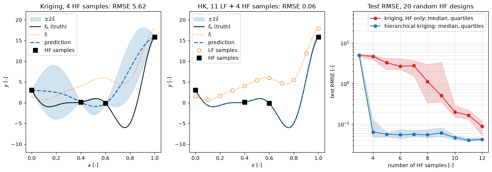

# Hierarchical Kriging and Variable-Fidelity Modelling

In many CFD studies the same output can be computed at more than one level of fidelity: on a coarse and a fine mesh, with an Euler and a RANS solver, with a panel method and a RANS solver, or with a converged and a partly converged run. The cheap low-fidelity (LF) model is less accurate but often captures the trends, and the expensive high-fidelity (HF) model is accurate but affordable only at a few points. Variable-fidelity modelling (VFM) combines many LF and few HF samples into one surrogate that is more accurate than either data set gives on its own. This note describes correction-based methods and co-kriging briefly and hierarchical kriging in detail: its predictor, mean squared error, hyperparameters, a worked example and the cost considerations that decide whether a second fidelity is worth using.

The single-fidelity kriging model on which everything here builds is derived in [Kriging](kriging.md).

## Problem Statement

Two models of the same quantity are available on $\Omega \subset \mathbb{R}^d$: the HF response $y(x)$ at a cost $c_h$ per evaluation, and the LF response $y_l(x)$ at a cost $c_l \ll c_h$. The data are $n_l$ LF samples $Y_l$ at $X_l$ and $n_h$ HF samples $Y$ at $X_h$, usually with $n_l \gg n_h$. Build a predictor $\hat{y}(x)$ of the HF response, with an error estimate, that interpolates the HF data and is as accurate as possible for the total cost

```math
C = n_h c_h + n_l c_l
```

The method succeeds when $\hat{y}$ is more accurate than kriging on $n_h + n_l c_l/c_h$ HF samples, the HF-only design of the same cost. The difficulty is that the relation between the two fidelities is unknown and may vary over $\Omega$: the LF model may be offset, scaled, shifted in $x$, or wrong in part of the domain, and the few HF samples must reveal which.

## Approaches to Variable-Fidelity Modelling

### Correction Functions

The oldest approach fits a surrogate to the discrepancy between the fidelities at the HF points and adds it to the LF model. The correction can be additive, $\hat{y}(x) = y_l(x) + \hat{\delta}(x)$ with $\delta = y - y_l$; multiplicative, $`\hat{y}(x) = \hat{\gamma}(x)\, y_l(x)`$ with $\gamma = y/y_l$; or a weighted combination of the two. Correction functions are simple and work with any surrogate of the discrepancy, but the user has to choose the form, and a multiplicative correction is ill-defined where $y_l$ is close to zero.

### Co-Kriging

Kennedy and O'Hagan (2000) model the HF response as a scaled LF Gaussian process plus an independent discrepancy process,

```math
y(x) = \rho\, y_l(x) + \delta(x),
\qquad
\mathrm{Cov}[y_l(x), y_l(x')] = \sigma_l^2 R_l(x, x'),
\qquad
\mathrm{Cov}[\delta(x), \delta(x')] = \sigma_d^2 R_d(x, x')
```

The combined data vector $(Y_l, Y)$ is then jointly Gaussian with the block covariance matrix

```math
C = \begin{pmatrix} \sigma_l^2 R_l(X_l, X_l) & \rho\,\sigma_l^2 R_l(X_l, X_h) \\ \rho\,\sigma_l^2 R_l(X_h, X_l) & \rho^2\sigma_l^2 R_l(X_h, X_h) + \sigma_d^2 R_d(X_h, X_h) \end{pmatrix}
```

and the co-kriging predictor of $y(x)$ is the conditional mean of the joint Gaussian, with the vector of covariances between $y(x)$ and all $n_l + n_h$ data in place of $r(x)$ (Forrester, Sóbester and Keane, 2007). The parameters are the LF correlation parameters $\theta_l$, the discrepancy parameters $\theta_d$, the scale $\rho$ and the variances. With nested designs, $X_h \subset X_l$, they can be estimated in two stages: first the LF model from $Y_l$, then $\rho$, $\theta_d$ and $\sigma_d^2$ from the discrepancies $`Y - \rho\,Y_l(X_h)`$. Co-kriging is the most complete model, but it needs a covariance matrix of size $n_l + n_h$, more hyperparameters, and in its simplest form nested designs.

### Hierarchical Kriging

Han and Görtz (2012) take a simpler route: build an ordinary kriging model $\hat{y}_l(x)$ of the LF data first, and then use it, scaled by an unknown factor, as the trend of a kriging model of the HF data. The LF information enters only through the trend, the HF model has the size $n_h$ of the HF data, and the designs need not be nested. The rest of this note develops this model.

## Hierarchical Kriging Model

Hierarchical kriging modifies the standard kriging model by replacing the regression trend $f(x)^T\beta$ with the LF predictor, scaled by a factor $\beta_0$:

```math
y(x) = \beta_0\,\hat{y}_l(x) + z(x), \qquad x \in \Omega \subset \mathbb{R}^d
```

The term $z(x)$ is a zero-mean stationary Gaussian process with variance $\sigma^2$ and correlation function $R$, which models the deviation of the HF response from the scaled LF trend. In classical kriging the deterministic part is a constant or a polynomial. Using $\hat{y}_l(x)$ instead puts prior knowledge from a simpler model directly into the trend. When the LF model has the right shape, the remaining deviation $z$ is smoother and smaller than $y$ itself, so it can be modelled from fewer HF samples. Since $\hat{y}_l$ is itself a kriging model, it can be built from any number of LF samples at any locations.

## Hierarchical Kriging Predictor

As in standard kriging, the predictor $\hat{y}(x)$ at an arbitrary point $x$ is a weighted linear combination of the known HF responses $Y = (y(x^{(1)}), \dots, y(x^{(n_h)}))^T$:

$$
\hat{y}(x) = \lambda(x)^T Y
$$

where $\lambda(x) \in \mathbb{R}^{n_h}$ is a vector of weights determined by solving a linear system that ensures both unbiasedness and minimal mean squared error.

Define the correlation matrix $R \in \mathbb{R}^{n_h \times n_h}$ of the HF samples and the vector $r(x) \in \mathbb{R}^{n_h}$ of correlations between $x$ and the HF sample points. In hierarchical kriging the regression matrix of standard kriging becomes the vector of LF predictions at the HF samples,

```math
F = \left(\hat{y}_l(x^{(1)}), \dots, \hat{y}_l(x^{(n_h)})\right)^T \in \mathbb{R}^{n_h},
\qquad
f(x) = \hat{y}_l(x)
```

Unbiasedness for every $\beta_0$ requires $F^T\lambda(x) = f(x)$, and minimizing the MSE under this constraint gives the system

```math
\begin{pmatrix}
R & F \\ F^T & 0
\end{pmatrix}
\begin{pmatrix}
\lambda(x) \\ \mu(x)
\end{pmatrix} =
\begin{pmatrix}
r(x) \\ f(x)
\end{pmatrix}
```

Solving this system yields $\lambda(x)$ and the Lagrange multiplier $\mu(x)$, which in turn give the prediction $\hat{y}(x) = \lambda(x)^T Y$.

### Closed-Form Predictor and Interpretation

Using the symmetry of the block matrix, the predictor can be written as

```math
\hat{y}(x) =
\begin{pmatrix}
r(x)^T & f(x)
\end{pmatrix}
\begin{pmatrix}
R & F \\ F^T & 0
\end{pmatrix}^{-1}
\begin{pmatrix}
Y \\ 0
\end{pmatrix}
```

With the generalized least-squares scaling factor

```math
\beta_0 = \left(F^T R^{-1} F\right)^{-1} F^T R^{-1} Y
```

this becomes

```math
\hat{y}(x) = \beta_0\,\hat{y}_l(x) + r(x)^T R^{-1}(Y - \beta_0 F)
```

This form mirrors standard kriging, with the regression term replaced by the scaled LF model. The factor $\beta_0$ scales the LF model so that $\beta_0\hat{y}_l$ fits the global trend of the HF data, and the term $r(x)^T R^{-1}(Y - \beta_0 F)$ interpolates the remaining residuals through the correlation function, so the model reproduces the HF data exactly (Exercise 2).

### Mean Squared Error

The MSE follows from the kriging formula with $f(x) = \hat{y}_l(x)$:

```math
\mathrm{MSE}[\hat{y}(x)] = \sigma^2\left[1 - r^T R^{-1} r + \frac{\left(r^T R^{-1} F - \hat{y}_l(x)\right)^2}{F^T R^{-1} F}\right]
```

It is zero at the HF samples and grows between them. Unlike co-kriging, it treats $\hat{y}_l$ as exact and does not include the uncertainty of the LF model, so it underestimates the error where the LF samples are sparse.

### Hyperparameters

The LF model is fitted first, as ordinary kriging, with its own correlation parameters $\theta_l$. The HF parameters follow from the concentrated log-likelihood of [Kriging](kriging.md) with $F$ in place of the regression matrix,

```math
\ln L_c(\theta) = -\frac{n_h}{2}\ln\hat{\sigma}^2(\theta) - \frac{1}{2}\ln\det R(\theta),
\qquad
\hat{\sigma}^2 = \frac{(Y - \beta_0 F)^T R^{-1}(Y - \beta_0 F)}{n_h}
```

which involves only $n_h \times n_h$ matrices. The two fits are independent, so the method extends to more than two fidelities by recursion: the model of level $k$ becomes the trend of level $k + 1$.

### Implementation

In practice, the preferred formulation for implementation is the block form. Rather than recomputing anything per prediction point, one solves once

```math
\begin{pmatrix}
R & F \\ F^T & 0
\end{pmatrix}
\begin{pmatrix}
w^{(Y)} \\ w^{(f)}
\end{pmatrix} =
\begin{pmatrix}
Y \\ 0
\end{pmatrix}
```

The vector $(w^{(Y)}, w^{(f)})$ is independent of $x$ and can be stored; $w^{(f)} = \beta_0$ and $w^{(Y)} = R^{-1}(Y - \beta_0 F)$. The prediction at a new point is then $`\hat{y}(x) = r(x)^T w^{(Y)} + \hat{y}_l(x)\, w^{(f)}`$, one evaluation of the LF kriging model and one dot product.

## Interpreting the Correction Terms

When the LF model closely approximates the HF response at the sample points, $\beta_0$ approaches unity and only minor corrections are needed from the correlation terms. If the LF model has the right shape but the wrong amplitude, $\beta_0$ absorbs the scale; in the limit $Y = cF$ the correction vanishes and the predictor is exactly $`c\,\hat{y}_l(x)`$ (Exercise 4). If the LF model is only a rough approximation, the correlation correction $r(x)^T R^{-1}(Y - \beta_0 F)$ carries most of the information and pulls the prediction toward the HF data near the samples, while far from them the prediction reverts to $\beta_0\hat{y}_l(x)$. In every case the final model reproduces the HF data exactly. A negative or very small $\beta_0$ is a warning that the LF model does not resemble the HF one, or that there are too few HF samples to estimate the relation.

## Worked Example: the Forrester Function

Forrester, Sóbester and Keane (2007) introduced a one-dimensional test case that has become the standard check of multi-fidelity methods. The HF function and the LF function on $[0, 1]$ are

```math
y(x) = (6x - 2)^2 \sin(12x - 4),
\qquad
y_l(x) = A\,y(x) + B(x - 0.5) - C,
\qquad A = 0.5,\; B = 10,\; C = -5
```

The LF function is a scaled HF function plus a linear trend, so $y - 2y_l = -20x$ is linear: the HF response is twice the LF response plus a smooth correction. The two functions are nevertheless poorly correlated in the usual sense: the squared Pearson correlation between them over $[0, 1]$ is only $r^2 = 0.54$, because the added linear trend dominates the LF curve: it varies between about 0.7 and 17.9 over the interval, rising almost monotonically, and has only a shallow dip where the HF curve has its deep minimum.



The left panel fits ordinary kriging to the four HF samples $x = 0, 0.4, 0.6, 1$ of the original paper. The samples miss the valley near $x = 0.76$, so the predictor has an RMS error of 5.62, and the truth leaves the $\pm 2\hat{s}$ band there. The middle panel builds the LF kriging model from 11 equally spaced LF samples and uses it as the trend for the same four HF samples. The fitted scaling factor is $\beta_0 = 1.993$, close to $1/A = 2$, the likelihood drives the correlation parameter of the correction to its lower bound (an almost linear correction), and the RMS error falls to 0.059. The right panel repeats the comparison for random Latin hypercube HF designs of 3 to 12 points:

| HF samples | 3 | 4 | 6 | 8 | 10 | 12 |
| --- | --- | --- | --- | --- | --- | --- |
| Median RMSE, kriging on HF only | 4.96 | 4.68 | 2.66 | 1.13 | 0.198 | 0.088 |
| Median RMSE, hierarchical kriging | 4.98 | 0.064 | 0.055 | 0.054 | 0.047 | 0.042 |

From four HF samples on, hierarchical kriging is one to two orders of magnitude more accurate. With three samples neither model can identify its hyperparameters and both fail. The hierarchical error levels off near 0.05, which is the error of the LF kriging model (0.028 against $y_l$) multiplied by $\beta_0 \approx 2$: beyond that point, more LF samples help more than more HF samples.

## Choosing a Method and the Cost Ratio

| Method | Relation assumed | Designs | Model size | Error estimate | Use when |
| --- | --- | --- | --- | --- | --- |
| Additive or multiplicative correction | $y = y_l + \delta$ or $`y = \gamma\,y_l`$ | Any; $y_l$ needed at $X_h$ | $n_h$ | From the surrogate of $\delta$ only | The discrepancy is known to be smooth, or the LF model is a closed-form or very cheap code |
| Co-kriging | $`y = \rho\,y_l + \delta`$, both Gaussian processes | Nested for the simple two-stage fit | $n_l + n_h$ | Includes LF uncertainty | Moderate $n_l$, best accuracy needed, honest error bars for adaptive sampling |
| Hierarchical kriging | $y = \beta_0\hat{y}_l + z$ | Any | $n_l$ and $n_h$ separately | Treats $\hat{y}_l$ as exact | Many LF samples, several fidelity levels, simple implementation |

A second fidelity pays off only if two conditions hold. The LF model must carry information that the HF samples lack, which in practice means that the HF response minus a scaled LF response is simpler than the HF response itself. The Forrester case shows that the correlation coefficient between the two fidelities is a poor guide to this ($r^2 = 0.54$ there, yet the correction is linear), although in general a low correlation is a warning sign (Toal, 2015). And the LF runs must be cheap enough. With a cost ratio $c_h/c_l$, the 11 LF and 4 HF samples of the example cost as much as $`4 + 11\,c_l/c_h`$ HF runs: 6.2 for a ratio of 5, 5.1 for 10 and 4.1 for 100. Kriging on HF data alone needs about 12 samples to approach the accuracy that hierarchical kriging reaches with four, so the multi-fidelity design is cheaper for any cost ratio above about 1.4. For CFD, where a coarse mesh is typically 4 to 8 times cheaper per refinement level in 2D and 8 to 16 times in 3D, and a panel method is several orders of magnitude cheaper than RANS, the ratio is rarely the limiting factor; the similarity of the fidelities is.

## Key Takeaways

- Variable-fidelity models combine many cheap LF and few expensive HF samples into one HF surrogate.
- Co-kriging models both fidelities as jointly Gaussian; hierarchical kriging uses the LF kriging predictor, scaled by $\beta_0$, as the trend of an HF kriging model.
- The hierarchical predictor is $\beta_0\hat{y}_l(x) + r^T R^{-1}(Y - \beta_0 F)$; it interpolates the HF data and its MSE ignores the LF uncertainty.
- On the Forrester case, 11 LF and 4 HF samples give an RMS error of 0.06 against 5.6 for kriging on the 4 HF samples alone.
- What matters is that the HF response minus the scaled LF response is simple, and that the LF runs are much cheaper; correlation coefficients alone can mislead.

## Related Scripts

- [Hierarchical Kriging for Multi-Fidelity Data](../../../scripts/algorithms/hierarchical_kriging_multifidelity/): fits a hierarchical kriging model to the Forrester test case, using a kriging model of 11 cheap low-fidelity samples as the trend of a kriging model of a few expensive high-fidelity samples, and compares it with ordinary kriging of the high-fidelity samples alone.
- [Kriging Interpolation](../../../scripts/algorithms/kriging_interpolation/): builds an ordinary kriging model of the Forrester function from nine samples with a compactly supported cubic correlation, estimates $\theta$ by maximum likelihood and compares the predictor and its uncertainty band for three values of $\theta$.
- [Correlation Functions](../../../scripts/algorithms/correlation_functions/): plots six correlation functions used in kriging surrogate models (linear, exponential, Matérn 3/2, Matérn 5/2, cubic spline and Gaussian) for several values of the correlation parameter $\theta$.

## Exercises

**Exercise 1.** Three HF samples have values $Y = (1.2, 2.1, 3.3)$, and the LF model gives $F = (1.0, 2.0, 3.0)$ at the same points. Assuming uncorrelated residuals ($R = I$), compute the scaling factor $\beta_0 = (F^T R^{-1} F)^{-1} F^T R^{-1} Y$ and the residuals $Y - \beta_0 F$ that the correlation term must interpolate.

<details>
<summary>Answer</summary>

$F^T F = 1 + 4 + 9 = 14$ and $F^T Y = 1.2 + 4.2 + 9.9 = 15.3$, so $\beta_0 = 15.3/14 \approx 1.0929$. The residuals are $Y - \beta_0 F = (0.1071, -0.0857, 0.0214)$. The LF model underpredicts by about 9% overall, and the Gaussian-process part corrects the small remaining local differences.

</details>

**Exercise 2.** Using the form $\hat{y}(x) = \beta_0 f(x) + r(x)^T R^{-1}(Y - \beta_0 F)$, prove that hierarchical kriging interpolates the HF data: $\hat{y}(x^{(i)}) = y_i$.

<details>
<summary>Answer</summary>

At a sample point, the correlation vector is the $i$-th column of $R$, so $r(x^{(i)}) = R e_i$, and $f(x^{(i)}) = F_i$. Therefore

```math
\hat{y}(x^{(i)}) = F_i\beta_0 + e_i^T R R^{-1}(Y - F\beta_0) = F_i\beta_0 +
(y_i - F_i\beta_0) = y_i
```

This holds for any $\beta_0$ and any LF model, provided $R$ is nonsingular (no nugget term).

</details>

**Exercise 3.** The HF response is $y(x) = 2x + 0.5x(1 - x)$ and the LF model is $\hat{y}_l(x) = 2x$. HF samples are taken at $x = 0, 0.5, 1$, with correlation $R(h) = \exp(-10h^2)$. Compute $\beta_0$ and the hierarchical kriging prediction at $x = 0.25$, and compare with $\hat{y}_l(0.25)$, $\beta_0\hat{y}_l(0.25)$ and the true value.

<details>
<summary>Answer</summary>

$Y = (0, 1.125, 2)$ and $F = (0, 1, 2)$. The off-diagonal correlations are $e^{-2.5} = 0.0821$ (neighbours) and $e^{-10} \approx 4.5 \times 10^{-5}$.

Solving gives $\beta_0 = 1.0225$ and residuals $Y - \beta_0 F = (0, 0.1025, -0.0450)$. With $r(0.25) = (e^{-0.625}, e^{-0.625}, e^{-5.625})$, the prediction is $\hat{y}(0.25) = 0.5639$.

For comparison, $\hat{y}_l(0.25) = 0.5$, $\beta_0\hat{y}_l(0.25) = 0.5112$ and $y(0.25) = 0.59375$. The correlation correction closes about 68% of the gap between the LF model and the truth using only three expensive samples. The rest comes from the limited sample density and the choice of $\theta$.

</details>

**Exercise 4.** Suppose the HF data are an exact multiple of the LF values at the samples, $Y = cF$. Show that $\beta_0 = c$ and that the predictor reduces to $`\hat{y}(x) = c\,\hat{y}_l(x)`$ everywhere. Why is this a desirable property for variable-fidelity modelling?

<details>
<summary>Answer</summary>

$\beta_0 = (F^T R^{-1} F)^{-1} F^T R^{-1}(cF) = c$, so $Y - \beta_0 F = 0$ and the correlation term vanishes. Then $`\hat{y}(x) = \beta_0 f(x) = c\,\hat{y}_l(x)`$ for every $x$. When the LF model has the correct shape and is only mis-scaled, hierarchical kriging recovers the scaled model exactly and introduces no spurious bumps between samples. This is the source of its robustness compared with fitting the HF data alone.

</details>

**Exercise 5.** An HF RANS run costs 200 core-hours and an LF run on a mesh coarsened by a factor of two in each direction costs 25 core-hours. A study can afford 2000 core-hours. Compare the HF-only design with a multi-fidelity design of 6 HF and 32 LF runs. Using the Forrester results of the note as a guide, which design would you expect to be more accurate, and what must be checked first?

<details>
<summary>Answer</summary>

The HF-only design has $2000/200 = 10$ runs. The multi-fidelity design costs $6 \times 200 + 32 \times 25 = 1200 + 800 = 2000$ core-hours, the same budget; the cost ratio is $c_h/c_l = 8$. In the Forrester case, kriging on 10 HF samples has a median error of 0.20, while hierarchical kriging with 6 HF samples and 11 LF samples reaches 0.055, so the multi-fidelity design is expected to be about four times more accurate, and more LF samples would lower its error floor further. This expectation rests on the coarse-mesh results having the same shape as the fine-mesh ones up to a scale and a smooth correction. Before committing the budget, a few paired LF/HF runs should confirm that the discrepancy is smooth (for example that separation occurs at similar parameter values on both meshes); otherwise the LF runs add little.

</details>

## References

- M. C. Kennedy and A. O'Hagan, "Predicting the output from a complex computer code when fast approximations are available", *Biometrika* 87(1), 1–13, 2000.
- A. I. J. Forrester, A. Sóbester and A. J. Keane, "Multi-fidelity optimization via surrogate modelling", *Proceedings of the Royal Society A* 463(2088), 3251–3269, 2007.
- A. I. J. Forrester, A. Sóbester and A. J. Keane, *Engineering Design via Surrogate Modelling: A Practical Guide*, Wiley, 2008.
- Z.-H. Han and S. Görtz, "Hierarchical Kriging model for variable-fidelity surrogate modeling", *AIAA Journal* 50(9), 1885–1896, 2012.
- L. Le Gratiet and J. Garnier, "Recursive co-kriging model for design of computer experiments with multiple levels of fidelity", *International Journal for Uncertainty Quantification* 4(5), 365–386, 2014.
- D. J. J. Toal, "Some considerations regarding the use of multi-fidelity Kriging in the construction of surrogate models", *Structural and Multidisciplinary Optimization* 51(6), 1223–1245, 2015.
- B. Peherstorfer, K. Willcox and M. Gunzburger, "Survey of multifidelity methods in uncertainty propagation, inference, and optimization", *SIAM Review* 60(3), 550–591, 2018.
