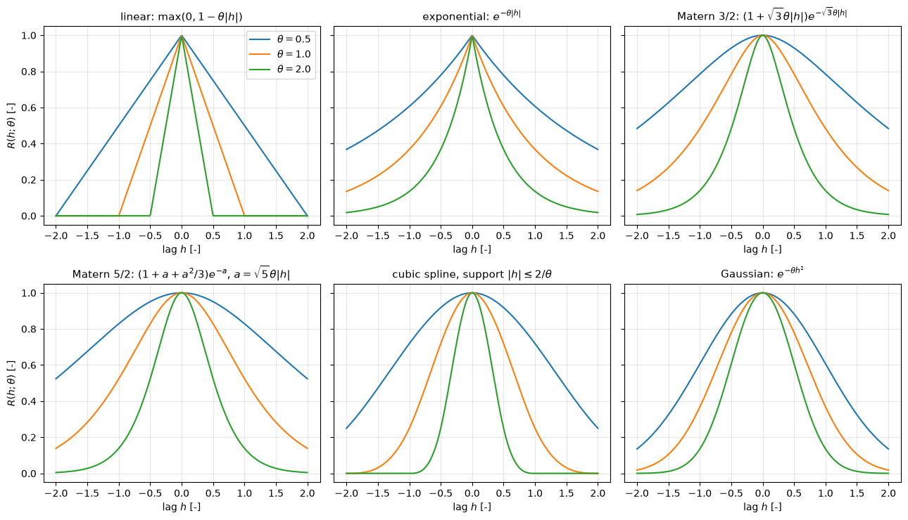
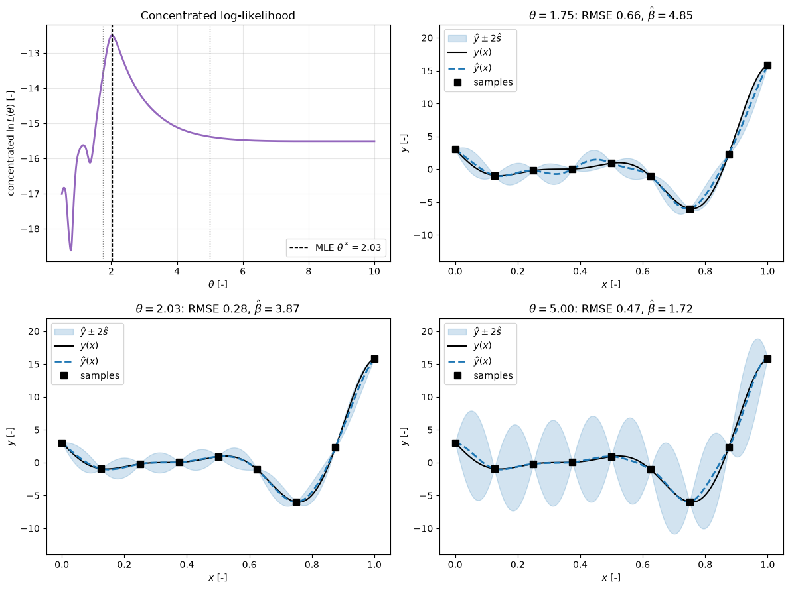

# Kriging

Kriging is a method for predicting values of a function at untried points from values observed at known sample points. It originated in geostatistics, with the work of Daniel Krige in the 1950s on estimating ore concentrations in mining. Georges Matheron later gave it a rigorous mathematical foundation and made it a cornerstone of spatial interpolation. In the 1980s Sacks and colleagues brought these ideas to deterministic computer experiments (Sacks et al., 1989), and since then kriging has been a standard surrogate model for expensive simulations in engineering and the sciences, CFD included.

The idea behind kriging is to model the data as a realization of a Gaussian process. This gives a mathematically rigorous framework for interpolation: the predictor is the best linear unbiased one under the model, and it comes with a measure of its own uncertainty. By selecting the correlation function and tuning its hyperparameters, a kriging model adapts to different kinds of behaviour, from smooth global trends to strongly nonlinear local features. In machine learning the same model is called Gaussian-process regression (Rasmussen and Williams, 2006). This note derives the predictor and its mean squared error, discusses the trend, the correlation function, the nugget and the estimation of hyperparameters, and works through a one-dimensional example.

## Problem Statement

Given $N$ distinct sample points $x^{(1)}, \dots, x^{(N)} \in \Omega \subset \mathbb{R}^d$ and responses $Y = (y_1, \dots, y_N)^T$ with $y_i = y(x^{(i)})$, typically outputs of CFD runs, predict $y(x)$ at any $x \in \Omega$ and estimate the error of that prediction. The unknown function is treated as a random process with a trend and a correlated fluctuation, whose parameters (trend coefficients $\beta$, process variance $\sigma^2$ and correlation parameters $\theta$) are estimated from the same $N$ samples. A kriging model is complete when $\theta$ has been fitted, normally by maximum likelihood, and the linear system for the predictor has been solved. It is good when its predictions agree with held-out data within the predicted uncertainty. The difficulties are that the likelihood is a multimodal function of $\theta$, that the $N \times N$ correlation matrix becomes ill-conditioned when samples are close or correlations are long, and that the cost of each likelihood evaluation grows as $N^3$.

## Model Formulation and Assumptions

Kriging treats the unknown function of interest, $y(x)$ for $x \in \Omega \subset \mathbb{R}^d$, as the sum of a global trend with known form and a stochastic fluctuation. The trend encodes what is known about the large-scale behaviour of the function, and the fluctuation accounts for the smaller-scale variations. Each observation $y_i = y(x^{(i)})$ at a sample location $x^{(i)}$ is seen as one value of a realization of a Gaussian process.

Consider a function modelled as

$$
y(x) = \sum_{j=1}^{K} \beta_j f_j(x) + z(x)
$$

where the functions $f_j(x)$ are known and capture the global or trend-like behaviour, and the coefficients $\beta_j \in \mathbb{R}$ are unknown parameters. The term $z(x)$ represents the more complex, nonlinear part of the function. It is assumed to be a realization of a Gaussian process with zero mean, variance $\sigma^2$, and a correlation structure defined by a chosen correlation function $`R(\|x-\tilde{x}\|)`$. In vector form the trend is $f(x)^T\beta$ with $f(x) = (f_1(x), \dots, f_K(x))^T$. The simplest case, $K = 1$ and $f_1 = 1$, is the model $y(x) = \mu + z(x)$ of ordinary kriging.

A key assumption is second-order stationarity, meaning that the covariance depends only on the separation of two points, not on their absolute position. Formally,

```math
\mathbb{E}[z(x)] = 0, \quad \mathrm{Cov}[z(x), z(\tilde{x})] = \sigma^2
R(\| x - \tilde{x}\|)
```

Here, $\sigma^2$ is the process variance and $`R(\|\cdot\|)`$ is a spatial autocorrelation function with $R(0) = 1$. This correlation function must be symmetric and positive definite, so that every correlation matrix built from distinct points is nonsingular and the problem has a unique and stable solution.

In practice, this implies that points closer together are more strongly correlated, and as the distance between points grows large, their correlation approaches zero. The regression part $f(x)^T \beta$ represents large-scale trends, while $z(x)$ models departures from these trends through the Gaussian process.

## The Kriging Predictor as a Best Linear Unbiased Predictor

The kriging predictor $\hat{y}(x)$ at any new point $x$ is defined as a linear combination of the observed data $Y = (y_1, \dots, y_N)^T$:

$$
\hat{y}(x) = \sum_{i=1}^N \lambda_i(x) y_i
$$

The weights $\lambda_i(x)$ depend on $x$ and are chosen to give the best linear unbiased prediction (BLUP). Best means that the mean squared error of the prediction is minimized, and unbiased means that the expected difference between $\hat{y}(x)$ and $y(x)$ is zero.

This leads to a constrained optimization problem. The predictor must be unbiased, so that for any $f(x)$ representing the known trend,

$$
\mathbb{E}[\hat{y}(x)] = f(x)^T \beta
$$

Collect the trend functions at the samples in the $N \times K$ regression matrix $F$ with $F_{ij} = f_j(x^{(i)})$, the correlations between samples in the $N \times N$ correlation matrix $R$ with $R_{ij} = R(\lVert x^{(i)} - x^{(j)} \rVert)$, and the correlations between the new point and the samples in the vector $r(x)$ with $r_i(x) = R(\lVert x - x^{(i)} \rVert)$. Since $\mathbb{E}[\lambda^T Y] = \lambda^T F \beta$, unbiasedness for every $\beta$ requires $F^T\lambda(x) = f(x)$. The prediction error is $\lambda^T Y - y(x) = \lambda^T z_X - z(x)$, with $z_X$ the fluctuations at the samples, so its variance is

```math
\mathbb{E}\left[(\lambda^T Y - y(x))^2\right] = \sigma^2\left(1 + \lambda^T R \lambda - 2\lambda^T r(x)\right)
```

Minimizing this subject to $F^T\lambda = f(x)$, with Lagrange multipliers $\mu(x) \in \mathbb{R}^K$, gives the kriging system for the weights $\lambda(x) = (\lambda_1(x), \ldots, \lambda_N(x))^T$:

```math
\begin{pmatrix}
R & F \\
F^T & 0
\end{pmatrix}
\begin{pmatrix}
\lambda(x) \\ \mu(x)
\end{pmatrix} =
\begin{pmatrix}
r(x) \\ f(x)
\end{pmatrix}
```

(the multipliers are scaled by a constant factor that does not affect $\lambda$). Solving this system provides the kriging weights and ensures unbiasedness and optimality of the prediction. Eliminating $\lambda$ and $\mu$ gives the predictor in closed form,

```math
\hat{y}(x) = f(x)^T\hat{\beta} + r(x)^T R^{-1}\left(Y - F\hat{\beta}\right),
\qquad
\hat{\beta} = \left(F^T R^{-1} F\right)^{-1} F^T R^{-1} Y
```

where $\hat{\beta}$ is the generalized least-squares estimate of the trend coefficients. The predictor is the fitted trend plus a correction that interpolates the residuals $Y - F\hat{\beta}$ through the correlation function.

A useful property of kriging is exact interpolation. If we evaluate the kriging predictor at any sample point $x^{(i)}$, we recover exactly $y(x^{(i)})$, because $r(x^{(i)})$ is the $i$-th column of $R$ (Exercise 5).

## Mean Squared Error and Confidence Intervals

The mean squared error (MSE) of the kriging predictor measures the expected squared difference between the predicted value and the true function value:

$$
\mathrm{MSE}[\hat{y}(x)] = \mathbb{E}[(\hat{y}(x) - y(x))^2]
$$

This can be written explicitly as:

$$
\mathrm{MSE}[\hat{y}(x)] =
\sigma^2 \left(
1 -
\begin{pmatrix}
r(x) \\
f(x)
\end{pmatrix}^{T}
\begin{pmatrix}
R & F \\
F^{T} & 0
\end{pmatrix}^{-1}
\begin{pmatrix}
r(x) \\
f(x)
\end{pmatrix}
\right)
$$

From this formula, we see that if $x$ coincides with a sample point $x^{(i)}$, the MSE goes to zero, confirming exact interpolation. Expanding the block inverse gives the equivalent form

```math
\mathrm{MSE}[\hat{y}(x)] = \sigma^2\left(1 - r^T R^{-1} r + u^T\left(F^T R^{-1} F\right)^{-1} u\right),
\qquad u = F^T R^{-1} r - f(x)
```

The first two terms are the variance of $z(x)$ that the samples do not explain. The last term, which is never negative, is the extra uncertainty from estimating $\beta$; it is why the MSE far from the data exceeds $\sigma^2$ (see Exercise 4 of [Adaptive Sampling](adaptive_sampling.md)).

With $\hat{s}(x) = \sqrt{\mathrm{MSE}[\hat{y}(x)]}$ and the Gaussian assumption, an approximate $`100(1 - \alpha)\%`$ confidence interval for $y(x)$ is

```math
\hat{y}(x) \pm z_{1-\alpha/2}\,\hat{s}(x)
```

with $z_{0.975} = 1.96$ for 95%. The interval is built with estimated $\sigma^2$ and $\theta$ treated as exact, so it is too narrow when few samples are available. A model fitted to four samples that have missed a valley of the function can be confidently wrong, as the four-sample example in [Hierarchical Kriging](hierarchical_kriging.md) shows. Leave-one-out standardized residuals (see [Surrogate Models in CFD](intro.md)) are the standard check that the intervals can be trusted.

### Noisy Data and the Nugget

When working with noisy data, additional regularization terms can be introduced, such as using $R + \epsilon I$ instead of $R$, where $\epsilon = \tau^2/\sigma^2$ is the ratio of the noise variance to the process variance. This is the nugget, named after the jumps in ore content between neighbouring core samples. It balances fitting the data exactly with dealing robustly with noise. With a nugget the predictor no longer interpolates: it smooths the data, the residuals at the samples are nonzero, and the MSE at the samples is no longer zero. The nugget also bounds the smallest eigenvalue of the correlation matrix from below by $\epsilon$, which is why a very small value (around $10^{-10}$ to $10^{-6}$) is often added even for noise-free data, purely to keep the Cholesky factorization stable. For CFD outputs with numerical noise from incomplete convergence or remeshing, $\epsilon$ is estimated along with $\theta$ by maximum likelihood.

## Relationship to Radial Basis Functions

Kriging can be viewed as a weighted sum of correlation functions and low-order regression functions. After solving the initial system once, the evaluation of the kriging surrogate at any new point $x$ is straightforward:

$$
\hat{y}(x) = (w^{(Y)})^T r(x) + (w^{(f)})^T f(x)
$$

where the weight vectors $w^{(Y)} = R^{-1}(Y - F\hat\beta)$ and $w^{(f)} = \hat\beta$ depend only on the sample set and not on $x$.

This structure is that of radial basis function interpolation, where each sample point acts as a centre for a basis function, here given by the correlation function, and the regression part plays the role of the polynomial tail. With the same kernel the two predictors coincide: ordinary kriging with a Gaussian correlation is a Gaussian RBF interpolant with a constant tail and the side condition $\sum_i w^{(Y)}_i = 0$. The difference is that kriging derives these basis functions and their parameters from a probabilistic model, which yields the MSE and a likelihood for choosing $\theta$, while RBF methods usually adopt a direct interpolation standpoint without a stochastic model and choose their shape parameter by cross-validation. See [Radial Basis Function Interpolation](radial_basis_functions.md).

## Choosing the Trend and Different Types of Kriging

If the trend is known exactly (typically a known constant mean), the method is called simple kriging, and the trend term in the MSE disappears. If the trend $f(x)$ is chosen to be a constant function with an unknown coefficient, the resulting method is called ordinary kriging. If a polynomial trend is used, universal kriging results. Universal kriging is more versatile since it can represent varying global behaviour, but it introduces more unknown parameters and requires careful estimation: with few samples, a linear or quadratic trend absorbs variation that the Gaussian process would otherwise model, and extrapolation follows the polynomial. In computer experiments ordinary kriging is the usual default, because the Gaussian process captures most of the structure and a constant trend does not extrapolate wildly. Using the prediction of a cheaper model as the trend gives [hierarchical kriging](hierarchical_kriging.md).

## Correlation Functions and Anisotropy

The correlation function $`R(\| x - \tilde{x} \|)`$ lies at the heart of kriging. Popular choices include the exponential, Gaussian, Matérn and cubic spline correlations. Each correlation function has its own smoothness properties, which affect how the interpolant behaves, especially in regions with few sample points: the smoothness of $R$ at zero lag sets how often the sample paths of the process are differentiable (Stein, 1999).

| Correlation $R(h;\theta)$, $h \ge 0$ | Formula | Sample paths | Support |
| --- | --- | --- | --- |
| Exponential | $e^{-\theta h}$ | continuous, not differentiable | global |
| Matérn 3/2 | $`(1 + \sqrt{3}\theta h)\,e^{-\sqrt{3}\theta h}`$ | once differentiable | global |
| Matérn 5/2 | $\left(1 + \sqrt{5}\theta h + \frac{5}{3}\theta^2 h^2\right)e^{-\sqrt{5}\theta h}$ | twice differentiable | global |
| Gaussian | $e^{-\theta h^2}$ | infinitely differentiable | global |
| Cubic (see the worked example) | piecewise cubic in $\theta h$ | twice differentiable | $h < 1/\theta$ |

For instance, the Gaussian correlation function

```math
R(h) = \exp\{ - \theta h^2 \}
```

produces very smooth interpolants but can be ill-conditioned if the data are highly correlated.

In $d$ dimensions the correlation is usually a product of one-dimensional correlations, one per input, $`R(x, \tilde{x}) = \prod_{k=1}^{d} R_k(|x_k - \tilde{x}_k|;\,\theta_k)`$; for the Gaussian this is $\exp\left(-\sum_k \theta_k (x_k - \tilde{x}_k)^2\right)$. The choice of correlation function and its parameters $\theta = (\theta_1, \ldots, \theta_d)^T$ plays a large role in shaping the approximation quality. The parameter $\theta_k$ acts as an inverse length scale along the $x_k$-direction. A large $\theta_k$ means rapid decay of correlation, focusing the prediction on nearby points. A small $\theta_k$ spreads the influence of observations over a larger region, and $\theta_k \to 0$ makes the response independent of $x_k$, so the fitted $\theta_k$ also show which inputs matter. For multi-dimensional problems, one can even model anisotropy and rotation of axes through transformations of the input space, though this becomes complex for higher dimensions.

The figure below plots the correlation functions for three values of $\theta$:



The cubic spline in this figure is written with support $|h| \le 2/\theta$, so its $\theta$ is twice the $\theta$ of the cubic correlation in the worked example below.

When selecting a correlation function, consider both the smoothness of the underlying function and the computational conditioning of the correlation matrix. Compactly supported correlations, such as the cubic, produce much better-conditioned matrices than the Gaussian at the same $\theta$, and sparse matrices once the support covers only a few neighbours. For ten equally spaced points on $[0, 1]$ and $\theta = 1$, the condition number is $3.4 \times 10^{14}$ for the Gaussian and $2.8 \times 10^{4}$ for the cubic spline:


## Hyperparameter Estimation

Determining the correlation parameters $\theta$ is the most delicate step. One typically uses maximum likelihood estimation (MLE) to find $\beta \in \mathbb{R}^K$, $`\sigma^2 \in \mathbb{R}_+`$, and $`\theta \in \mathbb{R}^d_+`$. The likelihood function measures how probable it is to observe the given data $Y$ under the chosen model. For the Gaussian process model the log-likelihood is

```math
\ln L(\beta, \sigma^2, \theta) = -\frac{N}{2}\ln(2\pi\sigma^2) - \frac{1}{2}\ln\det R(\theta) - \frac{1}{2\sigma^2}(Y - F\beta)^T R(\theta)^{-1}(Y - F\beta)
```

Setting its derivatives with respect to $\beta$ and $\sigma^2$ to zero gives, for fixed $\theta$,

```math
\hat{\beta}(\theta) = \left(F^T R^{-1} F\right)^{-1} F^T R^{-1} Y,
\qquad
\hat{\sigma}^2(\theta) = \frac{1}{N}(Y - F\hat{\beta})^T R^{-1}(Y - F\hat{\beta})
```

Substituting them back leaves the concentrated (or profile) log-likelihood, a function of $\theta$ alone up to a constant:

```math
\ln L_c(\theta) = -\frac{N}{2}\ln\hat{\sigma}^2(\theta) - \frac{1}{2}\ln\det R(\theta)
```

The first term rewards correlation structures that explain the data with a small variance, and the second penalizes correlation matrices that are close to singular, which corresponds to overconfident, overly smooth models. The log-likelihood involves the determinant and inverse of the correlation matrix $R(\theta)$, making the optimization a nonlinear problem with possibly several local maxima and flat regions. In practice $\ln L_c$ is maximized over $\log\theta_k$ with a multi-start gradient method or a global optimizer such as a genetic algorithm. Each evaluation costs one Cholesky factorization $R = LL^T$, $\mathcal{O}(N^3)$ operations, from which $\ln\det R = 2\sum_i \ln L_{ii}$ and the solves follow. With well-chosen optimization algorithms and correlation functions, one can reliably determine $\theta$ and achieve a high-quality surrogate.

In geostatistics, one may opt for variograms instead of correlation functions. A variogram $\gamma(h) = \frac{1}{2}\mathbb{E}[(y(x+h) - y(x))^2]$ relates directly to the difference $(y(x+h) - y(x))$; for a stationary process $\gamma(h) = \sigma^2(1 - R(h))$, and fitting a model variogram to the empirical one gives another avenue for estimating the correlation structure from data.

## Detailed Example in One Dimension

Consider the one-dimensional test function of Forrester, Sóbester and Keane (2008):

$$
y(x) = (6x - 2)^2 \sin(12x - 4)
$$

on the interval $\Omega = [0, 1]$. It is nearly flat up to $x \approx 0.6$, then dips to a minimum of about $-6$ near $x = 0.76$ and rises steeply to $15.8$ at $x = 1$. We take nine equally spaced sample points and build an ordinary kriging surrogate step by step, including the estimation of $\theta$ and the evaluation of $\hat{y}(x)$. The [Kriging Interpolation](../../../scripts/algorithms/kriging_interpolation/) script carries out every step and prints the numbers quoted here.

1. Choose sample points $x^{(i)}$, for $i = 1, \ldots, 9$:

   ```math
   X = \{0.0, 0.125, 0.25, 0.375, 0.5, 0.625, 0.75, 0.875, 1.0 \}
   ```

   Compute $y_i = y(x^{(i)})$ at these points. For instance, at $x^{(1)} = 0$, $y(0) = (6 \cdot 0 - 2)^2 \sin(-4) = 4 \sin(-4)$. Since $\sin(-4) \approx 0.7568$, this gives $y(0) \approx 3.0272$. The other values are listed in Exercise 1.

2. Choose a correlation function, for example the cubic correlation function

   ```math
   R(h,\theta) = \begin{cases}
   1 - 6(|\theta|h)^2 + 6(|\theta|h)^3 & \text{if } 0 \leq |\theta|h < 0.5, \\
   2(1-|\theta|h)^3 & \text{if } 0.5 \leq |\theta|h < 1, \\
   0 & \text{if } 1 \leq |\theta|h.
   \end{cases}
   ```

   Here, $h = |x - x^{(i)}|$ is the distance, and $\theta > 0$ is the hyperparameter that we need to estimate. The function is twice continuously differentiable and zero beyond $h = 1/\theta$.

3. Construct the correlation matrix $R(\theta)$ of size $9 \times 9$ by evaluating $R(|x^{(i)} - x^{(j)}|,\theta)$ for every pair $(i,j)$. Since $R(0,\theta)=1$, the diagonal entries are all ones, and entries for lags beyond $1/\theta$ are zero.

4. Perform maximum likelihood estimation. We need to find $\beta, \sigma^2, \theta$ that maximize

   ```math
   L(\beta,\sigma^2,\theta | Y) = (2 \pi \sigma^2)^{-\frac{N}{2}}
   (\det R(\theta))^{-\frac{1}{2}} \exp
   \left(-\frac{1}{2\sigma^2}(Y - F\beta)^T R(\theta)^{-1}(Y - F\beta)\right)
   ```

   With a constant trend $f(x) = 1$, $F$ is a column of ones and $\beta$ is a scalar. The closed-form $\hat{\beta}(\theta)$ and $\hat{\sigma}^2(\theta)$ above reduce the problem to maximizing the concentrated log-likelihood over $\theta$ alone. A scan over $\theta \in [0.5, 10]$ gives the maximum at $\theta^* = 2.03$, with $\ln L_c = -12.50$, $\hat{\beta} = 3.87$ and $\hat{\sigma}^2 = 53.7$. The support radius is then $1/\theta^* = 0.49$, so each sample is correlated with neighbours up to three spacings away.

5. Once $\theta^*$ is determined, we form the kriging predictor

   ```math
   \hat{y}(x) = f(x)^T\hat{\beta} + r(x)^T R(\theta^*)^{-1} (Y - F\hat{\beta})
   ```

   For each $x$, we compute $r(x)$, the correlation vector between $x$ and all sample points, and the MSE from the formula above.



With $\theta^* = 2.03$ the surrogate passes through all nine samples and has an RMS error of 0.28 over $[0, 1]$. The largest error, 0.94, is near $x = 0.95$, in the last interval where the function rises steeply, and the true function stays inside the $\pm 2\hat{s}$ band everywhere.

If we pick too small a $\theta$, say $\theta=1.75$, the correlation decays too slowly and each sample influences a large portion of the domain, causing unwanted oscillations between $x = 0.2$ and $0.5$; the RMS error rises to 0.66. Conversely, a large $\theta$, say $\theta=5.0$, makes the correlation vanish too quickly: each sample's influence is confined to less than two spacings, the predictor sags toward $\hat{\beta}$ between samples, the uncertainty band balloons there, and the RMS error is 0.47. The maximum-likelihood value is not the one with the smallest test error (for example $\theta = 2.5$ gives 0.19), because the likelihood measures how plausible the data are under the model, not the error at unseen points. It is nevertheless a sound choice that needs no extra data.

As $\theta \to \infty$, the correlation matrix $R(\theta)$ becomes the identity matrix; with the cubic function this happens exactly once $1/\theta$ is smaller than the sample spacing, for $\theta \ge 8$. Away from the samples the kriging predictor then reduces to the regression model $f(x)^T\beta$, and it reaches the data only in narrow spikes at the samples, without meaningful interpolation of the sample variations. Thus, the parameter $\theta$ fundamentally controls how local or global the influence of each sample point is.

## Key Takeaways

- Kriging models the response as a trend plus a stationary Gaussian process, and its predictor is the best linear unbiased predictor under that model.
- The predictor interpolates the data (without a nugget) and comes with an MSE that is zero at the samples and grows between them.
- Ordinary kriging (constant trend) is the usual default; universal kriging adds polynomial trends, and a low-fidelity model as trend gives hierarchical kriging.
- The correlation function sets the smoothness and the conditioning; one parameter per input gives anisotropy and shows which inputs matter.
- Hyperparameters are found by maximizing the concentrated log-likelihood, at $\mathcal{O}(N^3)$ per evaluation and with possible local maxima.
- A small nugget stabilizes the factorization; a fitted nugget smooths noisy CFD data.

## Related Scripts

- [Kriging Interpolation](../../../scripts/algorithms/kriging_interpolation/): builds an ordinary kriging model of the Forrester function from nine samples with a compactly supported cubic correlation, estimates $\theta$ by maximum likelihood and compares the predictor and its uncertainty band for three values of $\theta$.
- [Correlation Functions](../../../scripts/algorithms/correlation_functions/): plots six correlation functions used in kriging surrogate models (linear, exponential, Matérn 3/2, Matérn 5/2, cubic spline and Gaussian) for several values of the correlation parameter $\theta$.
- [Condition Number of the Correlation Matrix](../../../scripts/algorithms/condition_number_of_the_correlation_matrix/): plots how the condition number of a kriging correlation matrix changes with the correlation parameter $\theta$ for the linear, exponential, Gaussian and cubic spline correlation functions.
- [Hierarchical Kriging for Multi-Fidelity Data](../../../scripts/algorithms/hierarchical_kriging_multifidelity/): fits a hierarchical kriging model to the Forrester test case, using a kriging model of cheap low-fidelity samples as the trend for a few expensive high-fidelity samples, and compares it with ordinary kriging of the high-fidelity samples alone.
- [Adaptive Sampling with Kriging](../../../scripts/algorithms/adaptive_sampling_kriging/): grows a kriging surrogate of a 2D test function from an 8-point maximin Latin hypercube to 40 samples with max-MSE and LOO-CV infill criteria and compares both with one-shot maximin Latin hypercubes of the same size.
- [Bayesian Optimization](../../../scripts/algorithms/bayesian_optimization/): minimizes a one-dimensional drag-like test function and the two-dimensional Branin function by Bayesian optimization: a Gaussian-process (GP) surrogate with a squared-exponential kernel, hyperparameters fitted by maximum marginal likelihood, and the expected-improvement (EI) acquisition function of the EGO algorithm.
- [Learning Paradigms on Flow Data](../../../scripts/plots/ml_learning_paradigms/): Three panels contrast supervised regression, supervised classification and unsupervised clustering on synthetic flow data, each computed in numpy.

## Exercises

**Exercise 1.** Evaluate the test function $y(x) = (6x - 2)^2\sin(12x - 4)$ at the nine sample points $`X = \{0, 0.125, \ldots, 1\}`$ of the worked example (four decimals).

<details>
<summary>Answer</summary>

| $x$ | 0 | 0.125 | 0.25 | 0.375 | 0.5 | 0.625 | 0.75 | 0.875 | 1 |
| --- | --- | --- | --- | --- | --- | --- | --- | --- | --- |
| $y$ | 3.0272 | -0.9351 | -0.2104 | 0.0300 | 0.9093 | -1.0743 | -5.9933 | 2.2722 | 15.8297 |

Note that $\sin(-4) = +0.7568$, because $4$ rad lies in the third quadrant, where the sine is negative.

</details>

**Exercise 2.** For the Gaussian correlation $R(h) = \exp(-\theta h^2)$ with $\theta = 10$, compute $R(0.125)$ and $R(0.5)$, and the distance $h_{1/2}$ at which the correlation drops to $0.5$. How does $h_{1/2}$ change if $\theta$ is multiplied by 4?

<details>
<summary>Answer</summary>

$R(0.125) = e^{-0.15625} = 0.8553$ and $R(0.5) = e^{-2.5} = 0.0821$. From $\exp(-\theta h^2) = 1/2$, $h_{1/2} = \sqrt{\ln 2/\theta} = 0.2633$. Multiplying $\theta$ by 4 halves $h_{1/2}$, to $0.1316$. So $\theta$ behaves like an inverse squared length scale: larger $\theta$ means faster decay of correlation.

</details>

**Exercise 3.** With the cubic correlation function of the worked example and $\theta = 2.5$, compute the correlation between samples at lags $h = 0, 0.125, 0.25, 0.375, 0.5$. How many nonzero entries does the $9 \times 9$ matrix $R(\theta)$ have?

<details>
<summary>Answer</summary>

With $\xi = \theta h$:

| $h$ | 0 | 0.125 | 0.25 | 0.375 | 0.5 |
| --- | --- | --- | --- | --- | --- |
| $\xi$ | 0 | 0.3125 | 0.625 | 0.9375 | 1.25 |
| $R$ | 1 | $1 - 6\xi^2 + 6\xi^3 = 0.59717$ | $2(1 - \xi)^3 = 0.10547$ | $2(1 - \xi)^3 = 0.00049$ | 0 |

Only lags of up to three spacings are nonzero, so $R$ is banded with half-bandwidth 3. It has $9 + 2(8 + 7 + 6) = 51$ nonzeros out of 81. Compactly supported correlations give sparse, better-conditioned matrices.

</details>

**Exercise 4.** An ordinary kriging model ($f(x) = 1$) has samples $X = (0, 1)$, $Y = (1, 3)$ and $R(h) = \exp(-h^2)$ ($\theta = 1$). Compute $\hat{\beta}$, the predictions $\hat{y}(0.25)$ and $\hat{y}(0.5)$, and $\mathrm{MSE}/\sigma^2$ at both points.

<details>
<summary>Answer</summary>

$`R = \begin{pmatrix} 1 & \rho \\ \rho & 1 \end{pmatrix}`$ with $\rho = e^{-1} = 0.3679$. By symmetry $R^{-1}\mathbf{1} \propto \mathbf{1}$, so $\hat{\beta} = \mathbf{1}^T R^{-1} Y/\mathbf{1}^T R^{-1}\mathbf{1} = 2$. Then $Y - \hat{\beta} = (-1, 1)$ and $R^{-1}(-1, 1)^T = (-1, 1)^T/(1 - \rho)$, so

```math
\hat{y}(x) = 2 + \frac{r_2(x) - r_1(x)}{1 - e^{-1}}
```

- $x = 0.5$: $r_1 = r_2$, so $\hat{y} = 2$ and $\mathrm{MSE}/\sigma^2 = 0.1263$.
- $x = 0.25$: $r_1 = e^{-0.0625} = 0.9394$ and $r_2 = e^{-0.5625} = 0.5698$, so $\hat{y} = 2 - 0.3696/0.6321 = 1.4153$ and $\mathrm{MSE}/\sigma^2 = 0.0667$.

The MSE is smaller near a sample. The prediction bends toward the mean $\hat{\beta} = 2$ rather than following the straight line between the data.

</details>

**Exercise 5.** Prove the interpolation property using the kriging system: at a sample point $x = x^{(i)}$, show that $\lambda = e_i$, $\mu = 0$ solves the system, so $\hat{y}(x^{(i)}) = y_i$, and that the MSE formula gives zero.

<details>
<summary>Answer</summary>

At $x^{(i)}$ the correlation vector is column $i$ of $R$, $r = R e_i$, and $f(x^{(i)}) = F^T e_i$ (row $i$ of $F$ as a column). Then $R e_i + F \cdot 0 = r$ and $F^T e_i = f$, so $(\lambda, \mu) = (e_i, 0)$ solves the system. The saddle-point matrix is nonsingular when $R$ is positive definite and $F$ has full column rank, so the solution is unique and $\hat{y}(x^{(i)}) = e_i^T Y = y_i$.

For the MSE, $M^{-1}(r, f)^T = (e_i, 0)^T$, so the quadratic form equals $(r, f)^T(e_i, 0)^T = r_i = R(0) = 1$, and $\mathrm{MSE} = \sigma^2(1 - 1) = 0$.

</details>

## References

- D. G. Krige, "A statistical approach to some basic mine valuation problems on the Witwatersrand", *Journal of the Chemical, Metallurgical and Mining Society of South Africa* 52(6), 119–139, 1951.
- G. Matheron, "Principles of geostatistics", *Economic Geology* 58(8), 1246–1266, 1963.
- J. Sacks, W. J. Welch, T. J. Mitchell and H. P. Wynn, "Design and analysis of computer experiments", *Statistical Science* 4(4), 409–423, 1989.
- N. A. C. Cressie, *Statistics for Spatial Data*, revised ed., Wiley, 1993.
- D. R. Jones, M. Schonlau and W. J. Welch, "Efficient global optimization of expensive black-box functions", *Journal of Global Optimization* 13(4), 455–492, 1998.
- M. L. Stein, *Interpolation of Spatial Data: Some Theory for Kriging*, Springer, 1999.
- T. J. Santner, B. J. Williams and W. I. Notz, *The Design and Analysis of Computer Experiments*, Springer, 2003.
- C. E. Rasmussen and C. K. I. Williams, *Gaussian Processes for Machine Learning*, MIT Press, 2006.
- A. I. J. Forrester, A. Sóbester and A. J. Keane, *Engineering Design via Surrogate Modelling: A Practical Guide*, Wiley, 2008.
