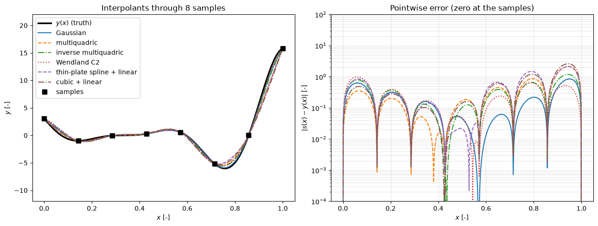
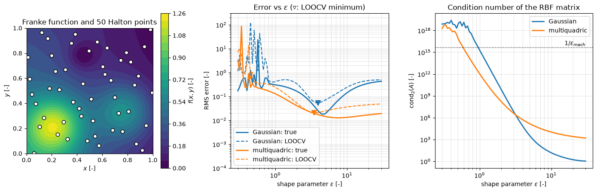

# Radial Basis Function Interpolation

Radial basis function (RBF) interpolation builds a function of $d$ variables from values at scattered points, with no mesh and no restriction on where the points lie. Each sample contributes a basis function that depends only on the distance to it, and the weights come from one linear solve. In CFD the method is used as a surrogate for expensive outputs, to transfer data between non-matching meshes, and to deform volume meshes from prescribed boundary displacements (de Boer, van der Schoot and Bijl, 2007). This note states the interpolation problem, lists the common kernels with the conditions under which the system is solvable, explains the polynomial tail and the shape parameter, and shows how to smooth noisy data.

## Problem Statement

Given $N$ distinct centres $x^{(1)}, \dots, x^{(N)} \in \mathbb{R}^d$ and values $y_1, \dots, y_N$, find a function

```math
s(x) = \sum_{j=1}^{N} c_j\,\varphi\left(\lVert x - x^{(j)} \rVert\right) + \sum_{l=1}^{M} b_l\,p_l(x)
```

that satisfies the interpolation conditions $s(x^{(i)}) = y_i$ for $i = 1, \dots, N$. Here $\varphi : [0, \infty) \to \mathbb{R}$ is the radial kernel, $\lVert \cdot \rVert$ the Euclidean norm, and $p_1, \dots, p_M$ a basis of polynomials of low degree (possibly none, $M = 0$). The unknowns are the weights $c_j$ and the polynomial coefficients $b_l$. The problem is solved when the linear system for them has a unique solution, which depends on the kernel and the tail, and the interpolant is useful when its error between the centres is small. That error decreases with the fill distance $h = \sup_{x \in \Omega}\min_i \lVert x - x^{(i)} \rVert$, the radius of the largest hole in the data. The difficulty is that the kernels which give the fastest error decay also give the worst-conditioned systems, and the trade-off is controlled by a shape parameter that has to be chosen from the data.

## Interpolation Conditions

Without a polynomial tail, the interpolation conditions read

```math
\sum_{j=1}^{N} c_j\,\varphi\left(\lVert x^{(i)} - x^{(j)} \rVert\right) = y_i, \qquad i = 1, \dots, N
```

or $A\mathbf{c} = \mathbf{y}$ with the symmetric matrix $A_{ij} = \varphi(\lVert x^{(i)} - x^{(j)} \rVert)$. A unique solution for every distinct point set and every right-hand side requires $A$ to be nonsingular, and the natural sufficient condition is that $A$ is positive definite.

A kernel is **positive definite** if $\mathbf{c}^T A \mathbf{c} > 0$ for every set of distinct points and every $\mathbf{c} \ne 0$. It is **conditionally positive definite of order $m$** if this holds for every $\mathbf{c} \ne 0$ that satisfies

```math
\sum_{j=1}^{N} c_j\, p(x^{(j)}) = 0 \quad \text{for all polynomials } p \text{ of degree less than } m
```

For such a kernel, positivity is only guaranteed on the subspace orthogonal to the polynomials of degree $m - 1$, and a polynomial tail of that degree has to be added to make the system well posed (Micchelli, 1986).

## Kernels

With $r = \lVert x - x' \rVert$ and shape parameter $\varepsilon > 0$:

| Kernel | $\varphi(r)$ | Smoothness | Definiteness | Tail needed |
| --- | --- | --- | --- | --- |
| Gaussian | $e^{-(\varepsilon r)^2}$ | $C^\infty$ | positive definite | none |
| Inverse multiquadric | $\left(1 + (\varepsilon r)^2\right)^{-1/2}$ | $C^\infty$ | positive definite | none |
| Multiquadric (Hardy, 1971) | $\left(1 + (\varepsilon r)^2\right)^{1/2}$ | $C^\infty$ | $-\varphi$ conditionally positive definite, order 1 | constant (but $A$ is nonsingular without it) |
| Linear | $r$ | $C^0$ | $-\varphi$ conditionally positive definite, order 1 | constant (but $A$ is nonsingular without it) |
| Cubic | $r^3$ | $C^2$ | conditionally positive definite, order 2 | linear |
| Thin-plate spline | $r^2 \ln r$ | $C^1$ | conditionally positive definite, order 2 | linear |
| Wendland $\varphi_{3,1}$ | $`(1 - \varepsilon r)_+^4\,(4\varepsilon r + 1)`$ | $C^2$ | positive definite in $d \le 3$ | none |

The general polyharmonic splines are $r^k$ for odd $k$ (order $\lceil k/2 \rceil$) and $r^{2k}\ln r$ (order $k + 1$), each up to a sign that makes it conditionally positive rather than negative definite; the sign does not change the interpolant. They have no shape parameter, since scaling $r$ only rescales the kernel. Micchelli (1986) proved that for the multiquadric and the linear kernel $A$ has one positive and $N - 1$ negative eigenvalues, so it is nonsingular even without the constant tail; adding it is still common because it lets the interpolant reproduce constants. The thin-plate spline in two dimensions with a linear tail is the interpolant of minimal bending energy, the 2D analogue of the natural cubic spline.

The kernels differ in support. Gaussian, inverse multiquadric and Wendland kernels decay, so each sample has a local influence and the interpolant falls back to the tail (or to zero) away from the data. Multiquadric and polyharmonic kernels grow with $r$, so every sample affects the whole domain. Wendland's compactly supported kernels (Wendland, 1995) vanish beyond $r = 1/\varepsilon$, which makes $A$ sparse when the support covers only a few neighbours, at the cost of lower accuracy than the global kernels.



The figure interpolates eight samples of $y(x) = (6x - 2)^2\sin(12x - 4)$ with six kernels. All six pass through the samples and look alike at the scale of the left panel, but the right panel shows that their errors between the samples differ by a factor of almost three: the RMS errors range from 0.30 for the Gaussian with $\varepsilon = 5$ to 0.80 for the cubic with a linear tail.

## The Augmented System

With a polynomial tail of degree $m - 1$, spanned by $p_1, \dots, p_M$, the $N$ interpolation conditions are completed by the $M$ side conditions $\sum_j c_j p_l(x^{(j)}) = 0$:

```math
\begin{pmatrix} A & P \\ P^T & 0 \end{pmatrix}
\begin{pmatrix} \mathbf{c} \\ \mathbf{b} \end{pmatrix} =
\begin{pmatrix} \mathbf{y} \\ \mathbf{0} \end{pmatrix},
\qquad P_{il} = p_l(x^{(i)})
```

The system has a unique solution if the kernel is conditionally positive definite of order $m$ and the centres are unisolvent for the polynomials of degree $m - 1$, that is, $P$ has full column rank (for a linear tail in 2D the centres must not all lie on one line). The side conditions also make the interpolant reproduce polynomials of degree $m - 1$ exactly: if the data come from such a polynomial, the solution is $\mathbf{c} = 0$ and the tail alone fits the data (Exercise 3). This is the RBF counterpart of the trend in [universal kriging](kriging.md).

## The Shape Parameter

For the kernels with a shape parameter, $\varepsilon$ sets the width of each basis function relative to the spacing of the centres, and it controls both accuracy and conditioning:

- For large $\varepsilon$ the basis functions are narrow peaks. For the Gaussian, $A$ tends to the identity and is perfectly conditioned, but the interpolant drops toward zero between the centres.
- For small $\varepsilon$ the basis functions are nearly flat and nearly identical, so the columns of $A$ become almost parallel. In exact arithmetic the interpolant converges to a polynomial interpolant as $\varepsilon \to 0$ (Driscoll and Fornberg, 2002), which is often accurate for smooth data, but $\mathrm{cond}(A)$ grows like a high power of $1/\varepsilon$, and in floating point the solve loses all accuracy once $\mathrm{cond}(A)$ exceeds about $10^{16}$.

Schaback (1995) showed that this is not an accident of particular kernels: for a fixed kernel, the bound on the interpolation error and the bound on the smallest eigenvalue of $A$ are tied together, and improving one worsens the other. A good $\varepsilon$ therefore balances the two and must be chosen for the data at hand.



The figure interpolates Franke's function from 50 Halton points. For the Gaussian kernel the true RMS error is smallest, $1.8 \times 10^{-2}$, at $\varepsilon = 4.6$, where $\mathrm{cond}(A) = 8.3 \times 10^3$. At $\varepsilon = 30$ the matrix is nearly the identity and the error is 0.43. Below $\varepsilon \approx 1$ the condition number passes $1/\epsilon_{\mathrm{mach}}$ and the errors become erratic. The dashed curves are the leave-one-out estimates described next; their minima ($\varepsilon = 3.9$ for the Gaussian, 3.5 for the multiquadric) give true errors within a factor 1.6 of the best possible.

### Rippa's Leave-One-Out Formula

Let $s^{(-i)}$ be the interpolant of all data except sample $i$, and $e_i = y_i - s^{(-i)}(x^{(i)})$ its error at the left-out point. The function $s^{(-i)}$ also interpolates the modified data $\mathbf{y}' = \mathbf{y} - e_i\mathbf{e}_i$ at all $N$ centres, where $\mathbf{e}_i$ is the $i$-th unit vector, and the interpolant of $\mathbf{y}'$ is unique. Its coefficients are therefore $\mathbf{c}' = A^{-1}\mathbf{y}' = \mathbf{c} - e_i A^{-1}\mathbf{e}_i$, and since $s^{(-i)}$ does not use centre $i$, $c'_i = 0$. Hence (Rippa, 1999)

```math
e_i = \frac{c_i}{(A^{-1})_{ii}}, \qquad i = 1, \dots, N
```

All $N$ residuals cost one inverse instead of $N$ solves, and the shape parameter is chosen by minimizing $\lVert \mathbf{e} \rVert_2$ over a range of $\varepsilon$. With a polynomial tail the same argument applies to the augmented matrix, with $\mathbf{c}$ and $(A^{-1})_{ii}$ taken from the first $N$ rows of the bordered system; see the validation section of [Surrogate Models in CFD](intro.md).

## Anisotropy and Input Scaling

A radial kernel treats all directions alike, so the inputs must be scaled to comparable ranges first, normally to $[0, 1]$. If the response varies much faster in some inputs than in others, a single $\varepsilon$ cannot suit all of them. The distance can be replaced by a weighted norm $\lVert x - x' \rVert_W^2 = \sum_k w_k (x_k - x'_k)^2$, with weights chosen by cross-validation. Kriging with one correlation parameter per input does exactly this and estimates the weights by maximum likelihood.

## Smoothing Noisy Data

CFD outputs contain numerical noise from incomplete convergence, remeshing and averaging of unsteady results. An interpolant that passes through noisy values oscillates between them. Replacing the interpolation system by

```math
(A + \lambda I)\,\mathbf{c} = \mathbf{y}, \qquad \lambda > 0
```

gives a smoothing approximant, which no longer passes through the data: the residuals are $\mathbf{y} - A\mathbf{c} = \lambda\mathbf{c}$. For a positive definite kernel this is the minimizer of $\sum_i (y_i - s(x^{(i)}))^2 + \lambda \lVert s \rVert_{\mathcal{N}}^2$, where $\lVert s \rVert_{\mathcal{N}}^2 = \mathbf{c}^T A \mathbf{c}$ is the native-space norm of the kernel, so $\lambda$ trades fidelity to the data against roughness. It also improves conditioning, since every eigenvalue of $A$ is shifted by $\lambda$. Rippa's formula holds unchanged with $A + \lambda I$ in place of $A$, so $\lambda$ and $\varepsilon$ can be chosen together by minimizing the LOO error. The same regularization in kriging is the nugget term.

## Relationship to Kriging

The Gaussian RBF interpolant without a tail is identical to the predictor of [kriging](kriging.md) with Gaussian correlation and zero mean, and adding a constant tail with the side condition $\sum_j c_j = 0$ gives exactly the ordinary kriging predictor. The two methods differ in how they choose the parameters and in what else they return. RBF practice selects $\varepsilon$ by cross-validation and treats the result as a deterministic interpolant; kriging estimates the correlation parameters by maximum likelihood and also delivers a predictive variance, which is what makes it the usual choice for adaptive sampling and optimization.

## Key Takeaways

- An RBF interpolant is a weighted sum of kernels centred at the samples, fitted by one linear solve, in any dimension and for scattered points.
- Positive definite kernels need no tail; conditionally positive definite kernels of order $m$ need a polynomial tail of degree $m - 1$ and unisolvent centres.
- The shape parameter trades accuracy against conditioning; flat kernels are accurate in exact arithmetic but ill-conditioned in floating point.
- Rippa's formula $e_i = c_i/(A^{-1})_{ii}$ gives all leave-one-out errors from one inverse and is a reliable way to choose $\varepsilon$.
- For noisy CFD data, solve $(A + \lambda I)\mathbf{c} = \mathbf{y}$ instead of interpolating.

## Related Scripts

- [Radial Basis Functions](../../../scripts/algorithms/radial_basis_functions/): interpolates eight samples of the Forrester function with six RBF kernels written in numpy and plots the interpolants and their pointwise errors.
- [RBF Shape Parameter Trade-Off](../../../scripts/plots/rbf_shape_parameter_tradeoff/): sweeps the shape parameter of Gaussian and multiquadric RBF interpolants of Franke's function and plots the true error, Rippa's LOOCV estimate and the condition number of the interpolation matrix.
- [Condition Number of the Correlation Matrix](../../../scripts/algorithms/condition_number_of_the_correlation_matrix/): plots how the condition number of a kriging correlation matrix changes with the correlation parameter $\theta$ for the linear, exponential, Gaussian and cubic spline correlation functions.
- [Kriging Interpolation](../../../scripts/algorithms/kriging_interpolation/): builds an ordinary kriging model of the Forrester function from nine samples with a compactly supported cubic correlation, estimates $\theta$ by maximum likelihood and compares the predictor and its uncertainty band for three values of $\theta$.
- [Cross-Design Generalization](../../../scripts/plots/cross_design_generalization/): is a synthetic illustration of why a surrogate trained on one design family can fail on another: three ridge-regression models trained on family X, family Y and both are tested on held-out designs of each family.

## Exercises

**Exercise 1.** Interpolate the data $(0, 1)$ and $(1, 2)$ with the Gaussian RBF $\varphi(r) = e^{-(\varepsilon r)^2}$, $\varepsilon = 1$. Compute the weights and $s(0.5)$. What does the interpolant predict far from the data, and how can this be fixed?

<details>
<summary>Answer</summary>

$`A = \begin{pmatrix} 1 & e^{-1} \\ e^{-1} & 1 \end{pmatrix}`$ with $\det A = 1 - e^{-2} = 0.8647$. Then

```math
\mathbf{c} = A^{-1}\mathbf{y} = \frac{1}{1 - e^{-2}}\begin{pmatrix} 1 - 2e^{-1} \\ 2 - e^{-1} \end{pmatrix} = \begin{pmatrix} 0.3056 \\ 1.8876 \end{pmatrix}
```

and $s(0.5) = e^{-0.25}(c_1 + c_2) = 0.7788 \times 2.1932 = 1.7080$. Far from the data every Gaussian decays, so $s \to 0$. Adding a polynomial tail (a constant or linear trend) gives sensible behaviour away from the samples.

</details>

**Exercise 2.** For six equally spaced points on $[0, 1]$ (spacing 0.2), compute the 2-norm condition number of the Gaussian RBF matrix for $\varepsilon = 1$, $10$ and $100$. Discuss the trade-off in choosing $\varepsilon$.

<details>
<summary>Answer</summary>

$\mathrm{cond}(A) \approx 3.4 \times 10^6$ for $\varepsilon = 1$, $1.07$ for $\varepsilon = 10$, and $1.00$ for $\varepsilon = 100$.

Small $\varepsilon$ gives wide, nearly identical basis functions: the matrix is almost singular, but the interpolant is smooth. Large $\varepsilon$ gives narrow bumps that barely overlap ($e^{-(10 \times 0.2)^2} = e^{-4} \approx 0.018$ between neighbours): the matrix is well conditioned, but the interpolant drops toward zero between samples. Good choices balance accuracy and conditioning, for example by minimizing Rippa's LOOCV error.

</details>

**Exercise 3.** Interpolate $y = 2x$ at $x = 0, 0.2, \ldots, 1$ with the cubic kernel $\varphi(r) = r^3$, first without and then with a linear tail, $s(x) = \sum_j c_j|x - x^{(j)}|^3 + b_0 + b_1 x$ with side conditions $\sum_j c_j = 0$ and $\sum_j c_j x^{(j)} = 0$. Evaluate $s(0.1)$ in both cases.

<details>
<summary>Answer</summary>

Without the tail, the weights are $\mathbf{c} \approx (9.010, -15.179, 3.447, 1.392, -9.015, 4.216)$ and $s(0.1) = 0.2421$ against the exact $0.2$, a 21% error, even though the data are linear.

With the tail, the augmented system

```math
\begin{pmatrix} A & P \\ P^T & 0 \end{pmatrix}\begin{pmatrix} \mathbf{c} \\ \mathbf{b} \end{pmatrix} = \begin{pmatrix} \mathbf{y} \\ \mathbf{0} \end{pmatrix}, \qquad P = [\mathbf{1}, \mathbf{x}]
```

gives $\mathbf{c} = 0$ and $(b_0, b_1) = (0, 2)$, so $s(x) = 2x$ exactly and $s(0.1) = 0.2$. The cubic kernel is conditionally positive definite of order 2, and the linear tail both guarantees solvability and reproduces linear trends.

</details>

**Exercise 4.** Show that the Gaussian RBF matrix $A_{ij} = \exp(-\varepsilon^2(x_i - x_j)^2)$ is positive definite for distinct points $x_1, \ldots, x_N \in \mathbb{R}$, so the interpolation system always has a unique solution. Use the Fourier representation $`e^{-\varepsilon^2 h^2} = \frac{1}{2\varepsilon\sqrt{\pi}}\int_{-\infty}^{\infty} e^{-\omega^2/(4\varepsilon^2)}\,e^{i\omega h}\,d\omega`$.

<details>
<summary>Answer</summary>

For any real $\mathbf{c} \ne 0$,

```math
\mathbf{c}^T A \mathbf{c} = \sum_{j,k} c_j c_k
e^{-\varepsilon^2(x_j - x_k)^2} = \frac{1}{2\varepsilon\sqrt{\pi}}\int_{-\infty}^{\infty}
e^{-\omega^2/(4\varepsilon^2)}\left|\sum_j c_j e^{i\omega x_j}\right|^2 d\omega \ge 0
```

The weight $e^{-\omega^2/(4\varepsilon^2)}$ is strictly positive, so the integral vanishes only if $\sum_j c_j e^{i\omega x_j} = 0$ for all $\omega$. For distinct $x_j$ the exponentials are linearly independent, which forces $\mathbf{c} = 0$. Hence $\mathbf{c}^T A \mathbf{c} > 0$ for all $\mathbf{c} \ne 0$, and $A$ is nonsingular. The same argument (Bochner's theorem) holds in $\mathbb{R}^d$.

</details>

**Exercise 5.** Repeat Exercise 1 with the smoothing system $(A + \lambda I)\mathbf{c} = \mathbf{y}$ for $\lambda = 0.1$ and $\lambda = 1$. Compute the fitted values at the two data points, the residuals, and the condition numbers, and compare with the interpolant.

<details>
<summary>Answer</summary>

The interpolant has $\mathrm{cond}(A) = (1 + e^{-1})/(1 - e^{-1}) = 2.164$.

- $\lambda = 0.1$: $\mathbf{c} = (0.3389, 1.7048)$, fitted values $A\mathbf{c} = (0.9661, 1.8295)$, residuals $\lambda\mathbf{c} = (0.0339, 0.1705)$, condition number 2.005.
- $\lambda = 1$: $\mathbf{c} = (0.3271, 0.9398)$, fitted values $(0.6729, 1.0602)$, residuals $(0.3271, 0.9398)$, condition number 1.451.

The residuals equal $\lambda\mathbf{c}$, as derived in the note. With a decaying kernel and no tail, smoothing shrinks the fit toward zero, so a large $\lambda$ removes the trend along with the noise; in practice a tail or a constant mean is added and $\lambda$ is chosen by LOOCV.

</details>

## References

- R. L. Hardy, "Multiquadric equations of topography and other irregular surfaces", *Journal of Geophysical Research* 76(8), 1905–1915, 1971.
- C. A. Micchelli, "Interpolation of scattered data: distance matrices and conditionally positive definite functions", *Constructive Approximation* 2, 11–22, 1986.
- R. Schaback, "Error estimates and condition numbers for radial basis function interpolation", *Advances in Computational Mathematics* 3, 251–264, 1995.
- H. Wendland, "Piecewise polynomial, positive definite and compactly supported radial functions of minimal degree", *Advances in Computational Mathematics* 4, 389–396, 1995.
- S. Rippa, "An algorithm for selecting a good value for the parameter c in radial basis function interpolation", *Advances in Computational Mathematics* 11(2–3), 193–210, 1999.
- T. A. Driscoll and B. Fornberg, "Interpolation in the limit of increasingly flat radial basis functions", *Computers & Mathematics with Applications* 43(3–5), 413–422, 2002.
- M. D. Buhmann, *Radial Basis Functions: Theory and Implementations*, Cambridge University Press, 2003.
- H. Wendland, *Scattered Data Approximation*, Cambridge University Press, 2005.
- G. E. Fasshauer, *Meshfree Approximation Methods with MATLAB*, World Scientific, 2007.
- A. de Boer, M. S. van der Schoot and H. Bijl, "Mesh deformation based on radial basis function interpolation", *Computers & Structures* 85(11–14), 784–795, 2007.
- A. I. J. Forrester, A. Sóbester and A. J. Keane, *Engineering Design via Surrogate Modelling: A Practical Guide*, Wiley, 2008.
