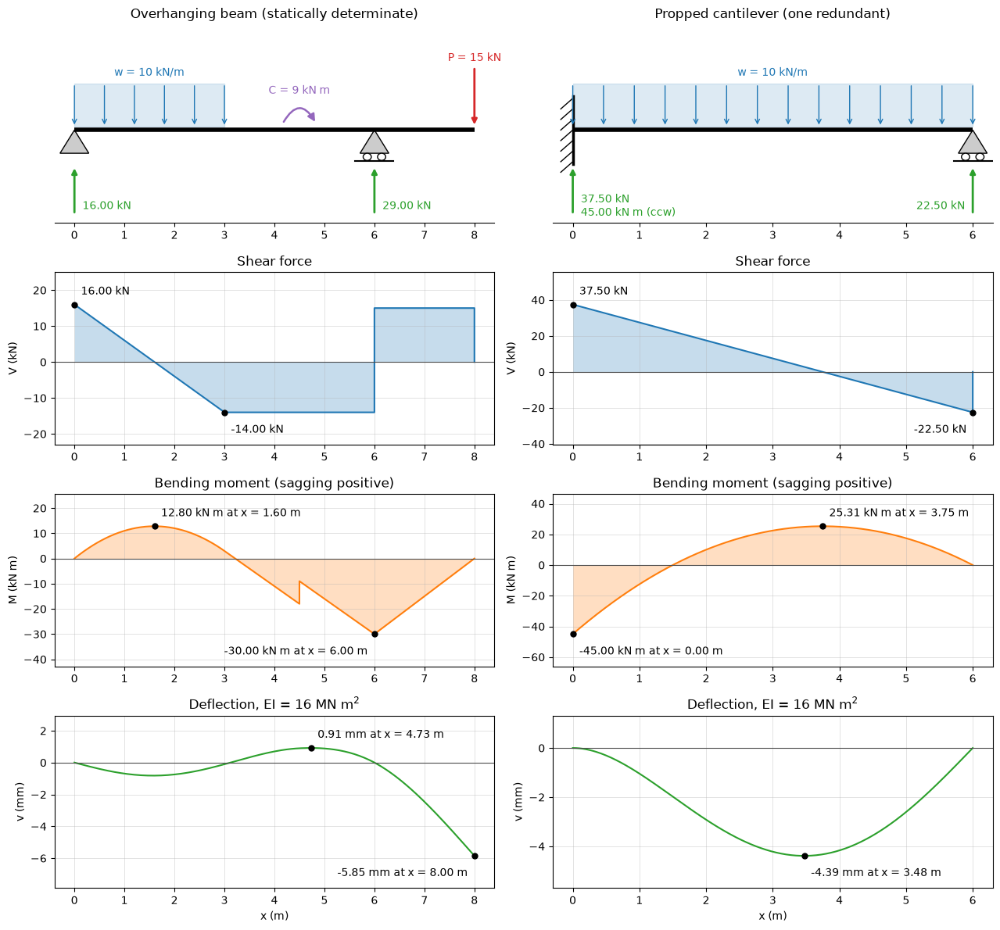

# Shear and Moment Diagrams of Beams

This script solves statically determinate and indeterminate beams with Euler–Bernoulli finite elements and draws the load, shear-force, bending-moment and deflection diagrams with their extreme values. A beam is described by its supports (pin, roller or fixed), point loads, couples and linearly varying distributed loads. The finite-element solution gives the support reactions and the deflection; the shear force and bending moment are then evaluated exactly from the loads and reactions with singularity functions, so the jumps at point loads and couples are sharp. Two cases are drawn: an overhanging beam with a partial uniform load, a couple and an end load, and a propped cantilever with one redundant reaction.

## Overview

- Meshes the beam with a uniform grid of 240 two-node Hermite elements plus a node at every support, load point, couple and end of a distributed load.
- Assembles the element stiffness matrices and the consistent load vector, integrating the distributed load against the cubic shape functions with three-point Gauss quadrature, which is exact for linearly varying loads.
- Removes the constrained degrees of freedom (deflection at pins and rollers, deflection and rotation at fixed ends), solves for the nodal deflections and rotations, and recovers the reactions from the residual $\mathbf{K}\mathbf{u} - \mathbf{f}$.
- Evaluates $V(x)$ and $M(x)$ with Macaulay brackets from the loads and the computed reactions, on a fine grid with an extra point just left of every key point so that jumps are drawn vertically.
- Prints the reactions, the extreme moments and their positions, the largest shear, the extreme deflection, and the residuals of force and moment equilibrium.
- Draws, for each beam, a schematic with the computed reactions and three diagrams below it, with extreme values annotated.

## Mathematical Background

### Sign Convention and Equilibrium

Loads $w$ and $P$ are positive downward, applied couples $C$ positive clockwise, the deflection $v$ positive upward. The shear force $V(x)$ is the sum of upward forces to the left of the section and the bending moment $M(x)$ is positive when sagging, so that

```math
\frac{dV}{dx} = -w,
\qquad \frac{dM}{dx} = V,
\qquad EI\, \frac{d^2v}{dx^2} = M
```

### Singularity Functions

With $\langle x - a\rangle^n$ equal to $(x - a)^n$ for $x \ge a$ and zero otherwise, a reaction $R$ at $a$ contributes $R\langle x - a\rangle^0$ to $V$ and $R\langle x - a\rangle^1$ to $M$, a downward load $P$ the same with $-P$, and a clockwise couple $C$ contributes $C\langle x - a\rangle^0$ to $M$. A load starting at $x_1$ with intensity $w_1$ and slope $s = (w_2 - w_1)/(x_2 - x_1)$ adds

```math
\Delta V = -w_1\langle x - x_1\rangle^1 - \frac{s}{2}\langle x - x_1\rangle^2, \qquad
\Delta M = -\frac{w_1}{2}\langle x - x_1\rangle^2 - \frac{s}{6}\langle x - x_1\rangle^3
```

and is cancelled beyond $x_2$ by the same terms in $x - x_2$, with $w_2$ in place of $w_1$ and the opposite sign.

### Hermite Beam Element

On an element of length $h$ with degrees of freedom $(v_1, \theta_1, v_2, \theta_2)$, $\theta = dv/dx$, the deflection is interpolated by cubic Hermite polynomials and the stiffness matrix is

```math
\mathbf{k} = \frac{EI}{h^3}
\begin{bmatrix}
12 & 6h & -12 & 6h \\
6h & 4h^2 & -6h & 2h^2 \\
-12 & -6h & 12 & -6h \\
6h & 2h^2 & -6h & 4h^2
\end{bmatrix}
```

A downward point load enters the load vector as $-P$ on the deflection degree of freedom and a clockwise couple as $-C$ on the rotation (counterclockwise positive). With consistent loads, the nodal values of this element are exact for the Euler–Bernoulli equation, whatever the number of elements.

## Implementation

- `Beam` holds `length`, `ei`, `supports`, `point_loads`, `couples` and `distributed`; `key_points()` returns the positions where something acts. `Reaction` holds a support's force (up) and couple (clockwise).
- `element_stiffness(ei, h)` and `hermite_shapes(xi, h)` define the element; `build_mesh(beam, n_elements)` merges the uniform grid with the key points; `assemble(beam, nodes)` builds $\mathbf{K}$ and $\mathbf{f}$; `constrained_dofs(beam, nodes)` lists the fixed degrees of freedom.
- `solve_beam(beam, n_elements=N_ELEMENTS)` returns the nodes, deflections, rotations and reactions.
- `macaulay(x, a, n)` and `internal_forces(beam, reactions, x)` evaluate $V$ and $M$; `evaluation_points(beam)` gives the plotting grid; `equilibrium_residual(beam, reactions)` returns the net force and the net moment about $x = 0$.
- `overhanging_beam()` and `propped_cantilever()` define the two cases. `draw_loads`, `draw_support`, `annotate_extreme`, `draw_case` and `report` draw and print the results.
- Constants: `E_STEEL` = 200 GPa and `I_SECTION` = $8.0 \times 10^{-5}$ m⁴, so `EI_DEFAULT` = 16 MN m², and `N_ELEMENTS` = 240.

## Usage

```bash
python main.py                          # print the results and show the figure
python main.py --no-show --output .     # save beams_shear_moment_diagrams.png in the current directory
```

| Flag | Meaning |
| --- | --- |
| `--no-show` | Do not open a plot window |
| `--output DIR` | Create `DIR` and save the figure as a PNG |

## Output

For the overhanging beam (pin at 0, roller at 6 m, 10 kN/m over the first 3 m, a clockwise couple of 9 kN m at 4.5 m and 15 kN at the tip, 8 m), the script prints reactions of 16.000 kN and 29.000 kN, a largest sagging moment of 12.800 kN m at 1.60 m, a hogging moment of $-30.000$ kN m over the roller, and a tip deflection of 5.852 mm downward. For the propped cantilever (fixed at 0, roller at 6 m, 10 kN/m), it prints $R_B = 22.500$ kN ($3wL/8$), $R_A = 37.500$ kN, a fixed-end moment of $-45.000$ kN m ($-wL^2/8$), $M_{\max} = 25.312$ kN m at 3.75 m ($9wL^2/128$ at $5L/8$), and a largest deflection of 4.387 mm at 3.475 m, which matches the closed form $`0.005416\,wL^4/EI`$ at $0.5785L$. The equilibrium residuals are below $2 \times 10^{-3}$ N m.



In the left column, the shear has slope $-10$ kN/m under the distributed load, is constant elsewhere, and jumps by the reaction at each support; the moment is parabolic under the load, linear elsewhere, and steps by exactly 9 kN m at the couple. The elastic curve is concave down wherever the moment is negative, which lifts the span near the roller by 0.91 mm. In the right column the redundant roller reaction comes from the solver, not from equilibrium.

## Related Notes

- [Shear Force and Bending Moment Diagrams](../../../notes/applied_mechanics/strength_materials/shear_moment.md)
- [Bending of Beams](../../../notes/applied_mechanics/strength_materials/beam_bending.md)
- [The Finite Element Method](../../../notes/numerical/fem/intro.md)
