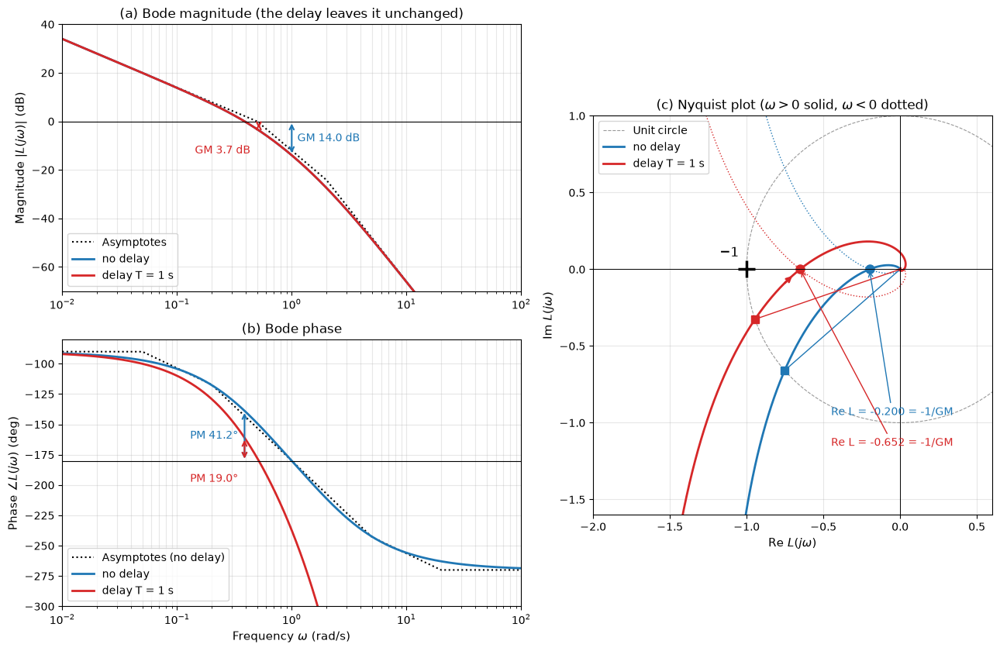
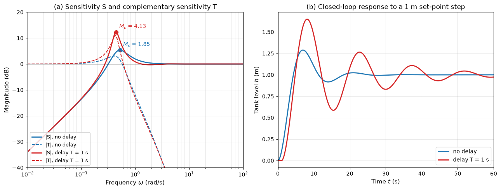

# Bode and Nyquist Margins

This script computes the Bode magnitude and phase with straight-line asymptotes, the gain, phase and delay margins, the Nyquist plot and its encirclements of $-1$, the sensitivity functions and the closed-loop step response of a tank level loop with and without a transport delay. A proportional controller drives a pump that fills a tank, the level sensor has a first-order lag, and in the second case the water takes 1 s to travel down the supply pipe.

## Overview

- Evaluates $L(j\omega) = K e^{-j\omega T}/[j\omega(\tau_p j\omega + 1)(\tau_m j\omega + 1)]$ with $K = K_c k_q/A = 0.5$ s⁻¹, $\tau_p = 2$ s, $\tau_m = 0.5$ s and $T = 0$ or 1 s.
- Draws the straight-line magnitude and phase asymptotes of the delay-free loop.
- Finds the gain crossover with `scipy.optimize.brentq` on $\lvert L\rvert = 1$ and the phase crossover on the analytic unwrapped phase, giving the gain margin, phase margin and delay margin.
- Finds, separately, where the Nyquist curve crosses the negative real axis and the unit circle by locating sign changes on a dense frequency grid, as a check on the Bode values.
- Counts the clockwise encirclements of $-1$ along the full Nyquist contour, including the large semicircle and the indentation around the integrator, at the nominal gain and at 1.2 times the gain margin.
- Computes $\lvert S\rvert$ and $\lvert T\rvert$ and simulates the closed-loop level response to a 1 m set-point step with an RK4 integrator and a delay buffer.

## Mathematical Background

The phase of the loop is $-90^\circ - \arctan(\tau_p\omega) - \arctan(\tau_m\omega) - \omega T$ (in degrees, with $\omega T$ converted), and its magnitude does not depend on $T$. The margins are

```math
GM = \frac{1}{\lvert L(j\omega_{pc})\rvert}, \quad \angle L(j\omega_{pc}) = -180^\circ; \qquad PM = 180^\circ + \angle L(j\omega_{gc}), \quad \lvert L(j\omega_{gc})\rvert = 1; \qquad T_{dm} = \frac{PM}{\omega_{gc}}
```

Without delay, $\arctan(2\omega) + \arctan(0.5\omega) = 90^\circ$ gives $\omega_{pc} = 1$ rad/s and $GM = (\tau_p + \tau_m)/(\tau_p\tau_m K) = 5$. The Nyquist criterion $Z = N + P$ with $P = 0$ requires no clockwise encirclement of $-1$; the winding number of $1 + L$ along the contour is computed from its unwrapped phase. The sensitivity functions are $S = 1/(1 + L)$ and $T = L/(1 + L)$.

## Implementation

- `loop_response(omega, delay, k)` and `phase_deg(omega, delay)` evaluate the loop; `magnitude_asymptote_db` and `phase_asymptote_deg` give the straight-line approximations.
- `bode_margins(delay)` returns the crossovers, margins and delay margin.
- `nyquist_real_axis_crossing(delay)` and `nyquist_unit_circle_crossing(delay)` locate the Nyquist crossings independently of `bode_margins`.
- `clockwise_encirclements(delay, k)` builds the Nyquist contour and returns $N$.
- `sensitivities(omega, delay)` returns $\lvert S\rvert$ and $\lvert T\rvert$; `simulate_step(delay)` integrates the level, pump-flow and sensor states with RK4 and a buffer of past pump flows.
- `make_bode_nyquist_figure(cases)` and `make_sensitivity_figure(cases)` draw the two figures. The physical constants (`TANK_AREA`, `PUMP_GAIN`, `PUMP_TIME_CONSTANT`, `SENSOR_TIME_CONSTANT`, `CONTROLLER_GAIN`, `DELAY`) are at the top of the file.

## Usage

```bash
python main.py                          # print the margins and show both figures
python main.py --no-show --output .     # save control_bode_nyquist.png and control_sensitivity.png
```

| Flag | Meaning |
| --- | --- |
| `--no-show` | Do not open plot windows |
| `--output DIR` | Create `DIR` and save the figures as PNGs |

## Output

| Quantity | No delay | Delay 1 s |
| --- | --- | --- |
| Gain crossover (rad/s) | 0.3878 | 0.3878 |
| Phase margin | $41.22^\circ$ | $19.00^\circ$ |
| Delay margin (s) | 1.855 | 0.855 |
| Phase crossover (rad/s) | 1.0000 | 0.5165 |
| Gain margin | 5.000 (13.98 dB) | 1.534 (3.72 dB) |
| Nyquist crossing $`\mathrm{Re}\,L`$ | $-0.2000$ | $-0.6520$ |
| Encirclements $N$ at nominal gain / 1.2 × GM | 0 / 2 | 0 / 2 |
| Peak sensitivity $M_s$ | 1.854 | 4.129 |
| Step overshoot | 28.8% | 64.8% |



Panels (a) and (b) show the Bode plot with the dotted asymptotes and the margins marked by arrows at the crossover frequencies; the magnitude curves of the two loops coincide. Panel (c) shows the Nyquist plots for positive (solid) and negative (dotted) frequency, the unit circle, the crossings of the negative real axis at $-1/GM$, and the lines from the origin to the unit-circle crossings, whose angle from the negative real axis is the phase margin.



Panel (a) shows $\lvert S\rvert$ and $\lvert T\rvert$ with the sensitivity peaks marked, and panel (b) the closed-loop level responses to a 1 m set-point step.

## Related Notes

- [Frequency Response](../../../notes/applied_mechanics/control_systems/frequency_response.md)
- [Feedback Control](../../../notes/applied_mechanics/control_systems/feedback_control.md)
- [PID Controllers](../../../notes/applied_mechanics/control_systems/pid_controllers.md)
