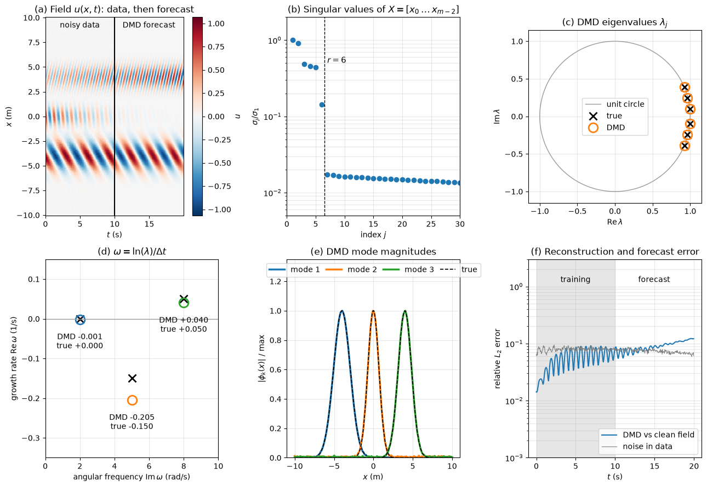

# Dynamic Mode Decomposition (DMD)

This script applies exact dynamic mode decomposition to a noisy synthetic 1D wave field built from three wave packets whose frequencies and growth rates are known, and checks how well DMD recovers them. It fits DMD to the first half of the record, forecasts the second half, and plots the singular value spectrum, the DMD eigenvalues against the unit circle and the true values, the recovered spatial modes, and the reconstruction and forecast error over time.

## Overview

- Builds a real field $u(x, t)$ on 200 points in $x \in [-10, 10]$ m from three travelling wave packets with continuous-time eigenvalues $`\omega_k = g_k + \mathrm{i}\,w_k`$: $0 + 2\mathrm{i}$, $-0.15 + 5\mathrm{i}$ and $0.05 + 8\mathrm{i}$ s $`^{-1}`$.
- Samples 400 snapshots at $\Delta t = 0.05$ s and adds Gaussian noise of standard deviation 0.02 to every value.
- Fits exact DMD with rank $r = 6$ (three conjugate pairs) to the first 200 noisy snapshots ($t < 10$ s) and forecasts all 400.
- Prints the continuous-time eigenvalues $\ln(\lambda_j)/\Delta t$ and the relative $L_2$ error in the training window and at the last snapshot.
- Draws a six-panel figure: the space-time field (data, then forecast), the normalized singular values, the eigenvalues in the complex plane, growth rate against frequency, the mode magnitudes against the true ones, and the relative error over time.

## Mathematical Background

### Snapshot Pairs

The snapshots $`\mathbf{x}_0, \dots, \mathbf{x}_{m-1} \in \mathbb{R}^n`$ are arranged into two shifted matrices

```math
\mathbf{X} = [\mathbf{x}_0 \ \cdots \ \mathbf{x}_{m-2}], \qquad \mathbf{X}' = [\mathbf{x}_1 \ \cdots \ \mathbf{x}_{m-1}]
```

and DMD seeks the linear operator $\mathbf{A}$ that best satisfies $\mathbf{X}' \approx \mathbf{A}\mathbf{X}$ in the least-squares sense, $\mathbf{A} = \mathbf{X}'\mathbf{X}^+$.

### Exact DMD (Tu et al. 2014)

1. Compute the truncated SVD $\mathbf{X} \approx \mathbf{U}_r \boldsymbol{\Sigma}_r \mathbf{V}_r^{\mathsf{H}}$.
2. Project the operator onto the POD subspace: $\tilde{\mathbf{A}} = \mathbf{U}_r^{\mathsf{H}} \mathbf{X}' \mathbf{V}_r \boldsymbol{\Sigma}_r^{-1}$, an $r \times r$ matrix.
3. Solve $\tilde{\mathbf{A}}\mathbf{W} = \mathbf{W}\boldsymbol{\Lambda}$ for the DMD eigenvalues $\lambda_j$.
4. Form the exact DMD modes $\boldsymbol{\Phi} = \mathbf{X}' \mathbf{V}_r \boldsymbol{\Sigma}_r^{-1} \mathbf{W}$.
5. Fit the amplitudes $\mathbf{b}$ to the first snapshot, $\boldsymbol{\Phi}\mathbf{b} = \mathbf{x}_0$, by least squares.

The model is then $\mathbf{x}_k \approx \boldsymbol{\Phi}\boldsymbol{\Lambda}^k\mathbf{b}$, and each discrete eigenvalue gives a continuous-time growth rate and angular frequency through

```math
\omega_j = \frac{\ln \lambda_j}{\Delta t},
\qquad g_j = \mathrm{Re}\,\omega_j,
\qquad w_j = \mathrm{Im}\,\omega_j
```

Eigenvalues inside the unit circle decay, those on it are neutral, and those outside grow.

### Synthetic Field

Each packet has a complex spatial shape $`\phi_k(x) = A_k\, e^{-(x - c_k)^2/s_k^2}\, e^{\mathrm{i}\kappa_k x}`$, and the field is

```math
u(x, t) = \mathrm{Re} \sum_{k=1}^{3} \phi_k(x)\, e^{\omega_k t}
```

The complex shapes make each packet a travelling wave of rank two, so the clean field has rank six and is exactly representable by six DMD modes. The true discrete eigenvalues are $\lambda = e^{\omega_k \Delta t}$ and their conjugates.

## Implementation

- `dmd(X, r)` implements the five steps above and returns the eigenvalues, the exact modes and the amplitudes.
- `dmd_predict(eigenvalues, modes, amplitudes, n_steps)` evaluates $\boldsymbol{\Phi}\boldsymbol{\Lambda}^k\mathbf{b}$ for $k = 0, \dots, n_{\mathrm{steps}} - 1$.
- `make_field(x, t, noise_std, seed)` returns the clean field and a noisy copy; `true_spatial_modes(x)` and `true_continuous_eigenvalues()` return the ground truth.
- `match_eigenvalues` pairs each true eigenvalue with the nearest DMD eigenvalue, and `relative_error` returns the per-snapshot relative $L_2$ error.
- `MODES`, `DT`, `N_TRAIN`, `N_TOTAL`, `NOISE_STD` and `RANK` set the packets, the sampling, the training window, the noise level and the truncation rank.

## Usage

```bash
python main.py                          # show the figure
python main.py --no-show --output .     # save the figure as a PNG in the current directory
```

## Output



Panel (b) shows six singular values well above a noise floor at about $0.017\sigma_1$, which identifies $r = 6$. The DMD eigenvalues in (c) lie on top of the true ones near $\lambda = 1$. The frequencies are recovered to within 0.005 rad/s, but panel (d) shows that the noise biases the growth rates downwards: $-0.205$ instead of $-0.15$ s $`^{-1}`$ for the decaying packet and $+0.040$ instead of $+0.05$ s $`^{-1}`$ for the growing one. This damping bias of standard DMD on noisy data is a known effect. The mode shapes in (e) match the true envelopes. In (f) the error against the clean field averages 5.6% over the training window, below the 7.6% noise in the data, and grows to 12% at $t = 20$ s as the biased growth rates accumulate.

## Related Notes

- [Modeling Flow Dynamics](../../../notes/machine_learning/flow/flow_dynamics.md)
- [Flow Feature Extraction](../../../notes/machine_learning/flow/feature_extraction.md)
- [POD and SVD](../../../notes/numerical/pod/pod_vs_svd.md)
- [Dynamic Mode Decomposition](../../../notes/numerical/rom/dmd.md)
