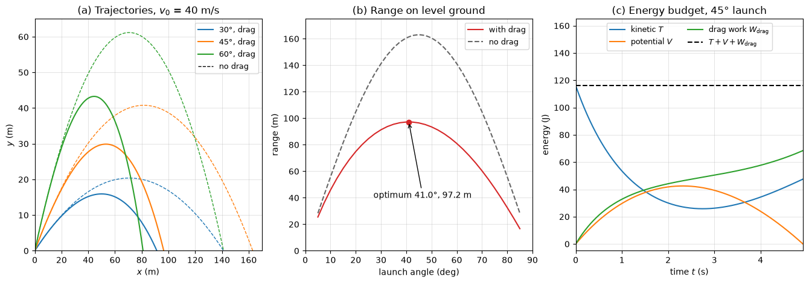

# Projectile with Quadratic Drag

This script integrates Newton's second law for a projectile with quadratic air drag and compares it with the drag-free parabola. A baseball-sized ball (0.145 kg, 73 mm diameter, $C_d = 0.35$) is launched at 40 m/s, close to its terminal speed, so drag shortens the range by about 40% and moves the optimum launch angle below $45^\circ$.

## Overview

- Integrates $m\mathbf{a} = m\mathbf{g} - \tfrac{1}{2}\rho C_dA|\mathbf{v}|\mathbf{v}$ with `solve_ivp` (RK45) and stops at the ground with an event function.
- Draws the trajectories for launch angles of $30^\circ$, $45^\circ$ and $60^\circ$ with and without drag.
- Computes the range as a function of launch angle and finds the optimum with `minimize_scalar`.
- Integrates the work done against drag as an extra state and checks that $T + V + W_{\mathrm{drag}}$ stays equal to the launch energy.

## Mathematical Background

With $k = \rho C_dA/(2m)$, the equations of motion are

```math
\ddot{x} = -k\,|\mathbf{v}|\,\dot{x},
\qquad
\ddot{y} = -g - k\,|\mathbf{v}|\,\dot{y}
```

Drag balances weight at the terminal speed $v_t = \sqrt{g/k}$, and a body dropped from rest reaches $v(t) = v_t\tanh(gt/v_t)$. The power of the drag force is $\mathbf{D}\cdot\mathbf{v} = -mk|\mathbf{v}|^3$, so the work-energy theorem reads

```math
\tfrac{1}{2}m|\mathbf{v}|^2 + mgy + W_{\mathrm{drag}}(t) = \tfrac{1}{2}m v_0^2,
\qquad
W_{\mathrm{drag}}(t) = \int_0^t mk\,|\mathbf{v}|^3\,dt'
```

Without drag the range on level ground is $R = v_0^2\sin 2\theta_0/g$.

## Implementation

- `drag_constant()` and `terminal_speed()` evaluate $k$ and $v_t$ from the constants `AIR_DENSITY`, `DRAG_COEFFICIENT`, `DIAMETER` and `MASS`.
- `rhs(t, state, k)` returns the derivatives of $(x, y, \dot{x}, \dot{y}, w)$, where $w$ is the drag work per unit mass.
- `fly(angle_deg, k)` integrates to impact using a terminal event on $y = 0$ and dense output; `flight_range` returns the impact distance.
- `vacuum_range`, `fall_speed` and `optimum_angle` give the closed-form and optimized comparisons; `energy_budget` returns $T$, $V$ and $W_{\mathrm{drag}}$.

## Usage

```bash
python main.py                          # print ranges and the energy check, show the figure
python main.py --no-show --output .     # save dynamics_projectile_drag.png
```

| Flag | Meaning |
| --- | --- |
| `--no-show` | Do not open a plot window |
| `--output DIR` | Create `DIR` and save the figure as a PNG |

## Output

The drag constant is $k = 0.00606$ m⁻¹ and the terminal speed 40.2 m/s. At $45^\circ$ the range is 96.5 m against 163.1 m without drag, the apex 29.9 m, the flight time 4.92 s and the impact speed 25.6 m/s. The optimum angle with drag is $41.0^\circ$ (97.2 m). Of the 116.0 J launch energy, drag removes 68.5 J before impact, and $T + V + W_{\mathrm{drag}}$ stays constant to $2\times10^{-7}$ J.



Panel (a) shows the asymmetric drag trajectories, which descend more steeply than they rise. Panel (b) shows the range curve with drag lying well below the parabola result and peaking below $45^\circ$. Panel (c) shows kinetic energy being converted to potential energy and to drag work, with their sum constant.

## Related Notes

- [Kinetics of Particles](../../../notes/applied_mechanics/dynamics/kinetics_particles.md)
- [Work and Energy Methods](../../../notes/applied_mechanics/dynamics/work_energy.md)
- [Kinematics of Particles](../../../notes/applied_mechanics/dynamics/kinematics_particles.md)
