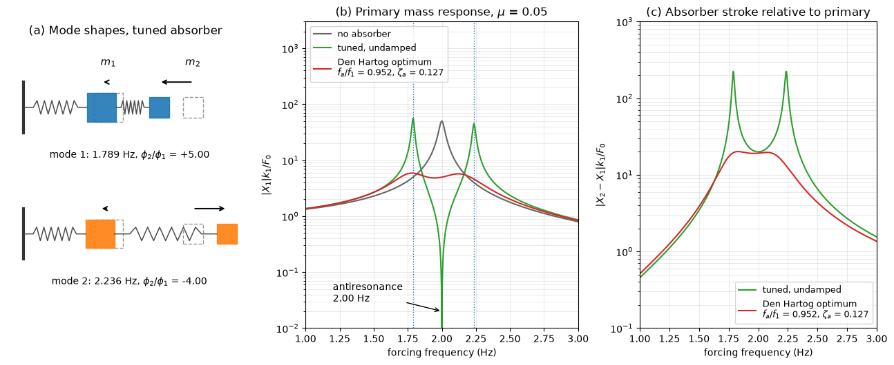

# Two-DOF Normal Modes and Tuned Mass Damper

This script solves the generalized eigenproblem of a two-degree-of-freedom spring–mass chain and uses it to explain the tuned mass damper. A 1000 kg primary mass on a 2 Hz spring carries a 50 kg absorber, and the forced response of the primary mass is computed without the absorber, with an undamped absorber tuned to 2 Hz and with Den Hartog's optimally damped absorber.

## Overview

- Builds $\mathbf{M}$, $\mathbf{K}$ and $\mathbf{C}$ for the chain ground–$`k_1`$–$`m_1`$–$`k_2`$–$`m_2`$, with a force on $`m_1`$ and 1% damping in the primary spring.
- Solves $\mathbf{K}\boldsymbol{\phi} = \omega^2\mathbf{M}\boldsymbol{\phi}$ with `scipy.linalg.eigh` and compares the natural frequencies with the roots of the characteristic quadratic.
- Draws both mode shapes of the tuned system.
- Computes the receptance $X_1(\omega)$ of the primary mass and the absorber stroke $X_2 - X_1$ by solving $(\mathbf{K} - \omega^2\mathbf{M} + i\omega\mathbf{C})\mathbf{X} = \mathbf{F}$ at each frequency.

## Mathematical Background

The equations of motion are $\mathbf{M}\ddot{\mathbf{x}} + \mathbf{C}\dot{\mathbf{x}} + \mathbf{K}\mathbf{x} = \mathbf{F}(t)$ with

```math
\mathbf{M} = \begin{bmatrix} m_1 & 0 \\ 0 & m_2 \end{bmatrix},
\qquad
\mathbf{K} = \begin{bmatrix} k_1 + k_2 & -k_2 \\ -k_2 & k_2 \end{bmatrix},
\qquad
\mathbf{C} = \begin{bmatrix} c_1 + c_2 & -c_2 \\ -c_2 & c_2 \end{bmatrix}
```

Setting $\det(\mathbf{K} - \omega^2\mathbf{M}) = 0$ gives

```math
m_1 m_2\,\omega^4 - \left[m_1 k_2 + m_2(k_1 + k_2)\right]\omega^2 + k_1 k_2 = 0
```

For harmonic forcing $F_0e^{i\omega t}$ on $m_1$ with $c_2 = 0$, Cramer's rule gives

```math
X_1 = \frac{(k_2 - \omega^2 m_2)\,F_0}{\det(\mathbf{K} - \omega^2\mathbf{M} + i\omega\mathbf{C})}
```

so the primary mass stands still at $\omega = \sqrt{k_2/m_2}$, the antiresonance, while the absorber force $k_2X_2 = -F_0$ balances the applied force. For mass ratio $\mu = m_2/m_1$, Den Hartog's optimum makes the two fixed points of the response curve equal:

```math
\frac{\omega_a}{\omega_1} = \frac{1}{1 + \mu},
\qquad
\zeta_a = \sqrt{\frac{3\mu}{8(1 + \mu)^3}}
```

## Implementation

- `matrices(m1, m2, k1, k2, c1, c2)` returns $\mathbf{M}$, $\mathbf{K}$ and $\mathbf{C}$.
- `normal_modes(mass, stiffness)` returns the natural frequencies and the mass-normalized modes, $\boldsymbol{\Phi}^T\mathbf{M}\boldsymbol{\Phi} = \mathbf{I}$.
- `closed_form_frequencies(m1, m2, k1, k2)` solves the quadratic in $\omega^2$.
- `receptance(omega, mass, stiffness, damping, force)` solves the complex dynamic-stiffness system at every frequency.
- `den_hartog_tuning(mu)` and `absorber_cases()` define the tuned and optimally damped absorbers; `draw_modes` and `make_figure` draw the figure.

## Usage

```bash
python main.py                          # print the modal results and show the figure
python main.py --no-show --output .     # save dynamics_two_dof_modes.png
```

| Flag | Meaning |
| --- | --- |
| `--no-show` | Do not open a plot window |
| `--output DIR` | Create `DIR` and save the figure as a PNG |

## Output

With the absorber tuned to the primary frequency ($k_2 = 7895.7$ N/m) the natural frequencies are 1.789 Hz and 2.236 Hz from both `eigh` and the closed form, with amplitude ratios $\phi_2/\phi_1 = +5$ and $-4$. Den Hartog's tuning ($f_a/f_1 = 0.952$, $\zeta_a = 0.127$, $k_2 = 7161.6$ N/m, $c_2 = 152.3$ N s/m) lowers the peak of $|X_1|k_1/F_0$ from 50 without absorber, and 55.9 with the undamped absorber, to 5.89.



Panel (a) shows the in-phase and out-of-phase modes; in both the light absorber moves much more than the primary mass. Panel (b) shows the single resonance of the primary mass being replaced by two resonances on either side of an antiresonance at 2.00 Hz, and the damped absorber flattening both. Panel (c) shows the absorber stroke, which sets the space and spring travel the device needs.

## Related Notes

- [Mechanical Vibrations](../../../notes/applied_mechanics/dynamics/vibrations.md)
- [Lagrangian Mechanics](../../../notes/applied_mechanics/dynamics/lagrangian_mechanics.md)
