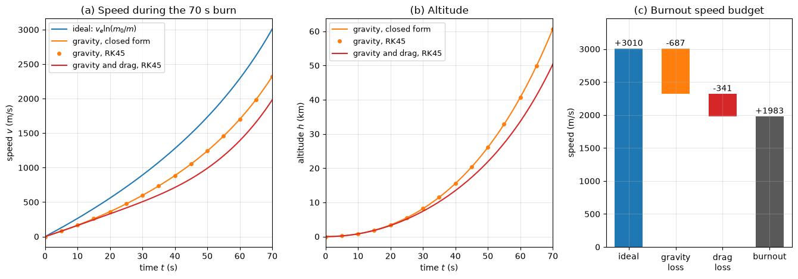

# Variable-Mass Rocket

This script integrates the momentum balance of a vertically launched rocket and splits its burnout speed into the ideal rocket-equation increment, the gravity loss and the drag loss. The rocket has a lift-off mass of 1000 kg and burns 700 kg of propellant at 10 kg/s with an exhaust speed of 2500 m/s.

## Overview

- Integrates $`m\,dv/dt = \dot{m}v_e - mg - D`$ with $m = m_0 - \dot{m}t$ using `solve_ivp` (RK45) over the 70 s burn.
- Models drag as $D = \tfrac{1}{2}\rho C_dAv|v|$ with $C_d = 0.4$, a 0.5 m diameter and an exponential atmosphere of scale height 8.5 km.
- Compares the numerical solution without drag with the closed-form speed and altitude for constant gravity, and with $g = 0$ against the Tsiolkovsky equation.
- Integrates the gravity loss $`\int g\,dt`$ and the drag loss $`\int D/m\,dt`$ as extra states.

## Mathematical Background

Over $dt$ the rocket ejects $`\dot{m}\,dt`$ of propellant at speed $v_e$ relative to itself. The momentum balance of rocket plus ejected mass gives

```math
m\frac{dv}{dt} = \dot{m}v_e - mg - D
```

With $g = 0$ and $D = 0$ this integrates to the Tsiolkovsky equation $v = v_e\ln(m_0/m)$. With constant $g$ and no drag,

```math
v(t) = v_e\ln\frac{m_0}{m} - gt,
\qquad
h(t) = \frac{v_e}{\dot{m}}\left[m_0 - m - m\ln\frac{m_0}{m}\right] - \frac{1}{2}gt^2
```

Integrating the full equation divided by $m$ over the burn gives the speed budget

```math
v_b = v_e\ln\frac{m_0}{m_b} - \int_0^{t_b}g\,dt - \int_0^{t_b}\frac{D}{m}\,dt
```

## Implementation

- `mass(t)`, `ideal_speed(t)` and `gravity_only(t)` give the closed-form mass, rocket-equation speed and constant-gravity solution.
- `rhs(t, state, g, drag)` returns the derivatives of altitude, speed, gravity loss and drag loss.
- `burn(g, drag, n)` integrates from lift-off to burnout and returns `n` samples.
- `make_figure()` draws the speed and altitude histories and the speed budget.
- Constants `INITIAL_MASS`, `PROPELLANT_MASS`, `MASS_FLOW`, `EXHAUST_SPEED`, `DRAG_COEFFICIENT`, `DIAMETER` and `SCALE_HEIGHT` set the case.

## Usage

```bash
python main.py                          # print the burnout values and show the figure
python main.py --no-show --output .     # save dynamics_variable_mass_rocket.png
```

| Flag | Meaning |
| --- | --- |
| `--no-show` | Do not open a plot window |
| `--output DIR` | Create `DIR` and save the figure as a PNG |

## Output

The thrust is 25 kN and the lift-off thrust-to-weight ratio 2.55. The ideal burnout speed is $2500\ln(1000/300) = 3010$ m/s. With gravity only, the closed form and RK45 agree to the printed digits: 2323.23 m/s and 60.67 km at burnout. With drag the rocket reaches 1983 m/s at 50.3 km, after a gravity loss of 687 m/s ($gt_b$) and a drag loss of 341 m/s.



Panel (a) shows the speed rising faster as the mass falls, and panel (b) the corresponding altitude. Panel (c) shows that a third of the ideal speed is lost, mostly to gravity, which is why launchers aim for high thrust-to-weight ratios early and pitch over once they are clear of the dense atmosphere.

## Related Notes

- [Impulse and Momentum](../../../notes/applied_mechanics/dynamics/impulse_momentum.md)
- [Kinetics of Particles](../../../notes/applied_mechanics/dynamics/kinetics_particles.md)
