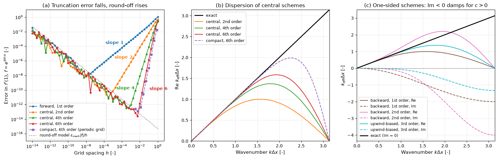

# Finite-Difference Stencils

This script computes finite-difference weights for any set of stencil offsets by solving the Taylor-series (Vandermonde) system, then measures how the error of each stencil depends on the grid spacing and how well it represents each Fourier wavenumber. It checks the weights against Fornberg's recursion, shows the round-off floor that limits every formula at small $h$, and compares the modified wavenumbers of explicit central, one-sided and sixth-order compact schemes with the exact derivative.

## Overview

- Solves the Vandermonde system for the weights of the $m$-th derivative on arbitrary offsets and finds the order and leading coefficient of the truncation error from the first moment that does not vanish.
- Implements Fornberg's (1988) recursion, which gives the same weights for non-integer offsets and is numerically stabler for wide stencils.
- Evaluates the forward (1st order) and central (2nd, 4th and 6th order) first derivatives of $f(x) = e^{\sin x}$ at $x = 1$ for $h$ from 1 down to $10^{-14}$.
- Applies the tridiagonal sixth-order compact scheme of Lele (1992) on periodic grids of 8 to 2048 points, solving the cyclic system with `scipy.linalg.solve_circulant`.
- Plots the real part of the modified wavenumber of the central and compact schemes, and the real and imaginary parts for three one-sided (upwind) stencils.
- Prints the number of points per wavelength each central scheme needs for a phase-speed error below 1% and 0.1%.

## Mathematical Background

### Weights From Taylor Series

For offsets $s_0, \dots, s_{n-1}$ (in units of $h$) the approximation

```math
f^{(m)}(x) \approx \frac{1}{h^m}\sum_{j=0}^{n-1} w_j\, f(x + s_j h)
```

is exact for polynomials of degree $n - 1$ when

```math
\sum_{j=0}^{n-1} w_j\,\frac{s_j^k}{k!} = \delta_{km}, \qquad k = 0, \dots, n-1
```

This is a transposed Vandermonde system. The first $q \ge n$ with a non-zero moment $`\mu_q = \sum_j w_j s_j^q/q!`$ gives the leading error $\mu_q h^{q-m} f^{(q)}$, so the order is $q - m \ge n - m$. On a symmetric stencil every moment whose index differs in parity from $m$ cancels, so the order is one higher than $n - m$ when $n - m$ is odd, as for the three-point second derivative.

### Round-Off

Each sample carries a relative rounding error of about $`\epsilon_{\mathrm{mach}} = 2.2 \times 10^{-16}`$, which the division by $h$ amplifies. The total error of a first-derivative stencil of order $p$ behaves like $C h^p + \epsilon_{\mathrm{mach}}|f|/h$, which has a minimum at $h \sim \epsilon_{\mathrm{mach}}^{1/(p+1)}$.

### Modified Wavenumber

Applying a first-derivative stencil to $e^{\mathrm{i}kx}$ returns $\mathrm{i}k_{\mathrm{eff}}e^{\mathrm{i}kx}$ with

```math
k_{\mathrm{eff}}\Delta x = -\mathrm{i}\sum_j w_j\, e^{\mathrm{i}s_j k\Delta x}
```

For the compact scheme $`\alpha f'_{i-1} + f'_i + \alpha f'_{i+1} = a\,(f_{i+1} - f_{i-1})/(2h) + b\,(f_{i+2} - f_{i-2})/(4h)`$ with $\alpha = 1/3$, $a = 14/9$, $b = 1/9$,

```math
k_{\mathrm{eff}}\Delta x = \frac{a\sin(k\Delta x) + (b/2)\sin(2k\Delta x)}{1 + 2\alpha\cos(k\Delta x)}
```

Central stencils have a real $k_{\mathrm{eff}}$: they disperse but do not damp. One-sided stencils have an imaginary part; for $`u_t + c\,u_x = 0`$ with $c > 0$, $`\mathrm{Im}\,k_{\mathrm{eff}} < 0`$ damps the mode.

## Implementation

- `fd_weights(offsets, derivative)` builds and solves the Vandermonde system.
- `fornberg_weights(z, x, max_derivative)` implements Fornberg's recursion for nodes `x` and evaluation point `z`.
- `truncation_error(offsets, weights, derivative)` returns the order and the leading coefficient.
- `apply_stencil` evaluates a stencil on a callable, `periodic_derivative` on periodic samples with `np.roll`, and `compact_derivative` solves the cyclic tridiagonal compact system.
- `modified_wavenumber(offsets, theta)` and `compact_modified_wavenumber(theta)` give $k_{\mathrm{eff}}\Delta x$; `points_per_wavelength(fn, tolerance)` finds the resolution needed for a phase-speed error tolerance.
- `pointwise_errors()` and `compact_errors()` run the two error studies; `make_figure` draws the three panels.
- Constants `X0`, `H_VALUES`, `N_COMPACT`, `STENCILS`, `ONE_SIDED`, `COMPACT_ALPHA`, `COMPACT_A`, `COMPACT_B` and `PHASE_TOLERANCES` set the experiment.

## Usage

```bash
python main.py                          # print the weight table and show the figure
python main.py --no-show --output .     # save finite_difference_stencils.png in the current directory
```

| Flag | Meaning |
| --- | --- |
| `--no-show` | Do not open a plot window |
| `--output DIR` | Create `DIR` and save the figure as a PNG |

## Output

The script prints the weights as fractions, for example $[1/12, -2/3, 0, 2/3, -1/12]$ with error $`-\tfrac{1}{30}h^4 f^{(5)}`$ for the fourth-order central first derivative, $[1/2, -2, 3/2]$ with error $`-\tfrac{1}{3}h^2 f'''`$ for the second-order backward difference, and $[-1/12, 4/3, -5/2, 4/3, -1/12]$ with error $`-\tfrac{1}{90}h^4 f^{(6)}`$ for the fourth-order second derivative. The smallest pointwise errors are $9.5 \times 10^{-9}$ at $h = 10^{-8}$ (forward), $1.1 \times 10^{-11}$ at $h = 3.2 \times 10^{-6}$ (central, 2nd order), $3.2 \times 10^{-13}$ at $h = 3.2 \times 10^{-4}$ (4th order) and $2.5 \times 10^{-14}$ at $h = 5.6 \times 10^{-3}$ (6th order). The compact scheme converges at order 6.0 down to $4.4 \times 10^{-13}$ at $N = 512$. For a phase-speed error below 1% the central schemes of order 2, 4 and 6 need 25.6, 8.3 and 5.7 points per wavelength and the compact scheme 4.0; for 0.1% they need 81, 15, 8.6 and 5.7.



Panel (a) shows each error falling with the slope of its order until it meets the rising round-off line; the higher the order, the larger the optimal $h$ and the smaller the attainable error. Panel (b) shows that all central schemes follow the exact line $k_{\mathrm{eff}} = k$ for well-resolved waves and fall to zero at the grid cut-off $k\Delta x = \pi$, the compact scheme staying accurate furthest. Panel (c) shows that the one-sided schemes add a negative imaginary part, numerical damping that grows with $k\Delta x$.

## Related Notes

- [Finite Difference Method](../../../notes/numerical/fdm/intro.md)
- [Systematic Finite-Difference Discretization](../../../notes/numerical/fdm/discretization.md)
- [High-Order Methods](../../../notes/numerical/high_order/intro.md)
