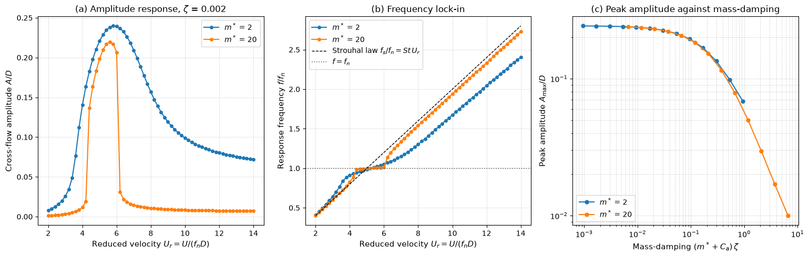

# Vortex-Induced Vibration with a Wake Oscillator

This script models vortex-induced vibration of an elastically mounted cylinder with the coupled structure and van der Pol wake oscillators of Facchinetti, de Langre and Biolley (2004). It sweeps the reduced velocity for two mass ratios to show the amplitude response and the lock-in of the response frequency onto the natural frequency, and sweeps the structural damping to show how the peak amplitude falls with the mass–damping parameter.

## Overview

- Integrates the two coupled oscillators in dimensionless form with a fixed-step fourth-order Runge–Kutta scheme, all cases at once as one vectorised state.
- Uses the constants of the original paper: $St = 0.2$, $C_{L0} = 0.3$, stall parameter from $C_D = 2$, $\varepsilon = 0.3$ and acceleration coupling $A = 12$, with potential-flow added mass $C_a = 1$.
- Sweeps $U_r = U/(f_n D)$ from 2 to 14 for mass ratios $m^* = 2$ and 20 at damping ratio $\zeta = 0.002$, and records the amplitude and the dominant response frequency over the last 40% of each run.
- Sweeps $\zeta$ from $3 \times 10^{-4}$ to 0.3 for both mass ratios and records the largest amplitude over $3.5 \le U_r \le 9$.

## Mathematical Background

Time is scaled with the Strouhal angular frequency $`\Omega_f = 2\pi St\,U/D`$, and the cross-flow displacement $y$ with $D$. The wake variable $q = 2C_L/C_{L0}$ represents the fluctuating lift. The model is

```math
\ddot y + \left(2\zeta\delta + \frac{\gamma}{\mu}\right)\dot y + \delta^2 y = M q,
\qquad
\ddot q + \varepsilon\left(q^2 - 1\right)\dot q + q = A\,\ddot y
```

with $`\delta = \omega_n/\Omega_f = 1/(St\,U_r)`$, mass ratio $\mu = (m_s + m_a)/(\rho D^2) = (m^* + C_a)\pi/4$, stall parameter $\gamma = C_D/(4\pi St)$ and forcing $M = C_{L0}/(16\pi^2 St^2\mu)$. Without coupling the wake settles on the van der Pol limit cycle of amplitude 2 at the Strouhal frequency. With coupling, near $U_r \approx 1/St = 5$ the wake and the cylinder synchronise at a common frequency close to $f_n$. A frequency ratio $f/f_n$ is obtained from the dimensionless frequency by dividing by $\delta$.

## Implementation

- `model_coefficients(ur, mass_ratio, damping)` returns $\delta$, the total damping coefficient and $M$.
- `simulate(ur, mass_ratio, damping, duration, dt, coupling, q0)` integrates all cases with RK4 (`DT = 0.08`, `DURATION = 800`) starting from $y = 0$, $q = 0.1$, and keeps the last `KEEP = 0.4` of the record.
- `dominant_frequency(signal)` takes the peak of a Hann-windowed, zero-padded FFT.
- `response(...)` returns the amplitude $\max|y|$, the response frequency ratio and the wake frequency ratio.
- `lock_in_band(ur, f_ratio)` reports the range of $U_r$ where $`|f/f_n - 1| < 5\%`$.
- The sweeps are set by `MASS_RATIOS`, `DAMPING`, `UR_SWEEP`, `UR_PEAK` and `DAMPING_SWEEP`.

## Usage

```bash
python main.py                         # print the peak responses and show the figure
python main.py --no-show --output .    # save fluid_loading_viv_wake_oscillator.png
```

| Flag | Meaning |
| --- | --- |
| `--no-show` | Do not open a plot window |
| `--output DIR` | Create `DIR` and save the figure as a PNG |

## Output

For $m^* = 20$ the peak amplitude is $A/D = 0.22$ at $U_r = 5.6$ and the response frequency stays within 5% of $f_n$ for $4.4 \le U_r \le 6.0$; outside this band it returns towards the Strouhal line. For $m^* = 2$ the peak is $A/D = 0.24$ at $U_r = 5.8$, the response band is much wider, and the frequency rises steadily above $f_n$ instead of locking onto it. In the damping sweep the peak amplitude falls from 0.24 to 0.010 as $(m^* + C_a)\zeta$ grows from $10^{-3}$ to 7, and the two mass ratios fall on one curve where their mass–damping values overlap. The model reproduces lock-in and the mass–damping collapse, but with these constants its peak amplitudes are well below the $A/D \approx 0.6$–1 of the upper response branch measured at low mass–damping (Williamson and Govardhan 2004).



Panel (a) is the amplitude response, panel (b) the response frequency against the Strouhal law $`f_s/f_n = St\,U_r`$ and the line $f = f_n$, and panel (c) the peak amplitude against mass–damping, a model version of the Griffin plot.

## Related Notes

- [Flow-Induced Vibrations](../../../notes/applied_mechanics/fluid_loading/flow_induced_vibrations.md)
- [Fluid Loading on Structures](../../../notes/applied_mechanics/fluid_loading/intro.md)
- [Wind Loading on Structures](../../../notes/applied_mechanics/fluid_loading/wind_loading.md)
