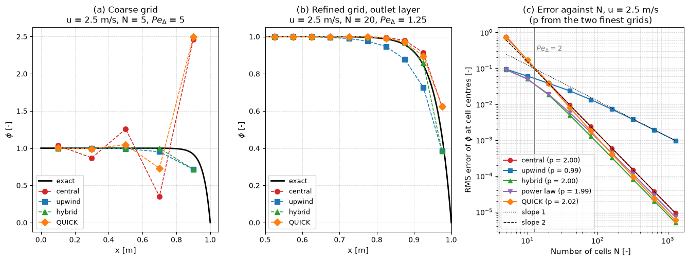

# 1D Finite-Volume Convection–Diffusion

This script solves steady 1D convection–diffusion with the finite volume method using central, upwind, hybrid, power-law and QUICK face values, and compares each with the exponential exact solution. It is the test problem of Versteeg and Malalasekera (2007, Examples 5.1 to 5.4): $\phi(0) = 1$, $\phi(1) = 0$, $\rho = 1$ kg/m³, $\Gamma = 0.1$ kg/(m s). On five cells at $u = 2.5$ m/s (cell Péclet number 5) central differencing oscillates and overshoots to 2.46, upwinding smears the outlet layer, and on refinement upwinding converges at first order while the other four schemes converge at second order.

## Overview

- Assembles $a_P\phi_P = a_W\phi_W + a_E\phi_E + b$ on $N$ uniform cell-centred cells for the five schemes and solves it with a banded solver.
- Treats the boundary faces with a half-cell diffusion conductance $2\Gamma/\Delta x$ and the boundary value as the convected value, except at an outflow boundary for the upwind-type schemes, which use the upstream node.
- Applies QUICK by deferred correction: the matrix is the upwind matrix and the difference between the QUICK and upwind face fluxes is moved to the right-hand side and iterated to a change below $10^{-12}$.
- Prints the solutions of the three cases of Example 5.1 ($u = 0.1$ m/s with 5 cells, $u = 2.5$ m/s with 5 and with 20 cells) next to the exact values.
- Runs a grid-convergence study at $u = 2.5$ m/s on $N = 5, 10, \dots, 1280$ cells and prints the RMS error at the cell centres and the observed order between consecutive grids.
- Provides `face_fluxes`, which evaluates the total flux on every face with the same formulas as the assembly; the tests use it to check that a converged solution carries the same flux through every face.

## Mathematical Background

### Discrete Equations

The equation $`d(\rho u\phi)/dx = d(\Gamma\,d\phi/dx)/dx`$ is integrated over cell $P$ between faces $w$ and $e$. With mass flux $F = \rho u$ and diffusion conductance $D = \Gamma/\Delta x$ on interior faces, Patankar's general form of the neighbour coefficients is

```math
a_E = D_e\,A(|Pe_e|) + \max(-F_e, 0),
\qquad
a_W = D_w\,A(|Pe_w|) + \max(F_w, 0),
\qquad
a_P = a_W + a_E + (F_e - F_w)
```

with $Pe = F/D$ and the scheme function

| Scheme | $A(\lvert Pe \rvert)$ |
| --- | --- |
| central | $1 - 0.5\lvert Pe \rvert$ |
| upwind | $1$ |
| hybrid | $\max(0,\ 1 - 0.5\lvert Pe \rvert)$ |
| power law | $\max(0,\ (1 - 0.1\lvert Pe \rvert)^5)$ |

### QUICK by Deferred Correction

For $F > 0$ the QUICK face value is $\phi_e = \tfrac{6}{8}\phi_P + \tfrac{3}{8}\phi_E - \tfrac{1}{8}\phi_W$. Next to the inflow boundary the missing upstream node is the mirror value $\phi_0 = 2\phi_A - \phi_1$. Iteration $k + 1$ solves

```math
a_P^{\mathrm{UD}}\phi_P^{k+1} - a_W^{\mathrm{UD}}\phi_W^{k+1} - a_E^{\mathrm{UD}}\phi_E^{k+1} = b - \left[F\left(\phi_f^{\mathrm{Q}} - \phi_f^{\mathrm{UD}}\right)\right]_w^e \Big|_{\phi^{k}}
```

so the converged solution satisfies the QUICK equations while every matrix stays diagonally dominant.

### Exact Solution

```math
\phi(x) = \phi_0 + (\phi_L - \phi_0)\,\frac{\exp(\rho u x/\Gamma) - 1}{\exp(\rho u L/\Gamma) - 1}
```

The error is the RMS difference between the cell values and $\phi(x_P)$ at the cell centres, and the observed order between grids $N$ and $2N$ is $p = \log_2(e_N/e_{2N})$.

## Implementation

- `a_function(scheme, peclet)` returns $A(|Pe|)$; QUICK uses the upwind value.
- `assemble(n, velocity, scheme)` returns $a_W$, $a_E$, $a_P$, $b$, the cell width and $F$, including the boundary-face terms.
- `tridiagonal_solve` solves the system with `scipy.linalg.solve_banded`.
- `quick_face_values(phi, flux, phi_left, phi_right)` evaluates QUICK on all $N + 1$ faces with the mirror node.
- `solve(n, velocity, scheme)` returns the cell centres, the solution and the number of deferred-correction iterations (0 for the direct schemes).
- `face_fluxes`, `exact_solution`, `rms_error`, `convergence_study` and `observed_orders` support the checks and the figure.
- Constants `LENGTH`, `DENSITY`, `DIFFUSIVITY`, `PHI_LEFT`, `PHI_RIGHT`, `CASES`, `VELOCITY_STUDY` and `N_STUDY` set the problem.

## Usage

```bash
python main.py                          # print the tables and show the figure
python main.py --no-show --output .     # save fvm_convection_diffusion_1d.png in the current directory
```

| Flag | Meaning |
| --- | --- |
| `--no-show` | Do not open a plot window |
| `--output DIR` | Create `DIR` and save the figure as a PNG |

## Output

For $u = 0.1$ m/s on 5 cells ($Pe_\Delta = 0.2$) central differencing gives 0.9421, 0.8006, 0.6276, 0.4163, 0.1579 against the exact 0.9388, 0.7964, 0.6225, 0.4100, 0.1505. For $u = 2.5$ m/s on 5 cells ($Pe_\Delta = 5$) it gives 1.0356, 0.8694, 1.2573, 0.3521, 2.4644, while upwind gives the bounded but smeared 0.9998, 0.9987, 0.9921, 0.9524, 0.7143; these are the values tabulated by Versteeg and Malalasekera. QUICK converges in 10, 27 and 20 deferred-correction iterations for the three cases and also overshoots (2.50) on the coarse grid. In the convergence study at $Pe_L = 25$ the observed orders on the two finest grids are 2.00 (central), 0.99 (upwind), 2.00 (hybrid), 1.99 (power law) and 2.02 (QUICK), and the RMS errors on 1280 cells are $9.3\times10^{-6}$, $9.7\times10^{-4}$, $5.0\times10^{-6}$, $7.1\times10^{-6}$ and $5.8\times10^{-6}$.



Panel (a) shows the coarse grid at $Pe_\Delta = 5$: central and QUICK oscillate, upwind and hybrid stay between 0 and 1 but place the layer in the wrong position. Panel (b) zooms on the outlet layer at $Pe_\Delta = 1.25$, where every scheme is bounded and upwind is visibly too diffusive. Panel (c) shows the RMS error against the number of cells; hybrid and power law follow upwind on coarse grids and switch to central behaviour once $Pe_\Delta < 2$ (vertical line).

## Related Notes

- [The Finite Volume Method](../../../notes/numerical/fvm/intro.md)
- [Convection Schemes for Finite Volume Methods](../../../notes/numerical/fvm/convection_schemes.md)
- [Finite Volume Discretization on General Meshes](../../../notes/numerical/fvm/discretization.md)
