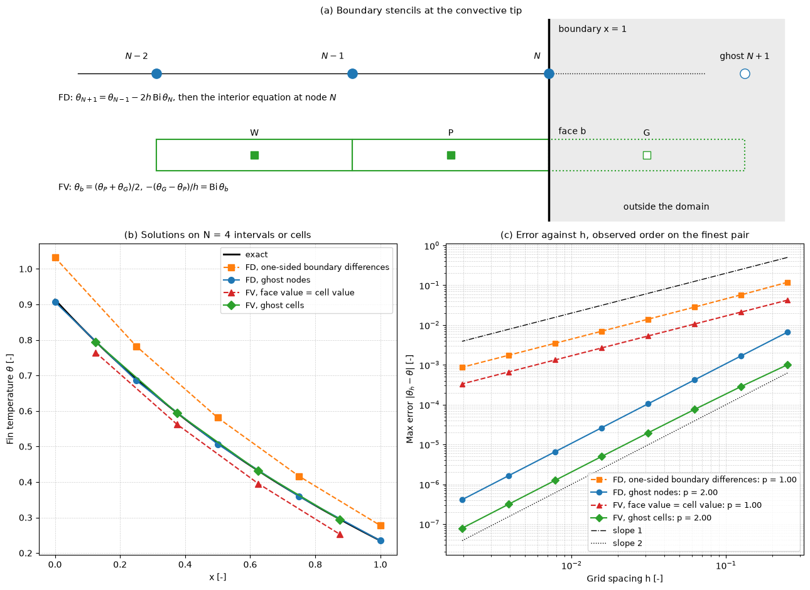

# Ghost-Cell Boundary Conditions

This script compares first-order and second-order ways of imposing Neumann and Robin boundary conditions in finite-difference and finite-volume discretizations of a 1D diffusion problem. The model is a cooling fin with a prescribed heat flux at its base and convective loss at its tip, solved on grids of 4 to 512 intervals. One-sided boundary differences and the "face value equals cell value" shortcut reduce both methods to first order, whereas ghost nodes and ghost cells keep them second order.

## Overview

- Solves the dimensionless fin equation $-\theta'' + m^2\theta = 0$ on $(0, 1)$ with $m = 1$, base flux $-\theta'(0) = q = 1$ (Neumann) and tip condition $`-\theta'(1) = \mathrm{Bi}\,\theta(1)`$ with $\mathrm{Bi} = 2$ (Robin).
- Vertex-centred finite differences (FD) close the system either with first-order one-sided differences at both ends or with ghost nodes and the interior equation at the boundary nodes.
- Cell-centred finite volumes (FV) apply the base flux exactly at the boundary face and treat the Robin face either with $\theta_b = \theta_P$ or with a ghost cell.
- Measures the maximum error at the nodes or cell centres against the exact solution on $N = 4, 8, \dots, 512$ and prints the observed orders.
- Draws the two boundary stencils, the four solutions on $N = 4$ and the error against $h$.

## Mathematical Background

The exact solution is $\theta = A\cosh(mx) + B\sinh(mx)$ with $B = -q/m$ and

```math
A = -B\, \frac{m\cosh m + \mathrm{Bi}\sinh m}{m\sinh m + \mathrm{Bi}\cosh m}
```

### Finite Differences

The interior equation is $(-\theta_{i-1} + 2\theta_i - \theta_{i+1})/h^2 + m^2\theta_i = 0$. The first-order closure is $(\theta_0 - \theta_1)/h = q$ and $`(\theta_N - \theta_{N-1})/h + \mathrm{Bi}\,\theta_N = 0`$, whose truncation error is $\tfrac{h}{2}\theta''$. The second-order closure discretizes each boundary condition with a central difference across the boundary node, which defines the ghost values

```math
\theta_{-1} = \theta_1 + 2hq,
\qquad \theta_{N+1} = \theta_{N-1} - 2h\,\mathrm{Bi}\,\theta_N
```

and substitutes them into the interior equation written at nodes 0 and $N$.

### Finite Volumes

Integrating over cell $P$ of width $h$ gives $F_w - F_e - m^2\theta_P h = 0$ with the flux $F = -\theta'$. Interior faces use $F = -(\theta_E - \theta_P)/h$; the base face carries $F = q$ exactly. At the tip face, the first-order treatment sets $\theta_b = \theta_P$, so $`F_b = \mathrm{Bi}\,\theta_P`$, which misplaces the face value by half a cell. The ghost-cell treatment places $\theta_G$ so that the linear profile through $\theta_P$ and $\theta_G$ satisfies the Robin condition at the face:

```math
\theta_b = \tfrac{1}{2}(\theta_P + \theta_G), \qquad -\frac{\theta_G - \theta_P}{h} = \mathrm{Bi}\,\theta_b
\quad\Longrightarrow\quad F_b = \frac{\theta_P}{1/\mathrm{Bi} + h/2}
```

the two thermal resistances in series.

## Implementation

- `exact_solution(x)` returns $\theta$; `FIN_PARAMETER`, `BASE_FLUX` and `TIP_BIOT` set $m$, $q$ and $\mathrm{Bi}$.
- `solve_fd(n, order)` and `solve_fv(n, order)` build the tridiagonal systems (`order` 1 or 2) and solve them with `scipy.linalg.solve_banded` through `_solve_tridiagonal`.
- `max_error(method, n, order)`, `observed_orders(errors)` and `convergence_study()` produce the convergence data for the four entries of `VARIANTS`.
- `_draw_stencils(ax)` draws the schematic and `make_figure()` the three panels.

## Usage

```bash
python main.py                          # print errors and orders and show the figure
python main.py --no-show --output .     # save ghost_cell_boundary_conditions.png
```

| Flag | Meaning |
| --- | --- |
| `--no-show` | Do not open a plot window |
| `--output DIR` | Create `DIR` and save the figure as a PNG |

## Output

The exact tip temperature is $\theta(1) = 0.234667$. On $N = 512$ the maximum errors are $8.7 \times 10^{-4}$ (FD, one-sided), $4.1 \times 10^{-7}$ (FD, ghost nodes), $3.3 \times 10^{-4}$ (FV, face value = cell value) and $7.9 \times 10^{-8}$ (FV, ghost cells). The observed orders on the finest pair are 1.00, 2.00, 1.00 and 2.00. The first-order variants are already worse by a factor of 18 (FD) and 42 (FV) on the coarsest grid, $N = 4$.



Panel (a) shows the ghost node beyond the boundary node in FD and the ghost cell beyond the boundary face in FV. Panel (b) shows that on four intervals the one-sided FD solution is shifted upwards everywhere, because the error made at the boundary propagates through the whole domain. Panel (c) shows the slopes.

## Related Notes

- [Boundary Conditions](../../../notes/numerical/cfd/boundary_conditions.md)
- [Verification and Validation](../../../notes/numerical/cfd/verification_and_validation.md)
