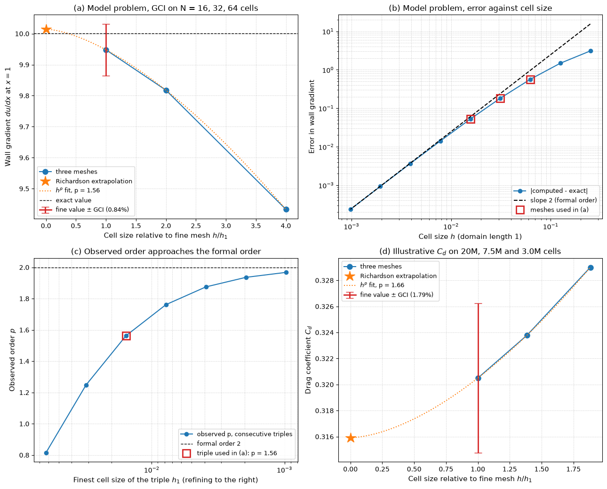

# Grid Convergence Index

This script estimates discretization error from three meshes with Richardson extrapolation and the grid convergence index (GCI), following the procedure of Celik et al. (2008). It first applies the procedure to a 1D advection-diffusion problem whose exact answer is known, so the observed order and the GCI can be checked against the true error, and then to an illustrative set of drag coefficients from three car meshes of 3.0, 7.5 and 20 million cells.

## Overview

- Solves $`a\,u' = \varepsilon\,u''`$ on $[0, 1]$ with $u(0) = 0$, $u(1) = 1$, $a = 1$, $\varepsilon = 0.1$ (Péclet number 10) using second-order central differences on $N = 4, 8, \dots, 1024$ cells.
- Takes the wall gradient $du/dx$ at $x = 1$ as the output quantity, computed with a second-order one-sided difference. It plays the role of a skin-friction or force coefficient.
- Runs the three-grid procedure on the meshes $N = 16, 32, 64$: observed order $p$, extrapolated value, approximate and extrapolated relative errors and the fine-grid GCI with safety factor $F_s = 1.25$.
- Computes the observed order of every consecutive triple of the refinement sequence to show how $p$ approaches the formal order 2.
- Repeats the procedure for illustrative $C_d$ values on three 3D meshes with unequal refinement ratios, where $p$ must be found iteratively.

## Mathematical Background

### Three-Grid Procedure

Let $\phi_1, \phi_2, \phi_3$ be the solutions on the fine, medium and coarse meshes with representative cell sizes $h_1 < h_2 < h_3$. For a 3D mesh of $N_k$ cells in a volume $V$, $h_k = (V/N_k)^{1/3}$. The refinement ratios are $r_{21} = h_2/h_1$ and $r_{32} = h_3/h_2$. With $\varepsilon_{21} = \phi_2 - \phi_1$, $\varepsilon_{32} = \phi_3 - \phi_2$ and $s = \mathrm{sign}(\varepsilon_{32}/\varepsilon_{21})$, the observed order solves

```math
p = \frac{1}{\ln r_{21}}\left|\ln\left|\frac{\varepsilon_{32}}{\varepsilon_{21}}\right| + q(p)\right|,
\qquad
q(p) = \ln\left(\frac{r_{21}^p - s}{r_{32}^p - s}\right)
```

For a constant ratio $r$, $q = 0$ and $p = \ln(\varepsilon_{32}/\varepsilon_{21})/\ln r$. A negative $s$ means oscillatory convergence.

### Extrapolated Value and GCI

```math
\phi_{\mathrm{ext}} = \frac{r_{21}^p\,\phi_1 - \phi_2}{r_{21}^p - 1},
\qquad
e_a^{21} = \left|\frac{\phi_1 - \phi_2}{\phi_1}\right|,
\qquad
\mathrm{GCI}_{\mathrm{fine}} = \frac{F_s\, e_a^{21}}{r_{21}^p - 1}
```

The extrapolated relative error is $e_{\mathrm{ext}}^{21} = |(\phi_{\mathrm{ext}} - \phi_1)/\phi_{\mathrm{ext}}|$. The GCI is meant as a band that contains the true value with roughly 95% confidence when the meshes are in the asymptotic range.

### Model Problem

The exact solution is $`u(x) = (e^{x\,a/\varepsilon} - 1)/(e^{a/\varepsilon} - 1)`$, so the exact wall gradient is

```math
\left.\frac{du}{dx}\right|_{x=1} = \frac{a/\varepsilon}{1 - e^{-a/\varepsilon}} = 10.000454
```

The interior scheme is $a(u_{i+1} - u_{i-1})/(2h) = \varepsilon(u_{i+1} - 2u_i + u_{i-1})/h^2$, and the wall gradient is $(3u_N - 4u_{N-1} + u_{N-2})/(2h)$. Both are formally second order, but the leading error term only dominates once the boundary layer of thickness $\varepsilon/a = 0.1$ is resolved by several cells.

## Implementation

- `solve_advection_diffusion(n)` assembles the tridiagonal system and solves it with `scipy.linalg.solve_banded`.
- `wall_gradient(n)` and `exact_wall_gradient()` return the computed and exact outputs.
- `observed_order(phi1, phi2, phi3, r21, r32)` iterates the fixed-point equation for $p$ and returns $(p, s)$.
- `richardson_extrapolate(phi1, phi2, r21, p)` and `gci(phi_fine, phi_coarse, r, p)` implement the formulas above.
- `gci_study(phi, h)` runs the full procedure on values ordered fine to coarse and returns a dictionary of results.
- `local_orders(values, h)` gives the observed order of every consecutive triple of a sequence.
- `representative_size(cells)` converts cell counts to $h = N^{-1/3}$ (up to the constant volume factor, which cancels in the ratios).
- Constants `N_SEQUENCE`, `N_GCI`, `CD_CELLS`, `CD_VALUES` and `SAFETY_FACTOR` set the meshes and the example data.

## Usage

```bash
python main.py                          # print the tables and show the figure
python main.py --no-show --output .     # save grid_convergence_index.png in the current directory
```

| Flag | Meaning |
| --- | --- |
| `--no-show` | Do not open a plot window |
| `--output DIR` | Create `DIR` and save the figure as a PNG |

## Output

For the model problem on $N = 16, 32, 64$ the script prints $p = 1.563$, $\phi_{\mathrm{ext}} = 10.0145$ and $`\mathrm{GCI}_{\mathrm{fine}} = 0.837\%`$. The true error of the fine mesh is 0.525%, so the GCI band contains the exact value, and the extrapolated value is in error by only 0.141%. The observed order of consecutive triples rises from 0.82 on the coarsest meshes to 1.97 on $`N = 256, 512, 1024`$. For the illustrative drag study ($`r_{21} = 1.387`$, $r_{32} = 1.357$) it gives $p = 1.66$, $C_{d,\mathrm{ext}} = 0.3159$ and $`\mathrm{GCI}_{\mathrm{fine}} = 1.79\%`$, about $\pm 0.006$ in $C_d$.



Panel (a) shows the three model-problem solutions against $h/h_1$, the $h^p$ curve through them, the extrapolated value at $h = 0$ and the GCI error bar on the fine value. Panel (b) shows the error approaching the slope-2 line only on fine meshes, and panel (c) shows the observed order of each consecutive triple. Panel (d) is the same construction as (a) for the drag coefficients.

## Related Notes

- [Generating CFD Training Data](../../../notes/machine_learning/automotive_aerodynamics/generating_cfd_datasets.md)
- [Building and Validating a Mesh Dataset](../../../notes/machine_learning/automotive_aerodynamics/dataset_of_meshes.md)
- [The Strategy of CFD](../../../notes/numerical/cfd/cfd_process.md)
- [Iterative Convergence](../../../notes/numerical/cfd/iterative_convergence.md)
