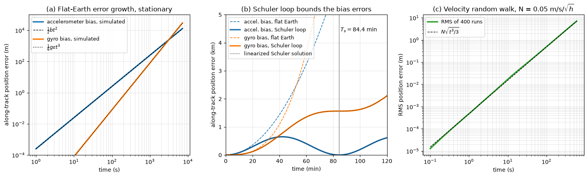
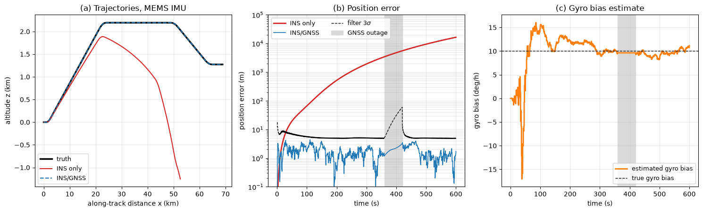

# INS Dead-Reckoning Errors

This script simulates a two-dimensional strapdown inertial navigation system and shows how accelerometer bias, gyro bias and sensor noise turn into position error, and how a Kalman filter that fuses GNSS fixes keeps that error bounded. The vehicle moves in a vertical plane (along-track distance $x$, altitude $z$, pitch angle $\theta$), which is the smallest setting in which a gyro error tilts the computed frame and leaks gravity into the horizontal channel. Stationary runs are compared with the analytic error laws $\tfrac{1}{2}bt^2$, $\tfrac{1}{6}g\varepsilon t^3$ and $N\sqrt{t^3/3}$, and with the 84.4-minute Schuler oscillation; a 10-minute flight with a MEMS-grade IMU compares unaided drift with INS/GNSS fusion through a one-minute GNSS outage.

## Overview

- Integrates a pitch-rate gyro and two body-axis accelerometers with a strapdown mechanization in a flat-Earth local-level frame with constant gravity.
- Runs a level, stationary INS for 2 h with a navigation-grade accelerometer bias $b = 5 \times 10^{-4}$ m/s² (about 50 μg) or gyro bias $\varepsilon = 0.01^\circ$/h, with and without Schuler feedback, and compares the error with the closed-form solutions.
- Runs 400 seeded Monte Carlo trials with white accelerometer noise (velocity random walk 0.05 m/s/√h) and compares the RMS position error with $N\sqrt{t^3/3}$.
- Generates a climb, cruise and descent profile, derives the error-free IMU outputs from it by inverting the discrete mechanization, and corrupts them with MEMS-grade errors: accelerometer biases of 0.02 and −0.015 m/s² (about 2 mg), a gyro bias of 10°/h, and white noise.
- Fuses 1 Hz GNSS position fixes (σ = 3 m along-track, 5 m vertical) with an 8-state closed-loop error-state Kalman filter that estimates position, velocity and attitude errors and the three sensor biases; GNSS is removed between 360 s and 420 s.

## Mathematical Background

### Strapdown Mechanization

With $\mathbf{C}_b^n(\theta)$ the body-to-navigation rotation, $\tilde\omega$ the gyro output and $\tilde{\mathbf{f}}^b$ the accelerometer output (specific force), one step of length $\Delta t$ is

```math
\theta_{k+1} = \theta_k + \tilde\omega_k\Delta t,\qquad
\mathbf{v}_{k+1} = \mathbf{v}_k + \left(\mathbf{C}_b^n(\bar\theta_k)\,\tilde{\mathbf{f}}^b_k + \mathbf{g}^n\right)\Delta t,\qquad
\mathbf{p}_{k+1} = \mathbf{p}_k + \tfrac{1}{2}(\mathbf{v}_k + \mathbf{v}_{k+1})\Delta t
```

with $\bar\theta_k = \theta_k + \tfrac{1}{2}\tilde\omega_k\Delta t$ and $\mathbf{g}^n = (0, -g)$. A stationary level IMU measures $\mathbf{f}^b = (0, g)$, the reaction of its support.

### Error Laws

For a constant horizontal accelerometer bias $b$ the velocity error is $bt$ and the position error $\delta x = \tfrac{1}{2}bt^2$; the trapezoidal update reproduces this exactly. A gyro bias $\varepsilon$ gives a tilt $\delta\theta = \varepsilon t$, which projects gravity into the horizontal channel as $`g\,\delta\theta`$, so $\delta x \approx \tfrac{1}{6}g\varepsilon t^3$. White accelerometer noise of density $N$ (m/s/√s) makes the velocity a random walk with variance $N^2 t$ and the position error variance $N^2t^3/3$.

### Schuler Loop

On a spherical Earth of radius $R$ the local-level frame turns at the transport rate $v_x/R$. Adding this rate to the attitude update closes the loop

```math
\delta\dot v = b - g\,\delta\theta, \qquad \delta\dot\theta = \varepsilon + \frac{\delta v}{R}
```

whose natural frequency is $\omega_s = \sqrt{g/R}$, period $T_s = 2\pi\sqrt{R/g} = 84.4$ min. The solutions are $\delta x = (b/\omega_s^2)(1 - \cos\omega_s t)$, bounded by $2bR/g$, and $`\delta x = -R\varepsilon\,(t - \sin(\omega_s t)/\omega_s)`$, which grows linearly at $R\varepsilon$ instead of as $t^3$.

### Error-State Kalman Filter

The state is $\delta\mathbf{x} = [\delta\mathbf{p}, \delta\mathbf{v}, \delta\theta, \Delta\mathbf{b}_a, \Delta b_g]$, where $\delta$ means INS minus truth and $\Delta$ the bias left after the current estimate is removed. Linearizing the mechanization gives

```math
\delta\dot{\mathbf{p}} = \delta\mathbf{v},\qquad
\delta\dot{\mathbf{v}} = \mathbf{J}\mathbf{f}^n\,\delta\theta + \mathbf{C}_b^n\,\Delta\mathbf{b}_a,\qquad
\delta\dot\theta = \Delta b_g,\qquad
\Delta\dot{\mathbf{b}} = \mathbf{0},
\qquad
\mathbf{J} = \begin{bmatrix} 0 & -1 \\ 1 & 0 \end{bmatrix}
```

plus white noise. Each IMU step propagates $\mathbf{P} \leftarrow \boldsymbol\Phi\mathbf{P}\boldsymbol\Phi^T + \mathbf{Q}$ with $\boldsymbol\Phi = \mathbf{I} + \mathbf{F}\Delta t$. At a GNSS fix the measurement is $`\mathbf{z} = \mathbf{p}_{INS} - \mathbf{p}_{GNSS} = \mathbf{H}\,\delta\mathbf{x} + \mathbf{w}`$ with $\mathbf{H} = [\mathbf{I}_2\ \mathbf{0}]$, and

```math
\mathbf{K} = \mathbf{P}\mathbf{H}^T(\mathbf{H}\mathbf{P}\mathbf{H}^T + \mathbf{R})^{-1},\qquad
\delta\hat{\mathbf{x}} = \mathbf{K}\mathbf{z},\qquad
\mathbf{P} \leftarrow (\mathbf{I} - \mathbf{K}\mathbf{H})\mathbf{P}(\mathbf{I} - \mathbf{K}\mathbf{H})^T + \mathbf{K}\mathbf{R}\mathbf{K}^T
```

The estimate is fed back into the INS (position, velocity and attitude corrected, bias estimates updated) and the error state is reset to zero.

## Implementation

- `mechanize(dt, gyro, force_b, pos0, vel0, pitch0, schuler)` integrates the IMU samples, vectorized with cumulative sums in the flat-Earth case and as a loop with the transport rate when `schuler=True`.
- `stationary_error(accel_bias, gyro_bias, schuler)` returns the along-track error of a level stationary INS; `schuler_error(t, ...)` gives the linearized Schuler solutions.
- `random_walk_study()` runs the noise-only Monte Carlo trials.
- `flight_profile(t)` defines speed and pitch with smooth ramps; `truth_and_imu` builds the truth trajectory and inverts the mechanization for the IMU samples, so perfect sensors reproduce the truth to round-off.
- `error_state_model(force_n, pitch)` builds $\mathbf{F}$; `run_flight(aided)` runs the noisy IMU with or without the filter and records the position standard deviations, bias estimates and the smallest covariance eigenvalue after each update.
- Sensor grades, GNSS settings and the outage window are named constants at the top of `main.py` (`NAV_ACCEL_BIAS`, `MEMS_GYRO_BIAS`, `GNSS_SIGMA`, `GNSS_OUTAGE`, ...), and the generator is seeded with `SEED`.

## Usage

```bash
python main.py                          # print the error table and show both figures
python main.py --no-show --output .     # save ins_error_growth.png and ins_gnss_fusion.png
```

| Flag | Meaning |
| --- | --- |
| `--no-show` | Do not open a plot window |
| `--output DIR` | Create `DIR` and save the figures as PNG |

## Output

The stationary runs match the analytic laws: after 10 min the accelerometer bias gives 90.0 m and the gyro bias 17.1 m; after 1 h, 3240 m and 3698 m. The gyro term overtakes the accelerometer term at $t = 3b/(g\varepsilon) \approx 53$ min. With the Schuler loop the accelerometer-bias error peaks at 650 m ($2bR/g = 649$ m) after half a Schuler period and returns to zero after 84.4 min.



Panel (a) shows the simulated errors on the $t^2$ and $t^3$ lines. Panel (b) shows the same biases with Schuler feedback: the accelerometer error oscillates and the gyro error grows only linearly with an oscillation superimposed. Panel (c) shows the Monte Carlo RMS error following $N\sqrt{t^3/3}$.

For the flight with the MEMS IMU the unaided INS is 26 m off after 60 s and 16.5 km off after 600 s. With GNSS fusion the RMS position error while fixes are available is 1.9 m, the largest error during the 60 s outage is 3.4 m, and the gyro bias estimate ends at 11.2°/h against the true 10°/h. The covariance stays positive definite (smallest eigenvalue $8.8 \times 10^{-11}$).



In panel (b) the filter's $3\sigma$ bound widens during the outage because the INS runs unaided, then collapses at the first fix; the actual error stays small because the biases were calibrated before the outage. Panel (c) shows the gyro bias estimate, which wanders during the first two minutes and then stays within about 3°/h of the true value.

## Related Notes

- [Inertial Navigation Systems](../../../notes/applied_mechanics/transportation/airplanes/inertial_navigation_systems.md)
