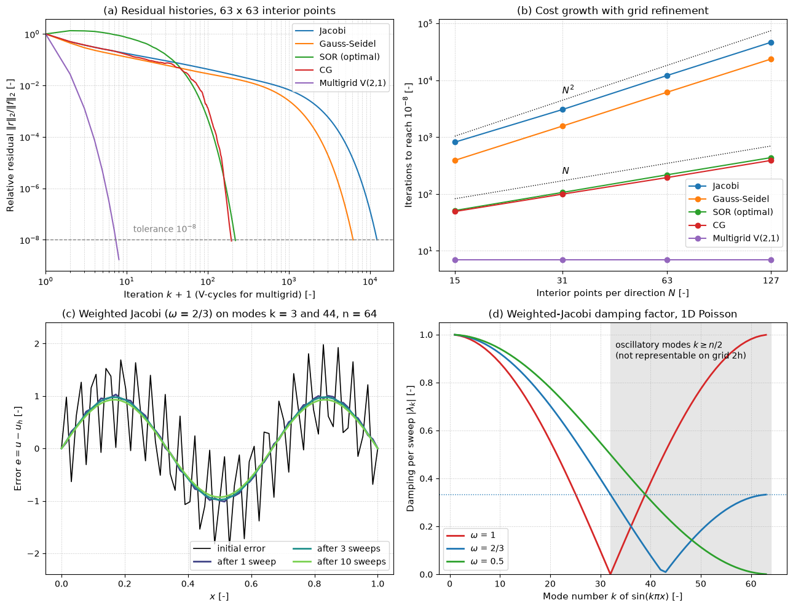

# Iterative Linear Solvers on the Poisson Equation

This script solves the 2D Poisson equation on an $N \times N$ grid with Jacobi, Gauss–Seidel, SOR with the optimal relaxation factor, conjugate gradients and a geometric multigrid V-cycle, and compares how many iterations each needs as the grid is refined. The same model problem is the pressure equation of an incompressible solver, so the measured costs are the ones that decide which linear solver a CFD code uses. A second part shows how weighted Jacobi smooths the error, which is the property multigrid is built on.

## Overview

- Solves $`-(u_{xx} + u_{yy}) = f`$ on the unit square with $u = 0$ on the boundary, using the five-point stencil on $N \times N$ interior points with $h = 1/(N+1)$.
- Uses a seeded random source $f$ so that every Fourier mode of the error is present; every method starts from $u = 0$.
- Runs Jacobi, red-black Gauss–Seidel, red-black SOR with $`\omega_{\mathrm{opt}} = 2/(1 + \sin\pi h)`$, unpreconditioned conjugate gradients and V(2,1) multigrid cycles until $`\Vert f - Au\Vert_2 / \Vert f\Vert_2 < 10^{-8}`$.
- Plots the residual histories on the $63 \times 63$ grid and the iteration counts for $N = 15, 31, 63, 127$.
- Applies weighted Jacobi with $\omega = 2/3$ to a 1D error made of the modes $k = 3$ and $k = 44$ on 64 intervals, and plots the damping factor of every mode for $\omega = 1$, $2/3$ and $1/2$.
- Prints the Jacobi spectral radius, $\omega_{\mathrm{opt}}$, the condition number and the iteration count of each method on each grid.

## Mathematical Background

### Model Problem

The five-point discretization gives $A\mathbf{u} = \mathbf{f}$ with

```math
(A\mathbf{u})_{i,j} = \frac{4u_{i,j} - u_{i-1,j} - u_{i+1,j} - u_{i,j-1} - u_{i,j+1}}{h^2}
```

$A$ is symmetric positive definite with eigenvalues $`\lambda_{pq} = (4/h^2)\left[\sin^2(p\pi h/2) + \sin^2(q\pi h/2)\right]`$, $p, q = 1, \dots, N$, so its condition number is $`\kappa = \cot^2(\pi h/2) \approx 4/(\pi h)^2`$.

### Stationary Iterations

With the splitting $A = M - N$ the iteration $M\mathbf{u}^{k+1} = N\mathbf{u}^k + \mathbf{f}$ has error $`\mathbf{e}^{k+1} = M^{-1}N\,\mathbf{e}^k`$ and converges if and only if the spectral radius $\rho(M^{-1}N) < 1$. For this problem

| Method | $M$ | $\rho$ | Iterations for a factor $10^{-8}$ |
| --- | --- | --- | --- |
| Jacobi | diagonal $D$ | $\cos\pi h \approx 1 - \pi^2h^2/2$ | $\approx 3.7/h^2$ |
| Gauss–Seidel | $D - L$ | $\cos^2\pi h$ | $\approx 1.9/h^2$ |
| SOR, $\omega_{\mathrm{opt}}$ | $D/\omega - L$ | $\omega_{\mathrm{opt}} - 1 \approx 1 - 2\pi h$ | $\approx 2.9/h$ |

Red-black ordering updates all points with $i + j$ even, then all points with $i + j$ odd. Each half-sweep only reads the other colour, so it vectorizes, and for this matrix it has the same spectral radius as the lexicographic sweep.

### Conjugate Gradients

CG minimises the $A$-norm of the error over the Krylov space $`\mathrm{span}\{\mathbf{r}^0, A\mathbf{r}^0, \dots, A^{k-1}\mathbf{r}^0\}`$, which gives

```math
\Vert\mathbf{e}^k\Vert_A \le 2\left(\frac{\sqrt{\kappa} - 1}{\sqrt{\kappa} + 1}\right)^k \Vert\mathbf{e}^0\Vert_A
```

so the iteration count grows like $\sqrt{\kappa} \propto N$.

### Multigrid

Weighted Jacobi on the 1D problem multiplies the mode $\sin(k\pi x)$ by $`\lambda_k = 1 - 2\omega\sin^2(k\pi/2n)`$. With $\omega = 2/3$, every mode with $k \ge n/2$ is reduced by at least a factor 3 per sweep, while the smoothest modes are barely touched. A V-cycle smooths, restricts the residual to the grid of spacing $2h$ by full weighting, solves the error equation there recursively, interpolates the correction back bilinearly and smooths again. The smooth error left by the smoother looks oscillatory on the coarse grid and is removed there, so the convergence factor per cycle does not depend on $h$ and the total cost is $O(N^2)$, proportional to the number of unknowns.

## Implementation

- `apply_laplacian(u, h)` and `residual(u, f, h)` work on arrays padded with a ring of zero boundary values; `norm2` is a plain NumPy norm.
- `jacobi(f, h, tol, max_iter, omega)` updates $\mathbf{u} \leftarrow \mathbf{u} + \omega D^{-1}\mathbf{r}$.
- `sor_sweep(u, f, h, omega)` performs one red-black sweep over strided slices; `sor(f, h, omega, ...)` repeats it, and $\omega = 1$ gives Gauss–Seidel. `optimal_omega(n)` returns $2/(1 + \sin\pi h)$.
- `conjugate_gradient(f, h, ...)` is the textbook CG algorithm, matrix-free.
- `restrict_full_weighting`, `prolong_bilinear` and the recursive `v_cycle(u, f, h, nu1, nu2)` make up the multigrid cycle, with two pre- and one post-smoothing red-black Gauss–Seidel sweeps (`MG_PRE_SMOOTH`, `MG_POST_SMOOTH`) and an exact solve on the $1 \times 1$ grid. `multigrid` requires $N = 2^k - 1$.
- `solve(method, n)` runs one of `METHODS` on the random-source problem and returns the solution and the residual history.
- `weighted_jacobi_1d` and `jacobi_damping_factor` produce the smoothing panels.
- Constants: `TOLERANCE`, `N_HISTORY`, `N_SCALING`, `SMOOTHING_INTERVALS`, `SMOOTHING_OMEGA`, `SMOOTHING_MODES`, `SMOOTHING_SWEEPS`, `SEED`.

## Usage

```bash
python main.py                          # run all solvers and show the figure
python main.py --no-show --output .     # save iterative_linear_solvers.png without opening a window
```

| Flag | Meaning |
| --- | --- |
| `--no-show` | Do not open a plot window |
| `--output DIR` | Create `DIR` and save the figure as a PNG |

The full run takes about 9 s, most of it in the Jacobi and Gauss–Seidel solves on the $127 \times 127$ grid.

## Output

| $N$ | $\rho_J$ | $\omega_{\mathrm{opt}}$ | $\kappa$ | Jacobi | Gauss–Seidel | SOR | CG | Multigrid |
| --- | --- | --- | --- | --- | --- | --- | --- | --- |
| 15 | 0.980785 | 1.6735 | 103 | 813 | 389 | 51 | 49 | 7 |
| 31 | 0.995185 | 1.8215 | 414 | 3040 | 1556 | 106 | 99 | 7 |
| 63 | 0.998795 | 1.9065 | 1659 | 12121 | 6156 | 217 | 194 | 7 |
| 127 | 0.999699 | 1.9521 | 6640 | 46436 | 23564 | 435 | 388 | 7 |

Doubling $N$ multiplies the Jacobi and Gauss–Seidel counts by about 4, the SOR and CG counts by about 2, and leaves multigrid at 7 cycles. Gauss–Seidel needs half as many sweeps as Jacobi, as $\rho_{GS} = \rho_J^2$ predicts.



Panel (a) shows the residual histories on the $63 \times 63$ grid: Jacobi and Gauss–Seidel drop quickly at first, while the oscillatory error is removed, and then crawl at the rate of the smoothest mode. Panel (b) shows the iteration counts with $N^2$ and $N$ guide lines. Panel (c) shows the oscillatory mode $k = 44$ disappearing after one sweep of weighted Jacobi while the smooth mode $k = 3$ is almost unchanged after ten, and panel (d) shows why: $|\lambda_k| \le 1/3$ for all $k \ge n/2$ when $\omega = 2/3$, while plain Jacobi ($\omega = 1$) does not damp the highest modes at all.

## Related Notes

- [Direct and Iterative Solvers](../../../notes/numerical/cfd/direct_and_iterative_solvers.md)
- [Iterative Convergence](../../../notes/numerical/cfd/iterative_convergence.md)
- [Dealing with Nonlinearity](../../../notes/numerical/cfd/dealing_with_nonlinearity.md)
