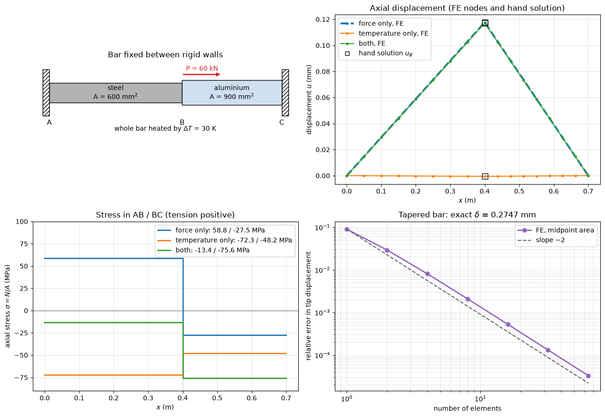

# Axial Bar Finite Elements

This script solves statically indeterminate axial bars with two-node finite elements and checks them against the hand solution from equilibrium and compatibility. A steel–aluminium bar fixed between two rigid walls carries a force at the joint and a uniform temperature rise; the force alone, the temperature alone and both together are solved, which shows superposition. A tapered bar under an end load checks the deformation integral $`\delta = \int N/(EA)\,dx`$: with constant-area elements the tip displacement converges to the closed form at second order.

## Overview

- Builds a mesh of eight elements per segment for a bar of steel ($L = 0.4$ m, $A = 600$ mm², $E = 200$ GPa, $\alpha = 12 \times 10^{-6}$ K⁻¹) and aluminium ($L = 0.3$ m, $A = 900$ mm², $E = 70$ GPa, $\alpha = 23 \times 10^{-6}$ K⁻¹), constants `STEEL` and `ALUMINIUM`.
- Applies $P = 60$ kN at the joint B and a temperature rise of 30 K (`LOAD_B`, `DELTA_T`), fixes both ends, and solves for the three load cases.
- Compares the element forces and the displacement of B with the closed-form compatibility solution.
- Checks that the strain energy equals half the work of the load (Clapeyron's theorem).
- Solves a tapered steel bar (width 60 mm to 20 mm, thickness 10 mm, length 1 m, end load 20 kN) with 1 to 64 elements and plots the relative error of the tip displacement.

## Mathematical Background

A two-node element of length $L_e$, axial stiffness $EA$ and expansion coefficient $\alpha$, heated by $\Delta T$, contributes

```math
\mathbf{k}_e = \frac{EA}{L_e}\begin{bmatrix} 1 & -1 \\ -1 & 1 \end{bmatrix},
\qquad
\mathbf{f}_e = EA\,\alpha\,\Delta T\begin{bmatrix} -1 \\ 1 \end{bmatrix}
```

to the global system $\mathbf{K}\mathbf{u} = \mathbf{f}$. Fixed nodes are removed from the system, and the element axial force is $`N = EA\left[(u_2 - u_1)/L_e - \alpha\,\Delta T\right]`$. For a bar fixed at both ends with a force $P$ at the joint B, equilibrium gives $N_{BC} = N_{AB} - P$, and zero total elongation gives

```math
N_{AB} = \frac{P f_2 - \Delta T(\alpha_1 L_1 + \alpha_2 L_2)}{f_1 + f_2},
\qquad
f_i = \frac{L_i}{E_iA_i},
\qquad
u_B = N_{AB} f_1 + \alpha_1\,\Delta T\,L_1
```

For a flat bar of thickness $t$ whose width varies linearly from $w_0$ to $w_1$, an end load $P$ gives

$$
\delta = \frac{P}{E}\int_0^L \frac{dx}{A(x)} = \frac{PL}{Et(w_0 - w_1)}\ln
\frac{w_0}{w_1}
$$

Replacing $A(x)$ by its midpoint value in each element is the midpoint rule for this integral, so the error falls as $h^2$.

## Implementation

- `build_mesh(segments, per_segment)` returns node positions and element arrays of $EA$ and $\alpha$.
- `solve_bar(x, ea, alpha, delta_t, nodal_loads, fixed)` assembles $\mathbf{K}$ and $\mathbf{f}$, solves on the free nodes with `numpy.linalg.solve`, and returns displacements, element forces and reactions.
- `hand_solution(load, delta_t, seg1, seg2)` evaluates the compatibility solution.
- `taper_exact(...)` and `taper_fem(elements, ...)` give the exact and finite element tip displacements of the tapered bar.
- `strain_energy(x, ea, u)` returns $\sum N^2L/(2EA)$.
- `draw_bar(ax)` sketches the bar and `make_figure()` draws the four panels.

## Usage

```bash
python main.py                          # open the figure window
python main.py --no-show --output .     # save materials_axial_bar_fem.png
```

| Flag | Meaning |
| --- | --- |
| `--no-show` | Do not open a plot window |
| `--output DIR` | Create `DIR` and save the figure as a PNG |

## Output

The script prints

```text
force only: N_AB = 35.294 kN (hand 35.294), N_BC = -24.706 kN (hand -24.706), u_B = 0.1176 mm (hand 0.1176), reactions -35.294, -24.706 kN
temperature only: N_AB = -43.359 kN (hand -43.359), N_BC = -43.359 kN (hand -43.359), u_B = -0.0005 mm (hand -0.0005), reactions 43.359, -43.359 kN
both: N_AB = -8.065 kN (hand -8.065), N_BC = -68.065 kN (hand -68.065), u_B = 0.1171 mm (hand 0.1171), reactions 8.065, -68.065 kN
strain energy (force only) = 3.529 J, P u_B / 2 = 3.529 J
tapered bar,  1 elements: tip = 0.25000 mm (exact 0.27465 mm)
tapered bar,  4 elements: tip = 0.27244 mm (exact 0.27465 mm)
tapered bar, 16 elements: tip = 0.27451 mm (exact 0.27465 mm)
tapered bar, 64 elements: tip = 0.27464 mm (exact 0.27465 mm)
```

The reactions are the forces the walls exert on the bar, positive in $+x$.



The displacement panel shows that the temperature rise alone barely moves the joint, because the walls suppress the free expansion of both segments, so the force-only and combined curves almost coincide. The stress panel shows superposition: the force puts the steel in tension at 58.8 MPa, the heating adds a uniform compressive force of 43.4 kN, and together the steel carries $-13.4$ MPa and the aluminium $-75.6$ MPa. The tapered bar error falls along the slope $-2$ line from 9% with one element to $3 \times 10^{-5}$ with 64.

## Related Notes

- [Axial Loading](../../../notes/applied_mechanics/strength_materials/axial_loading.md)
- [Finite Element Method](../../../notes/numerical/fem/intro.md)
