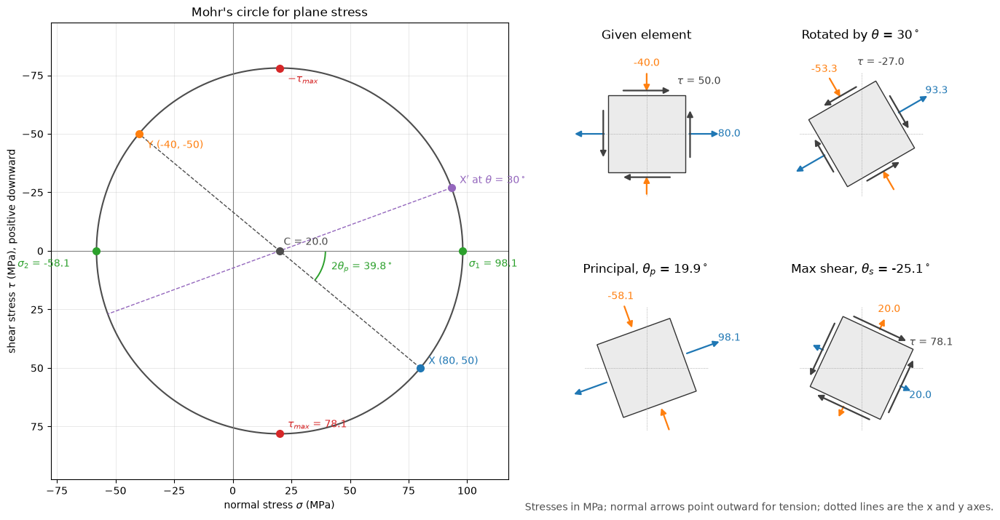

# Mohr's Circle for Plane Stress

This script transforms a 2D plane-stress state and draws Mohr's circle with the given, rotated, principal and maximum-shear stress elements. From $\sigma_x$, $\sigma_y$ and $\tau_{xy}$ it computes the stresses on a plane rotated by any angle, the principal stresses and their direction, and the in-plane and absolute maximum shear stresses, and it annotates every value on the circle and on the four elements. The stress state and the rotation angle can be set on the command line.

## Overview

- Uses the default state $\sigma_x = 80$ MPa, $\sigma_y = -40$ MPa, $\tau_{xy} = 50$ MPa and a rotation $\theta = 30^\circ$, or the values passed with `--sx`, `--sy`, `--txy` and `--theta`.
- Computes the centre and radius of the circle, $\sigma_1$, $\sigma_2$, the principal angle $\theta_p$, the maximum in-plane shear stress and its angle $\theta_s = \theta_p - 45^\circ$, and the absolute maximum shear stress with $\sigma_3 = 0$.
- Plots the circle with $\tau$ positive downward, the points $X$, $Y$ and $X'$, the diameters $XY$ and $X'Y'$, the principal and maximum-shear points, and the arc $2\theta_p$.
- Draws the stress element in its original orientation, rotated by $\theta$, aligned with the principal directions and aligned with the maximum-shear planes, with arrows for every face stress.
- Prints all computed values.

## Mathematical Background

For axes rotated counterclockwise by $\theta$,

```math
\sigma_{x'} = C + \frac{\sigma_x - \sigma_y}{2}\cos 2\theta + \tau_{xy}\sin 2\theta,
\qquad
\sigma_{y'} = C - \frac{\sigma_x - \sigma_y}{2}\cos 2\theta - \tau_{xy}\sin 2\theta,
\qquad
\tau_{x'y'} = -\frac{\sigma_x - \sigma_y}{2}\sin 2\theta + \tau_{xy}\cos 2\theta
```

with $C = (\sigma_x + \sigma_y)/2$. Eliminating $\theta$ gives the circle $(\sigma_{x'} - C)^2 + \tau_{x'y'}^2 = R^2$ with

```math
R = \sqrt{\left(\frac{\sigma_x - \sigma_y}{2}\right)^2 + \tau_{xy}^2},
\qquad
\sigma_{1,2} = C \pm R,
\qquad
\theta_p = \tfrac{1}{2}\,\mathrm{atan2}(2\tau_{xy},\ \sigma_x - \sigma_y)
```

where $\theta_p$ is the angle from $x$ to the direction of $\sigma_1$. On the planes at $\theta_s = \theta_p - 45^\circ$ the shear stress is $+R$ and both normal stresses are $C$. The absolute maximum shear stress is $(\max - \min)/2$ over $\sigma_1$, $\sigma_2$ and $\sigma_3 = 0$. With $\tau$ plotted downward, the point $X = (\sigma_x, \tau_{xy})$ moves round the circle by $2\theta$ in the same sense as the element rotates by $\theta$.

## Implementation

- `transform(sigma_x, sigma_y, tau_xy, theta)` returns $(\sigma_{x'}, \sigma_{y'}, \tau_{x'y'})$ for $\theta$ in radians.
- `circle(...)` returns $(C, R)$; `principal(...)` returns $(\sigma_1, \sigma_2, \theta_p)$; `max_shear(..., sigma_z=0.0)` returns the in-plane maximum, its angle and the absolute maximum.
- `draw_element(ax, theta, sx, sy, txy, scale, title)` draws a rotated square with normal-stress arrows (outward for tension) and shear arrows, all scaled by the largest stress.
- `make_figure(sigma_x, sigma_y, tau_xy, theta)` lays out the circle on the left and the four elements on the right.
- The constants `SIGMA_X`, `SIGMA_Y`, `TAU_XY` (MPa) and `THETA` (degrees) are the defaults of the command-line options.

## Usage

```bash
python main.py                                    # default state, open the figure window
python main.py --sx 60 --sy 20 --txy 25 --theta 45
python main.py --no-show --output .               # save materials_mohr_circle.png
```

| Flag | Meaning |
| --- | --- |
| `--sx`, `--sy`, `--txy` | Stress components in MPa |
| `--theta` | Rotation of the $x'$ axis in degrees, counterclockwise |
| `--no-show` | Do not open a plot window |
| `--output DIR` | Create `DIR` and save the figure as a PNG |

## Output

With the default state the script prints

```text
centre C = 20.00 MPa, radius R = 78.10 MPa
sigma_1 = 98.10 MPa, sigma_2 = -58.10 MPa, theta_p = 19.90 deg
tau_max in-plane = 78.10 MPa at theta_s = -25.10 deg, absolute (sigma_3 = 0) = 78.10 MPa
theta = 30.0 deg: sigma_x' = 93.30, sigma_y' = -53.30, tau_x'y' = -26.96 MPa
```



The circle passes through $X = (80, 50)$ and $Y = (-40, -50)$. Turning $CX$ by $2\theta_p = 39.8^\circ$ reaches $\sigma_1 = 98.1$ MPa, and the principal element (lower middle) is rotated $19.9^\circ$ counterclockwise with no shear on its faces. The maximum-shear element (lower right) is $45^\circ$ clockwise from it and carries 78.1 MPa of shear with 20 MPa of normal stress on every face. Because $\sigma_1$ and $\sigma_2$ have opposite signs, the absolute maximum shear equals the radius.

## Related Notes

- [Stress and Strain](../../../notes/applied_mechanics/strength_materials/stress_strain.md)
- [Combined Loading](../../../notes/applied_mechanics/strength_materials/combined_loading.md)
