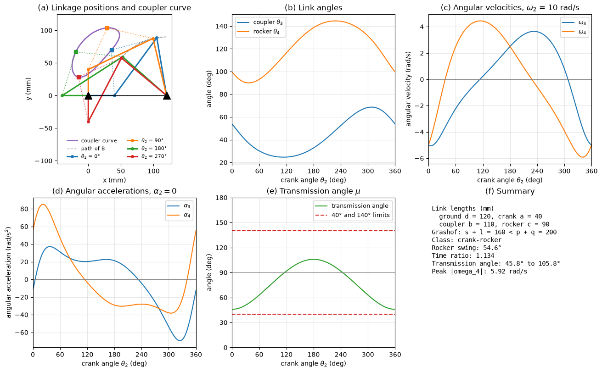
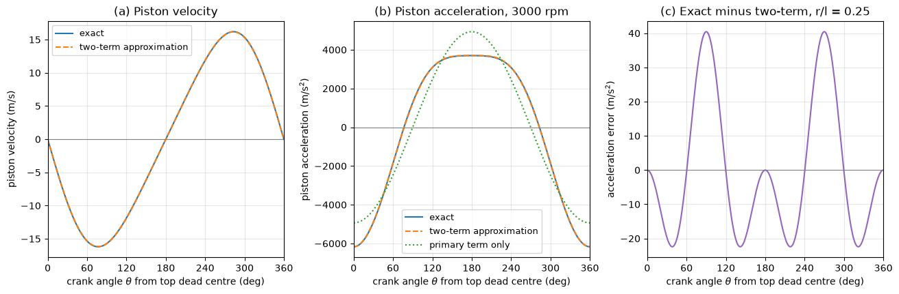

# Four-Bar Linkage Kinematics

This script solves the position, velocity and acceleration of a four-bar linkage over a full crank revolution by vector loop closure, using the Freudenstein equation for position and two linear 2 × 2 systems for the velocities and accelerations. The example is a Grashof crank-rocker. The figure draws the linkage at four crank angles with its coupler curve and plots the link angles, angular velocities, angular accelerations and the transmission angle against crank angle. A second figure compares the exact piston velocity and acceleration of an in-line slider-crank with the two-term approximation used for engine balancing.

## Overview

- Classifies the linkage by the Grashof condition and the position of the shortest link (crank-rocker, double-crank, double-rocker, change-point or triple-rocker).
- Solves the Freudenstein equation for the rocker angle $\theta_4$ in closed form for the open assembly, and takes the coupler angle $\theta_3$ from the loop equation.
- Solves the differentiated loop equation for $\omega_3, \omega_4$ and the twice-differentiated one for $\alpha_3, \alpha_4$ at constant crank speed $\omega_2 = 10$ rad/s.
- Computes the transmission angle, the two toggle positions and the quick-return time ratio.
- Traces a coupler point 70 mm from joint A at 40° to the coupler line.
- Evaluates the exact slider-crank kinematics for $r = 50$ mm, $l = 200$ mm at 3000 rpm and compares them with the first- plus second-harmonic approximation.

## Mathematical Background

### Loop Closure and the Freudenstein Equation

Ground pivots $O_2$ and $O_4$ lie on the $x$ axis a distance $d$ apart. With crank $a$, coupler $b$ and rocker $c$ at angles $\theta_2, \theta_3, \theta_4$ from the $x$ axis, the loop $O_2 \to A \to B \to O_4 \to O_2$ closes when

$$
a e^{i\theta_2} + b e^{i\theta_3} - c e^{i\theta_4} - d = 0
$$

Isolating $b e^{i\theta_3}$ and taking the squared modulus eliminates $\theta_3$:

$$
K_1\cos\theta_4 - K_2\cos\theta_2 + K_3 = \cos(\theta_2 - \theta_4),
\qquad K_1 = \frac{d}{a}, \quad K_2 = \frac{d}{c}, \quad
K_3 = \frac{a^2 - b^2 + c^2 + d^2}{2ac}
$$

The substitution $t = \tan(\theta_4/2)$ turns it into the quadratic $A t^2 + B t + C = 0$ with

$$
A = \cos\theta_2 - K_1 - K_2\cos\theta_2 + K_3,
\qquad B = -2\sin\theta_2,
\qquad C = K_1 - (K_2 + 1)\cos\theta_2 + K_3
$$

so $\theta_4 = 2\arctan\left[(-B \pm \sqrt{B^2 - 4AC})/(2A)\right]$, the minus sign giving the open assembly. A negative discriminant means the linkage cannot be assembled at that crank angle.

### Velocity and Acceleration

Differentiating the loop once gives a linear system for the unknown angular velocities,

```math
\begin{bmatrix} -b\sin\theta_3 & c\sin\theta_4 \\ b\cos\theta_3 & -c\cos\theta_4 \end{bmatrix}
\begin{bmatrix} \omega_3 \\ \omega_4 \end{bmatrix} =
\begin{bmatrix} a\omega_2\sin\theta_2 \\ -a\omega_2\cos\theta_2 \end{bmatrix}
```

and differentiating again gives the same matrix acting on $(\alpha_3, \alpha_4)$, with the centripetal terms $a\omega_2^2$, $b\omega_3^2$, $c\omega_4^2$ and the crank acceleration on the right-hand side. The matrix is singular only when coupler and rocker are collinear, which is where the transmission angle reaches 0° or 180°.

### Transmission Angle and Toggle Positions

The transmission angle $\mu$ is the angle between coupler and rocker at joint $B$. From the triangle $A B O_4$,

$$
\cos\mu = \frac{b^2 + c^2 - a^2 - d^2 + 2ad\cos\theta_2}{2bc}
$$

The usual guideline keeps $40^\circ \le \mu \le 140^\circ$. The rocker reaches its extreme positions when crank and coupler are collinear, $|O_2B| = a + b$ (extended) and $|O_2B| = b - a$ (folded). The crank turns through $180^\circ + \beta_2 - \beta_1$ between them, where $\beta_1$ and $\beta_2$ are the angles of $O_2B$ in the two triangles, and the time ratio is the larger of the two crank arcs divided by the smaller.

### Slider-Crank

For an in-line slider-crank with crank radius $r$, rod length $l$ and crank angle $\theta$ from top dead centre, the piston position is $x = r\cos\theta + \sqrt{l^2 - r^2\sin^2\theta}$. At constant $\omega$ the exact acceleration is

```math
a = -r\omega^2\cos\theta - \frac{r^2\omega^2\cos 2\theta}{\sqrt{l^2 - r^2\sin^2\theta}} - \frac{r^4\omega^2\sin^2\theta\cos^2\theta}{\left(l^2 - r^2\sin^2\theta\right)^{3/2}}
```

Expanding the square root in $\lambda = r/l$ and keeping the first term gives $a \approx -r\omega^2(\cos\theta + \lambda\cos 2\theta)$: a primary force at crank frequency and a secondary one at twice crank frequency.

## Implementation

- `grashof_class(ground, crank, coupler, rocker)` returns the linkage type.
- `freudenstein_constants(a, b, c, d)` and `solve_position(theta2, ..., branch=-1)` solve the position problem; `joint_positions` returns the complex positions of $O_2, A, B, O_4$ and the coupler point.
- `solve_velocity` and `solve_acceleration` solve the 2 × 2 systems with `numpy.linalg.solve` at each crank angle.
- `transmission_angle(theta3, theta4)` computes $\mu$ from the link angles; `transmission_angle_closed_form(theta2)` from the law of cosines, as a check.
- `limit_positions()` returns the toggle crank angles and the time ratio.
- `slider_crank(theta, omega)` and `slider_crank_approx(theta, omega)` give the exact and approximate piston kinematics.
- Constants `GROUND`, `CRANK`, `COUPLER`, `ROCKER`, `COUPLER_POINT`, `CRANK_SPEED`, `SC_CRANK`, `SC_ROD` and `SC_RPM` set the example.

## Usage

```bash
python main.py                          # print the results and show both figures
python main.py --no-show --output .     # save the two PNGs in the current directory
```

| Flag | Meaning |
| --- | --- |
| `--no-show` | Do not open a plot window |
| `--output DIR` | Create `DIR` and save the figures as PNGs |

## Output

For $d = 120$, $a = 40$, $b = 110$, $c = 90$ mm the script prints that the linkage is a crank-rocker ($s + l = 160 < p + q = 200$, shortest link adjacent to ground). The rocker swings 54.57° between 90.00° and 144.57°; the toggle positions are at crank angles 36.87° and 228.19°, giving a time ratio of 1.134. The transmission angle stays between 45.82° and 105.83°, inside the 40° to 140° guideline. At $\omega_2 = 10$ rad/s the rocker reaches 5.92 rad/s and 85.0 rad/s².



Panel (a) shows the linkage at four crank angles with the coupler point (squares) and its closed coupler curve. Panels (b) to (d) show that the output motion is far from a scaled copy of the input: the rocker angular velocity passes through zero at the two toggle positions, and its angular acceleration peaks at about $\theta_2 = 22^\circ$, shortly before the extended toggle. Panel (e) shows the transmission angle, smallest when the crank points at the rocker pivot ($\theta_2 = 0$) and largest when it points away from it ($\theta_2 = 180^\circ$).

For the slider-crank at 3000 rpm the piston moves at $-15.35$ m/s and accelerates at $-1851$ m/s² at $\theta = 60^\circ$, and accelerates at $-6169$ m/s² (about 630 g) at top dead centre.



The two-term approximation is within 41 m/s² of the exact acceleration, under 0.7% of its peak, for $r/l = 0.25$. The primary term alone misses the flat region around bottom dead centre and underestimates the top-dead-centre value by the factor $1 + r/l$.

## Related Notes

- [Mechanisms and Linkages](../../../notes/applied_mechanics/mechanical_systems/mechanisms.md)
- [Rigid Body Kinematics](../../../notes/applied_mechanics/dynamics/rigid_body_kinematics.md)
