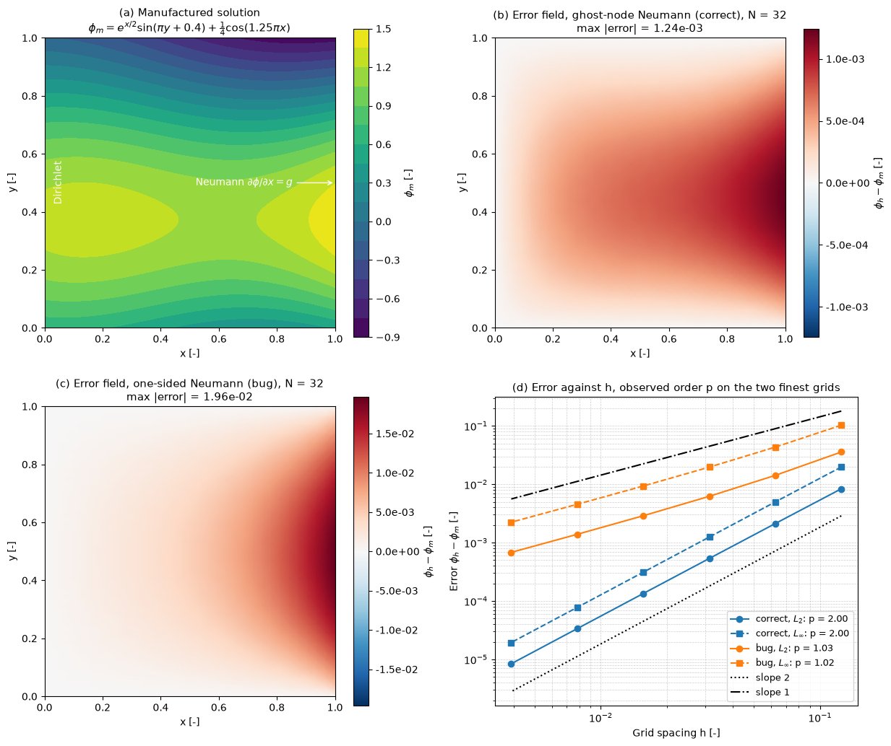

# Method of Manufactured Solutions

This script verifies a second-order finite-difference Poisson solver with the method of manufactured solutions (MMS) and shows how the same test exposes a first-order boundary treatment. A smooth function is chosen as the exact solution, the source term and boundary data that make it exact are derived analytically, and the discrete error is measured on six grids. The correct solver converges at order 2 in the $L_2$ and $L_\infty$ norms; a copy that differs only in its Neumann boundary closure converges at order 1.

## Overview

- Solves $-\nabla^2\phi = f$ on the unit square with the five-point stencil, Dirichlet conditions on $x = 0$, $y = 0$ and $y = 1$, and a Neumann condition $\partial\phi/\partial x = g$ on $x = 1$.
- Manufactures the exact solution $\phi_m = e^{x/2}\sin(\pi y + 0.4) + \tfrac{1}{4}\cos(1.25\pi x)$, which is non-zero on every boundary and has non-vanishing derivatives of all orders.
- Imposes the Neumann condition in two ways: with a ghost node and the five-point equation at the boundary node (second order), and with the one-sided difference $(\phi_{N,j} - \phi_{N-1,j})/h = g_j$ (first order, the deliberate bug).
- Measures the discrete $L_2$ (root-mean-square over all nodes) and $L_\infty$ errors on $N = 8, 16, \dots, 256$ intervals per side and prints the observed order between consecutive grids.
- Plots the manufactured solution, the error field of each solver on the $32 \times 32$ grid, and the error against $h$.

## Mathematical Background

The manufactured source and Neumann data follow by differentiation:

```math
f = -\nabla^2\phi_m = \left(\pi^2 - \tfrac{1}{4}\right)e^{x/2}\sin(\pi y + 0.4) + \tfrac{1}{4}(1.25\pi)^2\cos(1.25\pi x),
\qquad
g = \left.\frac{\partial\phi_m}{\partial x}\right|_{x=1}
```

The interior equation is

$$
\frac{4\phi_{i,j} - \phi_{i-1,j} - \phi_{i+1,j} - \phi_{i,j-1} - \phi_{i,j+1}}{h^2} = f_{i,j}
$$

with truncation error $-\tfrac{h^2}{12}(\partial_x^4\phi + \partial_y^4\phi)$. On $x = 1$ the ghost value $\phi_{N+1,j} = \phi_{N-1,j} + 2hg_j$ comes from the central difference of the Neumann condition, which is also second order. The one-sided difference has truncation error $\tfrac{h}{2}\partial_x^2\phi$, so the global error becomes $O(h)$. The observed order between grids $h$ and $h/2$ is $p = \log_2(e_h/e_{h/2})$.

## Implementation

- `manufactured(x, y)`, `manufactured_dx(x, y)` and `manufactured_source(x, y)` return $\phi_m$, $g$ and $f$; the parameters are the constants `A`, `B`, `C` and `K`.
- `solve_poisson(n, neumann_order)` assembles the sparse system for the unknowns at $i = 1, \dots, N$, $j = 1, \dots, N-1$, moves known Dirichlet values to the right-hand side and solves with `scipy.sparse.linalg.spsolve`. `neumann_order=2` uses the ghost node, `neumann_order=1` the one-sided difference.
- `error_norms(n, neumann_order)` returns the $L_2$ and $L_\infty$ errors, `observed_orders(errors)` the order between consecutive grids, and `convergence_study()` both for both solvers on `N_SEQUENCE`.
- `make_figure()` draws the four panels; `N_FIELD` sets the grid of the error-field panels.

## Usage

```bash
python main.py                          # print the convergence tables and show the figure
python main.py --no-show --output .     # save method_of_manufactured_solutions.png
```

| Flag | Meaning |
| --- | --- |
| `--no-show` | Do not open a plot window |
| `--output DIR` | Create `DIR` and save the figure as a PNG |

## Output

The ghost-node solver gives $L_2$ errors from $8.35 \times 10^{-3}$ at $N = 8$ to $8.42 \times 10^{-6}$ at $N = 256$, with observed orders 1.98, 1.99, 1.99, 2.00, 2.00 in $L_2$ and 1.99 to 2.00 in $L_\infty$. The one-sided variant gives $L_2$ errors from $3.57 \times 10^{-2}$ to $6.81 \times 10^{-4}$ with observed orders 1.33, 1.19, 1.11, 1.06, 1.03: on the two coarsest pairs it looks better than first order, and the drop to 1 is unambiguous only after four refinements.



Panel (a) is the manufactured solution with its boundary types. Panels (b) and (c) are the error fields on the $32 \times 32$ grid: both peak at the Neumann boundary, but the bugged solver's error is 16 times larger there and spreads into the whole domain. Panel (d) shows the four error curves against $h$ with the slope-1 and slope-2 reference lines.

## Related Notes

- [Verification and Validation](../../../notes/numerical/cfd/verification_and_validation.md)
- [Boundary Conditions](../../../notes/numerical/cfd/boundary_conditions.md)
