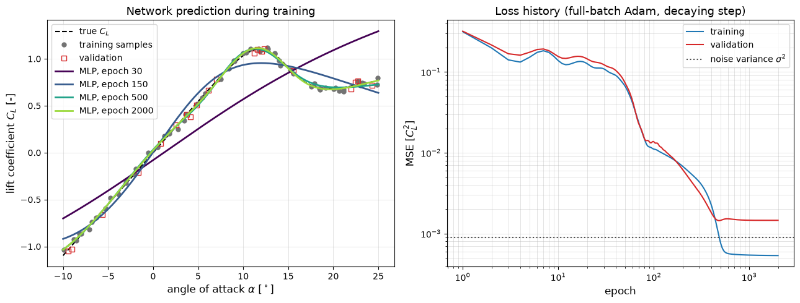

# MLP Regression

A two-hidden-layer tanh network written in numpy, with hand-coded backpropagation and Adam, learns a lift curve with stall from 60 noisy samples. The figure shows the prediction at several epochs and the training and validation loss, which makes spectral bias and the onset of overfitting visible.

## Overview

- Evaluates a synthetic lift curve $C_L(\alpha)$ for $\alpha \in [-10^\circ, 25^\circ]$: the thin-airfoil value $2\pi\alpha$ before stall, blended into the flat-plate value $\sin 2\alpha$ around $14^\circ$.
- Draws 80 angles uniformly, adds Gaussian noise of standard deviation 0.03, and holds out 20 samples at random for validation.
- Maps $\alpha$ onto $[-1, 1]$ and standardises $C_L$ with the training mean and standard deviation.
- Builds a 1-32-32-1 network ($\tanh$ hidden layers, linear output, 1153 parameters) with Xavier initialisation.
- Trains full-batch on the mean-squared error with Adam for 2000 epochs, decaying the learning rate exponentially from $10^{-2}$ to $10^{-4}$.
- Prints the final training and validation RMSE in units of $C_L$, and plots predictions at epochs 30, 150, 500 and 2000 together with both loss histories.

## Mathematical Background

### Lift Curve

With the angle $\alpha$ in radians and $\alpha_{\deg}$ in degrees,

```math
C_L(\alpha) = \big(1 - s(\alpha)\big)\, 2\pi\alpha + s(\alpha) \sin 2\alpha,
\qquad
s(\alpha) = \frac{1}{1 + e^{-0.6(\alpha_{\deg} - 14)}} .
```

The blend $s$ switches from attached to separated flow over a few degrees, giving a maximum of about $C_L = 1.1$ near $12^\circ$.

### Network and Backpropagation

The code stores samples as rows. For layer $l$ with input activations $A^{(l-1)} \in \mathbb{R}^{N \times n_{l-1}}$,

```math
Z^{(l)} = A^{(l-1)} W^{(l)} + \mathbf{1}\mathbf{b}^{(l)T},
\qquad
A^{(l)} = \tanh Z^{(l)} \ \text{(hidden)}, \qquad A^{(L)} = Z^{(L)} \ \text{(output)} .
```

For $\mathcal{L} = \frac{1}{N}\sum_i (\hat y_i - y_i)^2$, the output error is $\Delta^{(L)} = 2(\hat{\mathbf{y}} - \mathbf{y})/N$, and going backwards

```math
\frac{\partial \mathcal{L}}{\partial W^{(l)}} = A^{(l-1)T} \Delta^{(l)},
\qquad
\frac{\partial \mathcal{L}}{\partial \mathbf{b}^{(l)}} = \Delta^{(l)T}\mathbf{1},
\qquad
\Delta^{(l-1)} = \big(\Delta^{(l)} W^{(l)T}\big) \odot \big(1 - A^{(l-1)} \odot A^{(l-1)}\big),
```

using $\tanh' = 1 - \tanh^2$.

### Adam

With gradient $\mathbf{g}_k$, $\beta_1 = 0.9$, $\beta_2 = 0.999$ and $\epsilon = 10^{-8}$:

```math
\mathbf{m}_k = \beta_1 \mathbf{m}_{k-1} + (1 - \beta_1)\mathbf{g}_k,
\qquad
\mathbf{v}_k = \beta_2 \mathbf{v}_{k-1} + (1 - \beta_2)\mathbf{g}_k^2,
\qquad
\boldsymbol\theta_k = \boldsymbol\theta_{k-1} - \eta_k \frac{\mathbf{m}_k / (1 - \beta_1^k)}{\sqrt{\mathbf{v}_k / (1 - \beta_2^k)} + \epsilon},
```

with $`\eta_k = 10^{-2}\, (10^{-2})^{(k-1)/1999}`$, so that $\eta$ falls from $10^{-2}$ to $10^{-4}$ over the 2000 epochs. With a constant step of $5 \times 10^{-3}$ instead, the loss in this example shows repeated spikes once it nears its minimum.

## Implementation

- `lift_coefficient(alpha_deg)` evaluates the synthetic lift curve; `make_dataset(seed)` samples it and returns the training and validation sets as column vectors; `scale_alpha` maps angles onto $[-1, 1]$.
- `init_params(layer_sizes, rng)` returns a list of `(W, b)` tuples with Xavier normal weights, $\mathrm{Var}(W) = 2/(n_{\mathrm{in}} + n_{\mathrm{out}})$, and zero biases.
- `forward(params, x)` returns the output and the list of activations; `backward(params, activations, target)` returns the gradient of `mse_loss` for every `(W, b)`.
- `Adam` holds the moment estimates and its `step(params, grads)` returns updated parameters.
- `train(params, x_train, y_train, epochs, lr, lr_final, x_val, y_val, snapshot_epochs)` runs full-batch Adam with exponential learning-rate decay and records both losses after every epoch.
- `fit_lift_curve(seed, epochs)` scales the data, trains the network and converts the loss histories to $C_L^2$ units; `make_figure(result)` draws the two panels.
- `HIDDEN_LAYERS`, `EPOCHS`, `LEARNING_RATE`, `FINAL_LEARNING_RATE` and `SNAPSHOT_EPOCHS` set the architecture and training. `tests/test_fundamentals_ml.py` checks `backward` against central finite differences for every weight and bias.

## Usage

```bash
python main.py                          # train, print the errors and show the figure
python main.py --no-show --output .     # save the figure as a PNG in the current directory
```

## Output



In the left panel, the network after 30 epochs is almost a straight line through the data. At epoch 150 it has the S-shape of the curve, but the stall peak is flattened, because low-frequency components are learned first. By epoch 500 the peak and the post-stall plateau are resolved. In the right panel both losses fall by more than two orders of magnitude, with plateaus where the network is reorganising. The training MSE then drops below the noise variance $\sigma^2 = 9 \times 10^{-4}$, while the validation MSE levels off above it. The script prints a final training RMSE of 0.0231 and a validation RMSE of 0.0382, against a noise standard deviation of 0.03. A training error below the noise level shows that the 1153-parameter network has started to fit the noise in its 60 training samples.

## Related Notes

- [Neural Networks](../../../notes/machine_learning/fundamentals/neural_networks.md)
- [Training and Validation](../../../notes/machine_learning/fundamentals/training_and_validation.md)
