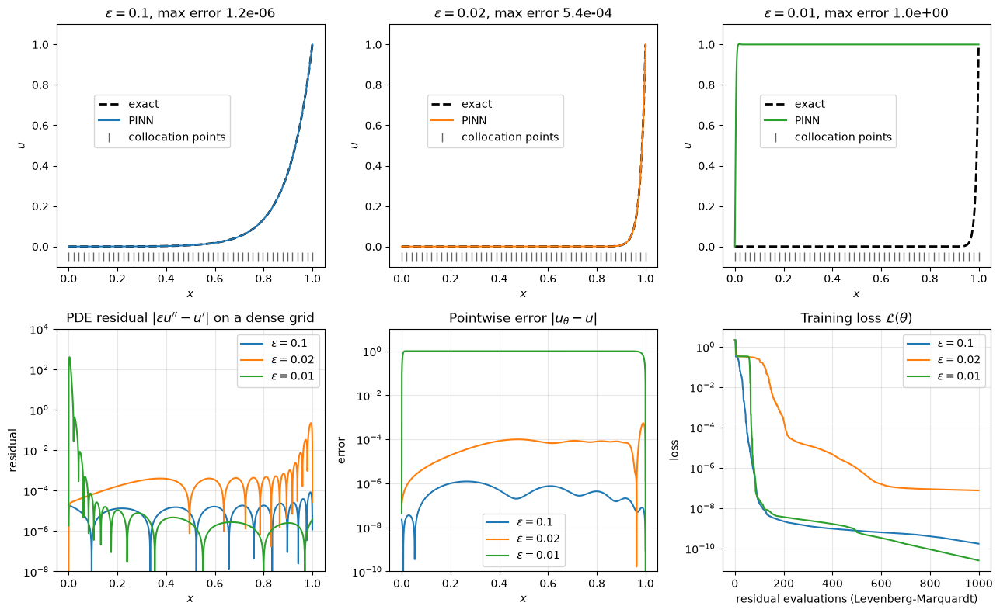

# PINN for a 1D Boundary Layer

This script trains a physics-informed neural network (PINN) on the steady advection–diffusion problem $\varepsilon u'' - u' = 0$, $u(0) = 0$, $u(1) = 1$, whose solution has a boundary layer of width about $\varepsilon$ at $x = 1$. It uses plain NumPy and SciPy: the network's derivatives with respect to $x$ and the Jacobian of the loss residuals with respect to the weights are written out by hand, and Levenberg–Marquardt minimises the loss. Comparing three values of $\varepsilon$ shows that a thinner layer makes the training problem harder, and that a PINN can reach its lowest loss on a completely wrong solution.

## Overview

- Builds a network $u_\theta(x) = \sum_j v_j \tanh(w_j x + b_j) + c$ with 10 hidden neurons (31 parameters).
- Places 50 uniformly spaced collocation points in $[0, 1]$ and imposes the boundary conditions as a soft penalty.
- Trains one network for each $`\varepsilon \in \{0.1, 0.02, 0.01\}`$ with `scipy.optimize.least_squares(method="lm")` and the analytic Jacobian, from the same random initialisation (seed 0), for at most 1000 residual evaluations.
- Evaluates the PINN, its PDE residual and its error against the exact solution on a dense grid of 4001 points.
- Prints the final loss, maximum error and maximum dense-grid residual for each $\varepsilon$, and draws a $2 \times 3$ figure.

## Mathematical Background

### Problem and Exact Solution

```math
\varepsilon u''(x) - u'(x) = 0, \quad 0 < x < 1, \qquad u(0) = 0, \quad u(1) = 1,
```

with exact solution

$$
u(x) = \frac{e^{x/\varepsilon} - 1}{e^{1/\varepsilon} - 1} = \frac{e^{(x-1)/\varepsilon} - e^{-1/\varepsilon}}{1 - e^{-1/\varepsilon}}
$$

The second form is the one evaluated, because $e^{1/\varepsilon}$ overflows for small $\varepsilon$. The solution is close to zero except in a layer of width $O(\varepsilon)$ next to $x = 1$; it reaches $u = 0.5$ at $x \approx 1 - \varepsilon \ln 2$.

### Network and Its Input Derivatives

With $z_j = w_j x + b_j$, $t_j = \tanh z_j$, $s_j = 1 - t_j^2$ and $q_j = -2 t_j s_j$:

$$
u_\theta = \sum_j v_j t_j + c,
\qquad u_\theta' = \sum_j v_j w_j s_j,
\qquad u_\theta'' = \sum_j v_j w_j^2 q_j
$$

because $dt/dz = s$ and $ds/dz = -2ts = q$. This is what automatic differentiation computes in a deep-learning framework; here it is three lines of NumPy.

### Loss and Parameter Jacobian

The loss over $N$ collocation points $x_k$ with boundary weight $\lambda$ is

$$
\mathcal{L}(\boldsymbol\theta) = \frac{1}{N} \sum_{k=1}^{N}
\left(\varepsilon u_\theta''(x_k) - u_\theta'(x_k)\right)^2 + \lambda
\left[u_\theta(0)^2 + \left(u_\theta(1) - 1\right)^2\right]
$$

It is a sum of squares, so a Gauss–Newton type method applies. The derivatives of $u_\theta$, $u_\theta'$ and $u_\theta''$ with respect to $w_j$, $b_j$, $v_j$ and $c$ follow from the chain rule with the third derivative $dq/dz = -2s^2 + 4t^2 s$; for example

```math
\frac{\partial u_\theta''}{\partial w_j} = 2 v_j w_j q_j + v_j w_j^2 \frac{dq_j}{dz} x,
\qquad
\frac{\partial u_\theta''}{\partial b_j} = v_j w_j^2 \frac{dq_j}{dz}
```

Levenberg–Marquardt then updates $\boldsymbol\theta \leftarrow \boldsymbol\theta - (J^T J + \mu I)^{-1} J^T \mathbf{r}$, where $\mathbf{r}$ stacks the scaled residuals and $J$ is their Jacobian.

## Implementation

- `exact_solution(x, eps)` evaluates the overflow-free exact solution.
- `hidden_layer`, `network(theta, x)` and `network_jacobians(theta, x)` return the activations, $(u, u', u'')$ and their parameter Jacobians, all in closed form.
- `residual_vector` and `residual_jacobian` stack the PDE and boundary residuals and their Jacobian; the squared norm of `residual_vector` is $\mathcal{L}$.
- `initial_parameters(rng)` draws $w_j \sim \mathcal{N}(0, 5^2)$ and sets $b_j = -w_j c_j$ with $c_j$ uniform in $[0, 1]$, so that every tanh starts with its transition inside the domain.
- `train_pinn(eps)` calls `least_squares` and records the running minimum of the loss at every residual evaluation.
- `EPSILONS`, `N_HIDDEN`, `N_COLLOCATION`, `BC_WEIGHT` and `MAX_EVALUATIONS` set the experiment.
- [`tests/test_neural_operator_pinn_ml.py`](../../../tests/test_neural_operator_pinn_ml.py) checks the input derivatives and the parameter Jacobian against finite differences, the accuracy at $\varepsilon = 0.1$, and the detection of the failed run by its dense-grid residual.

## Usage

```bash
python main.py                          # show the figure
python main.py --no-show --output .     # save the figure as a PNG in the current directory
```

The three trainings take about one second in total.

## Output



The script prints:

| $\varepsilon$ | final loss | max error | max dense-grid residual |
| --- | --- | --- | --- |
| 0.1 | $1.7 \times 10^{-10}$ | $1.2 \times 10^{-6}$ | $8.4 \times 10^{-5}$ |
| 0.02 | $7.5 \times 10^{-8}$ | $5.4 \times 10^{-4}$ | $0.22$ |
| 0.01 | $2.5 \times 10^{-11}$ | $1.0$ | $412$ |

The top row compares the PINN with the exact solution; the ticks mark the 50 collocation points. At $\varepsilon = 0.1$ the layer spans several points and the PINN is accurate to $10^{-6}$. At $\varepsilon = 0.02$ it is still correct but the error rises near $x = 1$, where only five collocation points lie inside the layer ($u > 0.01$ for $x > 0.908$). At $\varepsilon = 0.01$ the network converges to $u \approx 1$ with a jump between $x = 0$ and the first interior collocation point: a constant satisfies the PDE exactly, so the residual is zero at every collocation point and the jump satisfies $u(0) = 0$. This wrong solution has the lowest training loss of the three (bottom right). The dense-grid residual (bottom left) exposes it, with a peak of about 400 between the first two points, which is why a PINN's residual should always be checked away from the training points. Calling `train_pinn(0.01, n_collocation=200)` removes the failure (maximum error $1.5 \times 10^{-5}$), because a jump can no longer hide between two points without being seen by the loss; residual-adaptive resampling achieves the same with fewer points.

## Related Notes

- [Physics-Informed Neural Networks](../../../notes/machine_learning/neural_networks/pinns.md)
- [Neural Networks](../../../notes/machine_learning/fundamentals/neural_networks.md)
