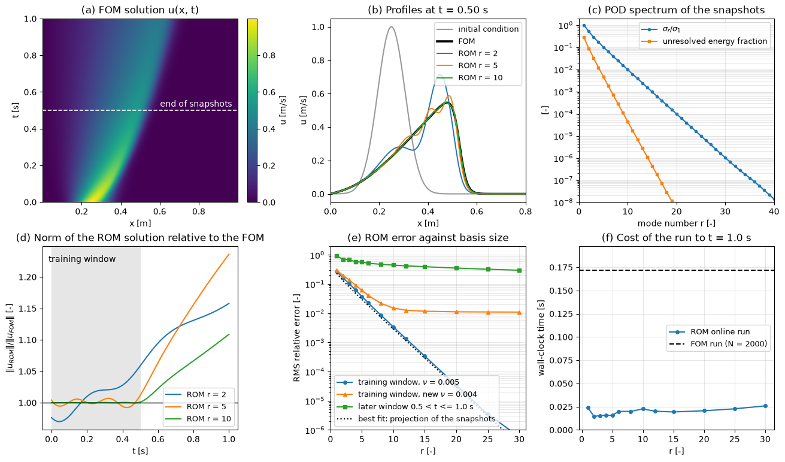

# POD-Galerkin Reduced-Order Model of the Burgers Equation

This script builds a POD-Galerkin reduced-order model (ROM) of the 1D viscous Burgers equation from snapshots of a 2000-point finite-difference solution, precomputes the reduced constant, linear and quadratic operators offline, and compares ROMs of 1 to 30 modes with the full-order model (FOM) inside the training window, in a later time window and at a new viscosity. It also measures the wall-clock cost of both models and shows how small ROMs gain energy that the FOM dissipates.

## Overview

- Solves $u_t + u u_x = \nu u_{xx}$ on $0 < x < 1$ m with $u(0, t) = u(1, t) = 0$ and a Gaussian pulse $u_0 = e^{-((x - 0.25)/0.08)^2}$, which steepens into a front and travels to the right.
- Uses second-order central differences on $N = 2000$ interior points and an IMEX Euler step (implicit diffusion, explicit convection) with $\Delta t = 2.5 \times 10^{-4}$ s up to $t = 1$ s.
- Takes 201 snapshots of the run with $\nu = 0.005$ m $`^2`$/s in $0 \le t \le 0.5$ s, subtracts their mean and computes the POD modes with `compute_pod` from `scripts/_numerics.py`.
- Projects the semi-discrete equations onto the first $r$ modes, precomputes the reduced operators, and integrates the ROM with the same IMEX scheme to $t = 1$ s for $\nu = 0.005$ and, with the same basis, for $\nu = 0.004$ m $`^2`$/s.
- Prints, for each $r$, the RMS relative error in the training window, at the new viscosity and in the later window $0.5 < t \le 1$ s, the largest ratio $`\lVert u_{\mathrm{ROM}} \rVert/\lVert u_{\mathrm{FOM}} \rVert`$ in the training window, and the run time.
- Draws a six-panel figure: the FOM field, profiles of the FOM and of ROMs with $r = 2, 5, 10$, the POD spectrum, the norm ratio over time, the error against $r$, and the wall-clock times.

## Mathematical Background

### Full-Order Model

With $\mathbf{u} \in \mathbb{R}^N$ the nodal values and $D_1$, $D_2$ the central first- and second-difference matrices (zero values outside the grid), the semi-discrete model and its time step are

```math
\frac{d\mathbf{u}}{dt} = \nu D_2\mathbf{u} - \mathbf{u} \odot (D_1\mathbf{u}),
\qquad
(I - \Delta t\,\nu D_2)\,\mathbf{u}^{n+1} = \mathbf{u}^n - \Delta t\,\mathbf{u}^n \odot (D_1\mathbf{u}^n)
```

where $\odot$ is the element-wise product. The tridiagonal system is solved once per step with `scipy.linalg.solve_banded`.

### Galerkin Projection

The ROM writes $\mathbf{u} \approx \bar{\mathbf{u}} + V\mathbf{a}$, with the snapshot mean $\bar{\mathbf{u}}$ and orthonormal POD modes $V \in \mathbb{R}^{N \times r}$. The mean satisfies the boundary conditions and the modes vanish at both ends, so no lifting function is needed. Substituting into the semi-discrete model and multiplying by $V^T$ gives

```math
\frac{d\mathbf{a}}{dt} = \nu\left(\mathbf{d} + D\mathbf{a}\right) - \left(\mathbf{c} + L\mathbf{a} + Q(\mathbf{a}, \mathbf{a})\right)
```

with the offline operators

```math
D = V^T D_2 V, \quad \mathbf{d} = V^T D_2\bar{\mathbf{u}}, \quad \mathbf{c} = V^T\left(\bar{\mathbf{u}} \odot D_1\bar{\mathbf{u}}\right), \quad L = V^T\left(\mathrm{diag}(\bar{\mathbf{u}})D_1 V + \mathrm{diag}(D_1\bar{\mathbf{u}})V\right), \quad Q_{ijk} = \sum_{n} V_{ni}V_{nj}(D_1V)_{nk}
```

and $`Q(\mathbf{a}, \mathbf{a})_i = \sum_{j,k} Q_{ijk}a_ja_k`$. Online, one step costs $O(r^3)$ operations for the quadratic term and nothing that depends on $N$. Because the viscous terms are linear in $\nu$, the same operators serve any viscosity. The ROM is advanced with the projected IMEX step

```math
(I - \Delta t\,\nu D)\,\mathbf{a}^{n+1} = \mathbf{a}^n + \Delta t\left(\nu\mathbf{d} - \mathbf{c} - L\mathbf{a}^n - Q(\mathbf{a}^n, \mathbf{a}^n)\right)
```

If every FOM state lies in $\bar{\mathbf{u}} + \mathrm{span}(V)$, this step reproduces the FOM trajectory exactly, which the unit test checks.

## Implementation

- `Grid(n)` holds the interior grid; `first_derivative` and `second_derivative` apply $D_1$ and $D_2$ to a vector or to every column of a matrix.
- `solve_fom(u0, grid, nu, dt, n_steps, every)` advances the FOM and returns every `every`-th state as a column.
- `build_rom(mean, modes, grid)` returns a `ReducedOperators` object with $D$, $\mathbf{d}$, $\mathbf{c}$, $L$ and $Q$ (stored as an $r \times r^2$ matrix).
- `solve_rom(ops, u0, nu, dt, n_steps, every)` projects the initial condition, inverts $`I - \Delta t\,\nu D`$ once and runs the reduced IMEX loop; `reconstruct` maps coefficients back to fields.
- `run_study()` runs both FOMs, the POD and the sweep over `SWEEP_RANKS`, timing each run with `best_time` (best of `TIMING_REPEATS`); `plot_study` draws the figure.
- `N_POINTS`, `NU_TRAIN`, `NU_TEST`, `DT`, `T_TRAIN`, `T_END` and `SNAPSHOT_EVERY` set the grid, viscosities, time step and windows.

## Usage

```bash
python main.py                          # print the table and show the figure
python main.py --no-show --output .     # save pod_galerkin_burgers.png in the current directory
```

## Output



The POD spectrum in (c) decays exponentially: two modes hold 91% of the fluctuation energy and five modes 99.5%. In the training window the ROM error in (e) follows the best possible error, the projection of the snapshots onto the same modes, from 16% at $r = 2$ through 3.8% at $r = 5$ and 0.34% at $r = 10$ to $6 \times 10^{-7}$ at $r = 30$. Panel (b) shows what these numbers mean: at $r = 2$ the front is in the wrong place and too high, at $r = 5$ it carries wiggles, and at $r = 10$ the ROM lies on the FOM.

At the new viscosity $\nu = 0.004$ m $`^2`$/s the error stops falling at about 1.1%, the part of the new solution that the training snapshots do not contain. In the later window $0.5 < t \le 1$ s the front moves into a region no snapshot covered, and the error stays between 30% and 90% whatever $r$ is: a POD-Galerkin ROM cannot represent states outside the span of its snapshots.

Panel (d) shows the stability issue of truncated Galerkin models. With few modes the ROM norm drifts above the FOM norm, by up to 6% at $r = 2$ inside the training window, and by 11% to 24% at $t = 1$ s for $r = 2, 5, 10$. The discarded modes are the small-scale ones that carry most of the viscous dissipation, and the Galerkin system has no term that represents the energy they would remove. This is the motivation for closure models (an added modal eddy viscosity) and for stabilized projections.

The FOM run takes about 0.17 s and each ROM run 0.015 to 0.026 s, a speed-up of 7 to 12 times. In 1D the FOM is itself cheap, an $O(N)$ banded solve per step, and the ROM time is dominated by Python loop overhead; the ROM cost does not depend on $N$, so the gain grows in proportion to the size of the full model.

## Related Notes

- [POD-Galerkin Projection](../../../notes/numerical/rom/pod_galerkin_projection.md)
- [Reduced-Order Modeling](../../../notes/numerical/rom/rom.md)
- [Proper Orthogonal Decomposition](../../../notes/numerical/pod/pod_intro.md)
- [Modeling Flow Dynamics](../../../notes/machine_learning/flow/flow_dynamics.md)
