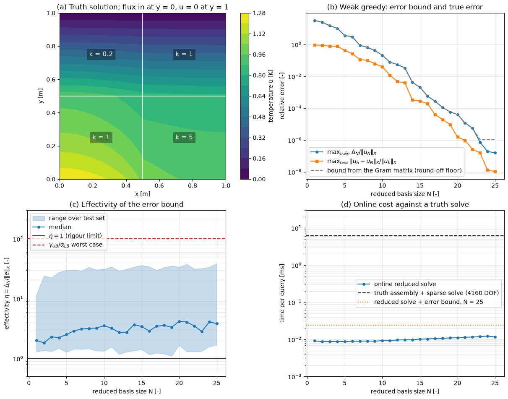

# Certified Reduced Basis Method for a Thermal Block

This script builds a certified reduced basis model of steady heat conduction in a 2D thermal block with three parametrized conductivities, using a weak greedy algorithm driven by the residual-based error bound $`\lVert r(\mu) \rVert_{X'}/\alpha_{\mathrm{LB}}(\mu)`$. It checks the bound against the true error on a test set, reports its effectivity, and compares the cost of an online query with a finite element truth solve.

## Overview

- Solves $-\nabla \cdot (k(\mathbf{x};\mu)\nabla u) = 0$ on the unit square divided into $2 \times 2$ blocks with conductivities $(1, \mu_1, \mu_2, \mu_3)$, $\mu_i \in [0.1, 10]$, numbered from the bottom left block row by row.
- Applies a unit heat flux on the bottom edge, $u = 0$ on the top edge and insulated sides; the output is the mean bottom temperature $`s(\mu) = \int_{y=0} u \, dx`$, a compliant output.
- Discretizes with piecewise-linear finite elements on a $64 \times 64$ structured triangulation, which gives 4160 unknowns.
- Assembles the affine operators $A_q$ once, so that $A(\mu) = \sum_q \theta_q(\mu) A_q$ with $\theta(\mu) = (1, \mu_1, \mu_2, \mu_3)$.
- Runs the weak greedy algorithm on 1000 log-uniform training parameters, starting from $\mu = (1, 1, 1)$, for 25 basis functions.
- After each greedy step, computes the true error at 50 test parameters from stored truth solutions, and the effectivities of the energy-norm bound and of the output bound.
- Draws four panels: a truth solution, the greedy decay of the bound and the true error, the effectivity range and the online cost.

## Mathematical Background

### Truth Problem and Affine Form

The truth solution $u_h(\mu) \in \mathbb{R}^{N_h}$ solves $`A(\mu)\mathbf{u}_h = \mathbf{f}`$, where $`(A_q)_{ij} = \int_{\Omega_q}\nabla\varphi_j \cdot \nabla\varphi_i \, d\mathbf{x}`$ is the stiffness matrix of block $q$ with unit conductivity and $`f_i = \int_{y=0}\varphi_i \, dx`$. The reference inner product is the energy product at $\mu = (1, 1, 1)$, $X = \sum_q A_q$, with $`\lVert v \rVert_X^2 = v^T X v`$.

### Coercivity Lower Bound

Every $A_q$ is symmetric positive semi-definite, so

```math
v^T A(\mu) v = \sum_q \theta_q(\mu)\, v^T A_q v \ \ge\ \min_q \theta_q(\mu) \sum_q v^T A_q v = \alpha_{\mathrm{LB}}(\mu)\,\lVert v \rVert_X^2
```

This min-theta bound is rigorous and costs nothing online. The same argument with the maximum gives the continuity bound $`\gamma_{\mathrm{UB}}(\mu) = \max_q\theta_q(\mu)`$.

### Reduced Problem and Error Bound

With an $X$-orthonormal basis $Z \in \mathbb{R}^{N_h \times N}$, the reduced solution solves $\left(\sum_q \theta_q(\mu) Z^TA_qZ\right)\mathbf{a} = Z^T\mathbf{f}$ and $u_N = Z\mathbf{a}$. The residual $r(\mu) = \mathbf{f} - A(\mu)Z\mathbf{a}$ gives the bounds

```math
\lVert u_h - u_N \rVert_X \le \Delta_N(\mu) = \frac{\lVert r(\mu) \rVert_{X'}}{\alpha_{\mathrm{LB}}(\mu)},
\qquad
0 \le s_h - s_N \le \frac{\lVert r(\mu) \rVert_{X'}^2}{\alpha_{\mathrm{LB}}(\mu)},
\qquad
1 \le \frac{\Delta_N}{\lVert u_h - u_N \rVert_X} \le \frac{\gamma_{\mathrm{UB}}(\mu)}{\alpha_{\mathrm{LB}}(\mu)}
```

where $`\lVert r \rVert_{X'}^2 = r^T X^{-1} r`$. The worst case of the effectivity bound over the parameter box is $10/0.1 = 100$.

### Offline-Online Evaluation of the Residual Norm

The Riesz representer of the residual is $`X^{-1}r = X^{-1}\mathbf{f} - \sum_{q,n}\theta_q(\mu)a_n X^{-1}A_q\mathbf{z}_n = W\mathbf{c}(\mu)`$, where the columns of $`W`$ are computed offline and $`\mathbf{c}(\mu) = (1, -\theta_q a_n, \dots)`$ is formed online. The usual Gram-matrix formula $`\lVert r \rVert_{X'}^2 = \mathbf{c}^T(W^TXW)\mathbf{c}`$ subtracts numbers of size $`\lVert \mathbf{f} \rVert_{X'}^2`$ and loses all accuracy once the relative residual falls to about $`\sqrt{\varepsilon_{\mathrm{mach}}} \approx 10^{-8}`$. The script instead factors $W = OR$ with $X$-orthonormal $O$ (two passes of Gram–Schmidt in the $X$ product) and evaluates $`\lVert r \rVert_{X'} = \lVert R\mathbf{c}(\mu) \rVert_2`$, which has no cancellation. The online cost is $O(QN^2)$ for assembly, $O(N^3)$ for the solve and $O((QN)^2)$ for the bound, independent of $N_h$.

### Weak Greedy

1. Set $\mu^{(1)} = (1, 1, 1)$ and $N = 1$.
2. Solve the truth problem at $\mu^{(N)}$, orthonormalize the solution against $Z$ in the $X$ product and append it; update the reduced matrices and the factor $R$.
3. Evaluate $`\Delta_N(\mu)/\lVert u_N(\mu) \rVert_X`$ online at every training parameter.
4. Stop if the maximum is below the tolerance; otherwise set $\mu^{(N+1)}$ to the maximizer, increase $N$ and return to step 2.

## Implementation

- `build_model(n_cells, blocks)` triangulates the square, computes the P1 element matrices and the boundary load; `assemble(model, element_weights)` assembles $\sum_e w_e K_e$ on the free nodes.
- `affine_operators(model)` returns the $A_q$; `assemble_affine` and `assemble_direct` build $A(\mu)$ from them and element by element, which the unit test compares.
- `coercivity_lower_bound(mu)` is the min-theta bound; `truth_solve` calls `scipy.sparse.linalg.spsolve`.
- `ReducedBasis.add` orthonormalizes a snapshot and updates the offline data; `solve`, `residual_norm(mus, a, stable)` and `error_bound` are the vectorized online stage; `stable=False` uses the Gram-matrix formula.
- `greedy(model, n_max, tolerance, seed)` runs the algorithm and records the bound, true error and effectivities; `time_queries` measures the truth and online costs.
- `N_CELLS`, `BLOCKS`, `MU_RANGE`, `N_TRAIN`, `N_TEST`, `N_MAX` and `TOLERANCE` set the mesh, parameter box, sample sizes and stopping rule.

## Usage

```bash
python main.py                          # print the greedy table and show the figure
python main.py --no-show --output .     # save reduced_basis_thermal_block.png in the current directory
```

## Output



Panel (b) shows the exponential decay that the reduced basis method relies on: the largest relative bound over the training set falls from 32 at $N = 1$ to $1.6 \times 10^{-7}$ at $N = 25$, and the largest true error over the test set from 0.91 to $1.0 \times 10^{-8}$. The greedy picks parameters near the corners of the box, such as $(9.26, 8.38, 0.101)$ and $(0.103, 6.69, 4.81)$, where the conductivity contrast is largest. The grey dashed curve is the same bound evaluated with the Gram-matrix formula; it stalls at about $1.1 \times 10^{-6}$ from $N = 23$ on, while the factored form keeps decreasing.

Panel (c) shows that the bound is rigorous: over all test parameters and all $N$ the effectivity lies between 1.10 and 39.1, below the worst case of 100, with a median of 2 to 4. The output bound has effectivity at least 1.12. Panel (d) shows the online cost: a truth assembly and sparse solve takes about 6 ms, a reduced solve 0.01 ms, and a certified query (solve plus bound) at $N = 25$ about 0.024 ms, a speed-up of about 250 times. The offline stage needs 25 truth solves and $25 \times 4$ solves with $X$ for the representers.

## Related Notes

- [Reduced Basis Approximation](../../../notes/numerical/rom/reduced_basis_approximation.md)
- [Parametrized Variational Problems](../../../notes/numerical/rom/parameterized_variational_problems.md)
- [Truth Discretization](../../../notes/numerical/rom/discretization_techniques.md)
- [Reduced-Order Modeling](../../../notes/numerical/rom/rom.md)
