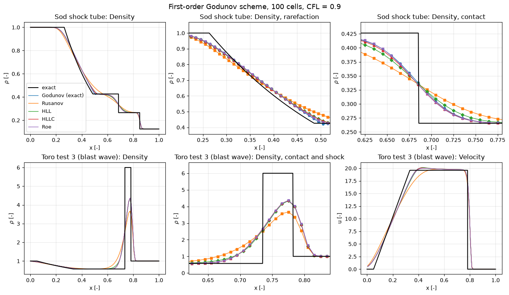
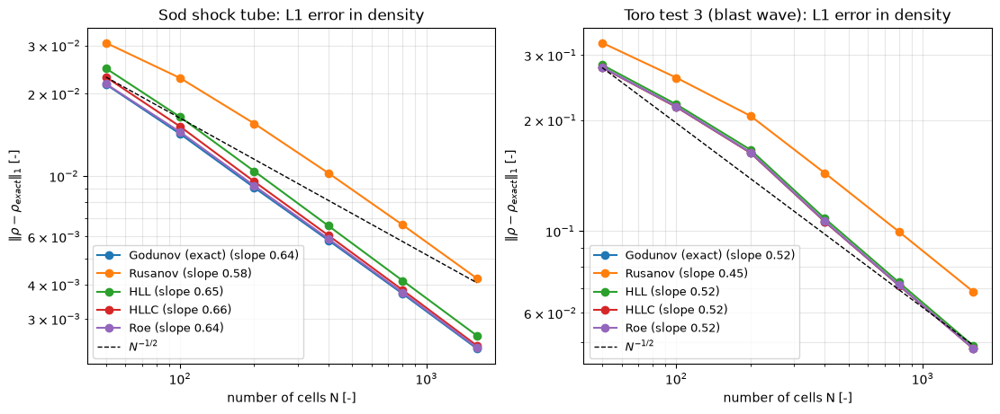

# Riemann Solver Comparison

This script compares five Riemann solvers inside the same first-order Godunov finite-volume scheme for the 1D Euler equations: the exact solver, Rusanov (local Lax–Friedrichs), HLL, HLLC and Roe with Harten's entropy fix. It runs Sod's shock tube and Toro's test 3, a strong blast wave, against the exact solution, zooms on the rarefaction, the contact and the thin shocked shell, and measures how the L1 density error falls as the grid is refined from 50 to 1600 cells. The comparison shows where the solvers differ: in how much they smear the contact discontinuity, which only HLLC, Roe and the exact solver resolve as a separate wave.

## Overview

- Solves two shock-tube problems on $0 \le x \le 1$ with the diaphragm at $x_0 = 0.5$ and $\gamma = 1.4$: Sod, $(\rho, u, p) = (1, 0, 1)$ and $(0.125, 0, 0.1)$ to $t = 0.2$; and Toro's test 3, $(1, 0, 1000)$ and $(1, 0, 0.01)$ to $t = 0.012$.
- Uses the first-order Godunov scheme with zero-gradient ends and an adaptive time step at CFL 0.9 (0.2 for the first five steps, while the cell speeds underestimate the speed of the waves leaving the initial jump).
- Computes the face fluxes with the exact Riemann solver (Newton iteration for $p^*$, vectorised over all faces), Rusanov, HLL and HLLC with Davis wave-speed estimates, and Roe with Harten's entropy fix.
- Plots density on 100 cells for both problems, zooms on the Sod rarefaction and contact and on the shocked shell of test 3, and shows the velocity of test 3.
- Computes the L1 density error against the exact solution on 50 to 1600 cells and fits the observed order.
- Prints the exact star states and the errors.

## Mathematical Background

### Godunov's Method

The cell averages $\mathbf{U}_i$ of the conserved variables $(\rho, \rho u, E)$ are updated by

```math
\mathbf{U}_i^{n+1} = \mathbf{U}_i^n - \frac{\Delta t}{\Delta x}\left(\mathbf{F}_{i+1/2} - \mathbf{F}_{i-1/2}\right),
\qquad \mathbf{F}_{i+1/2} = \mathbf{F}^{\mathrm{num}}\left(\mathbf{U}_i^n, \mathbf{U}_{i+1}^n\right)
```

Godunov (1959) took $\mathbf{F}^{\mathrm{num}}$ as the physical flux of the exact solution of the Riemann problem between the two cell averages, evaluated on the face $x/t = 0$. The approximate solvers replace that solution with a simpler wave model. Every numerical flux here is consistent, $\mathbf{F}^{\mathrm{num}}(\mathbf{U}, \mathbf{U}) = \mathbf{F}(\mathbf{U})$, and each face flux enters two cells with opposite signs, so the scheme conserves mass, momentum and energy to round-off.

### Exact Riemann Solver

The star pressure solves $`f_L(p^*) + f_R(p^*) + u_R - u_L = 0`$ with Toro's pressure function

```math
f_K(p) =
\begin{cases}
(p - p_K)\sqrt{\dfrac{2}{(\gamma + 1)\rho_K\left(p + \frac{\gamma - 1}{\gamma + 1}p_K\right)}}, & p > p_K, \\[2ex]
\dfrac{2c_K}{\gamma - 1}\left[\left(\dfrac{p}{p_K}\right)^{(\gamma - 1)/2\gamma} - 1\right], & p \le p_K,
\end{cases}
```

where the upper branch is a shock and the lower a rarefaction. `star_state` uses Newton's method from the primitive-variable estimate $`p_0 = \tfrac12(p_L + p_R) - \tfrac18(u_R - u_L)(\rho_L + \rho_R)(c_L + c_R)`$; Sod's problem converges in 6 iterations to $p^* = 0.30313$, and test 3 in 5 iterations to $p^* = 460.894$. `sample_riemann` evaluates the solution at $\xi = x/t$ elementwise.

### Approximate Fluxes

With the wave-speed estimates $S_L = \min(u_L - c_L, u_R - c_R)$ and $S_R = \max(u_L + c_L, u_R + c_R)$ of Davis (1988):

| Flux | Wave model | Formula for the subsonic case |
| --- | --- | --- |
| Rusanov | one speed $S^+ = \max(\lvert S_L\rvert, \lvert S_R\rvert)$ | $\tfrac12(\mathbf{F}_L + \mathbf{F}_R) - \tfrac12 S^+(\mathbf{U}_R - \mathbf{U}_L)$ |
| HLL | two waves, one averaged state between them | $\dfrac{S_R\mathbf{F}_L - S_L\mathbf{F}_R + S_LS_R(\mathbf{U}_R - \mathbf{U}_L)}{S_R - S_L}$ |
| HLLC | two waves and the contact at $S_*$ | $`\mathbf{F}_K + S_K(\mathbf{U}_{*K} - \mathbf{U}_K)`$ on the side $K$ of the contact |
| Roe | all three linearised waves | $\tfrac12(\mathbf{F}_L + \mathbf{F}_R) - \tfrac12\sum_k \tilde\alpha_k\lvert\tilde\lambda_k\rvert\tilde{\mathbf{K}}_k$ |

Roe's flux uses the averages $`\tilde u = (\sqrt{\rho_L}u_L + \sqrt{\rho_R}u_R)/(\sqrt{\rho_L} + \sqrt{\rho_R})`$, $\tilde H$ defined in the same way from the total enthalpy $H = (E + p)/\rho$, and $\tilde c^2 = (\gamma - 1)(\tilde H - \tilde u^2/2)$, with eigenvalues $\tilde u - \tilde c$, $\tilde u$, $\tilde u + \tilde c$. Harten's entropy fix replaces $|\tilde\lambda|$ of the two acoustic waves by $(\tilde\lambda^2 + \delta^2)/(2\delta)$ when $|\tilde\lambda| < \delta$, with $`\delta = 0.1\,(|\tilde u| + \tilde c)`$, so that a sonic rarefaction does not turn into an expansion shock.

### Error Measure

The error is $`\lVert \rho - \rho_{\mathrm{exact}}\rVert_1 = \frac{1}{N}\sum_i |\rho_i - \rho_{\mathrm{exact}}(x_i, t)|`$ with the exact solution at the cell centres. With discontinuities in the solution a first-order scheme cannot reach first order in L1: a contact spreads over a width proportional to $`\sqrt{t\,\Delta x}`$, which gives an error proportional to $\Delta x^{1/2}$, while shocks and the rarefaction converge at first order.

## Implementation

- `conservative`, `primitive`, `physical_flux` and `sound_speed` are the gas-state helpers.
- `pressure_function`, `star_state`, `sample_riemann` and `exact_solution` implement the exact solver; `exact_flux` turns it into the Godunov flux.
- `davis_speeds`, `rusanov_flux`, `hll_flux`, `hllc_flux` and `roe_flux` (with `ROE_ENTROPY_FIX`) are the approximate fluxes, all vectorised over the faces; `FLUXES` maps names to them.
- `godunov_step(U, flux, dt, dx, boundary)` performs one update with `"transmissive"` or `"periodic"` ghost cells; `solve(problem, solver, n_cells)` runs to the end time and raises an error if the pressure turns non-positive.
- `l1_density_error` and `observed_rate` give the error and the fitted slope; `solution_figure` and `convergence_figure` draw the two figures.
- `PROBLEMS`, `N_CELLS`, `N_REFINEMENT`, `CFL` and `START_CFL` are module constants.

The tests in `tests/test_compressible_pv_numerics.py` check the star states against Toro's tables, consistency and upwinding of every flux, exact preservation of a stationary contact by the exact, HLLC and Roe fluxes, conservation to round-off in a periodic box, and the decrease of the L1 error with refinement.

## Usage

```bash
python main.py                      # show both figures
python main.py --no-show --output . # save the two PNGs
```

The run takes about 5 s.

## Output



On 100 cells the five solvers produce nearly the same rarefaction (top middle), with Rusanov slightly more rounded. They differ at the contact (top right): the exact solver, Roe and HLLC give the same profile, HLL spreads the jump further because its single intermediate state cannot hold a density jump, and Rusanov spreads it furthest. In test 3 (bottom row) the shocked shell between the contact and the shock is only 0.047 wide at $t = 0.012$, less than five cells, so no first-order solver reaches its density of 6: the peak is about 4.4 for the exact, Roe, HLLC and HLL fluxes and 3.7 for Rusanov. In the velocity panel every solver overshoots the plateau velocity $u^* = 19.6$ by 1 to 3 % just behind the rarefaction, and Rusanov again gives the most rounded profile.



The L1 error falls with observed slopes of 0.58 (Rusanov) to 0.66 (HLLC) for Sod and 0.45 to 0.52 for test 3, between the $\Delta x^{1/2}$ of the contact and the $\Delta x$ of the shock and rarefaction. Rusanov needs about twice as many cells as the others for the same error. Printed values on 1600 cells:

| Solver | Sod | Test 3 |
| --- | --- | --- |
| Godunov (exact) | $2.34 \times 10^{-3}$ | $4.81 \times 10^{-2}$ |
| Rusanov | $4.22 \times 10^{-3}$ | $6.86 \times 10^{-2}$ |
| HLL | $2.61 \times 10^{-3}$ | $4.89 \times 10^{-2}$ |
| HLLC | $2.40 \times 10^{-3}$ | $4.81 \times 10^{-2}$ |
| Roe | $2.36 \times 10^{-3}$ | $4.81 \times 10^{-2}$ |

## Related Notes

- [Riemann Solvers and Godunov Methods](../../../notes/numerical/fvm/riemann_solvers.md)
- [Convection Schemes and Limiters](../../../notes/numerical/fvm/convection_schemes.md)
- [Shock Waves](../../../notes/fluid_mechanics/compressible_flow/shock_waves.md)
