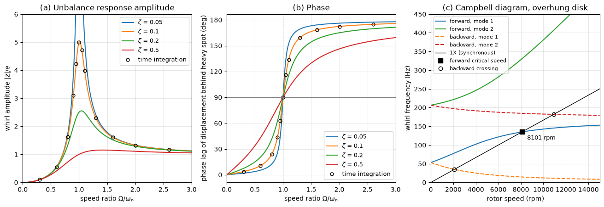

# Jeffcott Rotor and Campbell Diagram

This script computes the unbalance response of a Jeffcott rotor, amplitude and phase against speed for several damping ratios, and the Campbell diagram of an overhung disk whose gyroscopic moment splits each whirl mode into a forward and a backward branch. The amplitude curves show the resonance peak at the critical speed and the self-centring of the rotor above it; the phase curves show the 90° lag at the critical speed and the inversion of the heavy spot through resonance. The steady-state formula is checked by integrating the equation of motion in time. The Campbell diagram finds the critical speeds where the whirl frequencies cross the synchronous line, both numerically and in closed form.

## Overview

- Evaluates the steady unbalance response $|z|/e$ and its phase for damping ratios $\zeta = 0.05, 0.1, 0.2, 0.5$ against the speed ratio $\Omega/\omega_n$.
- Integrates the equations of motion from rest with `scipy.integrate.solve_ivp` at twelve speeds for $\zeta = 0.1$ and measures the amplitude and phase once the transient has decayed by a factor $10^6$.
- Builds a two-degree-of-freedom model of a steel disk (radius 150 mm, thickness 30 mm) on the free end of a steel cantilever shaft (diameter 20 mm, length 100 mm): disk translation and tilt, coupled by the shaft stiffness, with the gyroscopic moment on the tilt.
- Solves the quartic frequency equation at 300 speeds up to 15 000 rpm and plots the forward and backward whirl frequencies with the 1X line.
- Computes the forward and backward critical speeds from a quadratic in $\Omega^2$.

## Mathematical Background

### Jeffcott Rotor

A disk of mass $m$ sits at the middle of a massless shaft of lateral stiffness $k$; its mass centre is a distance $e$ from the shaft axis, and a viscous damper $c$ acts on the disk centre. With $z = x + iy$ the position of the disk centre and $\Omega$ the spin speed,

```math
m\ddot z + c\dot z + k z = m e\,\Omega^2 e^{i\Omega t}
```

With $\omega_n = \sqrt{k/m}$, $\zeta = c/(2\sqrt{km})$ and $s = \Omega/\omega_n$, the steady solution $z = |z| e^{i(\Omega t - \phi)}$ has

$$
\frac{|z|}{e} = \frac{s^2}{\sqrt{(1 - s^2)^2 + (2\zeta s)^2}},
\qquad \tan\phi = \frac{2\zeta s}{1 - s^2}
$$

where $\phi$ is the angle by which the displacement lags the heavy spot. At $s = 1$, $|z|/e = 1/(2\zeta)$ and $\phi = 90^\circ$. The maximum is $1/(2\zeta\sqrt{1 - \zeta^2})$ at $s = 1/\sqrt{1 - 2\zeta^2}$, slightly above the critical speed. For $s \gg 1$, $|z| \to e$ and $\phi \to 180^\circ$: the disk spins about its mass centre.

### Overhung Disk with Gyroscopic Moments

Let $u$ be the complex translation of a disk at the end of a cantilever of length $L$ and $\psi$ its complex tilt. The cantilever flexibility matrix for tip force and moment is

```math
\boldsymbol{\alpha} = \frac{1}{EI}\begin{bmatrix} L^3/3 & L^2/2 \\ L^2/2 & L \end{bmatrix},
\qquad
\mathbf{K} = \boldsymbol{\alpha}^{-1}
```

The disk has mass $m$, polar moment $I_p = mR^2/2$ and diametral moment $I_d = m(3R^2 + h^2)/12$. Free whirl $u, \psi \propto e^{i\lambda t}$ requires

```math
\left(k_{11} - m\lambda^2\right)\left(k_{22} - I_d\lambda^2 + I_p\Omega\lambda\right) - k_{12}^2 = 0
```

a quartic in $\lambda$ with two positive (forward whirl) and two negative (backward whirl) roots. The gyroscopic term raises the forward frequencies and lowers the backward ones as $\Omega$ grows. Setting $\lambda = \pm\Omega$ gives the critical speeds as the positive roots of

```math
m\left(I_d \mp I_p\right)\Omega^4 - \left[m k_{22} + \left(I_d \mp I_p\right)k_{11}\right]\Omega^2 + \det\mathbf{K} = 0
```

For a thin disk $I_p > I_d$, so the forward equation has one positive root only: the forward conical mode is stiffened faster than the 1X line rises and never meets it.

## Implementation

- `unbalance_response(speed_ratio, zeta)` and `peak_response(zeta)` implement the formulas above.
- `integrate_response(speed_ratio, zeta)` integrates the non-dimensional equations ($\omega_n = 1$, $e = 1$) to $t = 14/\zeta$ plus three whirl periods and returns the mean amplitude and phase lag of the last two periods.
- `overhung_rotor()` returns $m$, $I_p$, $I_d$ and the stiffness matrix from the constants `SHAFT_DIAMETER`, `SHAFT_LENGTH`, `DISK_RADIUS`, `DISK_THICKNESS`, `YOUNGS_MODULUS` and `DENSITY`.
- `whirl_frequencies(spin, ...)` solves the quartic with `numpy.roots`; `critical_speeds(..., direction)` solves the quadratic for forward (`+1`) or backward (`-1`) whirl.
- `campbell_data()` sweeps the speed up to `MAX_RPM`.

## Usage

```bash
python main.py                          # print the results and show the figure
python main.py --no-show --output .     # save rotor_jeffcott_campbell.png in the current directory
```

| Flag | Meaning |
| --- | --- |
| `--no-show` | Do not open a plot window |
| `--output DIR` | Create `DIR` and save the figure as a PNG |

## Output

The peak amplitude ratios are 10.01, 5.03, 2.55 and 1.15 for $\zeta = 0.05, 0.1, 0.2, 0.5$, at speed ratios 1.0025, 1.0102, 1.0426 and 1.414. The time integration agrees with the steady formula to $1.1\times10^{-6}$ in amplitude and $1.5\times10^{-5}$ degrees in phase. The overhung disk has $m = 16.65$ kg, $I_p = 0.1873$ kg m² and $I_d = 0.0949$ kg m², and non-rotating natural frequencies of 53.1 Hz and 206.5 Hz. Its only forward critical speed is 8101 rpm (135 Hz), well above the 3186 rpm that the non-rotating first frequency would suggest; the backward branches cross the 1X line at 2097 rpm and 10 916 rpm.



Panel (a) shows the amplitude ratio, with the time-integration results as circles on the $\zeta = 0.1$ curve. Panel (b) shows that every damping ratio passes through 90° at $\Omega = \omega_n$, which is how critical speeds are located from run-up measurements. Panel (c) shows the forward branches (solid) rising and the backward branches (dashed) falling with speed. Unbalance excites forward synchronous whirl only, so in a rotor with isotropic supports only the square marks a resonance; the circles become resonances when the bearings have different stiffness in two directions.

## Related Notes

- [Rotating Machinery](../../../notes/applied_mechanics/mechanical_systems/rotating_machinery.md)
- [Vibrations and Oscillations](../../../notes/applied_mechanics/dynamics/vibrations.md)
