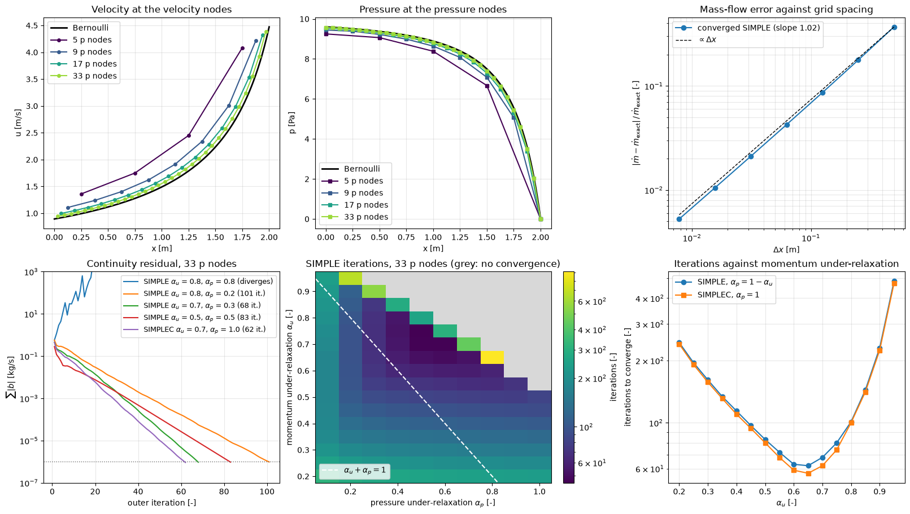

# SIMPLE in a 1D Converging Nozzle

This script solves steady, incompressible, frictionless flow through a converging nozzle with the SIMPLE and SIMPLEC pressure–velocity coupling algorithms on a staggered grid, and compares the converged mass flow and pressure with Bernoulli's equation. The set-up is Example 6.2 of Versteeg and Malalasekera (2007): a 2 m nozzle whose area falls linearly from 0.5 to 0.1 m², a stagnation pressure of 10 Pa at the inlet and a static pressure of 0 at the outlet. Besides the solution, the script maps how many outer iterations SIMPLE needs for each pair of under-relaxation factors, which shows the region where the iteration converges and the sense of the rule of thumb $\alpha_u + \alpha_p \approx 1$.

## Overview

- Discretises the nozzle with $n$ pressure nodes at $`x_I = I\,\Delta x`$ and $n - 1$ velocity nodes halfway between them (a backward-staggered grid), for $n$ from 5 to 257.
- Uses first-order upwind momentum fluxes, a stagnation-pressure inlet treated as in the textbook, and a fixed exit pressure.
- Starts every run from the textbook's guess of a mass flow of 1 kg/s and a linear pressure distribution, and stops when the continuity residual $\sum|b|$ falls below $10^{-6}$ kg/s, when it exceeds $10^3$ kg/s (divergence), or after 2000 iterations.
- Compares the velocity and pressure on 5, 9, 17 and 33 pressure nodes with Bernoulli's solution and fits the order of the mass-flow error on 5 to 257 nodes.
- Plots residual histories for five relaxation settings on 33 nodes, the number of SIMPLE iterations on a 16 × 10 grid of $(\alpha_u, \alpha_p)$, and the iteration counts of SIMPLE with $\alpha_p = 1 - \alpha_u$ and of SIMPLEC with $\alpha_p = 1$.

## Mathematical Background

### Governing Equations and Exact Solution

For steady, incompressible, inviscid flow in a duct of area $A(x)$, continuity and momentum are

```math
\frac{d}{dx}(\rho u A) = 0,
\qquad
\frac{d}{dx}(\rho u A\, u) = -A\frac{dp}{dx}
```

so the mass flow $\dot m = \rho u A$ is constant and Bernoulli's equation $p + \tfrac12\rho u^2 = p_0$ holds along the nozzle. With the outlet at $p_e = 0$:

```math
\dot m = \rho A_e\sqrt{\frac{2(p_0 - p_e)}{\rho}} = 0.1\sqrt{20} = 0.44721\ \mathrm{kg/s},
\qquad
p(x) = p_0 - \frac{\dot m^2}{2\rho A(x)^2}
```

### Discretisation

Velocity node $i$ sits between pressure nodes $I = i$ and $I + 1$. Its control volume has faces at those pressure nodes, with mass fluxes $F_w$ and $F_e$ obtained by averaging $\rho u A$ of the neighbouring velocity nodes. Upwind differencing (all flow is in $+x$) gives

```math
a_P u_i = a_W u_{i-1} + (p_I - p_{I+1}) A_i,
\qquad a_W = F_w, \qquad a_P = F_e
```

At the inlet the pressure node 0 follows from the stagnation pressure, $p_0^{\mathrm{node}} = p_0 - \tfrac12\rho u_A^2$ with $u_A = u_0 A_0/A_{\mathrm{in}}$ from continuity. Substituting it into the first momentum equation and treating one factor $u_0$ as known gives $a_P = F_e + \tfrac12 F_w (A_0/A_{\mathrm{in}})^2$ and the source $(p_0 - p_1)A_0 + F_w (A_0/A_{\mathrm{in}})u_0^{\mathrm{old}}$.

### SIMPLE and SIMPLEC

Each outer iteration:

1. Under-relaxes and solves the momentum equations with the current pressure: $`(a_P/\alpha_u)u_i^* = a_W u_{i-1}^* + (p_I - p_{I+1})A_i + \frac{1 - \alpha_u}{\alpha_u}a_P u_i^{\mathrm{old}}`$.

2. Writes the velocity correction as $u_i' = d_i(p_I' - p_{I+1}')$. SIMPLE drops the neighbour corrections, $d_i = A_i/(a_P/\alpha_u)$; SIMPLEC subtracts the neighbour coefficients instead, $d_i = A_i/(a_P/\alpha_u - a_W)$.

3. Substitutes into continuity for each interior pressure node, which gives the tridiagonal pressure-correction equation

   ```math
   (a_w + a_e)\,p_I' = a_w\,p_{I-1}' + a_e\,p_{I+1}' + b_I,
   \qquad a_w = \rho d_{i-1}A_{i-1}, \quad a_e = \rho d_i A_i,
   \qquad b_I = \rho u_{i-1}^* A_{i-1} - \rho u_i^* A_i
   ```

   with $p' = 0$ at the inlet node (its pressure follows from $p_0$) and at the outlet (fixed pressure).

4. Corrects $`u = u^* + d\,(p_I' - p_{I+1}')`$ and $p = p + \alpha_p p'$, and updates the inlet pressure from $p_0$.

The residual is $\sum_I |b_I|$, the mass imbalance left by the momentum predictor. The converged solution does not depend on $\alpha_u$, $\alpha_p$ or the variant, only on the grid.

### Accuracy

Summing the discrete momentum equations over all velocity nodes telescopes the convective terms, so the converged mass flow depends on the velocity convected out of the last control volume. Upwinding takes it from the last velocity node, half a cell upstream of the outlet, where the area is larger. This error is first order in $\Delta x$.

## Implementation

- `area`, `exact_mass_flow` and `exact_pressure` give the geometry and Bernoulli's solution.
- `solve_nozzle(n_nodes, alpha_u, alpha_p, variant, tol, max_iter)` sets up the grid and the initial guess and repeats `simple_iteration` until convergence or divergence. It returns a `Result` with the node positions, $p$, $u$, $\rho u A$ at each velocity node and the residual history.
- `simple_iteration` assembles and solves the bidiagonal momentum system and the tridiagonal pressure-correction system with `scipy.linalg.solve_banded`, then applies the corrections.
- `iteration_map` runs SIMPLE over `ALPHA_U_SCAN` × `ALPHA_P_SCAN`; `plot_results` draws the six panels.

The tests in `tests/test_compressible_pv_numerics.py` check Bernoulli's mass flow, discrete continuity and the boundary conditions of the converged solution, first-order convergence of the mass flow and convergence of the pressure, independence of the fixed point from the relaxation factors and the variant, divergence for $\alpha_u = \alpha_p = 0.8$, and the agreement in iteration count between SIMPLEC and SIMPLE with $\alpha_p = 1 - \alpha_u$.

## Usage

```bash
python main.py                      # show the figure
python main.py --no-show --output . # save simple_1d_nozzle.png
```

The run takes about 3 s.

## Output



The top row shows the converged solution with $\alpha_u = 0.7$, $\alpha_p = 0.3$. On 5 pressure nodes the mass flow is 0.6125 kg/s, 37 % above Bernoulli's 0.4472 kg/s, and the velocities lie well above the exact curve; refining the grid brings them onto it. The error halves with every halving of $\Delta x$ (fitted slope 1.02), down to 0.53 % on 257 nodes:

| Pressure nodes | 5 | 9 | 17 | 33 | 65 | 129 | 257 |
| --- | --- | --- | --- | --- | --- | --- | --- |
| $\dot m$ \[kg/s\] | 0.61248 | 0.52653 | 0.48581 | 0.46622 | 0.45664 | 0.45191 | 0.44957 |
| Error | +37.0 % | +17.7 % | +8.6 % | +4.3 % | +2.1 % | +1.1 % | +0.5 % |
| Iterations | 50 | 54 | 58 | 68 | 85 | 141 | 254 |

The bottom row is for 33 pressure nodes. SIMPLE with $\alpha_u = \alpha_p = 0.8$ diverges; $\alpha_u = 0.8$, $\alpha_p = 0.2$ needs 101 iterations, $0.7/0.3$ needs 68 and $0.5/0.5$ needs 83, while SIMPLEC with $\alpha_u = 0.7$ and no pressure relaxation needs 62. The iteration map (bottom middle) shows that SIMPLE converges for 122 of the 160 pairs tried. The fastest runs, 45 to 57 iterations, have $\alpha_u$ between 0.65 and 0.8 and $\alpha_u + \alpha_p$ between about 1.05 and 1.3. They lie close to the edge of the region where SIMPLE fails, which runs from $\alpha_u + \alpha_p \approx 1.55$ at $\alpha_u = 0.55$ down to 1.25 at $\alpha_u = 0.95$; the rule $\alpha_u + \alpha_p \approx 1$ stays on the safe side of that edge at a modest cost in iterations. For $\alpha_u \le 0.5$ every $\alpha_p$ up to 1 converges, but slowly. The last panel shows that SIMPLE with $\alpha_p = 1 - \alpha_u$ and SIMPLEC with $\alpha_p = 1$ need almost the same number of iterations for every $\alpha_u$, with a minimum near $\alpha_u = 0.65$: in this problem SIMPLEC's consistent correction does what the complementary pressure relaxation does in SIMPLE.

## Related Notes

- [Pressure–Velocity Coupling](../../../notes/numerical/fvm/pressure_velocity_coupling.md)
- [Finite Volume Discretization](../../../notes/numerical/fvm/discretization.md)
- [Iterative Convergence](../../../notes/numerical/cfd/iterative_convergence.md)
