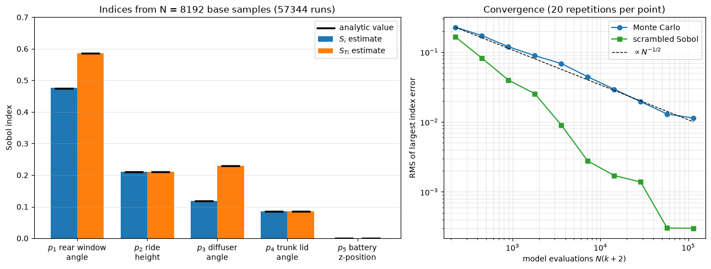

# Sobol Sensitivity Analysis

This script estimates first-order and total Sobol sensitivity indices of a synthetic five-parameter drag model with the Saltelli sampling scheme and checks them against the exact values. The model has linear main effects, one two-parameter interaction, one quadratic effect and one parameter with no effect, so its indices can be written down in closed form. A second panel shows how the estimation error falls with the number of model evaluations for plain Monte Carlo and for scrambled Sobol (quasi-Monte Carlo) samples.

## Overview

- Defines $C_d(\mathbf{p})$ on normalised parameters $\mathbf{p} \in [0, 1]^5$, labelled as rear window angle, ride height, diffuser angle, trunk lid angle and battery $z$-position.
- Computes the exact indices $S_i$ and $S_{Ti}$ from the variance of each model term.
- Estimates both sets with $N = 2^{13}$ scrambled Sobol base samples ($N(k+2) = 57{,}344$ model evaluations) and prints them next to the exact values.
- Repeats the estimate 20 times for each $N = 2^5, \dots, 2^{14}$ with Monte Carlo and with scrambled Sobol points and records the RMS of the largest index error.
- Draws a bar chart of the estimates with the exact values marked, and the convergence plot.

## Mathematical Background

### Model

With $x_i = 2p_i - 1 \sim U(-1, 1)$ independent,

$$
C_d = 0.30 + 0.012x_1 + 0.008x_2 + 0.006x_3 + 0.004x_4 + 0.010x_1x_3 +
0.006\left(x_4^2 - \tfrac{1}{3}\right)
$$

and $p_5$ does not appear.

### Variance decomposition

For independent inputs the variance of $f$ splits into contributions of single parameters and of groups (the Sobol, or functional ANOVA, decomposition). The first-order and total indices are

$$
S_i = \frac{\mathrm{Var}_{x_i}\left(\mathbb{E}[f \mid x_i]\right)}{\mathrm{Var}(f)},
\qquad
S_{Ti} = \frac{\mathbb{E}_{\mathbf{x}_{\sim i}}\left[\mathrm{Var}_{x_i}(f \mid \mathbf{x}_{\sim i})\right]}{\mathrm{Var}(f)}
$$

where $`\mathbf{x}_{\sim i}`$ denotes all parameters except $`x_i`$. $`S_i`$ is the share of variance explained by $`x_i`$ alone, and $`S_{Ti} - S_i`$ is the share due to its interactions.

Using $\mathrm{Var}(x) = 1/3$, $\mathrm{Var}(x^2) = 4/45$, $\mathrm{Var}(x_1x_3) = 1/9$ and the fact that all terms are uncorrelated, the variance is $1.0098 \times 10^{-4}$ and the exact indices are

| Parameter | $S_i$ | $S_{Ti}$ |
| --- | --- | --- |
| $p_1$ | 0.475 | 0.585 |
| $p_2$ | 0.211 | 0.211 |
| $p_3$ | 0.119 | 0.229 |
| $p_4$ | 0.085 | 0.085 |
| $p_5$ | 0 | 0 |

### Estimators

Two independent $N \times k$ sample matrices $A$ and $B$ are drawn, and $A_B^{(i)}$ is $A$ with its $i$-th column taken from $B$. After subtracting the sample mean from all outputs,

$$
S_i \approx
\frac{\frac{1}{N}\sum_{j=1}^{N} f(B)_j\left[f(A_B^{(i)})_j - f(A)_j\right]}{\mathrm{Var}(f)},
\qquad S_{Ti} \approx
\frac{\frac{1}{2N}\sum_{j=1}^{N}\left[f(A)_j - f(A_B^{(i)})_j\right]^2}{\mathrm{Var}(f)}
$$

The first is the estimator of Saltelli et al. (2010), the second the Jansen (1999) estimator. All indices together cost $N(k+2)$ model evaluations. Centring matters here: $C_d \approx 0.3$ while its spread is about 0.01, and without it the product $`f(B)\,[\dots]`$ carries a large noise term.

## Implementation

- `drag_model(p)` evaluates the synthetic $C_d$ for each row of `p`.
- `analytic_indices()` returns the exact $S_i$, $S_{Ti}$ and $\mathrm{Var}(C_d)$.
- `saltelli_indices(model, a, b)` implements the two estimators above.
- `sample_matrices(n, k, rng, method)` draws $A$ and $B$ from `rng.random` (`"mc"`) or from a scrambled `scipy.stats.qmc.Sobol` sequence in $2k$ dimensions (`"qmc"`).
- `convergence_study(n_values, rng)` returns the RMS over `N_REPEATS` repetitions of the largest absolute index error.
- `LINEAR`, `INTERACTION_13`, `QUADRATIC_4`, `N_BAR`, `N_CONVERGENCE` and `N_REPEATS` set the model and the experiment.

## Usage

```bash
python main.py                          # show the figure
python main.py --no-show --output .     # save the figure as a PNG in the current directory
```

## Output



With $N = 2^{13}$ Sobol base samples every estimate is within 0.001 of the exact value. The gap between the orange and blue bars of $p_1$ and $p_3$ is the $x_1x_3$ interaction; for $p_2$ and $p_4$ the bars coincide because those parameters act additively, and $p_5$ is correctly identified as inert ($S_{T5}$ is exactly zero because $`f(A) = f(A_B^{(5)})`$). The Monte Carlo error follows the $N^{-1/2}$ line, from 0.23 at 224 evaluations to 0.011 at about $1.1 \times 10^5$. Scrambled Sobol points reach 0.0028 already at 7168 evaluations, an order of magnitude below Monte Carlo at the same cost.

## Related Notes

- [Deformation Parameters](../../../notes/machine_learning/automotive_aerodynamics/deformation_parameters.md)
- [One-Stage Sampling](../../../notes/numerical/surrogates/one_stage_sampling.md)
- [Surrogate Modelling Introduction](../../../notes/numerical/surrogates/intro.md)
