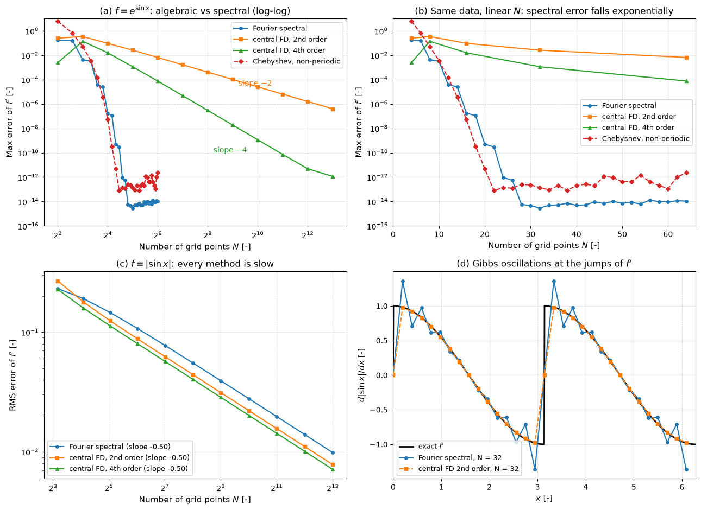

# Spectral vs Finite-Difference Differentiation

This script differentiates a smooth periodic function with the Fourier spectral method and with second- and fourth-order central finite differences, and shows that the spectral error falls exponentially with the number of points while the finite-difference errors fall algebraically. It adds Chebyshev collocation for a smooth non-periodic function, shows that a function with a kink, $|\sin x|$, removes the spectral advantage and produces Gibbs oscillations, and checks the 3/2 rule for de-aliasing a quadratic product.

## Overview

- Computes $f'$ for $f(x) = e^{\sin x}$ on $N$ equispaced points of $[0, 2\pi)$ by FFT (Fourier collocation) for $N = 4, 6, \dots, 64$, and by periodic central differences of order 2 and 4 for $N = 4, 8, \dots, 8192$.
- Builds the Chebyshev differentiation matrix of Trefethen (2000) on $N + 1$ Gauss–Lobatto points and applies it to $e^x\sin 4x$ on $[-1, 1]$.
- Checks that the dense Fourier differentiation matrix gives the same derivative as the FFT.
- Repeats the periodic comparison for $|\sin x|$, whose derivative jumps at $x = 0$ and $\pi$, using the root-mean-square error and odd $N$ so that no grid point sits on a kink.
- Multiplies $\cos 5x$ by $\cos 6x$ on 16 points with and without zero-padding to 24 points, and prints the aliased coefficient.

## Mathematical Background

### Fourier Collocation

On $x_j = 2\pi j/N$ the discrete Fourier transform gives the trigonometric interpolant $`I_N f = \sum_k \hat f_k e^{\mathrm{i}kx}`$ with $|k| \le N/2$. Its derivative has coefficients $\mathrm{i}k\hat f_k$; the Nyquist coefficient $k = N/2$ is set to zero for even $N$, because the Nyquist mode $\cos(Nx/2)$ has the derivative $-(N/2)\sin(Nx/2)$, which vanishes at every grid point. The same operator as a matrix is

```math
D_{ij} = \tfrac{1}{2}(-1)^{i-j}\cot\left(\frac{x_i - x_j}{2}\right) \quad (i \ne j), \qquad D_{ii} = 0
```

If $f$ is analytic in a strip $`|\mathrm{Im}\,x| < a`$, then $|\hat f_k| = O(e^{-a|k|})$ and the derivative error decays like $e^{-aN/2}$, faster than any power of $N$. Finite differences of order $p$ have errors $O(N^{-p})$.

### Chebyshev Collocation

On $x_j = \cos(\pi j/N)$, $j = 0, \dots, N$, the derivative of the polynomial interpolant is $Df$ with $`D_{ij} = (c_i/c_j)(-1)^{i+j}/(x_i - x_j)`$ for $i \ne j$, $c_0 = c_N = 2$ and $c_j = 1$ otherwise, and $D_{ii} = -\sum_{j \ne i} D_{ij}$. Clustering points near the ends avoids the Runge phenomenon, and the error decays exponentially for analytic $f$ without periodicity.

### Non-Smooth Functions

For $f = |\sin x|$ the Fourier coefficients decay only like $k^{-2}$, and $f'$ has jumps. Every method then converges at the same rate: the RMS error of $f'$ falls as $N^{-1/2}$, set by the $O(h)$ wide neighbourhood of each jump where the error is $O(1)$. The spectral derivative also oscillates around each jump (the Gibbs phenomenon).

### Aliasing and the 3/2 Rule

A product of two modes $k_1$ and $k_2$ with $|k_1 + k_2| > N/2$ appears on the grid at $k_1 + k_2 \mp N$. Padding the coefficients with zeros to $M \ge 3N/2$ points, multiplying there and truncating back removes all such contributions from the retained modes. For $\cos 5x\cos 6x = (\cos x + \cos 11x)/2$ on 16 points, mode 11 aliases onto mode 5.

## Implementation

- `fourier_derivative(u)` multiplies the FFT by $\mathrm{i}k$; `fourier_differentiation_matrix(n)` builds the dense matrix.
- `fd_derivative(u, order)` applies periodic central differences of order 2 or 4.
- `chebyshev(n)` returns the differentiation matrix and the points; `chebyshev_error(n)` measures the error for `cheb_function`.
- `smooth_study()` and `kink_study()` run the two convergence studies; `max_error` and `rms_error` measure the errors.
- `pad_product(u_hat, v_hat)` computes a de-aliased product with 3/2 padding; `aliasing_check()` applies it to $\cos 5x\cos 6x$.
- Constants `N_SPECTRAL`, `N_FD`, `N_GIBBS`, `N_ALIAS` and `CHEB_WAVENUMBER` set the experiment.

## Usage

```bash
python main.py                          # print the error tables and show the figure
python main.py --no-show --output .     # save spectral_vs_finite_difference.png in the current directory
```

| Flag | Meaning |
| --- | --- |
| `--no-show` | Do not open a plot window |
| `--output DIR` | Create `DIR` and save the figure as a PNG |

## Output

For $e^{\sin x}$ the Fourier error is $4.3 \times 10^{-3}$ at $N = 8$, $1.8 \times 10^{-7}$ at $N = 16$ and $2.9 \times 10^{-15}$ at $N = 32$. The second-order difference needs $N = 8192$ to reach $4.0 \times 10^{-7}$, and the fourth-order difference reaches $1.2 \times 10^{-9}$ at $N = 1024$; their observed orders are 2.00 and 4.00 (the fourth-order scheme hits round-off near $10^{-12}$ at the finest grid). Chebyshev collocation reaches $1.4 \times 10^{-13}$ at $N = 32$. For $|\sin x|$ all three methods converge at rate 0.50, with RMS errors between $7.1 \times 10^{-3}$ and $9.9 \times 10^{-3}$ at $N = 8193$. On 16 points the plain product $\cos 5x\cos 6x$ has a spurious coefficient $|c_5| = 0.25$; with 3/2 padding it is 0.000 and $|c_1| = 0.25$ is unchanged.



Panel (a) shows the algebraic slopes $-2$ and $-4$ of the finite differences on log–log axes and the spectral errors dropping to round-off by $N \approx 30$. Panel (b) uses a linear $N$ axis, on which exponential convergence is a straight line; the Fourier curve bends slightly downward because $e^{\sin x}$ is analytic in the whole complex plane and its coefficients decay faster than any exponential. Panel (c) shows the three methods converging at the same slow rate for $|\sin x|$, and panel (d) shows the spectral derivative overshooting at the jumps while the second-order difference smears them over one cell.

## Related Notes

- [High-Order Methods](../../../notes/numerical/high_order/intro.md)
- [Systematic Finite-Difference Discretization](../../../notes/numerical/fdm/discretization.md)
