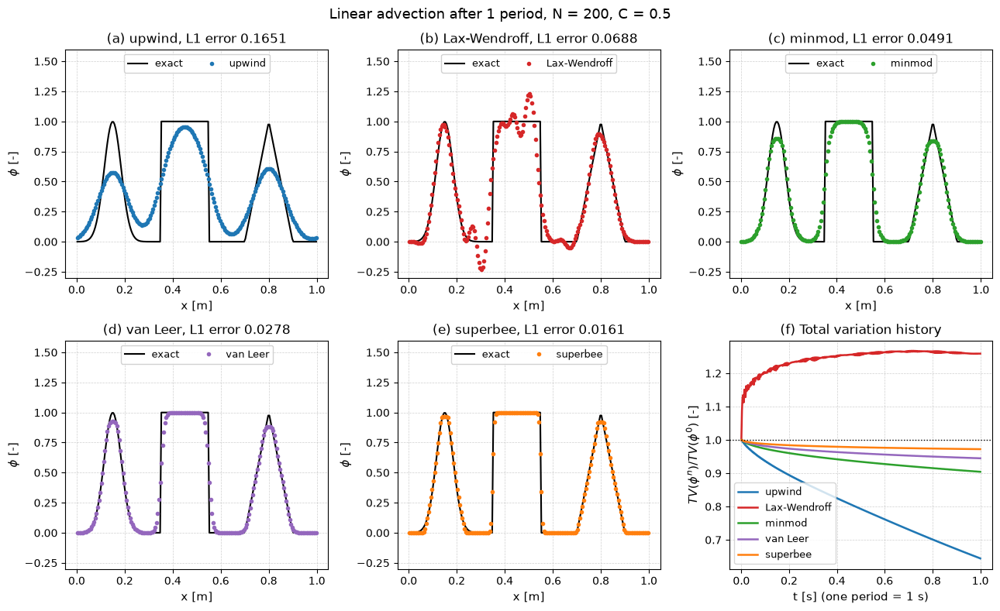
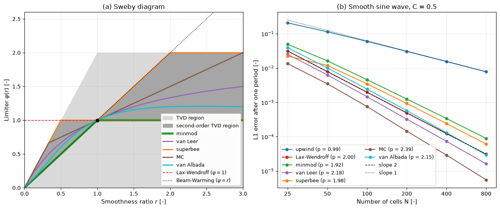

# TVD Limiters for Linear Advection

This script advects a Gaussian, a square wave and a triangle once around a periodic domain with first-order upwind, Lax–Wendroff and flux-limited TVD schemes, and shows the trade-off that Godunov's theorem forces on linear schemes. Upwind is bounded but smears every feature, Lax–Wendroff is second order but overshoots by 23% at the square wave and raises the total variation by 26%, and the minmod, van Leer, superbee, MC and van Albada limiters keep the solution between 0 and 1 with a total variation that never grows. The script also draws the Sweby diagram of the limiters and measures their order of accuracy on a smooth sine wave.

## Overview

- Initialises cell averages (32-point midpoint quadrature per cell) of a profile with a Gaussian centred at $x = 0.15$, a square wave on $[0.35, 0.55]$ and a triangle on $[0.7, 0.9]$ on $N = 200$ cells of $[0, 1)$.
- Advances $`\partial\phi/\partial t + u\,\partial\phi/\partial x = 0`$ with $u = 1$ m/s and Courant number $C = 0.5$ for 400 steps, one period, so the exact solution is the initial profile.
- Uses one conservative update with a limiter function $\psi(r)$ for all seven schemes: upwind ($\psi = 0$), Lax–Wendroff ($\psi = 1$), minmod, van Leer, superbee, MC and van Albada.
- Records the total variation and the integral $\sum_i\phi_i\Delta x$ after every step and prints the L1 error, the extreme values, the final total variation, the largest one-step increase of the total variation and the largest drift of the integral.
- Repeats the transport for a sine wave on $N = 25, 50, \dots, 800$ cells and prints the L1 error and the observed order on the two finest grids.

## Mathematical Background

### Flux-Limited Scheme

For $u > 0$ the numerical flux and update are (Sweby 1984)

```math
F_{i+1/2} = u\,\phi_i + \frac{u}{2}(1 - C)\,\psi(r_i)\,(\phi_{i+1} - \phi_i),
\qquad
r_i = \frac{\phi_i - \phi_{i-1}}{\phi_{i+1} - \phi_i},
\qquad
\phi_i^{n+1} = \phi_i^n - \frac{\Delta t}{\Delta x}\left(F_{i+1/2} - F_{i-1/2}\right)
```

For linear advection this is the same update as MUSCL–Hancock with the limited slope $\psi(r_i)(\phi_{i+1} - \phi_i)/\Delta x$. Where $\phi_{i+1} = \phi_i$ the code sets $r_i = 0$, which is harmless because the correction is multiplied by $\phi_{i+1} - \phi_i$.

### TVD Condition

The update can be written $\phi_i^{n+1} = \phi_i^n - c_i(\phi_i^n - \phi_{i-1}^n)$ with $`c_i = C\left[1 + \tfrac{1}{2}(1 - C)\left(\psi(r_i)/r_i - \psi(r_{i-1})\right)\right]`$. By Harten's lemma the scheme is TVD, $TV(\phi^{n+1}) \le TV(\phi^n)$ with $TV(\phi) = \sum_i|\phi_{i+1} - \phi_i|$, if $0 \le c_i \le 1$. For $0 \le C \le 1$ this holds when

```math
\psi(r) = 0 \ \text{ for } r \le 0, \qquad 0 \le \psi(r) \le \min(2r,\ 2) \ \text{ for } r > 0
```

because then $\psi(r_i)/r_i - \psi(r_{i-1}) \in [-2, 2]$ and $c_i \in [C^2,\ C(2 - C)]$. Second-order accuracy needs $\psi(1) = 1$, and Sweby's second-order region lies between minmod and superbee.

### Limiters

| Limiter | $\psi(r)$ for $r > 0$ |
| --- | --- |
| minmod | $\min(1, r)$ |
| van Leer | $(r + \lvert r \rvert)/(1 + \lvert r \rvert)$ |
| superbee | $\max\left[\min(2r, 1),\ \min(r, 2)\right]$ |
| MC | $\min\left[2r,\ (1 + r)/2,\ 2\right]$ |
| van Albada | $(r^2 + r)/(r^2 + 1)$ |

All five are zero for $r \le 0$ and satisfy $\psi(r)/r = \psi(1/r)$, so a profile and its mirror image are treated alike.

## Implementation

- `psi_upwind`, `psi_lax_wendroff`, `psi_minmod`, `psi_van_leer`, `psi_superbee`, `psi_mc` and `psi_van_albada` are collected in the dictionary `LIMITERS`.
- `smoothness_ratio(phi)` returns $r_i$ and $\phi_{i+1} - \phi_i$ on the periodic grid; `step(phi, psi, courant)` performs one update.
- `advect(phi0, psi, n_steps)` returns the final field and the histories of total variation and integral.
- `profile_test()` and `convergence_test()` run the two studies; `make_profile_figure` and `make_sweby_figure` draw the two figures.
- Constants `VELOCITY`, `LENGTH`, `N_CELLS`, `COURANT`, `PERIODS`, `N_CONVERGENCE` and `SUBSAMPLES` set the runs.

## Usage

```bash
python main.py                          # print the tables and show both figures
python main.py --no-show --output .     # save tvd_advection_profiles.png and sweby_diagram.png
```

| Flag | Meaning |
| --- | --- |
| `--no-show` | Do not open plot windows |
| `--output DIR` | Create `DIR` and save the figures as PNGs |

## Output

After one period on 200 cells (initial total variation 5.9434) the script prints

| Scheme | L1 error | max $\phi$ | min $\phi$ | $TV/TV_0$ | largest $\Delta TV$ per step |
| --- | --- | --- | --- | --- | --- |
| upwind | 0.16505 | 0.9544 | 0.0239 | 0.6442 | $-2.5\times10^{-7}$ |
| Lax–Wendroff | 0.06880 | 1.2318 | −0.2305 | 1.2590 | $+0.52$ |
| minmod | 0.04913 | 0.9998 | 0.0002 | 0.9043 | $-1.9\times10^{-7}$ |
| van Leer | 0.02776 | 1.0000 | 0.0000 | 0.9448 | $-2.6\times10^{-8}$ |
| superbee | 0.01608 | 1.0000 | 0.0000 | 0.9722 | $-1.0\times10^{-11}$ |
| MC | 0.02164 | 1.0000 | 0.0000 | 0.9594 | $-2.6\times10^{-10}$ |
| van Albada | 0.03451 | 1.0000 | 0.0000 | 0.9293 | $-8.2\times10^{-8}$ |

The integral drifts by at most $2\times10^{-16}$ for every scheme. On the sine wave the observed L1 orders between 400 and 800 cells are 0.99 (upwind), 2.00 (Lax–Wendroff), 1.92 (minmod), 2.18 (van Leer), 1.98 (superbee), 2.39 (MC) and 2.15 (van Albada); values above 2 come from the limiter switching off over a shrinking part of the domain as the grid is refined, not from a higher formal order.



Panels (a) to (e) compare the transported profile with the exact one. Upwind loses 42% of the Gaussian peak, Lax–Wendroff develops trailing oscillations behind the square wave, minmod is the most diffusive limiter and clips the smooth peaks, and superbee keeps the square wave sharpest but flattens the Gaussian into a plateau. Panel (f) shows that the total variation of Lax–Wendroff jumps in the first steps while that of every TVD scheme only decreases.



Panel (a) is the Sweby diagram: the light region satisfies the TVD condition, the dark region is its second-order part bounded by minmod and superbee, and every limiter passes through $(1, 1)$. Panel (b) shows the L1 error on the sine wave against the number of cells.

## Related Notes

- [Convection Schemes for Finite Volume Methods](../../../notes/numerical/fvm/convection_schemes.md)
- [Riemann Solvers and Godunov Methods](../../../notes/numerical/fvm/riemann_solvers.md)
- [Numerical Stability](../../../notes/numerical/cfd/numerical_stability.md)
