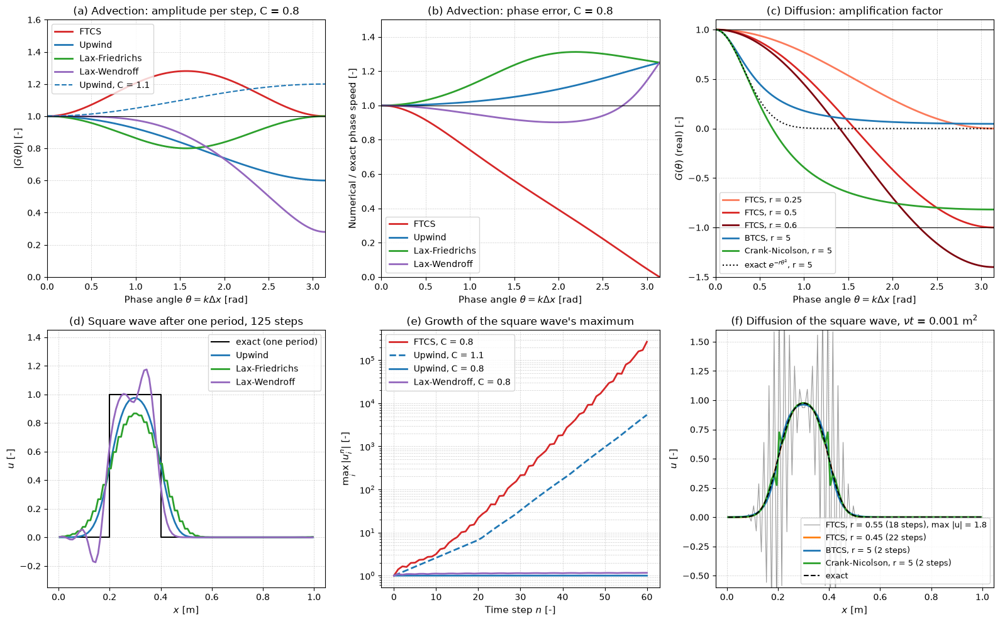

# Von Neumann Amplification Factors

This script computes the von Neumann amplification factor $G(\theta)$ of the classic finite-difference schemes for linear advection and diffusion and checks the predictions by marching a square wave with each scheme. For advection it covers FTCS, first-order upwind, Lax–Friedrichs and Lax–Wendroff; for diffusion it covers FTCS, BTCS and Crank–Nicolson. The plots show at a glance which schemes are stable, which ones smear a discontinuity and which ones produce oscillations, and why.

## Overview

- Evaluates $|G(\theta)|$ and the relative phase speed $-\arg G/(C\theta)$ of the four advection schemes at Courant number $C = 0.8$, plus first-order upwind at $C = 1.1$.
- Evaluates the real factor $G(\theta)$ of FTCS diffusion at $r = 0.25$, $0.5$ and $0.6$, and of BTCS and Crank–Nicolson at $r = 5$, against the exact factor $e^{-r\theta^2}$.
- Advects a square wave once around a periodic grid of 100 cells (125 steps at $C = 0.8$) with upwind, Lax–Friedrichs and Lax–Wendroff.
- Tracks $\max_i|u_i^n|$ over 60 steps for FTCS and Lax–Wendroff at $C = 0.8$ and upwind at $C = 0.8$ and $1.1$.
- Diffuses the same square wave to $\nu t = 10^{-3}$ with FTCS at $r = 0.45$ and $0.55$ and with BTCS and Crank–Nicolson at $r = 5$, and compares with the exact solution of the periodic heat equation.
- Prints $\max|G|$, $|G(\pi/2)|$, the phase-speed ratio at $\theta = \pi/4$, $G(\pi)$ for the diffusion schemes and the numerical viscosity of upwind.

## Mathematical Background

### Von Neumann Analysis

On a periodic grid any error is a sum of Fourier modes $`u_i^n = G^n e^{\mathrm{i}\,i\theta}`$, $\theta = k\Delta x \in [0, \pi]$. Substituting one mode into a linear scheme with constant coefficients gives the amplification factor $G(\theta)$, and the scheme is stable when $|G(\theta)| \le 1$ for every $\theta$ (up to $1 + O(\Delta t)$ for problems with growing exact solutions). With $C = a\Delta t/\Delta x$ for $u_t + a u_x = 0$ and $r = \nu\Delta t/\Delta x^2$ for $u_t = \nu u_{xx}$:

| Scheme | Update | $G(\theta)$ | Stable for |
| --- | --- | --- | --- |
| FTCS advection | $u_i - \frac{C}{2}(u_{i+1} - u_{i-1})$ | $1 - \mathrm{i}C\sin\theta$ | never ($`\lvert G\rvert^2 = 1 + C^2\sin^2\theta`$) |
| Upwind ($a > 0$) | $u_i - C(u_i - u_{i-1})$ | $1 - C(1 - e^{-\mathrm{i}\theta})$ | $0 \le C \le 1$ |
| Lax–Friedrichs | $\frac{1}{2}(u_{i+1} + u_{i-1}) - \frac{C}{2}(u_{i+1} - u_{i-1})$ | $\cos\theta - \mathrm{i}C\sin\theta$ | $\lvert C\rvert \le 1$ |
| Lax–Wendroff | $u_i - \frac{C}{2}(u_{i+1} - u_{i-1}) + \frac{C^2}{2}(u_{i+1} - 2u_i + u_{i-1})$ | $1 - \mathrm{i}C\sin\theta - C^2(1 - \cos\theta)$ | $\lvert C\rvert \le 1$ |
| FTCS diffusion | $u_i + r(u_{i+1} - 2u_i + u_{i-1})$ | $1 - 4r\sin^2(\theta/2)$ | $r \le 1/2$ |
| BTCS | implicit, $r$ at level $n+1$ | $1/\left(1 + 4r\sin^2(\theta/2)\right)$ | all $r$ |
| Crank–Nicolson | average of FTCS and BTCS | $`\dfrac{1 - 2r\sin^2(\theta/2)}{1 + 2r\sin^2(\theta/2)}`$ | all $r$ |

The exact solution multiplies a mode by $e^{-\mathrm{i}C\theta}$ per step for advection and by $e^{-r\theta^2}$ for diffusion, so $|G| < 1$ means numerical damping and $-\arg G \ne C\theta$ means a wrong propagation speed (dispersion).

### Modified Equation

Expanding the upwind scheme in Taylor series shows that it solves, to second order,

```math
u_t + a u_x = \nu_{\mathrm{num}}\,u_{xx}, \qquad \nu_{\mathrm{num}} = \frac{a\Delta x}{2}(1 - C)
```

which is why it smears the square wave. Lax–Wendroff has no $u_{xx}$ term; its leading error is dispersive ($u_{xxx}$), which produces the trailing oscillations.

## Implementation

- `advection_amplification(scheme, theta, c)` and `diffusion_amplification(scheme, theta, r)` return the formulas in the table; `relative_phase_speed` returns $-\arg G/(C\theta)$.
- `advection_step(u, scheme, c)` applies one step of an advection scheme with `np.roll` on a periodic grid.
- `diffusion_march(u0, scheme, r, steps)` builds the periodic second-difference matrix with `periodic_second_difference(n)` and applies the explicit, implicit or Crank–Nicolson step matrix.
- `exact_diffusion(u0, nu_t)` multiplies the discrete Fourier coefficients of $u_0$ by $e^{-k^2\nu t}$.
- `numerical_viscosity_upwind(a, dx, c)` returns $\nu_{\mathrm{num}}$.
- Constants: `COURANT`, `UNSTABLE_COURANT`, `N_CELLS`, `PULSE`, `GROWTH_STEPS`, `DIFFUSION_NUMBERS`, `IMPLICIT_R`, `DIFFUSION_TIME`, `DIFFUSION_MARCH`.

## Usage

```bash
python main.py                          # print the factors and show the figure
python main.py --no-show --output .     # save von_neumann_amplification.png without opening a window
```

| Flag | Meaning |
| --- | --- |
| `--no-show` | Do not open a plot window |
| `--output DIR` | Create `DIR` and save the figure as a PNG |

## Output

At $C = 0.8$ the script prints $\max|G| = 1.2806$ for FTCS and exactly 1 for the other three advection schemes, $|G(\pi/2)| = 0.8246$ (upwind), $0.8000$ (Lax–Friedrichs) and $0.8773$ (Lax–Wendroff), and phase-speed ratios at $\theta = \pi/4$ of $0.819$ (FTCS), $1.013$ (upwind), $1.074$ (Lax–Friedrichs) and $0.968$ (Lax–Wendroff). Upwind at $C = 1.1$ has $\max|G| = 1.2$. For diffusion, $G(\pi) = -1.4$ for FTCS at $r = 0.6$, $0.048$ for BTCS and $-0.818$ for Crank–Nicolson at $r = 5$. The upwind numerical viscosity at $C = 0.8$, $a = 1$ m/s and $\Delta x = 0.01$ m is $10^{-3}$ m²/s.



Panels (a) to (c) are the amplification factors and phase errors. Panel (d) shows the square wave after one period: upwind is smooth but smeared, Lax–Friedrichs is even more diffusive and shows a staircase from the decoupling of odd and even cells, and Lax–Wendroff keeps the edges sharper but leaves oscillations behind them because its short waves travel too slowly. Panel (e) shows exponential growth for FTCS and for upwind above $C = 1$. Panel (f) shows FTCS diffusion blowing up for $r = 0.55$ through the $\theta = \pi$ mode, BTCS matching the exact solution, and Crank–Nicolson keeping small oscillations at the edges because $G(\pi) = -0.82$ damps the shortest waves slowly.

## Related Notes

- [Numerical Stability](../../../notes/numerical/cfd/numerical_stability.md)
- [Time Integration](../../../notes/numerical/cfd/time_integration.md)
