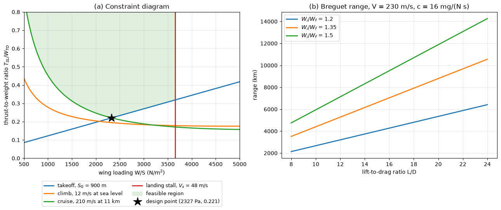

# Aircraft Design Constraint Diagram

This script draws the constraint diagram of conceptual aircraft design, the thrust-to-weight ratio each performance requirement demands as a function of wing loading, and picks the design point with the lowest thrust inside the feasible region. The example is a light business jet with a 900 m takeoff ground run, a 12 m/s sea-level climb rate, a 210 m/s cruise at 11 km and a 48 m/s landing stall speed. A second panel plots the Breguet range equation against the lift-to-drag ratio for three ratios of initial to final weight.

## Overview

- Uses the drag polar $C_D = C_{D0} + kC_L^2$ with $C_{D0} = 0.022$, aspect ratio 8 and Oswald factor $e = 0.8$, so $k = 1/(\pi e AR) = 0.0497$.
- Evaluates the takeoff, climb and cruise constraints on a grid of wing loadings from 500 to 5000 N/m², all referred to sea-level static thrust and takeoff weight.
- Converts the landing stall speed into a maximum takeoff wing loading, a vertical line.
- Shades the region above every thrust curve and left of the stall line and marks the lowest point of its lower boundary as the design point.
- Plots the Breguet range for $L/D$ from 8 to 24 at $V = 230$ m/s with thrust-specific fuel consumption $c = 1.6 \times 10^{-5}$ kg/(N s) (0.57 lb/(lbf h)).

## Mathematical Background

### Steady Flight

In steady level flight at load factor $n$, thrust equals drag and lift equals $nW$, so with dynamic pressure $q = \tfrac{1}{2}\rho V^2$

```math
\frac{T}{W} = \frac{q\,C_{D0}}{W/S} + k\,n^2\,\frac{W/S}{q}
```

A sustained climb at rate $V_V$ and speed $V$ needs the extra term $V_V/V$, the ratio of the rate of change of potential energy to $WV$.

### Cruise at Altitude

At cruise the weight is $\beta W_{TO}$ and the available thrust is $\alpha T_{SL}$. With the simple lapse model $\alpha = \sigma^{0.75}$, $\sigma = \rho/\rho_{SL}$ (an assumed, typical value for a turbofan),

```math
\frac{T_{SL}}{W_{TO}} = \frac{\beta}{\alpha}\left[\frac{q\,C_{D0}}{\beta\,W_{TO}/S} + k\,\frac{\beta\,W_{TO}/S}{q}\right]
```

### Takeoff Ground Run

Taking the net accelerating force at $V_{LOF}/\sqrt{2}$ as the average over the run, $T - D - \mu(W - L) = W V_{LOF}^2/(2gS_G)$, gives

```math
\frac{T}{W} = \frac{V_{LOF}^2}{2gS_G} + \frac{q\,C_{D,TO}}{W/S} + \mu\left(1 - \frac{q\,C_{L,TO}}{W/S}\right),
\qquad q = \tfrac{1}{2}\rho\left(\frac{V_{LOF}}{\sqrt{2}}\right)^2
```

with $`V_{LOF} = 1.2\,V_{s,TO}`$ and $V_{s,TO} = \sqrt{2(W/S)/(\rho C_{L\max,TO})}$, so the first term grows linearly with wing loading.

### Stall

The landing stall speed $V_s$ at landing weight $W_L$ fixes $W_L/S = \tfrac{1}{2}\rho V_s^2 C_{L\max,L}$, so $W_{TO}/S \le \tfrac{1}{2}\rho V_s^2 C_{L\max,L}/(W_L/W_{TO})$.

### Breguet Range

For a jet at constant $V$, $L/D$ and $c$, integrating $`dR = V\,dt`$ with fuel weight flow $`-dW/dt = c\,g\,T = c\,g\,W/(L/D)`$ gives

```math
R = \frac{V}{c\,g}\,\frac{L}{D}\,\ln\frac{W_i}{W_f}
```

With $V$ in m/s, $c$ in kg/(N s) and $g$ in m/s², $V/(cg)$ is in metres.

## Implementation

- `level_flight_tw(ws, q, n)` is the steady-flight relation; `climb_constraint`, `cruise_constraint` and `takeoff_constraint` build the three thrust curves from it and from the named constants (`CD0`, `CLIMB_RATE`, `CRUISE_DENSITY`, `GROUND_RUN`, ...).
- `stall_wing_loading()` returns the stall limit and `design_point()` the lowest feasible point of the constraint envelope.
- `breguet_range(lift_to_drag, weight_ratio, speed, tsfc)` returns the range in metres.
- `make_figure()` draws both panels.

## Usage

```bash
python main.py                          # print the design point and show the figure
python main.py --no-show --output .     # save aircraft_design_constraint_diagram.png
```

| Flag | Meaning |
| --- | --- |
| `--no-show` | Do not open a plot window |
| `--output DIR` | Create `DIR` and save the figure as a PNG |

## Output

The stall line limits the takeoff wing loading to 3653 N/m². The design point lies where the takeoff and cruise curves cross, at $W/S = 2327$ N/m² and $T_{SL}/W_{TO} = 0.221$; the climb requirement needs only 0.195 there. At $L/D = 18$ the Breguet range is 4809 km, 7916 km and 10 695 km for $W_i/W_f$ = 1.2, 1.35 and 1.5.



In panel (a) the cruise curve falls with wing loading at first, because a small wing flies at a low $C_L$ where zero-lift drag dominates, while the takeoff line rises because a heavily loaded wing needs a higher lift-off speed. Any point in the shaded region meets all four requirements; the designer usually picks one near its lower corner, with margin. Panel (b) shows range proportional to $L/D$ and to $\ln(W_i/W_f)$.

## Related Notes

- [Aircraft Design and Manufacturing](../../../notes/applied_mechanics/transportation/airplanes/manufacturing_and_design_process.md)
