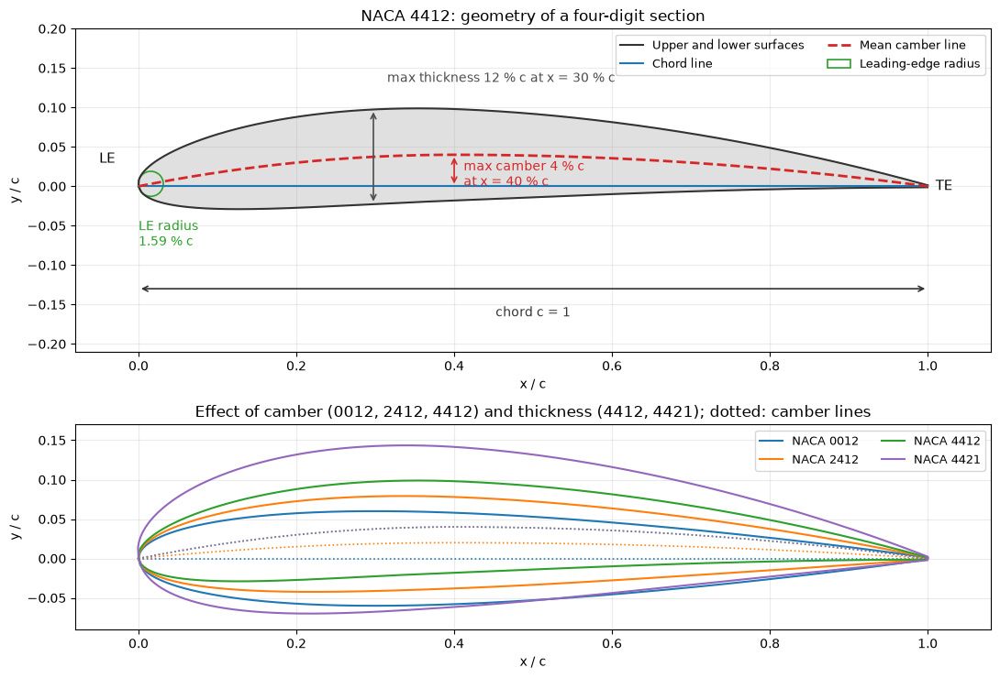

# NACA 4-Digit Airfoil Profile

This script draws an annotated NACA 4-digit airfoil profile (NACA 4412 by default) from its four-digit designation, marking the chord line, the mean camber line, the maximum camber and thickness and the leading-edge radius, and compares it with sections of different camber and thickness. It computes the piecewise parabolic camber line and the standard NACA thickness distribution, and offsets the surfaces perpendicular to the camber line.

## Overview

- Parses a four-digit code (`--naca`, default `4412`) into maximum camber $m$, camber position $p$ and thickness ratio $t$.
- Evaluates the camber line $y_c(x)$ and its slope at 500 chordwise stations on a unit chord.
- Applies the NACA thickness distribution and offsets the surfaces perpendicular to the camber line.
- Annotates the chord, the maximum camber and its position, the maximum thickness and its position (found numerically) and the leading-edge circle of radius $`1.1019\,t^2c`$, centred on the line through the nose with the camber-line slope at $x = 0$.
- In a second panel overlays NACA 0012, 2412, 4412 and 4421 with their camber lines, to separate the effects of camber and thickness.
- Handles symmetric sections such as `0012` (zero camber).

## Mathematical Background

For code `MPXX`: $m = M/100$, $p = P/10$ and $t = XX/100$.

### Camber Line

```math
y_c = \begin{cases} \dfrac{m c}{p^2}\left(2p\dfrac{x}{c} - \left(\dfrac{x}{c}\right)^2\right), & x < pc, \\ \dfrac{m c}{(1-p)^2}\left((1-2p) + 2p\dfrac{x}{c} - \left(\dfrac{x}{c}\right)^2\right), & x \geq pc, \end{cases}
```

with slope

```math
\frac{dy_c}{dx} = \begin{cases} \dfrac{2m}{p^2}\left(p - \dfrac{x}{c}\right), & x < pc, \\ \dfrac{2m}{(1-p)^2}\left(p - \dfrac{x}{c}\right), & x \geq pc. \end{cases}
```

### Thickness Distribution

```math
y_t = \frac{t}{0.2}\,
c\left(0.2969 \sqrt{\frac{x}{c}} - 0.1260 \frac{x}{c} -
0.3516\left(\frac{x}{c}\right)^2 + 0.2843\left(\frac{x}{c}\right)^3 -
0.1015\left(\frac{x}{c}\right)^4\right)
```

With these coefficients the trailing edge has a small finite thickness (0.25% of the chord for $t = 0.12$). The maximum thickness lies at $x = 0.30c$ for every member of the family, and the leading-edge radius is $`r_{LE} = 1.1019\,t^2c`$.

### Upper and Lower Surfaces

With $\theta = \arctan(dy_c/dx)$:

$$
x_u = x - y_t\sin\theta,
\qquad y_u = y_c + y_t\cos\theta
$$

$$
x_l = x + y_t\sin\theta,
\qquad y_l = y_c - y_t\cos\theta
$$

## Implementation

- `parse_naca4(code)` returns `(m, p, t)`.
- `camber_line(x, m, p, c)` returns $y_c$ and $dy_c/dx$, both zero for symmetric sections.
- `thickness_distribution(x, t, c)` returns $y_t$; `max_thickness_location(t, c)` returns the station and value of the maximum thickness; `leading_edge_radius(t, c)` returns $r_{LE}$.
- `naca4_geometry(code, c, n)` combines these into the camber line and the surface coordinates.
- `plot_airfoil(code, c, n)` draws the annotated profile and the comparison panel.
- `DEFAULT_CODE`, `CHORD` and `N_POINTS` set the defaults.

## Usage

```bash
python main.py                          # NACA 4412
python main.py --naca 0012              # any 4-digit code
python main.py --no-show --output .     # save the figure as a PNG in the current directory
```

## Output



The upper panel shows the 12%-thick NACA 4412: the mean camber line (dashed red) reaches 4% of the chord at 40% chord, the maximum thickness is at 30% chord, and the leading-edge circle has a radius of 1.59% of the chord. The lower panel shows that adding camber (0012, 2412, 4412) bends the section without changing its thickness, while 4421 has the camber of 4412 with 21% thickness and a much blunter nose.

## Related Notes

- [Airfoil Design](../../../notes/applied_mechanics/transportation/airplanes/airfoil_design.md)
- [Reading Airfoil Polars with Airfoil Tools](../../../notes/applied_mechanics/transportation/airplanes/airfoil_tools_walkthrough.md)
