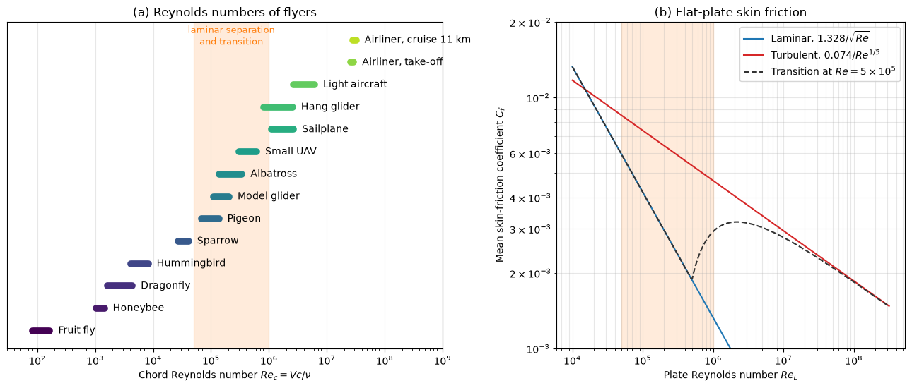

# Reynolds Numbers of Flyers

This script computes the chord Reynolds number $Re_c = Vc/\nu$ of fourteen flyers, from a fruit fly to an airliner at cruise, and draws them on one logarithmic axis next to the flat-plate skin-friction laws for laminar, turbulent and transitional boundary layers. The chart spans six decades and shows why the airfoils of insects, birds, model aircraft and airliners look so different: they operate in different boundary-layer regimes.

## Overview

- Uses a typical mean wing chord and a range of speeds for each flyer (wing speeds for the flapping insects), with ISA sea-level air and ISA air at 11 km for the airliner at cruise.
- Draws each flyer's Reynolds-number range as a horizontal bar on a log axis.
- Shades the band $5 \times 10^4 < Re_c < 10^6$, in which laminar separation, separation bubbles and transition dominate airfoil behaviour (an approximate band, not a sharp limit).
- Plots the mean skin-friction coefficient of a flat plate for a laminar boundary layer, a fully turbulent one and one that becomes turbulent at $Re_x = 5 \times 10^5$.

## Mathematical Background

```math
Re_c = \frac{\rho V c}{\mu} = \frac{Vc}{\nu},
\qquad
\nu_{SL} = \frac{1.789 \times 10^{-5}}{1.225} = 1.460 \times 10^{-5} \ \mathrm{m^2/s},
\qquad
\nu_{11\,km} = \frac{1.422 \times 10^{-5}}{0.364} = 3.907 \times 10^{-5} \ \mathrm{m^2/s}
```

Mean skin-friction coefficients of a flat plate of length $L$, $Re_L = VL/\nu$:

```math
C_{f,lam} = \frac{1.328}{\sqrt{Re_L}},
\qquad
C_{f,turb} = \frac{0.074}{Re_L^{1/5}},
\qquad
C_{f,trans} = \frac{0.074}{Re_L^{1/5}} - \frac{A}{Re_L}
```

The first is Blasius' result, the second Prandtl's one-seventh-power estimate for $5 \times 10^5 < Re_L < 10^7$, and the third (Prandtl–Schlichting) removes the turbulent friction of the laminar leading part. For transition at $Re_{x,cr} = 5 \times 10^5$ the constant is $`A = Re_{x,cr}(0.074\,Re_{x,cr}^{-1/5} - 1.328\,Re_{x,cr}^{-1/2}) = 1742`$, the classical value, and it makes $C_{f,trans}$ continuous at transition.

## Implementation

- `FLYERS` lists the name, mean chord, lowest and highest speed and kinematic viscosity of each flyer; `flyer_ranges()` converts them with `reynolds(speed, chord, nu)`.
- `cf_laminar`, `cf_turbulent` and `cf_transitional` implement the skin-friction laws; `RE_CRIT_PLATE` and `LOW_RE_BAND` set the transition value and the shaded band.
- `plot_scale()` draws both panels.

## Usage

```bash
python main.py                          # print the ranges and show the figure
python main.py --no-show --output .     # save the PNG in the current directory
```

## Output

| Flyer | Chord (m) | Speed (m/s) | $Re_c$ |
| --- | --- | --- | --- |
| Fruit fly | 0.0008 | 1.5–3 | 82–164 |
| Honeybee | 0.003 | 5–7 | 1030–1440 |
| Dragonfly | 0.008 | 3–8 | 1640–4380 |
| Hummingbird | 0.012 | 5–10 | 4110–8220 |
| Sparrow | 0.05 | 8–12 | $2.7$–$`4.1 \times 10^4`$ |
| Pigeon | 0.10 | 10–20 | $0.68$–$`1.4 \times 10^5`$ |
| Model glider | 0.20 | 8–15 | $1.1$–$`2.1 \times 10^5`$ |
| Albatross | 0.20 | 10–25 | $1.4$–$`3.4 \times 10^5`$ |
| Small UAV | 0.30 | 15–30 | $3.1$–$`6.2 \times 10^5`$ |
| Sailplane | 0.65 | 25–60 | $1.1$–$`2.7 \times 10^6`$ |
| Hang glider | 1.5 | 8–25 | $0.82$–$`2.6 \times 10^6`$ |
| Light aircraft | 1.5 | 26–60 | $2.7$–$`6.2 \times 10^6`$ |
| Airliner, take-off | 5.0 | 75–85 | $2.6$–$`2.9 \times 10^7`$ |
| Airliner, cruise at 11 km | 5.0 | 220–250 | $2.8$–$`3.2 \times 10^7`$ |

The chords and speeds are typical values chosen for the chart, not data for particular species or types. The airliner's Reynolds number hardly changes between take-off and cruise, because the threefold speed increase is offset by the 2.7 times larger kinematic viscosity at altitude.



Panel (a) shows birds, model aircraft and small UAVs inside the shaded band, where airfoil performance is most sensitive to $Re$. Panel (b) shows that a laminar boundary layer has several times less skin friction than a turbulent one at the same $Re$, 3.5 times less at $Re = 10^6$, which is the reason for laminar-flow airfoils. The transitional curve rises steeply after transition and approaches the turbulent one at high $Re$, where the laminar part of the plate becomes a small fraction of its length (6% below it at $10^7$).

## Related Notes

- [The Reynolds Number in Flight](../../../notes/applied_mechanics/transportation/airplanes/reynolds_number.md)
- [Reading Airfoil Polars with Airfoil Tools](../../../notes/applied_mechanics/transportation/airplanes/airfoil_tools_walkthrough.md)
- [Boundary Layers](../../../notes/fluid_mechanics/viscous_flow/boundary_layers.md)
