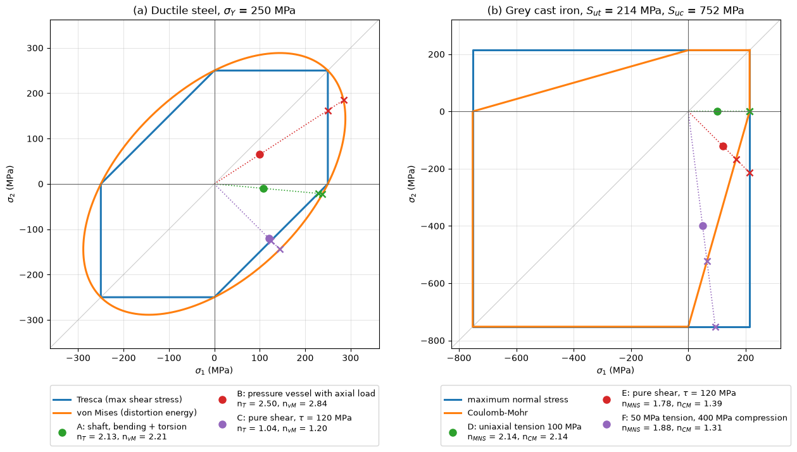

# Failure Envelopes in the Principal-Stress Plane

This script draws the Tresca, von Mises, maximum-normal-stress and Coulomb–Mohr envelopes in the plane-stress principal-stress plane and computes the safety factor of example load points under each criterion. The left panel compares the two yield criteria for a ductile steel, the right panel the two fracture criteria for a grey cast iron whose compressive strength is 3.5 times its tensile strength. Each load point is joined to the origin by its radial load line, and the point where that line leaves each envelope is marked, so the safety factor can be read as a ratio of distances.

## Overview

- Draws the Tresca hexagon and the von Mises ellipse for $\sigma_Y = 250$ MPa.
- Draws the maximum-normal-stress rectangle and the Coulomb–Mohr envelope for $S_{ut} = 214$ MPa and $S_{uc} = 752$ MPa (ASTM class 30 grey iron).
- Plots three ductile load points (a shaft in bending and torsion, a pressure vessel with an axial load, pure shear of 120 MPa) and three brittle ones (uniaxial tension of 100 MPa, pure shear of 120 MPa, 50 MPa tension with 400 MPa compression).
- Computes the safety factor of every point under the two criteria of its panel, marks the envelope crossings, and prints the results.

## Mathematical Background

In plane stress with in-plane principal stresses $\sigma_1$, $\sigma_2$ and $\sigma_3 = 0$, the safety factors along a radial load line are

```math
n_{\mathrm{T}} = \frac{\sigma_Y}{\max(|\sigma_1|, |\sigma_2|, |\sigma_1 - \sigma_2|)}, \qquad
n_{\mathrm{vM}} = \frac{\sigma_Y}{\sqrt{\sigma_1^2 - \sigma_1\sigma_2 + \sigma_2^2}}
```

for Tresca and von Mises. The maximum normal stress criterion gives $n = \min(S_{ut}/\sigma_i)$ over tensile principal stresses and $\min(S_{uc}/|\sigma_i|)$ over compressive ones. The Coulomb–Mohr criterion, with $\sigma_A \ge \sigma_B$ the larger and smaller principal stresses, gives $n = S_{ut}/\sigma_A$ when both are tensile, $n = S_{uc}/|\sigma_B|$ when both are compressive, and

```math
n = \left(\frac{\sigma_A}{S_{ut}} - \frac{\sigma_B}{S_{uc}}\right)^{-1}, \qquad \sigma_A \ge 0 \ge \sigma_B
```

otherwise. The von Mises ellipse is drawn along its principal axes, which lie at $45^\circ$ to the $\sigma_1$ axis with semi-axes $`\sqrt{2}\,\sigma_Y`$ and $`\sqrt{2/3}\,\sigma_Y`$.

## Implementation

- `von_mises(s1, s2)` and `tresca(s1, s2)` return the equivalent stresses; `safety_von_mises`, `safety_tresca`, `safety_max_normal` and `safety_coulomb_mohr` return the safety factors.
- `envelope_point(safety, s1, s2)` scales a load point onto an envelope.
- `plot_points`, `ductile_panel`, `brittle_panel` and `make_figure` draw the figure.
- The load points are in `DUCTILE_POINTS` and `BRITTLE_POINTS`; the strengths in `SIGMA_Y`, `S_UT` and `S_UC`.

## Usage

```bash
python main.py                          # print the safety factors and show the figure
python main.py --no-show --output .     # save beams_failure_envelopes.png in the current directory
```

| Flag | Meaning |
| --- | --- |
| `--no-show` | Do not open a plot window |
| `--output DIR` | Create `DIR` and save the figure as a PNG |

## Output

| Point | $\sigma_1$, $\sigma_2$ (MPa) | Criteria | Safety factors |
| --- | --- | --- | --- |
| A, shaft | 107.7, $-9.9$ | Tresca, von Mises | 2.126, 2.213 |
| B, pressure vessel | 100.0, 64.9 | Tresca, von Mises | 2.500, 2.845 |
| C, pure shear | 120, $-120$ | Tresca, von Mises | 1.042, 1.203 |
| D, tension | 100, 0 | Max normal, Coulomb–Mohr | 2.140, 2.140 |
| E, pure shear | 120, $-120$ | Max normal, Coulomb–Mohr | 1.783, 1.388 |
| F, tension and compression | 50, $-400$ | Max normal, Coulomb–Mohr | 1.880, 1.306 |



The Tresca hexagon is inscribed in the von Mises ellipse, so Tresca is never less conservative; the gap is largest in pure shear (point C), where the two differ by a factor of $2/\sqrt{3}$. In the brittle panel both criteria agree when both principal stresses have the same sign, but in the fourth quadrant the Coulomb–Mohr line cuts the corner of the rectangle, and the maximum-normal-stress criterion overestimates the strength of points E and F by 28% and 44%.

## Related Notes

- [Combined Loading](../../../notes/applied_mechanics/strength_materials/combined_loading.md)
- [Stress and Strain](../../../notes/applied_mechanics/strength_materials/stress_strain.md)
