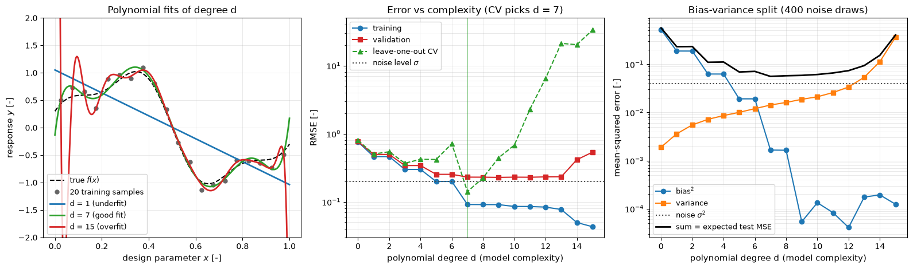

# Bias-Variance Trade-off

Polynomial fits of increasing degree to 20 noisy samples show underfitting, overfitting, a U-shaped validation curve and the Monte Carlo split of the error into bias², variance and noise. Leave-one-out cross-validation, computed from the training samples alone, selects the same degree as the independent validation set and the decomposition.

## Overview

- Samples $f(x) = \sin 2\pi x + 0.3 \cos 5\pi x$ at 20 fixed, equally spaced points $x_i = (i + 0.5)/20$ and adds Gaussian noise with $\sigma = 0.2$.
- Fits least-squares Legendre polynomials of degree $d = 0, \dots, 15$ in the variable $2x - 1$.
- Computes for each degree the training RMSE, the RMSE on 500 independent validation samples drawn uniformly between the first and last training points, and the leave-one-out cross-validation RMSE.
- Repeats the fit on 400 independent noise realisations at the same 20 points and estimates squared bias and variance on 200 points spanning the training range.
- Prints a table of all errors and draws three panels: three example fits ($d = 1, 7, 15$), error against degree, and the bias-variance split.

## Mathematical Background

### Decomposition

For $y = f(x) + \varepsilon$ with $\mathrm{Var}(\varepsilon) = \sigma^2$ and a fit $\hat f_j$ from the $j$-th training set,

```math
\mathbb{E}\big[(y - \hat f(x))^2\big] = \sigma^2 + \big(f(x) - \bar f(x)\big)^2 + \mathbb{E}\big[(\hat f(x) - \bar f(x))^2\big],
\qquad
\bar f(x) = \mathbb{E}\big[\hat f(x)\big].
```

The script replaces the expectations by averages over the 400 realisations and over the 200 test points. With these sample averages, the mean squared deviation of the $\hat f_j$ from $f$ equals bias² plus variance exactly. For least squares with $p = d + 1$ coefficients, the variance averaged over the 20 design points is $\sigma^2 p/N$.

### Cross-Validation

Each sample $i$ is predicted by the fit to the other folds, and the held-out errors are pooled:

```math
\mathrm{CV} = \sqrt{\frac{1}{N} \sum_{i=1}^{N} \big(y_i - \hat f^{(-\kappa(i))}(x_i)\big)^2 } .
```

With one sample per fold ($k = N$, leave-one-out) and a linear fit $\hat{\mathbf{y}} = H \mathbf{y}$, the held-out error equals $(y_i - \hat y_i)/(1 - H_{ii})$. The unit test checks the script against that formula.

## Implementation

- `true_function(x)`, `training_locations(n)` and `sample_data(x, rng)` define the response, the fixed design and the noisy observations.
- `fit_polynomial(x, y, degree)` calls `numpy.polynomial.legendre.legfit` (silencing the `RankWarning` raised at high degree) and `predict(coeffs, x)` evaluates the fit.
- `kfold_indices(n, k, rng)` and `kfold_cv(x, y, degree, k, rng)` implement pooled k-fold cross-validation; `N_FOLDS = N_TRAIN` makes it leave-one-out.
- `bias_variance(degree, rng, n_datasets, x_test)` returns bias², variance and the matrix of predictions.
- `compute_curves(seed)` evaluates everything for all degrees, and `make_figure(curves)` draws the three panels.
- `N_TRAIN`, `NOISE_STD`, `MAX_DEGREE`, `SHOWN_DEGREES`, `N_DATASETS` and `N_VALIDATION` set the experiment.

## Usage

```bash
python main.py                          # print the error table and show the figure
python main.py --no-show --output .     # save the figure as a PNG in the current directory
```

## Output



In the left panel the straight line ($d = 1$) misses both waves, $d = 7$ follows the true curve, and $d = 15$ passes near every sample but oscillates strongly between the first few samples and beyond the ends. In the centre panel the training RMSE falls from 0.76 at $d = 0$ to 0.04 at $d = 15$, below the noise level 0.2 from $d = 5$ on. The validation RMSE has a broad minimum of about 0.23 for $d = 7$ to 13 and rises to 0.54 at $d = 15$. Leave-one-out cross-validation is lowest at $d = 7$ (0.14) and grows much faster at high degree than the validation error, because leaving out an end sample forces the polynomial to extrapolate to it. In the right panel bias² falls from 0.53 to 0.002 at $d = 7$, while the variance rises from 0.002 to 0.37 at $d = 15$. Their sum plus $\sigma^2 = 0.04$ is smallest at $d = 7$ (0.056). The bias² values near $10^{-4}$ at high degree are Monte Carlo noise of the average over 400 realisations, not true bias.

## Related Notes

- [Training and Validation](../../../notes/machine_learning/fundamentals/training_and_validation.md)
- [Introduction to ML for CFD](../../../notes/machine_learning/intro.md)
