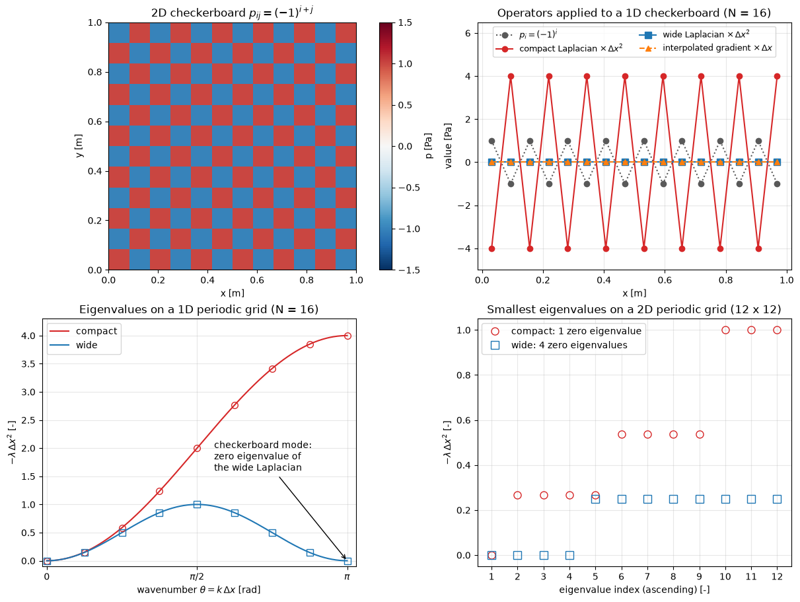

# Checkerboard Pressure on a Collocated Grid

This script shows why a collocated finite-volume grid with linearly interpolated face pressures cannot see a checkerboard pressure field: the cell pressure gradient and the pressure equation built from it both vanish for $p_i = (-1)^i$. It applies the interpolated gradient, the wide-stencil Laplacian that results from it, and the compact Laplacian obtained with Rhie–Chow interpolation to a checkerboard, and compares the eigenvalue spectra of the two Laplacians on periodic 1D and 2D grids. The extra zero eigenvalues of the wide Laplacian are the spurious pressure modes that the momentum equations cannot control.

## Overview

- Builds the operators as dense matrices on periodic grids: 16 cells in 1D and 12 × 12 cells in 2D on a unit domain.
- Applies the interpolated gradient, the wide Laplacian and the compact Laplacian to the 1D checkerboard $p_i = (-1)^i$.
- Computes the eigenvalues of both 1D Laplacians from the discrete Fourier transform of their first row (they are circulant matrices) and compares them with the analytical Fourier symbols.
- Builds the 2D Laplacians as Kronecker sums, computes their eigenvalues with `numpy.linalg.eigvalsh` and counts the zero eigenvalues.
- Prints the norms and the zero-eigenvalue counts.

## Mathematical Background

### Interpolated Gradient

With pressures stored at cell centres and face values interpolated linearly, $p_{i+1/2} = \tfrac12(p_i + p_{i+1})$, the pressure force on cell $i$ per unit volume is

```math
\left(\frac{\partial p}{\partial x}\right)_i \approx \frac{p_{i+1/2} - p_{i-1/2}}{\Delta x} = \frac{p_{i+1} - p_{i-1}}{2\Delta x}
```

It skips the cell's own value, so it is zero for the checkerboard $p_i = (-1)^i$, and in 2D for $p_{ij} = (-1)^{i+j}$: the momentum equations feel no force from it.

### Wide and Compact Laplacians

The pressure equation of an incompressible solver comes from the divergence of the velocity correction, which is proportional to the pressure gradient. If the face velocities are interpolated linearly from cell velocities that carry the cell gradient above, the discrete divergence of the gradient is the wide Laplacian

```math
(L_w\, p)_i = \frac{p_{i+2} - 2p_i + p_{i-2}}{4\Delta x^2}
```

which couples only every second cell. Rhie–Chow interpolation instead uses the pressure difference across each face, which gives the compact Laplacian

```math
(L_c\, p)_i = \frac{p_{i+1} - 2p_i + p_{i-1}}{\Delta x^2}
```

### Fourier Symbols

For the Fourier mode $p_j = e^{\mathrm{i}\theta j}$ with $\theta = k\Delta x$,

```math
\lambda_w(\theta) = -\frac{\sin^2\theta}{\Delta x^2},
\qquad
\lambda_c(\theta) = -\frac{4\sin^2(\theta/2)}{\Delta x^2}
```

Both vanish for the constant mode $\theta = 0$, which reflects the fact that pressure is defined only up to a constant in incompressible flow. The wide Laplacian also vanishes at $\theta = \pi$, the checkerboard. On a periodic 2D grid it has four zero eigenvalues, for the modes $(0, 0)$, $(\pi, 0)$, $(0, \pi)$ and $(\pi, \pi)$, while the compact Laplacian has only the constant mode. Both symbols agree to second order for small $\theta$, so the compact operator is an equally accurate Laplacian for smooth fields.

## Implementation

- `periodic_shift(n, k)` returns the cyclic shift matrix; `central_gradient`, `wide_laplacian` (the square of the central gradient) and `compact_laplacian` are built from it.
- `laplacian_2d` forms $L \otimes I + I \otimes L$, and `checkerboard(n, dims)` returns $(-1)^i$ or $(-1)^{i+j}$.
- `symbol_wide` and `symbol_compact` are the analytical eigenvalues, `circulant_eigenvalues` takes the FFT of a circulant matrix's first row, and `count_zero_eigenvalues` counts eigenvalues with $|\lambda|\Delta x^2 < 10^{-9}$.
- `plot_checkerboard` draws the four panels; `N_1D`, `N_2D` and `LENGTH` set the grids.

The tests in `tests/test_compressible_pv_numerics.py` check that the checkerboard lies in the null space of the gradient and the wide Laplacian, that the compact Laplacian returns $-4p/\Delta x^2$, the zero-eigenvalue counts, and that the FFT eigenvalues match both the symbols and `eigvalsh`.

## Usage

```bash
python main.py                      # show the figure
python main.py --no-show --output . # save checkerboard_pressure.png
```

## Output



The top left panel shows the 2D checkerboard. In the top right panel the interpolated gradient (orange) and the wide Laplacian (blue) of the 1D checkerboard are zero in every cell (the script prints $0.0$ for both maxima), while the compact Laplacian returns $-4p_i/\Delta x^2$. The bottom left panel shows the two Fourier symbols with the computed eigenvalues on top of them: the compact symbol rises monotonically to $4/\Delta x^2$ at $\theta = \pi$, whereas the wide symbol rises to $1/\Delta x^2$ at $\theta = \pi/2$ and falls back to zero at $\theta = \pi$. High-wavenumber pressure errors are therefore barely damped by a pressure equation built on the wide stencil, and the checkerboard not at all. The bottom right panel lists the twelve smallest eigenvalues of the 2D operators: the wide Laplacian has four zero eigenvalues and the compact Laplacian one.

## Related Notes

- [Pressure–Velocity Coupling](../../../notes/numerical/fvm/pressure_velocity_coupling.md)
- [Finite Volume Discretization](../../../notes/numerical/fvm/discretization.md)
