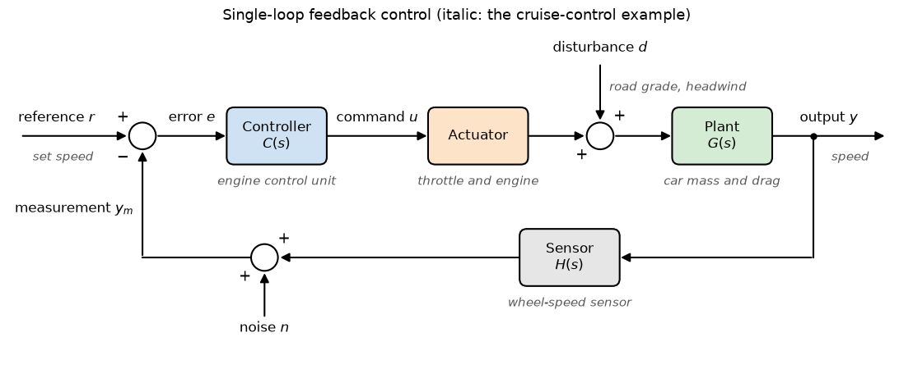

# Control Loop Block Diagram

This script draws the standard single-loop feedback structure with reference, controller, actuator, input disturbance, plant, sensor and measurement noise, and names the matching parts of a car cruise control. It is a schematic drawn with matplotlib patches and contains no computation.

## Overview

- Draws the forward path: reference $r$, the comparison junction, the error $e$, the controller $C(s)$, the command $u$, the actuator, the junction where the disturbance $d$ enters, the plant $G(s)$ and the output $y$.
- Draws the feedback path: the sensor $H(s)$, the junction where the noise $n$ is added and the measurement $y_m$ returned to the comparison junction with a minus sign.
- Writes the cruise-control counterpart of each element in grey italics: set speed, engine control unit, throttle and engine, road grade and headwind, car mass and drag, speed and wheel-speed sensor.

## Mathematical Background

The diagram represents $u = C(r - y_m)$, $y = G(u_a + d)$ with $u_a$ the actuator output, and $y_m = Hy + n$. Eliminating the internal signals, with the actuator lumped into $G$, gives

```math
Y = \frac{CG}{1 + CGH}R + \frac{G}{1 + CGH}D - \frac{CG}{1 + CGH}N
```

## Implementation

- `block(ax, x, y, text, color)` draws a rounded box with `FancyBboxPatch` and returns its edges.
- `summing_junction(ax, x, y, signs)` draws a circle with the input signs.
- `arrow(ax, points, label)` draws a polyline ending in an arrow head with `FancyArrowPatch`.
- `make_figure()` places the elements; `BLOCK_W`, `BLOCK_H`, `SUM_R`, `Y_MAIN` and `Y_FEEDBACK` set the geometry.

## Usage

```bash
python main.py                          # show the diagram
python main.py --no-show --output .     # save control_block_diagram.png
```

| Flag | Meaning |
| --- | --- |
| `--no-show` | Do not open a plot window |
| `--output DIR` | Create `DIR` and save the figure as a PNG |

## Output



The forward path runs left to right along the top, the measurement returns along the bottom, the disturbance enters from above between actuator and plant, and the noise enters from below at the sensor output.

## Related Notes

- [Introduction to Control Systems](../../../notes/applied_mechanics/control_systems/intro.md)
