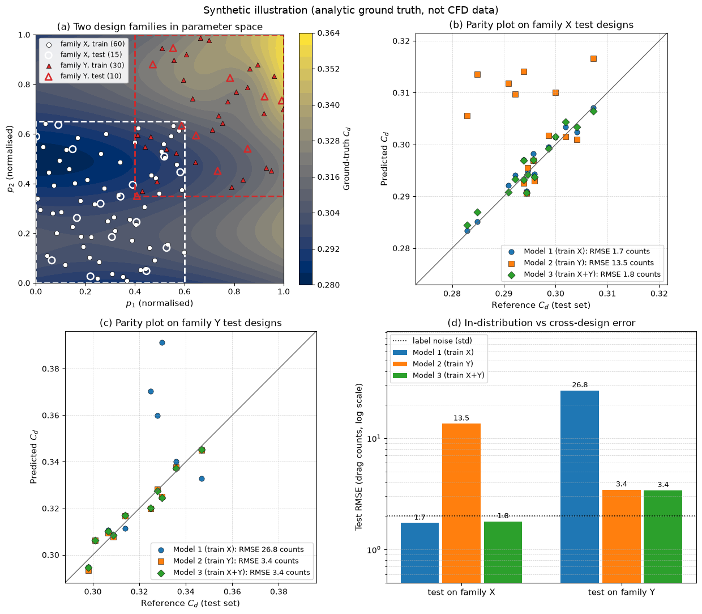

# Cross-Design Generalization

This script is a synthetic illustration of why a surrogate trained on one design family can fail on another: three ridge-regression models trained on family X, family Y and both are tested on held-out designs of each family. The ground truth is an analytic function standing in for the CFD drag coefficient, so the numbers show the mechanism (a shift of the input distribution), not the accuracy of any real model.

## Overview

- Defines two design families in a normalised 2D parameter space: X in the box $[0, 0.6] \times [0, 0.65]$ and Y in $[0.4, 1] \times [0.35, 1]$, which overlap in a small corner.
- Draws 60 training and 15 test designs for X and 30 training and 10 test designs for Y with Latin hypercube sampling inside each box.
- Labels every design with an analytic $C_d(p_1, p_2)$ plus Gaussian noise of standard deviation 0.002 (2 drag counts), which stands in for the error budget of the CFD dataset.
- Fits ridge regression on 49 Gaussian radial basis functions plus linear terms, choosing the ridge penalty and the RBF width by 5-fold cross validation on each training set.
- Trains Model 1 on X, Model 2 on Y and Model 3 on X + Y, and evaluates each on both test sets.
- Plots the design space, a parity plot for each test family and a bar chart of test RMSE in drag counts.

## Mathematical Background

### Ground Truth

```math
C_d(p_1, p_2) = 0.29 + 0.04\,(p_1 - 0.3)^2 + 0.05\,p_1 p_2 + 0.012\,\sin(3\pi p_2)
- 0.02\,\exp\left(-\frac{(p_1 - 0.85)^2 + (p_2 - 0.8)^2}{0.02}\right)
```

The last term is a local drag reduction centred in family Y's region; inside family X's box it is below 0.0003, so a model trained on X alone has no information about it.

### Ridge Regression on RBF Features

The feature vector of a design $\mathbf{p}$ is $\boldsymbol\phi(\mathbf{p}) = [p_1, p_2, \varphi_1(\mathbf{p}), \dots, \varphi_{49}(\mathbf{p})]$ with $`\varphi_j(\mathbf{p}) = \exp(-\|\mathbf{p} - \mathbf{c}_j\|^2 / (2w^2))`$ and centres $\mathbf{c}_j$ on a $7 \times 7$ lattice. With centred features $A$ and centred labels $\mathbf{y}$, the weights solve

```math
\left(A^T A + \lambda N\, I\right)\mathbf{w} = A^T \mathbf{y},
```

and the intercept is the mean label. The penalty $`\lambda \in \{10^{-6}, \dots, 10^{-1}\}`$ and the width $`w \in \{0.15, 0.25, 0.4\}`$ are chosen by minimising the 5-fold cross-validation RMSE on the training set only.

### Error Measure

The test error is $\mathrm{RMSE} = \sqrt{\frac{1}{N_{\mathrm{test}}}\sum_i (C_{d,i} - \hat{C}_{d,i})^2}$, reported in drag counts ($1$ count $= 0.001$ in $C_d$). Because the test labels contain the same noise as the training labels, an RMSE of about 2 counts is the floor.

## Implementation

- `true_cd(p)` evaluates the ground truth; `sample_family(box, n, rng)` draws a Latin hypercube inside a box; `make_datasets()` builds the train and test sets.
- `rbf_features(p, width)` builds the feature matrix; `RidgeRBF(lam, width)` has `fit` and `predict`.
- `cross_validate(p, y)` performs the grid search and refits the best model on all training data.
- `train_models(data)` trains the three models defined in `MODELS` and returns a table of test RMSE.
- `make_figure(data, models, table)` draws the four panels.
- `FAMILIES`, `NOISE_STD`, `LAMBDAS`, `WIDTHS` and `RBF_GRID` are the settings.

## Usage

```bash
python main.py                          # print the RMSE table and show the figure
python main.py --no-show --output .     # save cross_design_generalization.png in the current directory
```

| Flag | Meaning |
| --- | --- |
| `--no-show` | Do not open a plot window |
| `--output DIR` | Create `DIR` and save the figure as a PNG |

## Output

The script prints the test RMSE in drag counts:

| Model | Test on X | Test on Y |
| --- | --- | --- |
| Model 1 (train X) | 1.7 | 26.8 |
| Model 2 (train Y) | 13.5 | 3.4 |
| Model 3 (train X + Y) | 1.8 | 3.4 |

Each single-family model is within a factor of two of the noise floor on its own family and 4 to 16 times worse on the other one. The combined model matches the specialist on each family, because the families share one underlying function. In the parity plots, the cross-design predictions fall far from the diagonal for the designs that lie farthest from the training box.



## Related Notes

- [Training and Evaluating Surrogates Across Vehicle Designs](../../../notes/machine_learning/automotive_aerodynamics/model_training.md)
- [Design of Experiments and Dataset Construction](../../../notes/machine_learning/automotive_aerodynamics/datasets.md)
- [Training and Validation](../../../notes/machine_learning/fundamentals/training_and_validation.md)
- [Radial Basis Functions](../../../notes/numerical/surrogates/radial_basis_functions.md)
