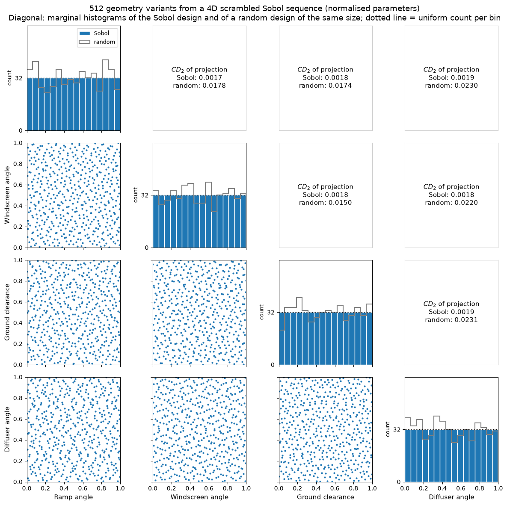

# Design Space Distribution via Sobol Sequences

This script draws a four-dimensional scrambled Sobol design of 512 geometry variants and shows all of its 2D projections and 1D marginals in a scatter matrix, with the discrepancy of each projection compared against a random design of the same size. Each dimension stands for one normalised shape parameter (ramp angle, windscreen angle, ground clearance, diffuser angle) in $[0, 1]$. In a real CFD workflow each sample would be turned into a deformed mesh and simulated to build a surrogate-model training set, and these plots are the coverage check made before the simulations are launched.

## Overview

- Generates $2^9 = 512$ points of a 4D scrambled Sobol sequence with `scipy.stats.qmc.Sobol` (seeded, so the design is reproducible).
- Uses a power-of-two sample count, which keeps the balance properties of the Sobol sequence.
- Draws a $4 \times 4$ scatter matrix: the six pairwise projections below the diagonal and 16-bin marginal histograms on the diagonal, with the histogram of a seeded pseudo-random design of the same size overlaid for comparison.
- Writes the centred $L_2$ discrepancy of each 2D projection, for the Sobol and the random design, above the diagonal.
- Prints the 4D discrepancy, the minimum pairwise distance and the range of marginal bin counts for both designs.

## Mathematical Background

### Low-Discrepancy Sequences

Sobol sequences are deterministic sequences built to fill $[0,1]^d$ as evenly as possible. Uniformity is measured by the star discrepancy, where the supremum is taken over boxes $J = [0, a_1) \times \dots \times [0, a_d)$ anchored at the origin:

```math
D^*_N = \sup_{J} \left| \frac{\#\{i : \mathbf{x}_i \in J\}}{N} - \text{Vol}(J) \right|
```

### Discrepancy Rates

For $N$ points in $d$ dimensions a Sobol sequence achieves

```math
D^*_N = \mathcal{O}\!\left(\frac{(\log N)^d}{N}\right)
```

while independent pseudo-random points have a discrepancy that decreases only like $N^{-1/2}$, up to a logarithmic factor.

### Centred $L_2$ Discrepancy

The star discrepancy is expensive to evaluate in several dimensions, so the plots use Hickernell's centred $L_2$ discrepancy $CD_2$, which replaces the supremum by a root-mean-square over boxes with one corner at a vertex of the cube and has a closed form that costs $\mathcal{O}(N^2 d)$ operations. It is invariant to reflections of the coordinates and also measures the uniformity of lower-dimensional projections. For independent uniform points $CD_2$ decays like $N^{-1/2}$.

### Why It Matters for Sampling

For a response $f$ evaluated at the design points (for example a drag coefficient from CFD), the Koksma–Hlawka inequality bounds the error of the sample mean $\hat{\mu} = \frac{1}{N}\sum_{i=1}^{N} f(\mathbf{x}_i)$:

```math
\left|\hat{\mu} - \int_{[0,1]^d} f(\mathbf{x})\, d\mathbf{x}\right| \le V_{HK}(f)\,
D^*_N
```

where $V_{HK}(f)$ is the Hardy–Krause variation of $f$. A lower discrepancy therefore gives a tighter error bound and fewer gaps in the design space.

## Implementation

- `generate_design(log2_samples, dimension, seed)` creates `Sobol(d=4, scramble=True, rng=SEED)` and calls `random_base2(m=LOG2_SAMPLES)` with `LOG2_SAMPLES = 9`.
- `random_design(n, dimension, seed)` draws the pseudo-random comparison design.
- `centred_l2_discrepancy(samples)` returns the square root of `qmc.discrepancy(samples, method="CD")`, which is the squared centred discrepancy.
- `min_pairwise_distance(samples)` returns the smallest distance between two points.
- `make_figure(samples, reference, parameters)` draws the scatter matrix (`figsize=(12, 12)`) using the names in `PARAMETERS` and `N_BINS = 16` histogram bins.
- `main(argv=None)` parses the flags, prints the coverage statistics, then shows or saves the figure.

## Usage

```bash
python main.py                          # open the figure window
python main.py --no-show --output out   # save design_space_distribution.png into out/
```

| Flag | Meaning |
| --- | --- |
| `--no-show` | Do not open a plot window |
| `--output DIR` | Create `DIR` and save the figure as a PNG |

## Output

The script prints a 4D centred discrepancy of 0.0054 for the Sobol design against 0.0355 for the random design, minimum pairwise distances of 0.061 and 0.026, and marginal bin counts of exactly 32 in every bin for Sobol against 21 to 43 for the random design. The discrepancy of every 2D projection is about 0.0018 for Sobol and between 0.015 and 0.023 for the random design.



## Related Notes

- [One-Stage Sampling](../../../notes/numerical/surrogates/one_stage_sampling.md)
- [Surrogate Models: Introduction](../../../notes/numerical/surrogates/intro.md)
- [Building and Validating a Mesh Dataset](../../../notes/machine_learning/automotive_aerodynamics/dataset_of_meshes.md)
- [Design of Experiments and Dataset Construction](../../../notes/machine_learning/automotive_aerodynamics/datasets.md)
- [Deformation Parameters](../../../notes/machine_learning/automotive_aerodynamics/deformation_parameters.md)
