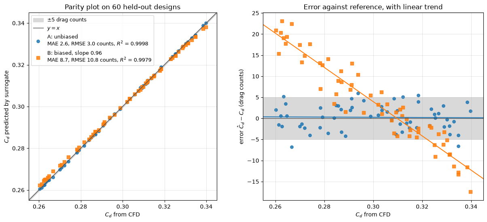

# Drag Coefficient Prediction

This script compares two synthetic drag-coefficient surrogates with held-out CFD values in a parity plot and an error plot, and shows that a high $R^2$ can hide errors of ten drag counts. Surrogate A is unbiased with a random error of 3 counts. Surrogate B has the same random error plus a 4-count offset and a scale error. Both lie close to the identity line in the parity plot, but the error plot in drag counts separates them at once. This is the check to apply to any machine-learning or reduced-order drag model before trusting it for design decisions, where differences of a few counts matter.

## Overview

- Draws 60 reference values $C_d \sim \mathcal{U}(0.26, 0.34)$ from a seeded generator, standing for held-out CFD results
- Forms surrogate A as $C_d$ plus Gaussian noise with a standard deviation of 3 drag counts
- Forms surrogate B with the same noise, a slope of 0.96 about the mean $C_d$ and an offset of +4 counts
- Draws the parity plot with the line $y = x$ and a band of $\pm 5$ drag counts
- Plots the error in drag counts against the reference value, with a least-squares trend line per surrogate
- Prints and shows MAE, RMSE and bias in drag counts, and $R^2$, for each surrogate

## Mathematical Background

### Drag Coefficient and Drag Counts

The drag coefficient non-dimensionalises the drag force $F_D$ on a body:

$$
C_d = \frac{F_D}{\frac{1}{2}\rho U^2 A}
$$

where $\rho$ is the fluid density, $U$ the free-stream velocity and $A$ the reference area. One drag count is $\Delta C_d = 10^{-4}$. A modern passenger car has $C_d \approx 0.25$ to $0.35$, and design changes are usually worth a few counts each.

### Synthetic Surrogates

With $\bar{C}_d$ the mean of the reference values and $\varepsilon_i, \eta_i \sim \mathcal{N}(0, 1)$,

```math
\hat{C}_{d,i}^{A} = C_{d,i} + 3\times10^{-4}\,\varepsilon_i,
\qquad
\hat{C}_{d,i}^{B} = \bar{C}_d + 0.96\,(C_{d,i} - \bar{C}_d) + 4\times10^{-4} + 3\times10^{-4}\,\eta_i
```

### Error Metrics

With $`e_i = (\hat{C}_{d,i} - C_{d,i})/10^{-4}`$ the error in counts,

```math
\mathrm{MAE} = \frac{1}{N}\sum_i |e_i|,
\qquad
\mathrm{RMSE} = \sqrt{\frac{1}{N}\sum_i e_i^2},
\qquad
R^2 = 1 - \frac{\sum_i (\hat{C}_{d,i} - C_{d,i})^2}{\sum_i (C_{d,i} - \bar{C}_d)^2}
```

$R^2$ is measured about the identity line, not about a fitted line. Its denominator is the spread of the reference values, about 230 counts here, so an RMSE of 10 counts still gives $R^2 \approx 0.998$. The scale error of surrogate B contributes $0.04 \times 400 = 16$ counts at each end of the range, which the error plot shows as a sloped trend.

## Implementation

- `generate_data(n, seed)` returns the reference values and both surrogates (constants `N_SAMPLES`, `CD_LOW`, `CD_HIGH`, `NOISE_COUNTS`, `SLOPE_B`, `OFFSET_B_COUNTS`).
- `metrics(reference, predicted)` returns MAE, RMSE and bias in drag counts, and $R^2$ about $y = x$.
- `make_figure(cd, pred_a, pred_b)` draws the parity plot with the `BAND_COUNTS` band and the error plot with a `numpy.polyfit` trend line per surrogate.
- `main(argv=None)` parses the flags, prints the metrics, then shows or saves the figure.

## Usage

```bash
python main.py                          # open the figure window
python main.py --no-show --output out   # save drag_coefficient_prediction.png into out/
```

| Flag | Meaning |
| --- | --- |
| `--no-show` | Do not open a plot window |
| `--output DIR` | Create `DIR` and save the figure as a PNG |

## Output

With the default seed the script prints

```text
surrogate A: MAE 2.55, RMSE 3.04, bias +0.26 counts, R^2 0.9998
surrogate B: MAE 8.68, RMSE 10.77, bias +3.79 counts, R^2 0.9979
```

In the parity plot (left) both point clouds sit on the identity line and the two $R^2$ values differ only in the third decimal. In the error plot (right) surrogate A stays inside the $\pm 5$ count band with a flat trend. Surrogate B over-predicts low-drag designs by up to about 20 counts and under-predicts high-drag designs, so it would compress the differences between designs and could reverse the ranking of two that differ by a few counts.



## Related Notes

- [Understanding Drag](../../../notes/fluid_mechanics/viscous_flow/drag.md)
- [Training and Validation](../../../notes/machine_learning/fundamentals/training_and_validation.md)
- [Training and Evaluating Surrogates Across Vehicle Designs](../../../notes/machine_learning/automotive_aerodynamics/model_training.md)
- [Output Data: CFD Results as Machine-Learning Targets](../../../notes/machine_learning/automotive_aerodynamics/output_data.md)
