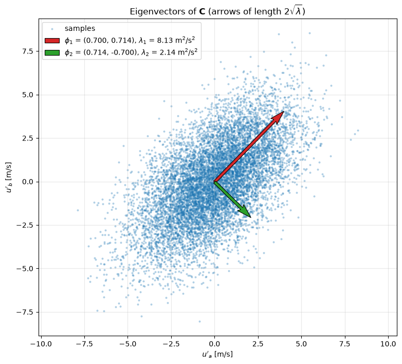
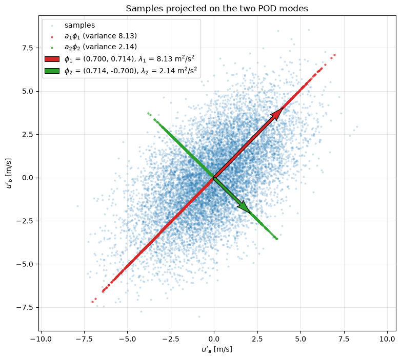

# Eigenvector Projection of Velocity Fluctuations

This script finds the principal directions of correlated 2D velocity fluctuations from the eigenvectors of their covariance matrix and projects the data onto them. It uses the same synthetic two-probe signals as [longitudinal_velocity_fluctuations_and_projections](../longitudinal_velocity_fluctuations_and_projections/README.md): a large-scale motion shared by probes a and b plus a local motion at each probe. It solves the $2 \times 2$ eigenvalue problem and produces two figures, the data cloud with the eigenvectors drawn as arrows, and the data projected onto each eigenvector. This is the two-point Proper Orthogonal Decomposition (POD).

## Overview

- Generates $`M = 10\,000`$ seeded samples of $u'_a = s + \ell_a$ and $u'_b = s + \ell_b$ from independent AR(1) signals (shared variance 2.8 m²/s², local variance 2.2 m²/s²) and stores them as a $2 \times M$ matrix with the sample mean removed.
- Computes the sample covariance matrix $\mathbf{C} = \mathbf{U}\mathbf{U}^T/(M-1)$.
- Solves the symmetric eigenvalue problem with `numpy.linalg.eigh`, sorts the modes by decreasing eigenvalue and fixes the sign so that the first component of each eigenvector is positive.
- Prints the covariance matrix, the eigenvalues with their energy fractions, the eigenvectors and their angles to the $u'_a$ axis.
- Figure 1: the data cloud with each eigenvector drawn as an arrow of length $2\sqrt{\lambda_k}$.
- Figure 2: each sample projected onto $\boldsymbol{\phi}_1$ (red) and $\boldsymbol{\phi}_2$ (green), drawn as points in the same plane.

## Mathematical Background

### Covariance Matrix

With the $2 \times M$ matrix of zero-mean samples $\mathbf{U}$, whose column $j$ is $`\mathbf{u}'_j = (u'_{a,j}, u'_{b,j})^T`$,

```math
\mathbf{C} = \frac{1}{M-1}\mathbf{U}\mathbf{U}^T = \frac{1}{M-1}\begin{bmatrix}\sum_j u'^2_{a,j} & \sum_j u'_{a,j}u'_{b,j} \\ \sum_j u'_{a,j}u'_{b,j} & \sum_j u'^2_{b,j}\end{bmatrix}
```

For the signal model the exact matrix is $`\begin{bmatrix} 5.0 & 2.8 \\ 2.8 & 5.0 \end{bmatrix}`$ m²/s², with eigenvalues 7.8 and 2.2 and eigenvectors $(1, \pm 1)/\sqrt{2}$.

### Eigenvalue Problem

```math
\mathbf{C}\,\boldsymbol{\phi}_k = \lambda_k\,\boldsymbol{\phi}_k,
\qquad \lambda_1 \ge \lambda_2
```

Because $\mathbf{C}$ is symmetric, the unit eigenvectors are orthogonal and form the principal axes of the data ellipse.

### Projection onto the Principal Directions

The POD coefficient of sample $j$ on mode $k$ and its position in the plane are

```math
a_{kj} = \boldsymbol{\phi}_k^T\mathbf{u}'_j,
\qquad \mathbf{p}_{kj} = a_{kj}\,\boldsymbol{\phi}_k
```

The variance of the coefficients equals the eigenvalue, $`\frac{1}{M-1}\sum_j a_{kj}^2 = \boldsymbol{\phi}_k^T\mathbf{C}\,\boldsymbol{\phi}_k = \lambda_k`$. The first mode therefore carries the most fluctuation energy, and $`\lambda_1 + \lambda_2 = \mathrm{tr}\,\mathbf{C}`$.

## Implementation

- `ar1_process(n, dt, tau, variance, rng)` and `generate_fluctuations(n, dt, seed)` reproduce the data of the companion script (same constants and `SEED = 0`).
- `principal_directions(data)` returns the covariance matrix, the eigenvalues in descending order, and the sign-fixed eigenvectors as columns.
- `draw_eigenvectors(ax, eigenvalues, eigenvectors)` draws the arrows with `quiver`, scaled by $2\sqrt{\lambda_k}$, so each arrow reaches two standard deviations along its axis.
- `plot_raw_data_with_eigenvectors(...)` and `plot_projections_on_eigenvectors(...)` build the two figures on equal-aspect axes, so orthogonal directions look orthogonal.
- `main(argv=None)` prints the decomposition and shows or saves both figures.

## Usage

```bash
python main.py                          # open both figure windows
python main.py --no-show --output out   # save both PNGs into out/
```

| Flag | Meaning |
| --- | --- |
| `--no-show` | Do not open plot windows |
| `--output DIR` | Create `DIR` and save `eigenvector_projection_raw.png` and `eigenvector_projection_projections.png` |

## Output

With the default seed the script prints

```math
\mathbf{C} = \begin{bmatrix} 5.074 & 2.991 \\ 2.991 & 5.195 \end{bmatrix}, \qquad \lambda_1 = 8.126\ (79.1\%),\ \boldsymbol{\phi}_1 = (0.700, 0.714), \qquad \lambda_2 = 2.143\ (20.9\%),\ \boldsymbol{\phi}_2 = (0.714, -0.700)
```

The first mode makes an angle of $45.6^\circ$ with the $`u'_a`$ axis: it is slightly tilted toward $`u'_b`$ because $`c_{22} > c_{11}`$ in this sample.

The first figure shows the tilted elliptical cloud, with the red arrow along its major axis and the shorter green arrow along its minor axis.



The second figure shows the projections lying on two perpendicular lines through the origin. The red points along $\boldsymbol{\phi}_1$ spread much further (variance 8.13 m²/s²) than the green points along $\boldsymbol{\phi}_2$ (variance 2.14 m²/s²).



## Related Notes

- [Two-Point POD: A Worked Example](../../../notes/numerical/pod/derivation_in_2d.md)
- [Proper Orthogonal Decomposition](../../../notes/numerical/pod/pod_intro.md)
- [POD for N Points](../../../notes/numerical/pod/derivation_in_n_dim.md)
