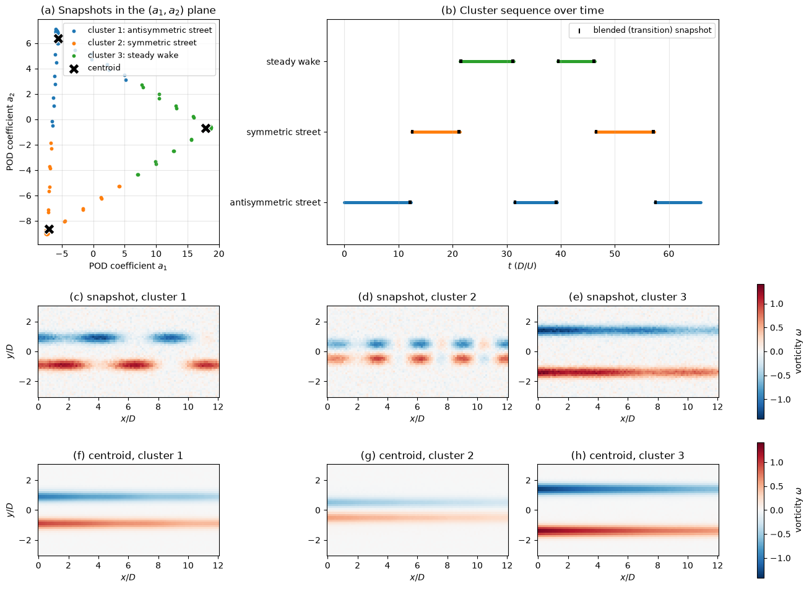

# Flow Regime Clustering with POD and k-means

This script groups the snapshots of a synthetic wake that switches between three flow regimes into clusters, by projecting them onto their leading POD modes and running k-means on the POD coefficients. It plots the snapshots in the plane of the first two POD coefficients colored by cluster, the cluster sequence over time, a representative snapshot of each cluster and each cluster centroid reconstructed as a field.

## Overview

- Builds 660 vorticity-like snapshots on a $96 \times 48$ grid covering $0 \leq x/D \leq 12$, $|y/D| \leq 3$, with spacing $`\Delta t = 0.1\,D/U`$.
- Switches between three regimes seven times: an antisymmetric (staggered) vortex street, a symmetric (varicose) street with a shorter wavelength and narrower wake, and a nearly steady wake with strong, widely spaced shear layers.
- Blends the old and new regime over 8 snapshots at each switch, and adds Gaussian noise of standard deviation 0.05.
- Computes POD with `compute_pod` from `scripts/_numerics.py` and keeps the first 10 temporal coefficients, which hold 95.1% of the fluctuation energy.
- Runs k-means with $K = 3$ on the coefficients (Lloyd iteration, k-means++ seeding, 10 restarts, lowest objective kept).
- Prints the k-means objective, the agreement with the true regime and the one-step cluster transition matrix.

## Mathematical Background

### POD Coordinates

The snapshots form the columns of $\mathbf{X} \in \mathbb{R}^{n \times m}$. After subtracting the temporal mean $\bar{\mathbf{x}}$, the thin SVD $`\mathbf{X} - \bar{\mathbf{x}}\mathbf{1}^T = \mathbf{U}\boldsymbol{\Sigma}\mathbf{V}^T`$ gives the POD modes $\mathbf{U}$ and the coefficients $`\mathbf{a}_i = (\boldsymbol{\Sigma}\mathbf{V}^T)_{:, i}`$ of snapshot $i$. Clustering uses the first $r = 10$ coefficients, so each snapshot becomes a point in $\mathbb{R}^{10}$.

### k-means

k-means partitions the points into $K$ clusters $C_1, \dots, C_K$ with centroids $\mathbf{c}_j$ by minimizing

```math
J = \sum_{j=1}^{K} \sum_{i \in C_j} \lVert \mathbf{a}_i - \mathbf{c}_j \rVert^2
```

Lloyd's algorithm alternates two steps:

1. Assign each point to its nearest centroid.
2. Move each centroid to the mean of its members.

Each step minimizes $J$ over one set of unknowns with the other fixed, so $J$ never increases, and the iteration stops when the assignment stops changing. The result is a local minimum, which is why the script restarts from 10 k-means++ seeds.

### Centroids as Fields and Transitions

A centroid maps back to a flow field through $`\bar{\mathbf{x}} + \mathbf{U}_r\mathbf{c}_j`$. The one-step transition probabilities

```math
P_{jk} = \frac{\#\{i : i \in C_j,\ i + 1 \in C_k\}}{\#\{i : i \in C_j\}}
```

define the cluster-based Markov model of Kaiser et al. (2014).

## Implementation

- `regime_field(X, Y, t, ...)` evaluates one regime: shear layers at $y = \pm$ `offset` with the given `strength`, plus a downstream-growing travelling wave whose upper and lower rows have opposite (`antisym=True`) or equal sign.
- `make_snapshots(seed)` follows `SCHEDULE`, blends regimes for `BLEND_STEPS` snapshots and returns the snapshot matrix, the true labels (with $-1$ for blended snapshots) and the times.
- `kmeans(points, k, rng)` runs Lloyd's algorithm from `kmeans_plus_plus` seeds and returns the labels, centroids and the objective after each assignment; `best_kmeans` keeps the best of `N_RESTARTS` runs.
- `relabel_by_majority` names each cluster after the true regime most of its members belong to, and `transition_matrix` counts one-step transitions.
- `REGIMES`, `SCHEDULE`, `N_POD` and `N_CLUSTERS` set the regimes, the switching sequence, the number of POD coefficients and $K$.

## Usage

```bash
python main.py                          # show the figure
python main.py --no-show --output .     # save the figure as a PNG in the current directory
```

## Output



In panel (a) the three regimes form three compact groups in the $(a_1, a_2)$ plane, connected by trails of blended snapshots at the switches. k-means converges in 7 iterations and agrees with the true regime for 100% of the 612 non-blended snapshots. Panel (b) shows the recovered sequence; each blended snapshot (black tick) is assigned to the old or the new regime. The centroid fields in (f)–(h) are the regime-averaged wakes: averaging over a shedding cycle removes the travelling waves seen in the snapshots (c)–(e) and leaves the shear layers. The printed transition matrix has diagonal entries of 0.988–0.993, since each regime persists for 70–120 snapshots before switching.

## Related Notes

- [Flow Feature Extraction](../../../notes/machine_learning/flow/feature_extraction.md)
- [POD in CFD](../../../notes/numerical/pod/pod_intro.md)
